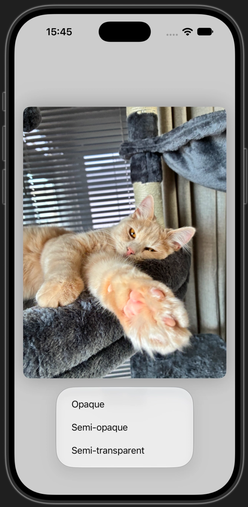
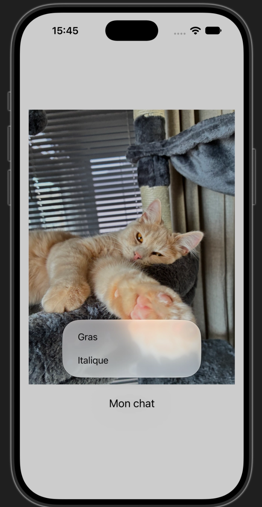

# Le menu contextuel

Le menu contextuel, comme son nom l'indique, offre des options différentes selon le contexte.

Ce contexte, c'est l'élément graphique sur lequel on a fait un clic droit sur ordinateur ou un appui long sur mobile.

Avec SwiftUI, le menu contextuel est défini à l'aide de la méthode [.contextMenu()](https://developer.apple.com/documentation/swiftui/view/contextmenu(menuitems:)), qui doit être appliquée précisément sur la vue à laquelle le menu est associé.

Dans cet exemple, on pourra modifier l'apparence de l'image ou du texte à l'aide d'un menu contextuel propre à chacun.

```swift title="SwiftUI"
enum Opacite : Double {
  case opaque = 1.0
  case semiopaque = 0.7
  case semitransparent = 0.3
}

struct ContentView: View {
  @State private var opacite: Opacite = .opaque
  @State private var gras = false
  @State private var italique = false

  var body: some View {
    VStack {
      Image("chat")
        .resizable()
        .scaledToFit()
        .opacity(opacite.rawValue)
        .contextMenu {
          Button("Opaque", action:{
             opacite = .opaque
           })
           Button("Semi-opaque", action:{
             opacite = .semiopaque
           })
           Button("Semi-transparent", action:{
             opacite = .semitransparent
           })
        }

      Text("Mon chat")
        .padding()
        .fontWeight(gras ? .bold : .regular)
        .italic(italique)
        .contextMenu {
           Button(gras ? "Non gras" : "Gras", action:{
             gras.toggle()
           })
           Button(italique ? "Non italique" : "Italique", action:{
             italique.toggle()
           })
        }
    }
    .padding()
  }
}
```

{width=300} {width=316}

??? info "Pour plus d'information"

    « How to add a Context Menu to a view in SwiftUI ». dev.to. <https://dev.to/maeganwilson_/how-to-add-a-context-menu-to-a-view-in-swiftui-4eo4>
