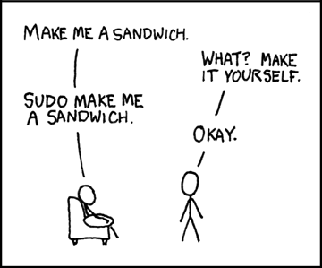

# Gestion des droits pour usagers non administrateurs

## Fichier sudoers

Le fichier `/etc/sudoers` permet de donner des privilèges précis à des utilisateurs donnés. De façon plus précise, il permet de déterminer quels usagers peuventt utiliser la commande [sudo](https://linux.die.net/man/8/sudo) et qu'est-ce que que chacun peut faire avec cette commande.

Par exemple, un usager non administrateur pourrait se voir attribuer le privilège d'éditer le fichier `/etc/hosts` sans nécessiter de mot de passe, ce qui est normalement réservé à un administrateur.

Il est possible d'éditer directement le fichier `/etc/sudoers` pour y ajouter les configurations souhaitées mais on préférera utiliser la commande [visudo](https://www.sudo.ws/docs/man/1.8.13/visudo.man/) puisqu'elle se charge d'effectuer certaines vérifications avant d'enregistrer les modifications.

```text title="Terminal"
sudo visudo
```

Dans ce fichier, l'ajout d'un privilège est réalisé à l'aide d'une ligne au format :

Syntaxe Linux

`usager` ALL=(`utilisateur-cible`) `OPTION`: `commande1, commande2`

Voici les détails de cette commande :

- On nomme d'abord l'usager pour qui le privilège est donné, par exemple `toto`. Il est possible de nommer un groupe en faisant précéder le nom du groupe par %.
- Le mot `ALL` qui suit le nom de l'usager indique que les droits seront conférés sur tous les hôtes. Ceci est surtout utile dans un environnement centralisé.

  On aurait aussi pu indiquer le nom d'un seul hôte, par exemple `MacBook-Pro-de-Toto.local`.

  Puisque sur un MacBook, il n'y a généralement qu'un seul hôte, l'utilisation de `ALL` est correcte.
- Entre parenthèses, on liste au nom de qui cet usager peut effectuer l'action. Si on précise `ALL`, l'usager pourra exécuter la commande au nom de n'importe quel autre usager, par exemple `root`, `www-data`, etc. Il pourra donc faire `sudo -u root ...`, `sudo -u www-data ...`, etc.
- Optionnellement, on précise ensuite l'option en lien avec le privilège, par exemple `NOPASSWD`. [Les autres options possibles](https://www.sudo.ws/docs/man/1.8.17/sudoers.man/#Tag_Spec) sont moins souvent utilisées : `EXEC`, `NOEXEC`, `FOLLOW`, `NOFOLLOW`, `LOG_INPUT`, `NOLOG_INPUT`, `LOG_OUTPUT`, `NOLOG_OUTPUT`, `MAIL`, `NOMAIL`, `PASSWD`, `SETENV`, `NOSETENV`.
- Vient ensuite la commande affectée par cette configuration. Il est possible de spécifier plusieurs commandes, séparées par des virgules.

Par exemple, pour permettre à l'usager toto d'éditer le fichier hosts sans mot de passe (commande `/usr/bin/nano /etc/hosts`) :

```text title="Fichier /etc/sudoers"
toto ALL=(ALL) NOPASSWD: /usr/bin/nano /etc/hosts
```

Permettre à l'usager eleve de lancer sans mot de passe tous les exécutables situés dans son dossier ~/Applications :

```text title="Fichier /etc/sudoers"
eleve ALL=(ALL) NOPASSWD: /Users/eleve/Applications/*/Contents/MacOS/*
```

## Utiliser sudo alors qu'on n'est pas administrateur

La commande [sudo](https://linux.die.net/man/8/sudo) permet à un usager d'effectuer une tâche au nom d'un autre usager.

Par exemple, si je suis authentifiée sur mon Mac en tant que `christiane` (même s'il s'agit d'un usager administrateur), je ne pourrai pas lancer de commandes qui sont réservées à l'usager `root` à moins de les faire précéder par `sudo`.

```text title="Terminal"
christiane@MacBook-Pro ~ %chown -R root:staff mondossier
chown: mondossier: Operation not permitted
christiane@MacBook-Pro ~ %sudo chown -R root:staff mondossier
Password:
```

Une fois le mot de passe de l'usager `christiane` entré, l'opération peut être réalisée.



Source :<https://xkcd.com/149/>

### Configurations sudo

C'est le fichier [sudoers](gestion-des-droits-pour-usagers-non-administrateurs.md#fichier-sudoers) qui spécifie quels usagers peuvent utiliser `sudo` et qu'est-ce qu'ils peuvent faire avec cette commande.

Pour les usagers qui font partie du groupe `admin`, voici la ligne qui leur permet d'utiliser `sudo`.

```text title="Fichier /etc/sudoers"
%admin ALL=(ALL) ALL
```

On voit que les usagers de ce groupe peuvent, sur n'importe quel hôte (`ALL=`), prendre l'identité de n'importe quel usager (`(ALL)`). Ils peuvent utiliser `sudo` pour effectuer n'importe quelle commande (`ALL`).

### Sudo avec un usager non administrateur

Dans le cas où je suis authentifiée en tant qu'usager non administrateur, par exemple `eleve`, l'utilisation de `sudo` n'est pas possible à prime abord puisqu'aucune configuration du fichier `sudoers` ne donne ce privilège à cet usager.

Si on modifiait le fichier `sudoers` pour qu'un usager non admin puisse utiliser `sudo`, ceci lui conférerait beaucoup de droits puisque ça reviendrait à l'ajouter au groupe `admin` (à moins de cibler une commande spécifique).

Si on souhaite plutôt permettre temporairement à cet usager d'effectuer des commandes réservée aux administrateurs :

- Il doit être accompagné d'une personne qui connaît un mot de passe administrateur.
- Dans une fenêtre Terminal, il doit se substituer à un usager administrateur en utilisant la commande [su](https://man7.org/linux/man-pages/man1/su.1.html). Il devra fournir le mot de passe de l'usager pour qui il veut se substituer.

  ```text title="Terminal"
  su christiane
  ```
- Ceci ouvrira une nouvelle session shell en tant que `christiane`, tel que démontré par l'invite. Le dossier courant sera le même qu'avant la substitution.

  ```text title="Terminal"
  eleve@MacBook-Pro ~ %su christiane
  Password:
  christiane@MacBook-Pro eleve %
  ```
- Tant qu'il s'est substitué à l'usager `christiane`, il bénéficie des privilèges donnés à cet usager. Il lui sera désormais possible d'utiliser `sudo`.

  Le mot de passe de `christiane` sera à nouveau demandé pour chaque commande qui débute par `sudo`.

  ```text title="Terminal"
  christiane@MacBook-Pro eleve % sudo chown -R root:staff mondossier
  Password:
  ```
- Une fois le travail terminé, il est possible de mettre fin à la session substituée simplement en refermant la fenêtre Terminal. Il est également possible d'entrer la commande `exit`.

  ```text title="Terminal"
  christiane@MacBook-Pro eleve % exit
  Saving session...
  ...copying shared history...
  ...saving history...truncating history files...
  ...completed.
  eleve@MacBook-Pro ~ %
  ```
