# Les formulaires SwiftUI

## Form

La structure [Form](https://developer.apple.com/documentation/swiftui/form) permet de modifier l'apparence d'un formulaire.

Il s'agit d'un conteneur spécialisé, basé sur List, qui applique automatiquement au formulaire un style prédéfini.

Il est cependant tout à fait possible de définir un formulaire sans Form.

### Form simple

```swift title="SwiftUI"
Form {
  TextField("Nom", text: $nom)
 }
```

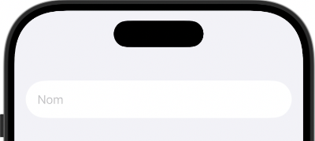

### Ajuster l'espacement à l'intérieur du Form

Le modifieur `.contentMargins()` permet d'ajuster la marge entre le contenu du Form et ses bordures.

Dans cet exemple, le Form est placé dans un NavigationStack avec titre. Par défaut, l’espacement sous le titre est minimal.

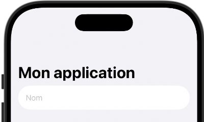

Avec le `.contentMargins()`, on a un plus grand contrôle sur l'espacement.

```swift title="SwiftUI"
NavigationStack {
  Form {
    TextField("Nom", text: $nom)
  }
  .contentMargins(.top, 20)
  .navigationTitle("Mon application")
 }
```

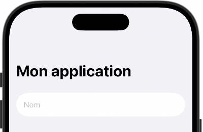

### Limiter la hauteur du Form

Par défaut, un Form s'étend pour occuper tout l'espace disponible à l'écran.

Il est généralement recommandé de conserver ce comportement.

Si vous devez absolument limiter sa hauteur, le modifieur `.frame()` permet d'ajuster la taille du Form.

```swift title="SwiftUI"
Form {
  TextField("Nom", text: $nom)
}
.frame(maxHeight: 150)
```

Le Form sera alors centré verticalement dans l’espace disponible. Au besoin, il est possible d’utiliser un VStack et un Spacer() pour le maintenir en haut de l’écran.

Attention : en limitant la taille avec `.frame()`, le formulaire se transformera en zone de défilement si son contenu est plus grand que l'espace alloué. Ce comportement peut être déroutant pour l'usager.

### Placer plus d'un bouton dans une ligne du formulaire

Puisque Form est basé sur List, il faut prendre une précaution particulière pour placer plus d'un bouton sur une même ligne du formulaire.

Le problème, c'est que par défaut, dans une liste, SwiftUI étire la zone cliquable des boutons sur toute la largeur de l'écran. Un seul bouton par ligne est donc cliquable.

Ce comportement est pratique : il permet de cliquer n'importe où sur la ligne pour réaliser l'action du bouton.

Dans cet exemple, SwiftUI ne parvient pas à distinguer les zones de clic, ce qui rend le comportement imprévisible.

```swift title="SwiftUI"
Form {
  HStack(spacing: 12) {
    Button("Premier choix") {
      choix = 1
    }
    .tint(choix == 1 ? .blue : .gray)

    Button("Deuxième choix") {
      choix = 2
    }
    .tint(choix == 2 ? .blue : .gray)
  }
 }
```

Pour permettre à chacun des boutons de coexister sur la même ligne, il faut limiter la taille des boutons à l'aide d'un style prédéfini.

```swift title="SwiftUI"
Form {
  HStack(spacing: 12) {
    Button("Premier choix") {
      choix = 1
    }
    .buttonStyle(.borderless)
    .tint(choix == 1 ? .blue : .gray)
    Button("Deuxième choix") {
      choix = 2
    }
    .buttonStyle(.borderless)
    .tint(choix == 2 ? .blue : .gray)
  }
}
```

??? info "Pour plus d'information"

    « Creating Forms in SwiftUI ». SerialCoder.dev. <https://serialcoder.dev/text-tutorials/swiftui/creating-forms-in-swiftui/>

## TextField

La vue [TextField](https://developer.apple.com/documentation/swiftui/textfield) permet de saisir du texte.

Le premier paramètre de `TextField` permet de spécifier le libellé. Sous iOS, ce libellé sera inscrit dans la boîte de saisie, comme un filigrane (en anglais : **watermark** ou **placeholder**). Ce n'est que sous macOS qu'il est placé comme les libellés qu'on a l'habitude de voir dans un formulaire Web, c'est-à-dire à gauche de la case de saisie.

Le second paramètre est le nom de la variable dans laquelle la valeur saisie sera stockée. Ce doit être une variable avec liaison (**binding**), donc précédée par un signe $, afin que la valeur entrée dans le `TextField` modifie cette variable et vice-versa. Ce peut être par exemple une variable déclarée avec l'attribut `@State`.

```swift title="SwiftUI"
struct ContentView: View {
  @State private var nom: String = ""

  var body: some View {
    ...
    TextField("Nom", text: $nom)
    ...
  }
}
```


### Modifieur textFieldStyle()

Vous l'avez sans doute remarqué, par défaut, l'apparence n'est pas très intéressante.

Le modifieur `textFieldStyle()` permet d'ajuster l'apparence du TextField.

```swift title="SwiftUI"
TextField("Nom", text: $nom)
  .textFieldStyle(.roundedBorder)
  .padding()
```

J'ai ajouté un modifieur `padding()` afin que le `TextField` ne soit pas collé sur les bords de l'écran.

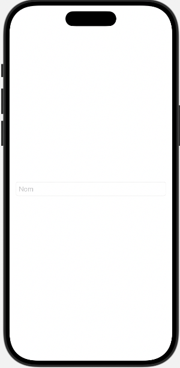

### Bordure personnalisée

Plutôt qu'une bordure grise, il est possible de définir une bordure personnalisée selon nos besoins.

La technique consiste à utiliser le modifieur [overlay](https://developer.apple.com/documentation/swiftui/view/overlay(alignment:content:)) qui permet de définir une vue à placer par-dessus le `TextField`.

```swift title="SwiftUI"
TextField("Nom", text: $nom)
  .padding(7)
  .overlay {
    RoundedRectangle(cornerRadius: 5)
      .stroke(Color.accentColor, lineWidth: 2)
  }
  .padding()
```

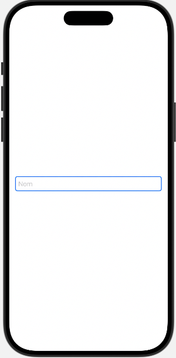

### Placer le TextField dans un Form

Bien que ceci ne soit pas obligatoire, il est possible de placer le `TextField` dans une structure [Form](https://developer.apple.com/documentation/swiftui/form) afin d'améliorer le visuel.

Remarquez que lorsqu'on utilise un `Form`, l'apparence est agréable même sans modifieur.

```swift title="SwiftUI"
Form {
  TextField("Nom", text: $nom)
 }
```


### Libellé

Il faut toujours avoir un libellé autre que le filigrane.

En effet, l'utilisation d'un filigrane comme seul libellé n'est pas ergonomique puisqu'une fois le formulaire rempli, on ne verra plus ce qui était attendu dans chacune des cases.

Ceci serait problématique par exemple dans un formulaire qui doit saisir un prénom et un nom de famille. Devait-on entrer le nom de famille en premier ou le prénom?

D'ailleurs, on voit dans les applications de Apple qu'il y a généralement autre chose que le filigrane pour identifier une case de saisie, tel qu'illustré dans cette vue dans les réglages.

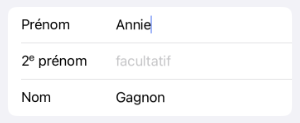

Afin de s'assurer que l'application soit ergonomique, il est possible de forcer l'affichage d'un libellé en utilisant des sections.

Remarquez qu'ici, je n'ai rien spécifié comme filigrane. J'aurais pu utiliser un filigrane pour donner de l'information complémentaire sur ce qui est attendu, par exemple le format d'un numéro de téléphone ou encore le fait que l'information soit requise ou non.

```swift title="SwiftUI"
Form {
  Section(header: Text("Nom")) {
    TextField("", text: $nom)
  }
  Section(header: Text("Âge")) {
    TextField("", text: $ageString)
      .keyboardType(.numberPad)
  }
}
```

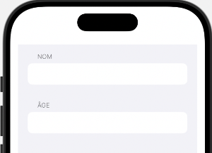

Autre technique : définir le libellé à l'aide d'un `Text` placé à gauche du `TextField`.

```swift title="SwiftUI"
Form {
  HStack {
    Text("Nom")
    TextField("", text: $nom)
  }

  HStack {
    Text("Âge")
    TextField("", text: $ageString)
      .keyboardType(.numberPad)
  }
}
```

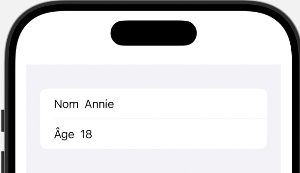

Afin de reproduire l'apparence des réglages du iPhone, il suffit d'ajouter une largeur aux libellés et de préciser qu'ils doivent être alignés à gauche.

```swift title="SwiftUI"
let largeurLibelles = 60.0
...

Form {
  HStack {
    Text("Nom")
      .frame(width: largeurLibelles, alignment: .leading)
    TextField("", text: $nom)
  }

  HStack {
    Text("Âge")
      .frame(width: largeurLibelles, alignment: .leading)
    TextField("", text: $ageString)
      .keyboardType(.numberPad)
  }
 }
```

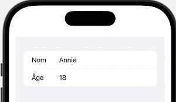

### Libellé flottant

Pour une apparence plus sophistiquée, vous pouvez vous tourner vers des libellés flottants, c'est-à-dire que le libellé apparaît comme un filigrane au départ et qu'il se déplace en haut de la valeur saisie dès qu'on commence à entrer du texte.

Contrairement à Google avec [Material Design](https://m3.material.io/components/text-fields/overview), Apple a choisi de ne pas fournir de vue qui permet de générer un libellé flottant. C'est que ce type d'utilisation [est controversé](https://medium.com/simple-human/floating-labels-are-a-bad-idea-82edb64220f6) bien que plusieurs arguments des détracteurs [soient discutables](https://medium.com/bymds/are-float-labels-really-that-problematic-after-all-da7ffe7d5417).

Si vous souhaitez utiliser des libellés flottants, vous devrez ajouter un peu de code à votre application.

Vous pouvez par exemple baser votre travail sur ceci : <https://github.com/kishanraja/FloatingLabelTextFieldSwiftUI>

ou sur ceci : <https://levelup.gitconnected.com/swiftui-floating-label-text-field-af04c2eb1a2b>

### Alignement du texte

Il est possible de modifier l'alignement du filigrane, et par le fait même du texte qui sera entré dans le `TextField`.

Ceci est réalisé à l'aide du modifieur [multilineTextAlignment()](https://developer.apple.com/documentation/swiftui/view/multilinetextalignment(_:)).

```swift title="SwiftUI"
Form {
  TextField("Nom", text: $nom)
    .multilineTextAlignment(.trailing)
 }
```

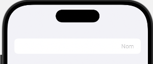

### Bouton pour traiter le formulaire

Voir la fiche « [Bouton pour traiter le formulaire](les-formulaires-swiftui.md#bouton-pour-traiter-le-formulaire_1) » .

### Configurer le clavier

Voir la fiche « [Configurer le clavier du téléphone](les-formulaires-swiftui.md#configurer-le-clavier-du-telephone) ».

### Quelques autres modifieurs

- [.autocorrectionDisabled()](https://developer.apple.com/documentation/swiftui/view/autocorrectiondisabled(_:))
- [.multilineTextAlignment()](https://developer.apple.com/documentation/swiftui/view/multilinetextalignment(_:))
- [.textInputAutocapitalization()](https://developer.apple.com/documentation/swiftui/view/textinputautocapitalization(_:))

### Réagir au changement

Il est possible de commander une action dès que l'usager tape du texte dans le TextField grâce à la méthode [onChange()](../lecons/reagir-a-un-changement.md).

```swift title="SwiftUI"
TextField("Code:", text: $code)
  .onChange(of: code) { ancienneValeur, nouvelleValeur in
    ...
  }
```

??? info "Pour plus d'information"

    « TextField in SwiftUI ». Swift with Majid. <https://swiftwithmajid.com/2020/02/26/textfield-in-swiftui/>

    « TextField in SwiftUI ». Stefan Blos. <https://stefanblos.com/posts/textfield-in-swiftui/>

    « Custom TextField in SwiftUI ». The Happy Programmer. <https://thehappyprogrammer.com/custom-textfield-in-swiftui>

    « SwiftUI Form tutorial for beginners ». Programming with Swift. <https://programmingwithswift.com/swiftui-form-beginners-guide/>

## TextEditor

La vue [TextEditor](https://developer.apple.com/documentation/swiftui/texteditor) permet de saisir un texte long sur plusieurs lignes.

```swift title="SwiftUI"
struct ContentView: View {
  @State private var commentaire: String = ""

  var body: some View {
    VStack {
      Text("Commentaire")
      TextEditor(text: $commentaire)
        .border(Color.gray, width: 1)
    }
  }
}
```

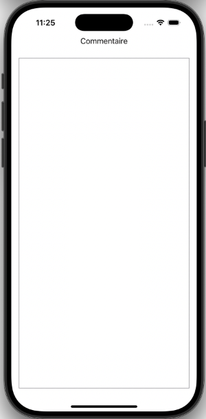 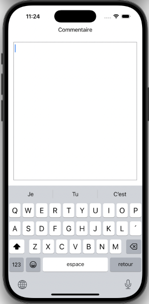

## Configurer le clavier du téléphone

Par défaut, dès que l'usager clique dans un TextField, un clavier apparaît au bas de l'écran.

Sur le simulateur, pour obtenir ce comportement, vous devez aller dans le menu **I/O** / **Keyboard** et décocher l'option **Connect Hardware Keyboard**.

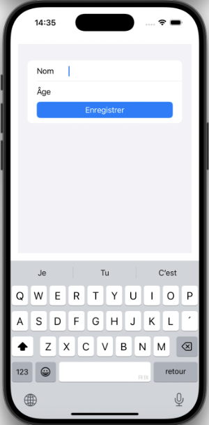

Le modifieur [.keyboardType()](https://developer.apple.com/documentation/swiftui/view/keyboardtype(_:)) permet de spécifier le type de clavier à utiliser. Ceci permettra d'offrir à l'usager un clavier adapté au genre d'information qu'il doit entrer.

Par exemple, lorsqu'on saisit un nombre, il serait judicieux d'afficher le clavier numérique.

```swift title="SwiftUI"
TextField("", text: $ageString)
  .keyboardType(.numberPad)
```

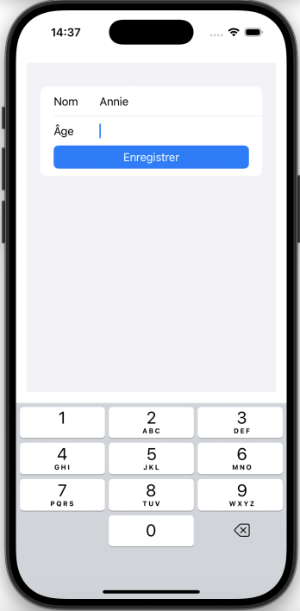

Il existe des claviers spécialisés pour différents besoins.

Je vous présente un peu plus bas un aperçu des touches offertes par chacun.

### Icône pour changer la langue du clavier

Au bas du clavier numérique, vous retrouverez souvent une icône de globe.

Un clic sur cette icône permet de basculer entre deux langues configurées sur le téléphone ou dans le simulateur. S'il y a plus de deux langues, un clic prolongé permettra de sélectionner parmi ces langues.

Les caractères présentés sur le clavier numérique seront différents selon la langue choisie.

C'est l'usager qui détermine les langues disponibles et non le développeur.

Pour ajouter une langue sur le téléphone ou dans le simulateur :

- Cliquez sur l'icône **Réglages**.
- Sélectionnez l'option **Général** / **Langue et région**.
- Cliquez sur **Ajouter une langue** puis sélectionnez la langue désirée.

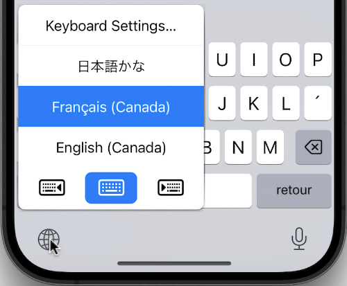

### Aperçu des configurations de clavier disponibles

#### .default

C'est le clavier qui apparaît si vous ne spécifiez pas de type de clavier ou encore si vous spécifiez le style .default.

Il est illustré ici avec les lettres majuscules, avec les lettres minuscules, avec les chiffres puis avec les caractères spéciaux.

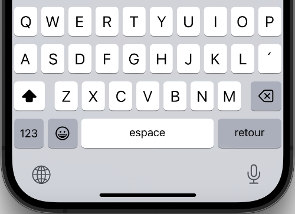 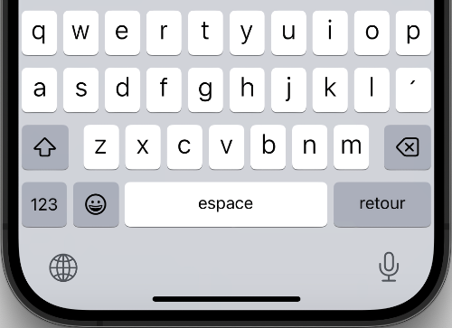

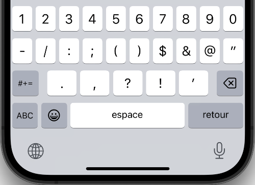 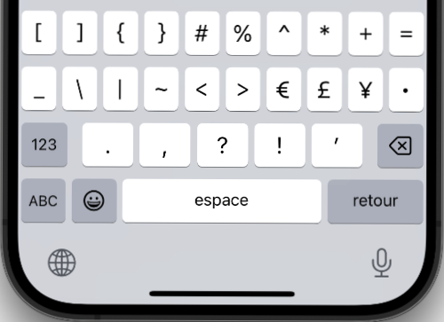

#### .numberPad

Ce clavier a été pensé pour faciliter l'entrée de nombres.

Fait à noter : les touches offrent des chiffres seulement, pas de point décimal ni de possibilité pour nombres négatifs.

Si le téléphone est configuré pour travailler dans une langue dans laquelle les caractères numériques sont différents, le clavier affichera les caractères dans la langue configurée.

Dans cet exemple, on voit que le clavier peut afficher des caractères arabes.

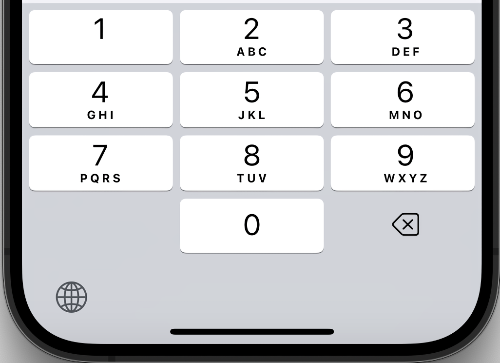 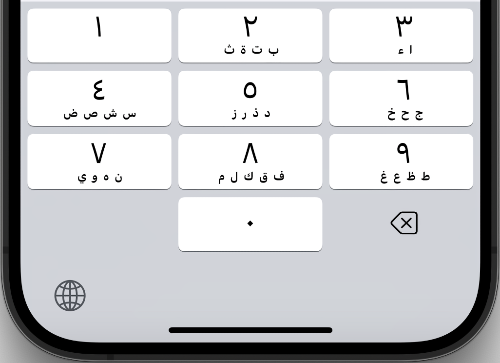

#### .decimalPad

Même chose que .numberPad sauf qu'il y a une touche pour ajouter un point décimal.

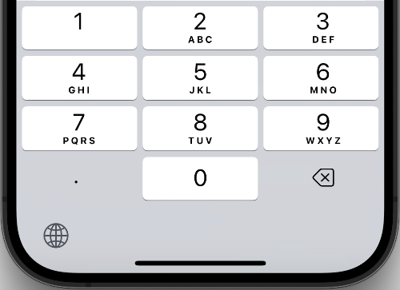

#### .numbersAndPonctuation

Des touches ont été ajoutées à celles des chiffres afin faciliter l'entrée de certains caractères.

C'est le clavier à utiliser si vous avez besoin de permettre les nombres négatifs.

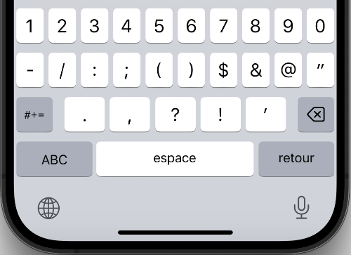

#### .phonePad

Ce clavier est optimisé pour entrer des numéros de téléphone. Il est comme .numberPad sauf qu'une touche permet de basculer vers un clavier qui facilite l'entrée des caractères +, * et #.

Dans le cas où votre application permettrait par exemple d'entrer un numéro qui serait composé par l'application, il y a même les touches `wait` et `pause` qui peuvent être utilisées.

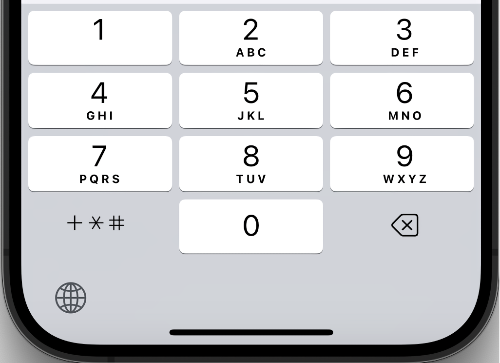 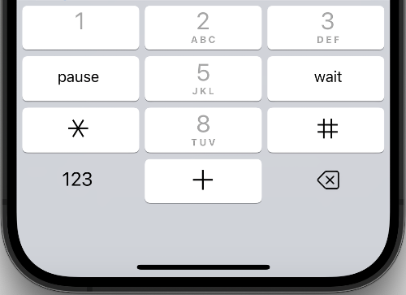

#### .namePhonePad

Ce clavier a été pensé pour les fois où l'usager doit entrer soit du texte, soit un numéro.

Quand il présente des lettres, le clavier est identique au clavier .default. C'est quand on clique sur la touche 123 pour passer en mode numérique qu'il est différent puisqu'il ne présente que des chiffres.

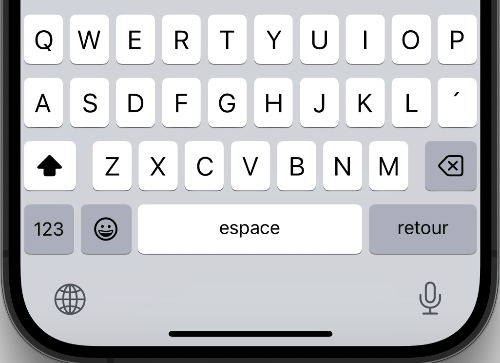 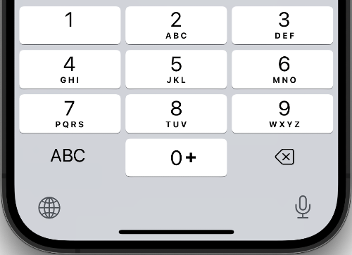

#### .alphabet

Comme .default sauf qu'il n'y a pas de touche pour les émoticones.

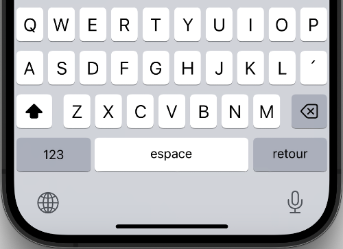

#### .asciiCapable

Comme .alphabet sauf que si on clique sur l'icône de globe pour modifier la localisation, seules les langues dont les lettres sont représentés par des caractères de la charte ASCII de base seront disponibles.


#### .asciiCapableNumberPad

Même chose que .numberPad sauf que les chiffres sont toujours représentés par des caractères de la charte ASCII de base.

Même si plusieurs langues sont configurées sur le téléphone, il n'y a pas d'icône de globe qui permet de changer de langue, par exemple pour afficher des chiffres arabes.

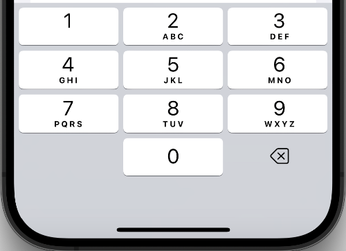

#### .twitter

Comme .default sauf qu'on a ajouté des touches pour faciliter l'entrée du @ et du #.

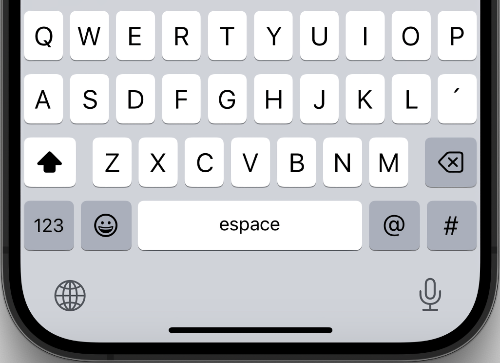

#### .URL

Comme .default sauf qu'on a ajouté des touches pour faciliter l'entrée de la barre oblique et des caractères « .com ».

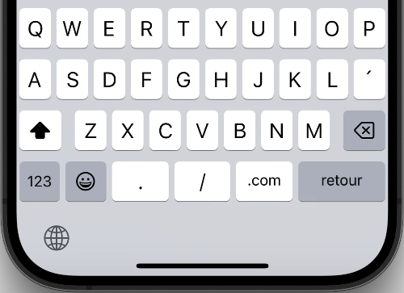

#### .emailAddress

Comme .default sauf qu'il y a une touche pour faciliter l'entrée du @ et du point.

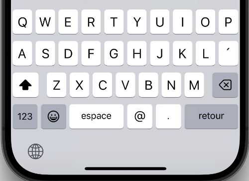

#### .webSearch

Comme .default sauf qu'il y a une touche pour faciliter l'entrée du point.

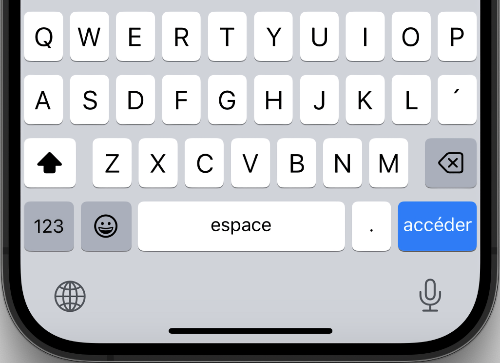

## Saisir un nombre

Pour saisir un nombre dans une application SwiftUI, il est possible d'utiliser un `TextField` auquel on appliquera un format [.number](https://developer.apple.com/documentation/swiftui/textfield/init(_:value:format:prompt:)-3fh51) ou encore un [NumberFormatter](https://developer.apple.com/documentation/swiftui/textfield/init(_:value:formatter:prompt:)-8kpfa).

Ceci fera en sorte que **dès que le `TextField` perd le focus**, la valeur qui y est entrée sera validée afin qu'elle ne contienne que des chiffres avec possibilité d'un séparateur de décimales et de milliers selon la configuration.

Si des caractères non numériques y sont entrés, le résultat sera ajusté afin de respecter le format attendu. Dans certains cas, les caractères non numériques seront supprimés pour ne conserver que les caractères numériques au début du texte. Dans d'autres cas la variable associée au `TextField` conservera la valeur qu'elle avait avant la saisie.

Afin de rendre l'expérience utilisateur plus agréable, on prendra soin d'afficher le pavé numérique.

Il faut cependant savoir que la pavé numérique n'est pas une assurance que l'usager entrera seulement des chiffres puisqu'il peut toujours faire un copier-coller d'une valeur non numérique.

Voici un exemple de saisie d'un nombre entier avec un paramètre `format`.

```swift title="SwiftUI"
struct ContentView: View {
  @State private var valeur: Int = 0

  var body: some View {
    VStack(alignment: .leading) {
      Text("Entrez un nombre :")
      TextField("", value: $valeur, format: .number)
        .keyboardType(.numberPad)
      ...
    }
  }
}
```

Et voici le même exemple avec un paramètre `formatter`.

```swift title="SwiftUI"
struct ContentView: View {
  @State private var valeur: Int = 0

  var body: some View {
    VStack(alignment: .leading) {
      Text("Entrez un nombre :")
      TextField("", value: $valeur, formatter: NumberFormatter())
        .keyboardType(.numberPad)
      ...
    }
  }
}
```

Remarquez que les paramètres nommés du `TextField` sont différents de ceux utilisés lorsqu'il n'y a pas de `format` ou de `formatter`.

```swift title="SwiftUI"
TextField("", text: $prenom)
```

### Saisie d'un nombre avec décimales

Il est facile de permettre une saisie avec décimales.

Lorsqu'on utilise un paramètre `format: .number`, il suffit d'associer le `TextField` à une variable de type Double.

```swift title="SwiftUI"
struct ContentView: View {
  @State private var valeur: Double = 0.0

  var body: some View {
    VStack {
      Text("Entrez un nombre :")
      TextField("", value: $valeur, format: .number)
        .keyboardType(.decimalPad)
      ...
    }
  }
}
```

Remarquez l'utilisation du clavier `decimalPad`. La nuance entre les deux est subtile mais elle est importante.

|  |  |
| --- | --- |
| numberPad | decimalPad |
| .keyboardType(.numberPad) | .keyboardType(.decimalPad) |

Si vous préférez utiliser un `NumberFormatter`, il faudra instancier un objet afin de lui préciser le format attendu.

```swift title="SwiftUI"
let numberFormatter: NumberFormatter = {
  let formatter = NumberFormatter()
  formatter.numberStyle = .decimal
  return formatter
}()

struct ContentView: View {
  @State private var valeur: Double = 0.0

  var body: some View {
    VStack {
      Text("Entrez un nombre :")
      TextField("", value: $valeur, formatter: numberFormatter)
        .keyboardType(.decimalPad)
      ...
  }
}
```

Par défaut, le séparateur de décimales dépendra des configurations du iPhone.

Il est possible de forcer l'utilisation d'une virgule pour séparer les décimales. Mais attention : le caractère spécifié pourrait ne pas être disponible sur le pavé numérique.

```swift title="SwiftUI"
let numberFormatter: NumberFormatter = {
  let formatter = NumberFormatter()
  formatter.numberStyle = .decimal
  formatter.decimalSeparator = ","
  return formatter
}()
```

### Autres formats de nombres

Il est même possible de pousser l'audace jusqu'à exiger que le nombre soit entré en toutes lettres! La valeur numérique qui correspond au texte entré sera stocké dans la variable.

Par exemple, si l'usager entre `neuf`, la variable prendra la valeur `9`.

```swift title="SwiftUI"
let numberFormatter: NumberFormatter = {
  let formatter = NumberFormatter()
  formatter.locale = Locale(identifier: "fr_CA")
  formatter.numberStyle = .spellOut
  return formatter
}()

struct ContentView: View {
  @State private var valeur: Int = 0

  var body: some View {
    VStack {
      Text("Entrez un nombre en toutes lettres :")
      TextField("", value: $valeur, formatter: numberFormatter)
      ...
    }
  }
}
```

## Limiter le nombre de caractères dans un TextField

Je vous partage une petite astuce qui permet de limiter le nombre de caractères entrés dans un [TextField](les-formulaires-swiftui.md#textfield) avec SwiftUI.

La technique consiste à utiliser la méthode [onChange()](../lecons/reagir-a-un-changement.md) afin d'ajuster la variable si elle contient plus de caractères que désiré.

Il faudra passer le paramètre [par référence](../lecons/les-fonctions.md#passer-un-parametre-par-reference) pour que la fonction puisse modifier la valeur de ce paramètre.

```swift title="SwiftUI"
var body: some View {
  ...
  TextField("Code:", text: $code)
    .onChange(of: code) { ancienneValeur, nouvelleValeur in
      let texteBonneTaille = limiterLongueur(texte: code, longueur: 5)
      if (code != texteBonneTaille) {
        code = texteBonneTaille
       }
    }
  ...
}

/**
  Retourne la chaîne limitée à un certain nombre de caractères.
 - Parameters:
   - texte: Chaîne de caractères originale
   - longueur: Nombre de caractères maximal
 */
 func limiterLongueur(texte: String, longueur: Int) {
  var retour = texte
  if texte.count > longueur {
    retour = String(texte.prefix(longueur))
  }
  return retour
 }
```

## Picker

La structure [Picker](https://developer.apple.com/documentation/swiftui/picker) permet de lister des options et d'identifier celle qui est présentement sélectionnée.

Le Picker pourra être utilisé dans différents contextes, par exemple un formulaire ou un menu.

Les options d'un Picker sont mutuellement exclusives, comme c'est le cas avec des boutons radio.

#### Picker avec un tableau de String

Quand on travaille avec un tableau de String, le Picker retiendra directement la chaîne sélectionnée.

Il faut déclarer une variable d'état pour retenir cette valeur.

```swift title="SwiftUI"
struct ContentView: View {
  let options: [String] = [
    "Option 1",
    "Option 2",
    "Option 3"
  ]

  @State private var optionChoisie: String   // On aurait pu l'initialiser directement à "Option 1".
                                             // Le code est plus intéressanat si on l'initialise à la première valeur du tableau.
                                             // Comme il est trop tôt pour référer au tableau ici,
                                             // il faut passer par le constructeur.

  init() {
    optionChoisie = options[0]
  }

  var body: some View {
    VStack {
      Picker("Choisissez une option", selection: $optionChoisie) {
        ForEach(options, id: \.self) { option in
          Text(option)
        }
      }

      Text("Vous avez choisi :")
      Text(optionChoisie)
    }
    .padding()
  }
}
```

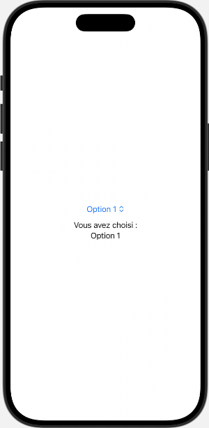 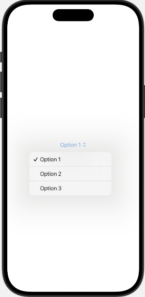

#### Picker avec instances d'une structure ou d'une classe

Il est possible de travailler avec un tableau dont chaque élément est une instance d'une structure ou d'une classe qui répond au protocole [Identifiable](https://developer.apple.com/documentation/swift/identifiable).

```swift title="Swift"
struct Option: Identifiable {
    var id: Int = 0
    var texte: String = ""
    var icone: String = ""
}
```

À ce moment, le Picker retiendra **l'identifiant** de l'option sélectionnée.

```swift title="SwiftUI"
Struct ContentView: View {
    let options: [Option] = [
        Option(id: 1, texte: "Option 1", icone: "1.square.fill"),
        Option(id: 2, texte: "Option 2", icone: "2.square.fill"),
        Option(id: 3, texte: "Option 3", icone: "3.square.fill")
    ]

    @State private var idOptionChoisie: Int = 1

    var body: some View {
        VStack {
            Picker("Choisissez une option", selection: $idOptionChoisie) {
                ForEach(options) { option in
                    Label(option.texte, systemImage: option.icone)
                }
            }
            Text("Vous avez choisi :")
            if let option = options.first(where: { $0.id == idOptionChoisie }) {
              Text(option.texte)
            }
            else {
              Text("Option invalide")
            }
        }
    }
}
```

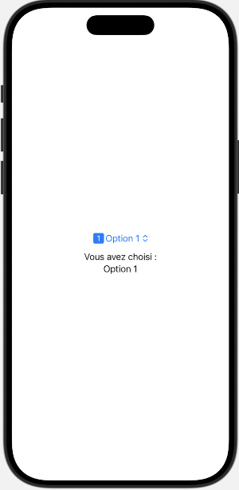 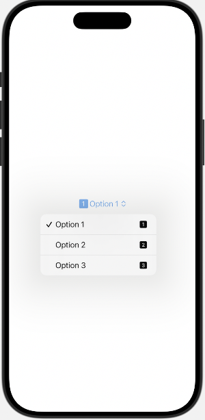

#### Picker avec une énumération

Voyons maintenant comment travailler avec une [énumération](le-langage-swift-reference.md#les-enumerations).

L'énumération doit répondre au protocole [CaseIterable](https://developer.apple.com/documentation/swift/caseiterable).

```swift title="SwiftUI"
enum Option: String, CaseIterable {
  case option1 = "Option 1"
  case option2 = "Option 2"
  case option3 = "Option 3"
}
```

Cette fois, le Picker retiendra une référence au cas sélectionné dans l'énumération.

```swift title="SwiftUI"
struct ContentView: View {
  @State private var optionChoisie: Option = .option1

  var body: some View {
    VStack {
      Picker("Choisissez une option", selection: $optionChoisie) {
        ForEach(Option.allCases, id: \.self) { option in
          Text(option.rawValue)
        }
      }

      Text("Vous avez choisi :")
      Text(optionChoisie.rawValue)
    }
    .padding()
  }
}
```

### Utilisation d'une valeur optionnelle

Si le picker est associé à une variable qui peut prendre la valeur nil et que vous ne prenez pas les précautions nécessaires, vous obtiendrez le message « Picker: the selection "nil" is invalid and does not have an associated tag, this will give undefined results. ».

Pour régler ce problème, il faut utiliser [.tag() dans Picker](https://developer.apple.com/documentation/swiftui/picker) pour préciser :

- la valeur de l'option, soit celle qui sera assignée à la variable du Picker qui recueille l'option choisie (ici : valeurChoisie)
- le type de l'option, qui doit correspondre au type de la variable qui recueille l'option choisie.

```swift title="SwiftUI"
struct ContentView: View {
  let valeurs = ["A", "B", "C"]
  @State private var valeurChoisie: String?

  var body: some View {
    ...
    Picker("", selection: $valeurChoisie) {
      ForEach(valeurs, id: \.self) { valeur in
        Text(valeur).tag(valeur as String?)
      }
    }
  }
}
```

Si vous désirez permettre la sélection de la valeur nil, il faut procéder comme suit :

```swift title="SwiftUI"
struct ContentView: View {
  let valeurs = ["A", "B", "C"]
  @State private var valeurChoisie: String?

  var body: some View {
    ...
    Picker("", selection: $valeurChoisie) {
      Text("Aucune valeur").tag(nil as String?)
      ForEach(valeurs, id: \.self) { valeur in
        Text(valeur).tag(valeur as String?)
      }
    }
  }
}
```

### Picker dans un menu

Si vous désirez créer un menu avec un crochet devant l'option sélectionnée, vous pouvez placer un picker dans le menu. [Les détails sont ici](../lecons/le-menu.md).

## Toggle

La vue [Toggle](https://developer.apple.com/documentation/swiftui/toggle) permet, dans un formulaire SwiftUI, de saisir un état binaire (vrai/faux, ouvert/fermé, actif/inactif).

Elle prend l'apparence d'un bouton à bascule au fond vert ou gris selon que la valeur qu'elle représente est vraie ou fausse.

 

```swift title="SwiftUI"
struct ContentView: View {
  @State private var actif: Bool = false

  var body: some View {
    Toggle(isOn: $actif) {
      Text("Actif")
    }
    .padding()
  }
}
```

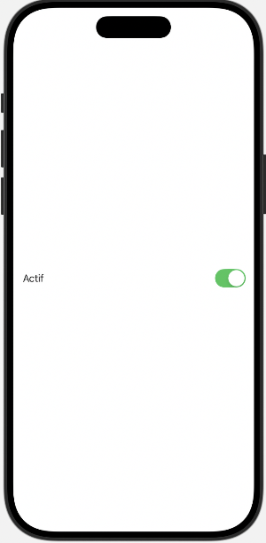

??? info "Pour plus d'information"

    « How to Use Toggle in SwiftUI ». Waldo. <https://www.waldo.com/blog/swiftui-toggle>

## Stepper

Un [Stepper](https://developer.apple.com/documentation/swiftui/stepper) permet de saisir un nombre en cliquant sur + ou - jusqu'à la valeur désirée.

```swift title="SwiftUI"
struct ContentView: View {
  @State private var quantite: Int = 0

  var body: some View {
    Stepper {
      Text("Quantité: \(quantite)")
    } onIncrement: {
      quantite += 1
    } onDecrement: {
      quantite -= 1
    }
    .padding()
  }
}
```

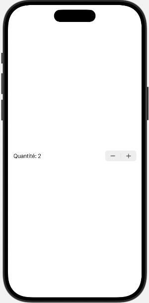

## Slider

Un [Slider](https://developer.apple.com/documentation/swiftui/slider) (en français: **glissière**) permet de sélectionner une valeur en faisant glisser un curseur sur une échelle.

```swift title="SwiftUI"
struct ContentView: View {
  @State private var valeur: Double = 0

  var body: some View {
    VStack {
      Slider(value: $valeur, in: 0...10, step: 1.5)
        .padding()
      Text("Valeur choisie : \(valeur, specifier: "%.1f")")
    }
  }
}
```

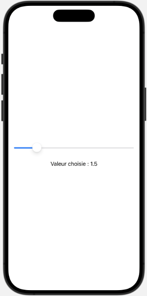

## Bouton pour traiter le formulaire

Il n'est pas toujours requis d'ajouter un bouton pour traiter les données saisies dans un formulaire SwiftUI.

Les informations pourraient être traitées à différents moments, par exemple :

- Au fur et à mesure que les informations sont modifiées (ex : [.onChange()](../lecons/reagir-a-un-changement.md));
- Lorsque l'usager clique sur le bouton de retour dans une [vue affichée via NavigationLink](../lecons/les-applications-multivues.md);
- Sur-le-champ, lorsqu'il s'agit de valeurs tirées de la base de données à l'aide de [SwiftData](../lecons/crud-avec-swiftdata.md#operations-crud-avec-swiftdata-ajouter-modifier-ou-supprimer-des-donnees).

Si vous souhaitez tout de même ajouter un bouton à un formulaire, sachez qu'il n'est pas requis que le bouton soit placé à l'intérieur du `Form`. Il n'est d'ailleurs pas nécessaire d'utiliser un `Form`.

Voici quelques exemples de boutons situés au bas d'une série de `TextField`, avec et sans `Form`.

Dans ce premier exemple, remarquez l'ajout d'un `VStack` qui entoure le dernier `TextField` et le bouton. Ce `VStack` assure qu'il n'y aura pas de ligne grise juste avant le bouton puisqu'il n'y a une ligne grise qu'entre les enfants directs du `Form`.

```swift title="SwiftUI"
Form {
  HStack {
    Text("Prénom")
      .frame(width: largeurLibelles, alignment: .leading)
    TextField("", text: $prenom)
  }

  // VStack pour éviter une ligne grise entre le dernier TextField et le bouton
  VStack {
    HStack {
      Text("Nom de famille")
        .frame(width: largeurLibelles, alignment: .leading)
      TextField("", text: $nomFamille)
    }

    Button(action: {
      // traitement ici
    }) {
      Text("Enregistrer")
        .frame(maxWidth: .infinity)
    }
    .buttonStyle(.borderedProminent)
  }
}
```

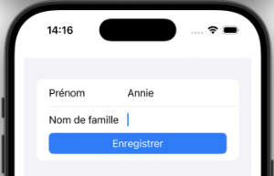

 Ici, on utilise l'approche avec des sections pour les libellés.

```swift title="SwiftUI"
Form {
  Section(header: Text("Prénom")) {
    TextField("", text: $prenom)
  }
  .listSectionSpacing(8)

  Section(header: Text("Nom de famille")) {
    TextField("", text: $nomFamille)
  }

  Button(action: {
    // traitement ici
  }) {
    Text("Enregistrer")
      .frame(maxWidth: .infinity)   // sans ceci, le texte du bouton serait aligné à gauche
  }
}
```

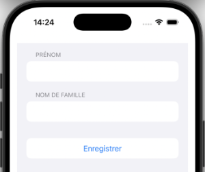

Voici un exemple sans `Form`.

```swift title="SwiftUI"
VStack(alignment: .leading) {
  Text("Prénom")
  TextField("", text: $prenom)
    .textFieldStyle(.roundedBorder)
    .padding(.bottom, 20)

  Text("Nom de famille")
  TextField("", text: $nomFamille)
    .textFieldStyle(.roundedBorder)
    .padding(.bottom, 20)

  Button(action: {
    // traitement ici
  }) {
    Text("Enregistrer")
      .frame(maxWidth: .infinity)
  }
  .buttonStyle(.bordered)
}
 .padding()
 Spacer()
```

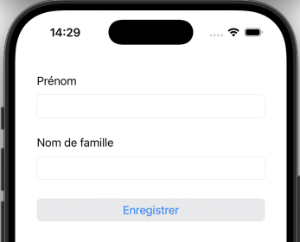

## Contrôle du focus

SwiftUI nous permet de modifier le focus par programmation.

Ceci permet, par exemple, de placer le focus dans un contrôle de saisie lorsque sa valeur n'est pas valide.

```swift title="SwiftUI"
enum Champ: Hashable {
  case courriel
  case motDePasse
}

struct ContentView: View {
  ...
  @FocusState private var champFocus: Champ?

  var body: some View {
    VStack {
      HStack {
        Text("Courriel")
        TextField("", text: $courriel)
          .focused($champFocus, equals: .courriel)
          .keyboardType(.emailAddress)
      }

      HStack {
        Text("Mot de passe")
        SecureField("", text: $motDePasse)
          .focused($champFocus, equals: .motDePasse)
      }

      Button("Soumettre") {
        if courriel.isEmpty {
          ...   // mécanisme pour afficher un message à l'écran
          champFocus = .courriel
        } else if motDePasse.isEmpty {
          ...   // mécanisme pour afficher un message à l'écran
          champFocus = .motDePasse
        } else {
          ...   // traitement
          champFocus = nil
        }
      }
    }
    .padding()
  }
}
```

## Cacher le clavier

Dans un formulaire SwiftUI pour iOS, dès qu'on clique dans une vue qui permet de saisir des caractères, par exemple un TextField, un clavier virtuel apparaît au bas de l'écran.

Dans la plupart des formulaires, il n'est pas nécessaire de cacher ce clavier lorsque les informations ont été saisies.

Parfois, cependant, le clavier cache certaines informations, ce qui nuit à l'ergonomie.

Je vous présente un extrait de code qui permet de cacher le clavier virtuel dès qu'on tape en dehors d'un TextField ou qu'on modifie la valeur d'un autre contrôle de saisie.

```swift title="SwiftUI"
struct ContentView: View {
  @State private var nom: String = ""
  @State private var commentaire: String = ""
  @State private var valeurSlider: Double = 0
  @State private var valeurStepper: Int = 0
  @FocusState private var focusSurTextField: Bool

  var body: some View {
    VStack {
      Form {
        HStack {
          Text("Nom")
          TextField("", text: $nom)
            .focused($focusSurTextField)
        }

        HStack {
          Text("Commentaire")
          TextField("", text: $commentaire)
            .focused($focusSurTextField)
        }

        Slider(value: $valeurSlider, in: 0...10, step: 1.5)
          .onChange(of: valeurSlider) {
            // le clavier n'était pas caché quand on cliquait sur le Slider alors on le cache dès que la valeur est changée
            cacherClavier()
          }

        Stepper {
          Text("Quantité: \(valeurStepper)")
        } onIncrement: {
          valeurStepper += 1
        } onDecrement: {
          valeurStepper -= 1
        }
        .onChange(of: valeurStepper) {
            // le clavier n'était pas caché quand on cliquait sur le Stepper alors on le cache dès que la valeur est changée
          cacherClavier()
        }
      }
    }
    .onTapGesture {
      // cache le clavier dès qu'on clique en dehors d'un TextField
      cacherClavier()
    }
  }

  func cacherClavier() {
    focusSurTextField = false
  }
}
```

## La validation

Il existe plusieurs techniques pour valider un formulaire dans une application SwiftUI.

Je vous en présente une ici qui utilise des propriétés calculées pour déterminer si une valeur est valide.

Le message d'erreur de validation est affiché dans le pied de page de section, ce qui lui confère une apparence intéressante.

Le bouton de soumission ne sera pas cliquable tant qu'au moins une valeur n'est pas valide.

```swift title="SwiftUI"
struct ContentView: View {
  @State private var nom: String = ""
  @State private var prix: Double = 0

  // propriétés calculées pour la validation
  var messageNom: String {
    var message = ""
    if nom.count == 0 {
      message = "Le nom est requis."
    }
    else if nom.count > 100 {
      message = "Le nom doit comporter au maximum 100 caractères."
    }

    return message
  }

  var messagePrix: String {
    var message = ""
    if prix < 0 {
      message = "Le prix doit être une valeur positive."
    }

    return message
  }

  var formulaireValide: Bool {
    messageNom == "" && messagePrix == ""
  }

  var body: some View {
    NavigationStack {
      Form {
        Section {
          TextField("", text: $nom)
        } header: {
          Text("Nom")
        } footer: {
          if messageNom != "" {
            Text(messageNom)
              .foregroundStyle(.red)
          }
        }

        Section {
          TextField("", value: $prix, format: .number)
            .keyboardType(.numberPad)
        } header: {
          Text("Prix")
        } footer: {
          if messagePrix != "" {
            Text(messagePrix)
              .foregroundStyle(.red)
          }
        }

        Button(action: {
          ...
        }) {
          Text("Enregistrer")
            .frame(maxWidth: .infinity)
        }
        .disabled(!formulaireValide)
      }
      .navigationTitle("Nouvel article")
    }
  }
}
```

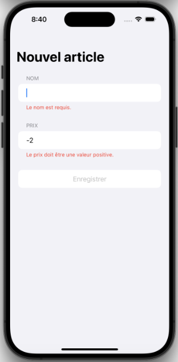

### Pour ne pas que les messages d'erreur soient affichés avant que l'usager ait modifié une valeur

Avec l'extrait de code présenté plus haut, le message d'erreur du nom est affiché avant-même que l'usager ait eu la chance d'entrer un nom.

Pour corriger la situation, je vous propose de travailler avec des variables d'état booléennes qui changeront de valeur dès qu'une valeur saisie est modifiée.

Lorsqu'une valeur n'est pas valide, ce n'est que lorsqu'une de ces variables est à true que le message correspondant pourra s'afficher.

```swift title="SwiftUI"
struct ContentView: View {
  @State ...
  @State private var peutAfficherMessageNom: Bool = false
  @State private var peutAfficherMessagePrix: Bool = false

  // propriétés calculées pour la validation
  ...

  var body: some View {
    NavigationStack {
      Form {
        Section {
          TextField("", text: $nom)
        } header: {
          Text("Nom")
        } footer: {
          if messageNom != "" && peutAfficherMessageNom {
            Text(messageNom)
              .foregroundStyle(.red)
          }
        }

        Section {
          TextField("", value: $prix, format: .number)
            .keyboardType(.numberPad)
        } header: {
          Text("Prix")
        } footer: {
          if messagePrix != "" && peutAfficherMessagePrix {
            Text(messagePrix)
              .foregroundStyle(.red)
          }
        }

        Button(action: {
          ...
        }) {
          Text("Enregistrer")
            .frame(maxWidth: .infinity)
        }
        .disabled(!formulaireValide)
      }
      .onChange(of: nom) {
        peutAfficherMessageNom = true
      }
      .onChange(of: prix) {
        peutAfficherMessagePrix = true
      }
      .navigationTitle("Nouvel article")
    }
  }
}
```

??? info "Pour plus d'information"

    « Advanced SwiftUI TextField: Formatting and Validation ». Fatbobman's blog. <https://fatbobman.com/en/posts/textfield-1/>

    « How to validate TextFields in SwiftUI like a Pro ». Medium. <https://medium.com/@mhmtkrnlk/how-to-validate-textfields-in-swiftui-like-a-pro-3dbe368d1570>

    « A Data Validation Solution Utilizing Swift Property Wrappers and SwiftUI View Extensions ». Medium. <https://betterprogramming.pub/a-data-validation-solution-utilizing-swift-property-wrappers-and-swiftui-view-extensions-ae2db2209a32>

    « Field Validation and MVVM in SwiftUI ». YouTube - Stewart Lynch. <https://www.youtube.com/watch?v=7oMlz-pMSAI>
