# Quelques modifieurs

## Modifieur .frame() pour ajouter un cadre invisible d'une grandeur spécifique

Vous avez besoin d'un cercle ou d'un rectangle d'une grandeur précise? [.frame()](https://developer.apple.com/documentation/swiftui/view/frame(width:height:alignment:)) est le modifieur qu'il vous faut!

```swift title="SwiftUI"
Rectangle()
  .frame(width: 150, height: 125)
```

 Dans le cas d'un cercle, il suffit de spécifier une seule coordonnée.

```swift title="SwiftUI"
Circle()
  .frame(width: 25)
```

Le modifieur `.frame()` permet également de spéficier la taille d'une image. Dans cet exemple, l'image conservera son ratio et se limitera à la largeur ou la hauteur du cadre spécifié.

```swift title="SwiftUI"
Image("nom-image")
  .resizable()
  .scaledToFit()
  .frame(width: 250, height: 250)
```

Vous trouverez plus d'exemples avec aperçu du résultat de chacun sur la fiche « [Ajuster une image](../lecons/les-images-et-icones.md#ajuster-une-image) ».

## Modifieur .padding()

Le modifieur [.padding()](https://developer.apple.com/documentation/swiftui/view/padding(_:_:)) permet d'ajouter de l'espace alentour d'une vue.

Ce modifieur est très utilisé. Il fait d'ailleurs partie de la vue générée par défaut dans un nouveau projet SwiftUI afin d'assurer qu'aucun texte ne soit collé directement au bord de l'écran.

### Côté où l'espacement doit être ajouté

Lorsqu'il est utilisé sans paramètre, le modifieur `.padding()` ajoute un espacement égal de chaque côté de la vue.

```swift title="SwiftUI"
Text("Hello, world!")
  .padding()
  .background(Color.yellow)
```

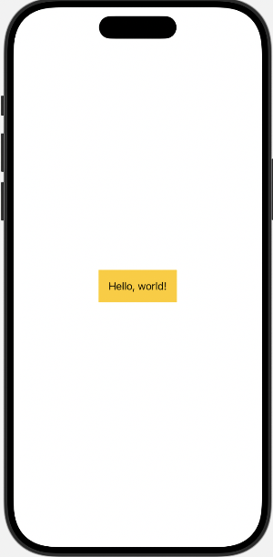

Il est possible de préciser le ou les côtés où l'espacement doit être ajouté. Les [paramètres disponibles](https://developer.apple.com/documentation/swiftui/edge/set) à cet effet sont :

- `.all` (valeur par défaut)
- .`top`
- `.bottom`
- `.leading` (espacement placé avant la vue, normalement à sa gauche)
- `.trailing` (espacement placé après la vue, normalement à sa droite)
- `.horizontal` (de chaque côté horizontal, normalement à gauche et à droite)
- `.vertical` (de chaque côté vertical, normalement en haut et en bas)

```swift title="SwiftUI"
Text("Hello, world!")
  .padding(.leading)
  .background(Color.yellow)
```

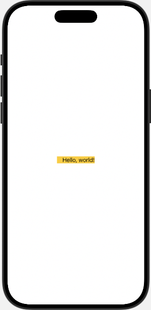

Si vous désirez ajouter un espacement partout sauf en bas :

```swift title="SwiftUI"
Text("Hello, world!")
  .padding(.horizontal)
  .padding(.top)
  .background(Color.yellow)
```

Cette syntaxe est équivalente :

```swift title="SwiftUI"
Text("Hello, world!")
  .padding([.horizontal, .top])
  .background(Color.yellow)
```

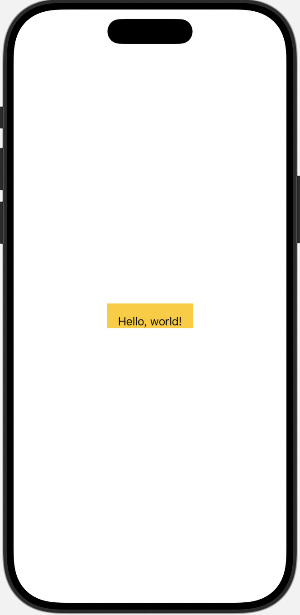

### Taille de l'espacement

La taille de l'espacement est calculée en points.

Par défaut, SwiftUI utilise une taille qui tient compte du périphérique utilisé.

Vous avec la possibilité de spécifier la taille désirée à l'aide d'un nombre ou d'une variable de type CGFloat.

```swift title="SwiftUI"
Text("Hello, world!")
  .padding(100)
  .background(Color.yellow)
```

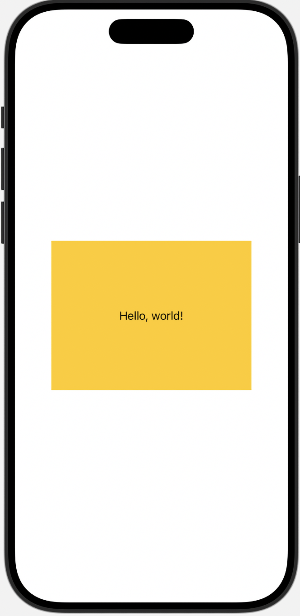

```swift title="SwiftUI"
Text("Hello, world!")
  .padding(.leading, 50)
  .background(Color.yellow)
```

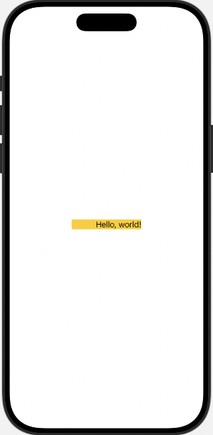

```swift title="SwiftUI"
Text("Hello, world!")
  .padding(.horizontal, 100)
  .padding(.vertical, 30)
  .backgound(Color.yellow)
```

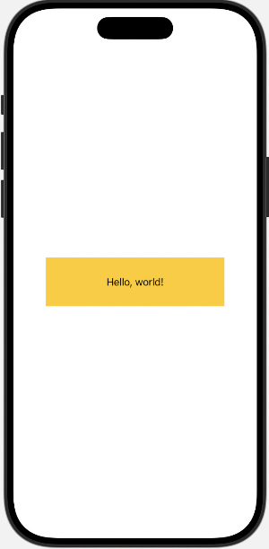

```swift title="SwiftUI"
Text("Hello, world!")
   .padding([.horizontal, .top], 75)
  .backgound(Color.yellow)
```

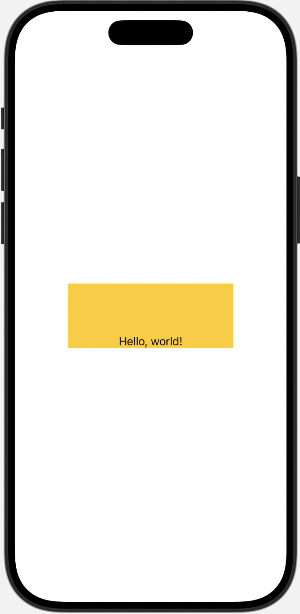

La dimension des espacements peut également être fournie à l'aide d'un paramètre de type [EdgeInsets](https://developer.apple.com/documentation/swiftui/edgeinsets) :

```swift title="SwiftUI"
Text("Hello, world!")
  .padding(EdgeInsets(top: 10, leading: 20, bottom: 30, trailing: 40))
  .backgound(Color.yellow)
```

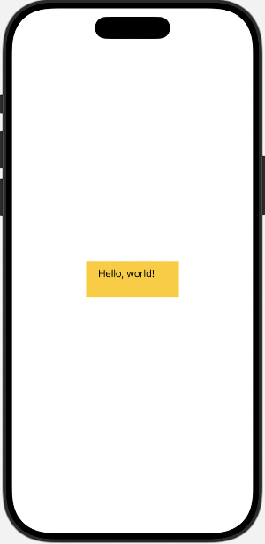

## Modifieur .offset()

Le modifieur [.offset()](https://developer.apple.com/documentation/swiftui/view/offset(x:y:)) permet de donner une position relative à une vue par rapport à sa position naturelle.

Autrement dit, il permet de décaler la vue horizontalement et/ou verticalement.

Prenons un cercle dans lequel on a écrit du texte.

La position naturelle de ces deux éléments placés dans un ZStack fait en sorte qu'ils sont centrés l'un par rapport à l'autre.

```swift title="SwiftUI"
struct ContentView: View {
  var body: some View {
    ZStack {
      Circle()
        .frame(width: 150, height: 150)
        .foregroundStyle(.orange)

      Text("Hello, world!")
        .font(.title)
    }
  }
}
```

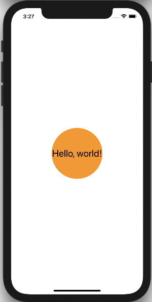

Il est possible de décaler le texte vers la droite à l'aide d'un .`offset()`.

```swift title="SwiftUI"
struct ContentView: View {
  var body: some View {
    ZStack {
      Circle()
        .frame(width: 150, height: 150)
        .foregroundStyle(.orange)

      Text("Hello, world!")
        .font(.title)
        .offset(x: 77)
    }
  }
}
```

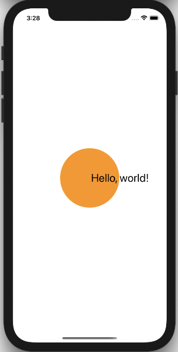

Le résultat sera légèrement différent si c'est le cercle qui est déplacé vers la gauche. Cette fois, le texte demeure centré dans l'écran.

```swift title="SwiftUI"
struct ContentView: View {
  var body: some View {
    ZStack {
      Circle()
        .frame(width: 150, height: 150)
        .foregroundStyle(.orange)
        .offset(x: -77)

      Text("Hello, world!")
        .font(.title)
    }
  }
}
```

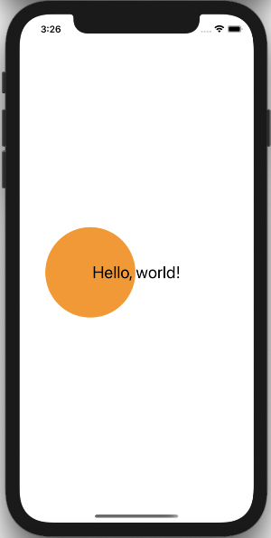

Dans Xcode, il est possible de configurer le canevas pour que lorsqu'on clique sur le code qui affiche le cercle, le canevas affiche des lignes bleues alentour de l'emplacement qu'il utilise.

Il est donc possible de voir que même lorsqu'un élément est décalé par un `offset()`, SwiftUI considère toujours sa position originale lorsqu'il calcule la position des autres éléments.

Cette image illustre ce qu'on voit quand on clique sur le cercle dans le code.

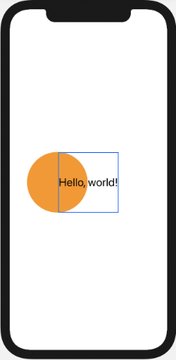

??? info "Pour plus d'information"

    « Making Fine Adjustments to a View’s Position ». Apple. <https://developer.apple.com/documentation/swiftui/making-fine-adjustments-to-a-view-s-position>

    « SwiftUI Tutorial: Layout Tools - Offset and Position ». Karin Prater. <https://karinprater.medium.com/swiftui-tutorial-layout-tools-211b9663befe#d397>

## Modifieur .position()

Le modifieur [.position()](https://developer.apple.com/documentation/swiftui/view/position(x:y:)) permet de donner une position absolue à une vue **par rapport à son parent**.

Soit le rectangle suivant :

```swift title="SwiftUI"
struct ContentView: View {
  var body: some View {
    Rectangle()
      .frame(width: 150, height: 100)
      .foregroundStyle(Color.red)
  }
}
```

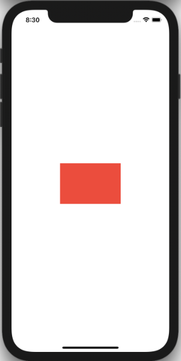

Par défaut, pour positionner ce rectangle, SwiftUI prend tout l'espace disponible et place le rectangle au centre.

L'enfant peut choisir de modifier sa position à l'aide de `.position()`.

```swift title="SwiftUI"
struct ContentView: View {
  var body: some View {
    Rectangle()
      .frame(width: 150, height: 100)
      .foregroundStyle(Color.red)
      .position(x: 0, y: 0)
  }
}
```

La position peut également être donnée à l'aide d'une variable de type [CGPoint](https://developer.apple.com/documentation/coregraphics/cgpoint). Le même résultat sera obtenu comme suit.

Ce code a l'avantage de refléter la nouvelle position aussitôt que la variable d'état est modifiée.

```swift title="SwiftUI"
struct ContentView: View {
@State private var position: CGPoint = CGPoint(x: 0, y: 0)

  var body: some View {
    Rectangle()
      .frame(width: 150, height: 100)
      .foregroundStyle(Color.red)
      .position(position)
  }
}
```

Dans cet exemple, on obtient un rectangle dont le **centre** est à la position 0, 0 de son parent.

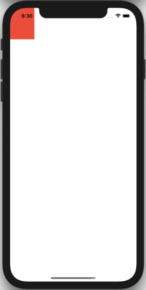

Pour positionner le coin supérieur gauche du rectangle dans le coin supérieur gauche de son parent, il suffit de le positionner à la moitié de sa largeur et à la moitié de sa hauteur.

```swift title="SwiftUI"
struct ContentView: View {
  let largeur: CGFloat = 150
  let hauteur: CGFloat = 100

  var body: some View {
    Rectangle()
      .frame(width: largeur, height: hauteur)
      .foregroundStyle(Color.red)
      .position(x: largeur/2, y: hauteur/2)
  }
}
```

Remarquez que le parent n'est pas l'écran entier mais bien la zone sécuritaire de l'écran (**safe area**). Voilà pourquoi il reste une zone blanche en haut du rectangle.

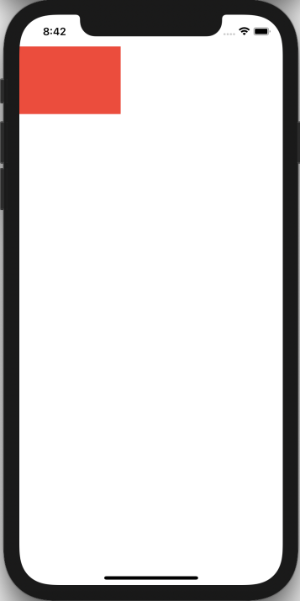

Et pour le coin inférieur droit, on travaillera avec [GeometryReader](../lecons/position-des-elements-a-l-ecran.md#tenir-compte-de-la-taille-de-lecran-avec-geometryreader).

```swift title="SwiftUI"
struct ContentView: View {
  let largeur: CGFloat = 150
  let hauteur: CGFloat = 100

  var body: some View {
    GeometryReader { geometry in
      Rectangle()
        .frame(width: largeur, height: hauteur)
        .foregroundStyle(Color.red)
        .position(x: geometry.size.width - largeur/2, y: geometry.size.height - hauteur/2)
    }
  }
}
```

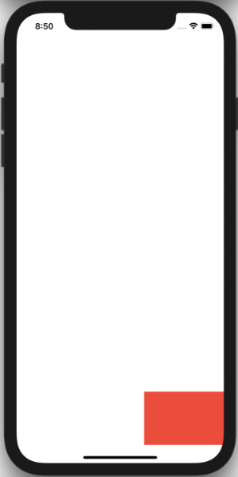

Remarquez que quand on travaille avec `GeometryReader`, si on ne propose aucune position, le coin supérieur gauche du rectangle sera dans le coin supérieur gauche du parent plutôt que d'avoir un rectangle centré comme c'était le cas sans le `GeometryReader`.

```swift title="SwiftUI"
struct ContentView: View {
  let largeur: CGFloat = 150
  let hauteur: CGFloat = 100

  var body: some View {
    GeometryReader { geometry in
      Rectangle()
        .frame(width: largeur, height: hauteur)
        .foregroundStyle(Color.red)
    }
  }
}
```


### Un VStack comme parent

Regardons maintenant ce qui se passe si le parent du rectangle est un `VStack` plutôt que toute la zone sécuritaire de l'écran.

```swift title="SwiftUI"
struct ContentView: View {
  let largeur: CGFloat = 150
  let hauteur: CGFloat = 100

  var body: some View {
    VStack {
      Rectangle()
        .frame(width: largeur, height: hauteur)
        .foregroundStyle(Color.red)
        .position(x: largeur/2, y: hauteur/2)

      Rectangle()
        .frame(width: largeur, height: hauteur)
        .foregroundStyle(Color.blue)
        .position(x: largeur/2, y: hauteur/2)
    }
  }
}
```

Avec ce résultat, on comprend que le parent de chacun des rectangles est la place qu'il aurait normalement occupée dans le `VStack`.

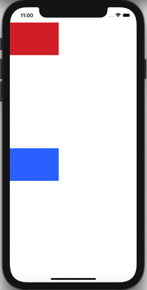

??? info "Pour plus d'information"

    « Making Fine Adjustments to a View’s Position ». Apple. <https://developer.apple.com/documentation/swiftui/making-fine-adjustments-to-a-view-s-position>

    « SwiftUI Tutorial: Layout Tools - Offset and Position ». Karin Prater. <https://karinprater.medium.com/swiftui-tutorial-layout-tools-211b9663befe#d397>

## Modifieur .zIndex()

Lorsqu'on travaille avec du positionnement relatif ([.offset()](quelques-modifieurs.md#modifieur-offset)) ou absolu ([.position()](quelques-modifieurs.md#modifieur-position)), il peut arriver que deux éléments graphiques se superposent.

Le modifieur .[zIndex()](https://developer.apple.com/documentation/swiftui/view/zindex(_:)) permet d'indiquer quel élément apparaîtra par-dessus l'autre.

Dans cet exemple, sans le `.zIndex()`, le cercle serait placé sous le rectangle puisque le rectangle est affiché en dernier. Le `.zIndex()` permet au cercle de rester au-dessus.

```swift title="SwiftUI"
ZStack {
  Circle()
    .frame(width: 150, height: 150)
    .foregroundStyle(.orange)
    .offset(x: -77)
    .zIndex(1)

  Rectangle()
    .frame(width: 150, height: 150)
    .foregroundStyle(.teal)
 }
```

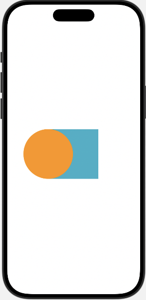

Attention : ceci vaut pour une série d'éléments à l'intérieur d'un même contrôle d'empilement.

Si des éléments en provenance de plusieurs contrôles d'empilement se superposent, c'est un contrôle d'empilement qui devra recevoir le `zIndex()`.

## Modifieur .disabled()

Le modifieur [disabled()](https://developer.apple.com/documentation/swiftui/view/disabled(_:)) permet de rendre une vue inactive selon la condition précisée en paramètre.

Ceci est pratique, par exemple, pour empêcher la modification d'un TextField.

```swift title="SwiftUI"
TextField("Code:", $code)
  .disabled(uneVariable == uneValeur)
```

Il permet également de désactiver un bouton.

```swift title="SwiftUI"
Button("Cliquez ici", action: {
  // traitement ici
})
.disabled(nom.isEmpty)
```

## Modifieur .opacity()

Le modifieur [opacity()](https://developer.apple.com/documentation/swiftui/view/opacity(_:)) permet d'ajouter de la transparence à une vue.

Une opacité de 1 correspond à aucune transparence.

Une opacité de 0 correspond à une vue invisible.

On peut utiliser l'opacité, par exemple, pour [pâlir une couleur](../lecons/couleurs.md).

Attention : il faut appliquer l'opacité sur la bonne vue.

Par exemple, pour pâlir la couleur de fond d''un HStack, si vous appliquez l'opacité sur le background du HStack, toutes les vues du HStack auront de la transparence.

```swift title="SwiftUI"
HStack {
  Text("Allô")
    .padding()
    .background(Color.white)
    .border(Color.accentColor)
  Text("Bonjour")
    .padding()
    .background(Color.white)
    .border(Color.accentColor)
 }
 .padding()
 .background(Color.gray)
 .cornerRadius(15)
 .opacity(0.4)
```

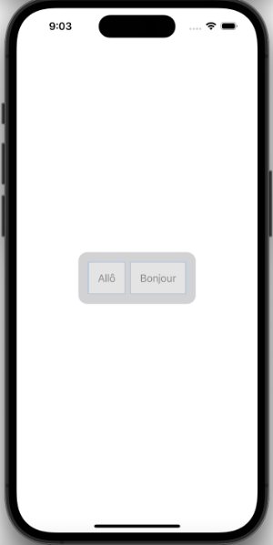

Si vous désirez pâlir seulement la couleur de fond, il faut appliquer l'opacité directement sur la couleur.

```swift title="SwiftUI"
HStack {
  Text("Allô")
    .padding()
    .background(Color.white)
    .border(Color.accentColor)
  Text("Bonjour")
    .padding()
    .background(Color.white)
    .border(Color.accentColor)
 }
 .padding()
 .background(Color.gray.opacity(0.4))
 .cornerRadius(15)
```

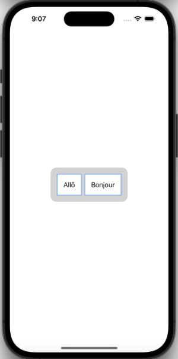

## Modifieur .rotationEffect()

Le modifieur [rotationEffect()](https://developer.apple.com/documentation/swiftui/view/rotationeffect(_:anchor:)) appliqué à une vue permet de lui appliquer une rotation 2D.

```swift title="SwiftUI"
VStack {
  Text("************")
  Text("Texte normal")
  Text("************")
  Text("Rotation de 20 degrés")
    .rotationEffect(.degrees(20))
  Text("************")
 }
```

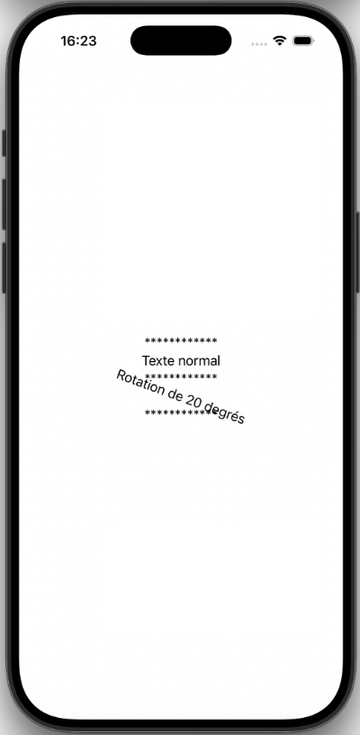
