# Utiliser la caméra du iPhone par programmation

## Application qui utilise les photos de la bibliothèque

...

??? info "Pour plus d'information"

    « How to let users select pictures using PhotosPicker ». Hacking with Swift. <https://www.hackingwithswift.com/quick-start/swiftui/how-to-let-users-select-pictures-using-photospicker>

    « The Complete Guide to PHPicker API in iOS 14 ». AppCoda. <https://www.appcoda.com/phpicker/>

    « PhotosPicker in SwiftUI ». Swift with Majid. <https://swiftwithmajid.com/2023/04/25/photospicker-in-swiftui/>

## Prendre une photo directement dans l'application

Une application SwiftUI peut utiliser la caméra de l'appareil mobile pour prendre une photo. Bien sûr, l'usager devra appuyer sur un bouton pour prendre la photo mais il pourra le faire directement dans l'application.

Avant de vous lancer, vous devez savoir que SwiftUI ne supporte pas la caméra de façon native. Il faut passer par du code UIKit qui sera enrobé pour que SwiftUI puisse le comprendre.

Je vous montre comment y arriver à l'aide d'une structure qui répond au protocole **UIViewControllerRepresentable**.

Si vous avez besoin d'un contrôle plus précis de la caméra, je vous suggère cet article qui utilise [AVFoundation](https://developer.apple.com/av-foundation/) : <https://www.objc.io/issues/21-camera-and-photos/camera-capture-on-ios/>.

### Demander la permission

Pour utiliser la caméra, vous devez ajouter la clé [NSCameraUsageDescription](https://developer.apple.com/documentation/bundleresources/information_property_list/nscamerausagedescription) (Privacy - Camera Usage Description) [à Info.plist](../lecons/info-plist.md#ajouter-une-paire-cle-valeur-dans-infoplist).

Dès que l'application tentera d'utiliser la caméra, une boîte de dialogue demandera la permission à l'usager s'il ne l'a pas déjà accordée.

Une fois la photo prise, si vous désirez l'enregistrer dans la bibliothèque de photos, il faut ajouter la clé [NSPhotoLibraryAddUsageDescription](https://developer.apple.com/documentation/bundleresources/information_property_list/nsphotolibraryaddusagedescription) (Privacy - Photo Library Additions Usage Description) à Info.plist.

### Vue pour utiliser la caméra

Voici le code d'une vue qui permet d'utiliser la caméra par programmation.

Il s'agit d'un squelette fortement inspiré de <https://itnext.io/building-a-lightweight-camera-app-in-swiftui-66db47b3537f>.

J'y ai ajouté des commentaires explicatifs et j'ai effectué quelques ajustements pour mes besoins.

```swift title="SwiftUI"
import Foundation
import UIKit // le contrôle de la caméra utilise du code UIKit
import SwiftUI

// Vue qui permet d'utiliser l'appareil photo par programmation.
// UIViewControllerRepresentable est une vue SwiftUI qui représente un ViewController de UIKit.
// Source : https://itnext.io/building-a-lightweight-camera-app-in-swiftui-66db47b3537f
// Adapté par Christiane Lagacé
struct CameraView: UIViewControllerRepresentable {
  @Environment(\.presentationMode) var presentationMode // pour pouvoir refermer la caméra et retourner à la vue parent
  @Binding var enregistrementReussi: Bool   // pour pouvoir réagir dans la vue parent si un problème survient
   @Binding var photo: UIImage?   // pour pouvoir afficher la photo dans la vue parent

  // Ceci indique quel type de vue UIViewControllerRepresentable représente.
  typealias UIViewControllerType = UIImagePickerController

  // Crée et initialise la vue
  func makeUIViewController(context: Context) -> UIViewControllerType {
    let viewController = UIViewControllerType() // crée le UIImagePickerController
    viewController.delegate = context.coordinator // C'est la classe Coordinator qui sera en charge des communications entre la vue UIKit et la vue SwiftUI.
    viewController.sourceType = .camera // Si on avait mis .photoLibrary, on aurait plutôt choisi une photo dans la bibliothèque.

    return viewController
  }

  // Initialise le responsable des communications.
  func makeCoordinator() -> CameraView.Coordinator {
    return Coordinator(self)
  }

  // Retourne de l'information vers le code UIKit
  func updateUIViewController(_ uiViewController: UIViewControllerType, context: Context) {

  }
}

extension CameraView {
  // La classe Coordinator est imbriquée dans la structure puisqu'elle est utilisée seulement par elle.
  // Le coordonnateur est responsable des communications entre la vue UIKit et la vue SwiftUI.
  class Coordinator : NSObject, UIImagePickerControllerDelegate, UINavigationControllerDelegate {
    var parent: CameraView
    private let fileManager = LocalFileManager.instance

    init(_ parent: CameraView) {
      self.parent = parent
    }

    // Effectue le traitement quand une photo a été prise.
    func imagePickerController(_ picker: UIImagePickerController, didFinishPickingMediaWithInfo info: [UIImagePickerController.InfoKey : Any]) {
      if let image = info[UIImagePickerController.InfoKey.originalImage] as? UIImage {
        ... // voir exemples d'actions plus bas
      }

      // Retourne à la vue précédente
      parent.presentationMode.wrappedValue.dismiss()
    }

    // Effectue le traitement quand la prise de photo est annulée.
    func imagePickerControllerDidCancel(_ picker: UIImagePickerController) {
      print("Prise de photo annulée.")
      // Retourne à la vue précédente
      parent.presentationMode.wrappedValue.dismiss()
    }
  }
}
```

Il vous reste à coder ce qui doit se passer lorsqu'une photo est prise.

Ce code doit être placé dans la fonction qui a le paramètre `didFinishPickingMediaWithInfo`.

Voici quelques exemples de traitements qui peuvent être réalisés.

```swift title="SwiftUI"
// Retient l'image dans la propriété liée (@Binding)
 parent.photo = image

// Enregistre l'image dans la bibliothèque
UIImageWriteToSavedPhotosAlbum(image, nil, nil, nil)

// Enregistre l'image dans le système de fichiers de l'appareil mobile
parent.enregistrementReussi = fileManager.saveImage(image: image, folderName: "mesImages")

// Enregistre le nom de l'image dans la base de données
parent.enregistrementReussi = gestionBD.insererImage()
```

Et voici un extrait de code qui permet d'utiliser cette vue.

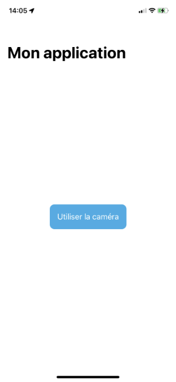 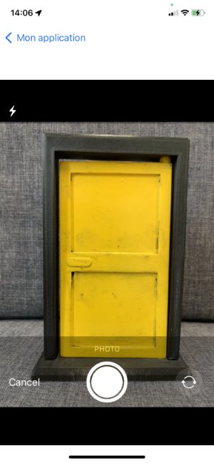

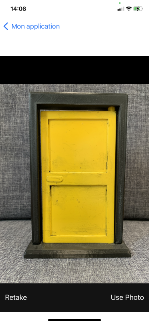 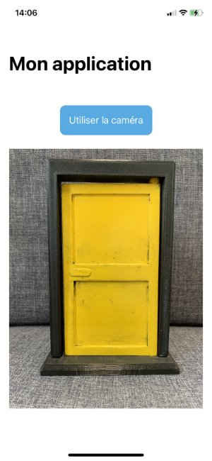

```swift title="SwiftUI"
import SwiftUI

struct ContentView: View {
  @State private var enregistrementReussi: Bool = true
  @State private var photo: UIImage? = nil

  var body: some View {
    NavigationStack {
      VStack {
        NavigationLink(destination: CameraView(enregistrementReussi: $enregistrementReussi, photo: $photo)) {
          Text("Utiliser la caméra")
            .padding()
            .foregroundColor(Color.white)
            .background(Color.cyan)
            .cornerRadius(10.0)
        }

        if photo != nil {
          Image(uiImage: photo!)
            .resizable()
            .scaledToFit()
            .padding()
        }

        if !enregistrementReussi {
          Text("L'image n'a pas pu être enregistrée dans le système de fichiers.")
            .foregroundColor(.red)
        }
      }   // fin VStack
      .navigationTitle("Mon application")
    }   // fin NavigationStack
  }
}
```

### Localisation des boutons

Lorsque [l'application est localisée](../lecons/la-localisation-traduction.md#application-swiftui-bilingue), SwiftUI affiche automatiquement les boutons de la caméra dans la langue de l'application.

Notez que les termes `Cancel`, `Retake` et `Use Photo` n'apparaîtront pas dans les chaînes à localiser, tout se passe sans qu'on le voit.

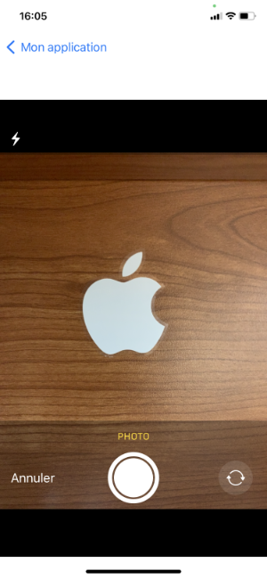 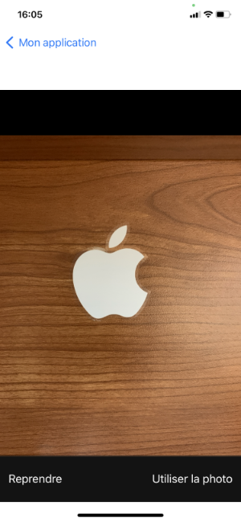

??? info "Pour plus d'information"

    « Building A Lightweight Camera App In SwiftUI ». Medium. <https://itnext.io/building-a-lightweight-camera-app-in-swiftui-66db47b3537f>

    « Capturing and Saving a Photo ». Apple. <https://developer.apple.com/tutorials/sample-apps/capturingphotos-captureandsave>

    « Requesting authorization to capture and save media ». Apple. <https://developer.apple.com/documentation/avfoundation/capture_setup/requesting_authorization_to_capture_and_save_media>

    « How to use UIViewController in SwiftUI ». Sarunw. <https://sarunw.com/posts/uiviewcontroller-in-swiftui/>

## Personnaliser les boutons de la caméra

Par défaut, une application SwiftUI qui utilise la caméra présente les contrôles de base :

- Bouton pour prendre la photo
- Bouton pour passer à la caméra avant ou arrière
- Bouton pour gérer le flash
- Bouton **Cancel** pour annuler la prise de photo
- Une fois la photo prise, boutons **Use Photo** pour utiliser la photo et **Retake** pour prendre une nouvelle photo

 

Il est possible de modifier ces boutons en travaillant avec une vue personnalisée qui sera superposée à la vue de la caméra.

Notez qu'avec des boutons personnalisés, il n'y aura plus l'écran intermédiaire qui permet d'utiliser la photo ou de la reprendre.

Je vous explique ici les modifications à apporter à une application de base avec caméra [basée sur UIViewControllerRepresentable](utiliser-la-camera-du-iphone-par-programmation.md#prendre-une-photo-directement-dans-lapplication).

### Modifications dans CameraView

Au nouveau de la structure qui définit la caméra, il faut ajouter des propriétés pour retenir les configurations désirées.

Ces propriétés seront liées puisque la vue parent les utilisera pour ajuster l'affichage des boutons.

Il faudra également ajouter le code qui ajustera les configurations de la caméra selon ces valeurs et qui pourra prendre une photo.

```swift title="SwiftUI"
struct CameraView: UIViewControllerRepresentable {
  ...
  // variables pour réagir aux contrôles
  @Binding var utiliserFlash: Bool
  @Binding var utiliserCameraAvant: Bool
  @Binding var clicPrendrePhoto: Bool

  ...

  // Retourne de l'information vers le code UIKit
  func updateUIViewController(_ uiViewController: UIViewControllerType, context: Context) {
    // Cache les contrôles natifs de caméra
    uiViewController.showsCameraControls = false

    // ajuste les options de la caméra
    uiViewController.cameraFlashMode = (utiliserFlash ? .on : .off)
    uiViewController.cameraDevice = (utiliserCameraAvant ? .front : .rear)

    if clicPrendrePhoto {
      uiViewController.takePicture()
      clicPrendrePhoto = false
    }
  }
}
```

Dans la vue parent, on aura des variables d'état pour retenir les configurations de la caméra.

Une vue sera créée pour définir les boutons et cette vue sera placée par-dessus la vue de la caméra grâce au modifieur `.overlay()`.

```swift title="SwiftUI"
struct ContentView: View {
  ...
  @State var utiliserCameraAvant: Bool = false
  @State var utiliserFlash: Bool = false
  @State var clicPrendrePhoto: Bool = false

  var body: some View {
    ...
    NavigationLink(destination: CameraView(enregistrementReussi: $enregistrementReussi, photo: $photo, utiliserFlash: $utiliserFlash, utiliserCameraAvant: $utiliserCameraAvant, clicPrendrePhoto: $clicPrendrePhoto)
      .overlay(cameraOverlay, alignment: .topTrailing)
    ...
  }

  private var cameraOverlay: some View {
    VStack {
      Spacer()
      HStack {
        Button(action: {
          utiliserCameraAvant.toggle()
        }) {
          Image(systemName: "arrow.triangle.2.circlepath")
            .font(.title)
            .foregroundColor(.white)
            .shadow(radius: 10)
        }

        Spacer()

        Button(action: {
          clicPrendrePhoto = true
        }) {
          Circle()
            .frame(width: 80)
            .foregroundColor(.black)
            .padding()
            .background(Color.gray)
            .clipShape(Circle())
            .shadow(radius: 10)
        }

        Spacer()

        Button(action: {
          utiliserFlash.toggle()
        }) {
          if (utiliserFlash == true){
            Image(systemName: "bolt.fill")
              .font(.title)
              .foregroundColor(.yellow)
              .shadow(radius: 10)
          } else {
            Image(systemName: "bolt.slash.fill")
              .font(.title)
              .foregroundColor(.gray)
              .shadow(radius: 10)
          }
        }
      } // fin HStack
      .padding()
    } // fin VStack
  }
}
```

Et voilà le résultat!

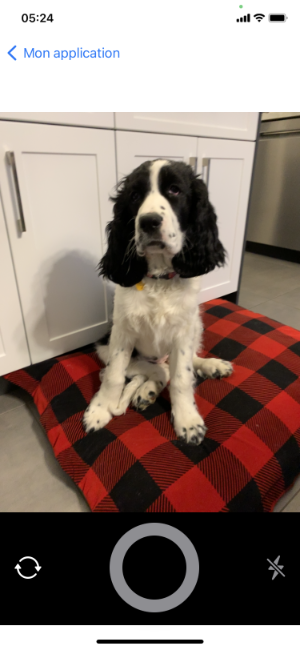

??? info "Pour plus d'information"

    « Customized Camera in SwiftUI ». Medium. <https://medium.com/macoclock/customized-camera-in-swiftui-bd218d2407d9>

## Enregistrer et retrouver une image dans le système de fichiers du iPhone

Je vous présente le code d'une classe qui permet d'enregistrer une image dans le système de fichiers du iPhone.

Ce code est fortement inspiré du tutoriel sur les cryptomonaies que vous retrouvez à l'adresse [https://www.youtube.com/watch?v=Z9yWdChUDlo](https:/www.youtube.com/watch?v=Z9yWdChUDlo).

J'y ai apporté de légères modifications et je l'ai fortement commenté pour vous aider à mieux le comprendre.

```swift title="SwiftUI"
import Foundation
import SwiftUI

// Classe pour enregistrer et retrouver des images sous le dossier Documents dans le système de fichiers du iPhone.
// Source : https://www.youtube.com/watch?v=Z9yWdChUDlo
// Adapté par Christiane Lagacé
class LocalFileManager {
  static let instance = LocalFileManager()

  private init() { } // Il ne sera pas possible d'instancier un objet en dehors de la classe.

  /**
   Enregistre une image dans un sous-dossier de Documents dans le système de fichiers du iPhone.

   - parameters:
     - image : Image à enregistrer
     - imageName: Nom à donner au fichier de l'image
     - folderName: Nom du sous-dossier de Documents dans lequel l'image doit être enregistrée

   - Returns: True si l'image a été enregistrée avec succès
  */
  func saveImage(image: UIImage, imageName: String, folderName: String) -> Bool {
    var retour = false

    if createFolderIfNeeded(folderName: folderName)

      // retrouve l'URL
      guard
        let data = image.jpegData(compressionQuality: 1.0),
        let url = getUrlForImage(imageName: imageName, folderName: folderName)
      else { return false }

      // enregistre l'image
      do {
        try data.write(to: url)
        retour = true
      } catch let error {
        print("Erreur lors de l'enregistrement de l'image. \(error)")
      }
    }

    return retour
  }

  /**
   Retrouve une image dans un sous-dossier de Documents dans le système de fichiers du iPhone.

    - parameters:
      - imageName: Nom de l'image recherchée
      - folderName: Nom du sous-dossier de Documents dans lequel l'image est placée

      - Returns: Image ou nil si pas trouvée
  */
  func getImage(imageName: String, folderName: String) -> UIImage? {
    guard
      let url = getUrlForImage(imageName: imageName, folderName: folderName),
      FileManager.default.fileExists(atPath: url.path) else {
      return nil
    }

    return UIImage(contentsOfFile: url.path)
  }

  /**
   Supprime une image d'un sous-dossier de Documents dans le système de fichiers du iPhone.

   - parameters:
     - imageName: Nom du fichier de l'image
     - folderName: Nom du sous-dossier de Documents dans lequel l'image est placée

   - Returns: True si l'image a été supprimée avec succès
  */
  func deleteImage(imageName: String, folderName: String) -> Bool {
    var retour = false

    // retrouve l'URL
    guard
      let url = getUrlForImage(imageName: imageName, folderName: folderName)
    else { return false }

    // supprime l'image
    do {
      try FileManager.default.removeItem(at: url)
      retour = true
    } catch let error {
      print("Erreur lors de la suppression de l'image \(url.absoluteString). \(error)")
    }

    return retour
  }

  /**
   Crée un dossier sous Documents dans le système de fichiers du iPhone mais seulement s'il n'existe pas déjà.

    - parameters:
      - folderName: Nom du sous-dossier de Documents à créer

   - Returns: True si le dossier a été créé avec succès ou s'il existait déjà
  */
  private func createFolderIfNeeded(folderName: String) -> Bool {
    var retour = false

    guard let url = getURLForFolder(folderName: folderName) else { return false }

    if !FileManager.default.fileExists(atPath: url.path) {
      do {
        try FileManager.default.createDirectory(at: url, withIntermediateDirectories: true, attributes: nil)
        retour = true
      } catch let error {
        print("Impossible de créer le dossier \(folderName). \(error)")
      }
    }
    else {
      retour = true
    }

    return retour
  }

  /**
   Retrouve l'URL d'un sous-dossier de Documents dans le système de fichiers du iPhone.

    - parameters:
      - folderName: Nom du sous-dossier de Documents à ajouter au chemin

      - Returns: URL du chemin ou nil si n'a pas pu être initialisé
  */
  private func getURLForFolder(folderName: String) -> URL? {
    do {
      let urlDocuments = try FileManager.default.url(for: .documentDirectory, in: .userDomainMask, appropriateFor: nil, create: true)
      return urlDocuments.appendingPathComponent(folderName)
    } catch {
      print("Erreur inattendue : \(error)")
      return nil
    }
  }

  /**
   Retrouve l'URL d'un fichier placé dans un sous-dossier de Documents dans le système de fichiers du iPhone.

    - parameters:
      - imageName: Nom de l'image à ajouter au chemin
      - folderName: Nom du sous-dossier de Documents à ajouter au chemin

    - Returns: URL du chemin ou nil si n'a pas pu être initialisé
  */
  private func getUrlForImage(imageName: String, folderName: String) -> URL? {
    guard let folderURL = getURLForFolder(folderName: folderName) else {
      return nil
    }

    return folderURL.appendingPathComponent(imageName)
  }
}
```

Pour tester cette classe, j'ai écrit une petite application qui permet d'enregistrer une image sur le téléphone à partir d'un URL puis d'afficher la liste des images enregistrées.

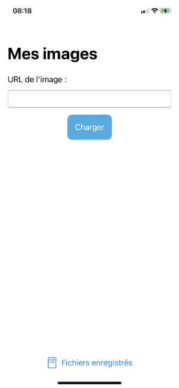 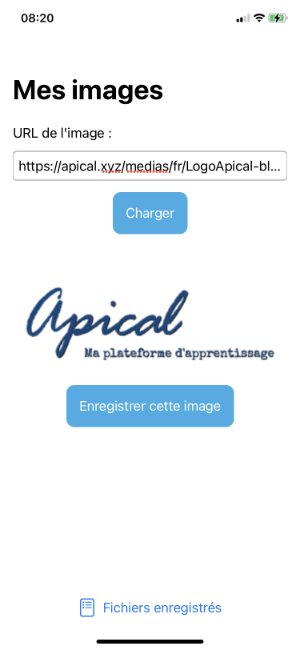 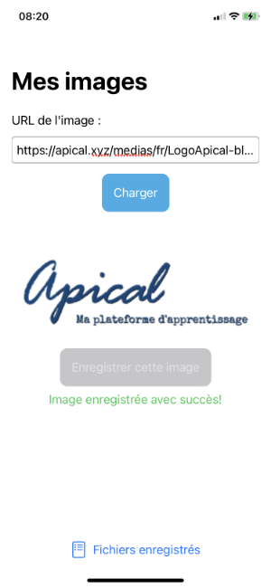

Quand on clique sur **Fichiers enregistrés**, on obtient un aperçu de chaque image et on a la possibilité de les supprimer toutes.

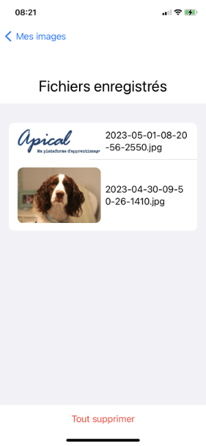 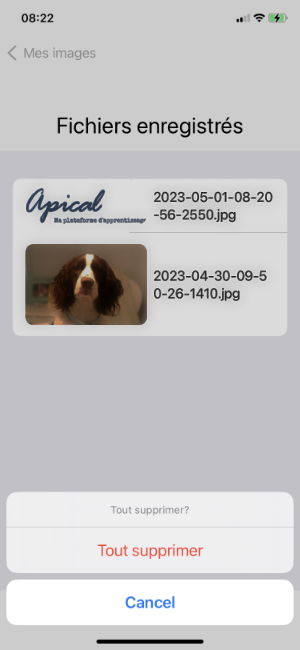 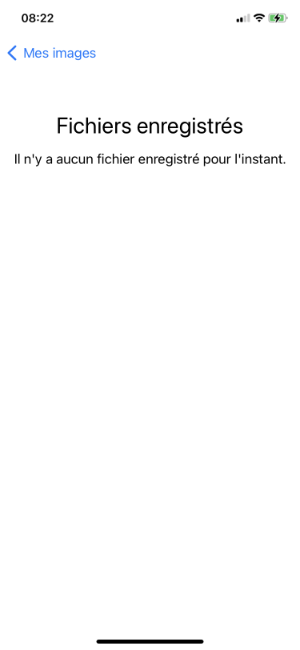

Voici le code de cette application.

```swift title="Fichier ContentView.swift"
import SwiftUI

struct MonBouton: ButtonStyle {
  var actif: Bool = true

  func makeBody(configuration: Configuration) -> some View {
    configuration.label
    .padding()
    .foregroundColor(Color.white)
    .background(actif ? Color.cyan : Color.gray)
    .cornerRadius(10.0)
    .opacity(actif ? 1 : 0.5)
  }
}

struct ContentView: View {
  let dossier = "mesImages"
  let fileManager = LocalFileManager.instance
  // @State private var chaineURL: String = ""
  @State private var image: UIImage? = nil
  @State private var boutonEnregistrerActif: Bool = true
  @State private var erreur: Bool = false
  @State private var imageIntrouvable: Bool = false
  @FocusState var isFocused : Bool // quand aucun contrôle n'aura le focus, le clavier sera caché

  var body: some View {
    NavigationStack {
      VStack {
        // Saisir l'URL d'une image.
        Text("URL de l'image :")
          .frame(maxWidth: .infinity, alignment: .leading)
        TextField("", text: $chaineURL)
          .textInputAutocapitalization(.never)
          .padding(7)
          .focused($isFocused)
          .overlay {
            RoundedRectangle(cornerRadius: 5)
              .stroke(Color.gray, lineWidth: 2)
              .opacity(0.5)
          }
        Spacer()
          .frame(height: 15)
        Button(action: {
          // cache le clavier
          isFocused = false

          Task {
            do {
              try await chargerImage()
            } catch {
              print(error.localizedDescription)
              erreur = true
            }
          }
        }) {
          Text("Charger")
        }
        .buttonStyle(MonBouton())

        Spacer()
          .frame(height: 50)

        if image != nil {
          Image(uiImage: image!)
            .resizable()
            .aspectRatio(contentMode: .fit)
            .clipShape(RoundedRectangle(cornerRadius: 10))
            .padding()

          Spacer()
            .frame(height: 15)

          Button(action: {
            enregistrerImage()
          }) {
            Text("Enregistrer cette image")
          }
          .buttonStyle(MonBouton(actif: boutonEnregistrerActif))
          .disabled(!boutonEnregistrerActif)

          Spacer()
        }

        if !boutonEnregistrerActif && !erreur {
          Text("Image enregistrée avec succès!")
            .foregroundColor(.green)
        }

        if imageIntrouvable {
          Text("Impossible de retrouver une image à cette adresse.")
            .foregroundColor(.red)
        }

        if erreur {
          Text("Une erreur s'est produite.")
            .foregroundColor(.red)
        }
      } // fin VStack
      .navigationTitle("Mes images")
      .toolbar(content: {
        ToolbarItem(placement: .bottomBar, content: {
          NavigationLink(destination: FichiersEnregistresView(dossier: dossier)) {
            HStack {
              Image(systemName: "list.bullet.rectangle.portrait")
              Text("Fichiers enregistrés")
            }
          }
        })
      }) // fin .toolbar
      .padding()
    } // fin NavigationStack
  }

  // Charge l'image à partir de son URL
  func chargerImage() async throws {
    boutonEnregistrerActif = true // on pourra enregistrer à nouveau après avoir chargé une image

    guard let url = URL(string: chaineURL) else {
      erreur = true
      print("URL invalide : \(chaineURL)")
      return
    }

    let appel = URLSession.shared.dataTask(with: url) { data, response, error in
      guard let data = data else {
         erreur = true
        return
      }

      let response = response as! HTTPURLResponse
      guard (200...299).contains(response.statusCode) else {
        imageIntrouvable = true
        return
      }

      DispatchQueue.main.async {
        image = UIImage(data: data) ?? UIImage()
      }
    }
    appel.resume()
  }

  // Enregistre l'image.
  func enregistrerImage() {
    boutonEnregistrerActif = false

    let dateFormatter = DateFormatter()
    dateFormatter.dateFormat = "yyyy-MM-dd-HH-mm-ss-SSSS"
    let nomFichier = dateFormatter.string(from: Date()) + ".jpg"
    if fileManager.saveImage(image: image!, imageName: nomFichier, folderName: dossier) {
      erreur = false
    }
    else {
      erreur = true
    }
  }
}
```

```swift title="Fichier FichiersEnregistresView.swift"
import SwiftUI

struct FichiersEnregistresView: View {
  var dossier: String

  let fileManager = LocalFileManager.instance

  @State private var listeFichiers: [String] = []
  @State private var afficherPopup: Bool = false
  @State private var image: UIImage? = nil
  @State private var erreur: Bool = false

  var body: some View {
    VStack {
      Text("Fichiers enregistrés")
        .font(.title)

      Spacer()
        .frame(height: 15)

      // Affiche les fichiers enregistrés
      if listeFichiers.count > 0 {
        List(listeFichiers, id: \.self) { nomFichier in
          HStack {
            if let image = fileManager.getImage(imageName: nomFichier, folderName: dossier) {
              Image(uiImage: image)
                .resizable()
                .scaledToFit()
                .clipShape(RoundedRectangle(cornerRadius: 10))
            } else {
              Text("Impossible de retrouver l'image test.jpg.")
            }
            Text(nomFichier)
          }
        }

        Spacer()
          .frame(height: 15)

        Button(role: .destructive, action: {
          afficherPopup = true
        }) {
          Text("Tout supprimer")
        }
        .confirmationDialog("Tout supprimer?", isPresented: $afficherPopup, titleVisibility: .visible) {
          Button(role: .destructive, action: {
            toutSupprimer()
          }) {
            Text("Tout supprimer")
          }
          .buttonStyle(MonBouton())
        }
      }
      else {
        Text("Il n'y a aucun fichier enregistré pour l'instant.")
      }

      Spacer()

      if erreur {
        Text("Une erreur s'est produite.")
          .foregroundColor(.red)
      }
    } // fin VStack
    .onAppear(perform: initialiserListeFichiers)
  }

  // Initialise la liste des fichiers présents dans le dossier
  func initialiserListeFichiers() {
    listeFichiers = []

    guard let url = fileManager.getURLForFolder(folderName: dossier)
    else {
      print("Impossible de retrouver les fichiers du dossier \(dossier).")
      return
    }

    if FileManager.default.fileExists(atPath: url.path) {
      let items: [String] = try! FileManager.default.contentsOfDirectory(atPath: url.path)

      for item in items {
        listeFichiers.append(item)
      }
    }
  }

  // Supprime tous les fichiers présents dans le dossier.
  func toutSupprimer() {
    listeFichiers.forEach { fichier in
      if !fileManager.deleteImage(imageName: fichier, folderName: dossier) {
        erreur = true
      }

      if !erreur {
        listeFichiers = []
      }
    }
  }
}
```
