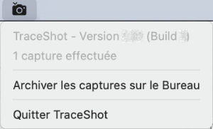

# Exercice 7 : Nouvelle application

Vous avez reçu une commande pour développer une application qui permet de gérer des objets connectés.

Puisqu'on ne travaille pas avec des objets connectés dans ce cours, l'application travaillera plutôt avec des valeurs entrées à l'écran et elle simulera qu'il s'agit d'informations provenant d'objets connectés.

Dans ce premier exercice, nous allons nous concentrer sur l'interface de l'application.

1. En prévision de l'examen qui aura lieu au prochain cours, lancez l'application de surveillance **TraceShot.app**.

    Sous l'icône qui apparaît dans la barre de menu, si la mention « En attente de la première capture... » demeure en place, faites appel au prof.

    Lorsque l'application fonctionne correctement, le nombre de captures s'incrémente dans le menu.

    { width="300" }

    !!! Warning "Important"
        Lors d'une évaluation sommative, tout travail remis sans la série complète de captures d'écran, ou présentant une séquence interrompue, sera considéré comme non remis et ne sera pas corrigé.

2. Nous voici de retour à l'application que vous devez développer. Cette application doit, sur sa page principale, afficher une liste de vos objets connectés à l'aide de la vue [List](../lecons/les-listes.md). Pour l'instant, affichez la valeur actuelle de 2 prises intelligentes, d'un capteur de température ainsi que d'une ampoule intelligente. Utilisez des informations de votre choix. Pour chaque objet, on doit voir son nom, une icône qui le représente et, si pertinent pour l'objet, un texte qui indique sa valeur actuelle (ex : allumée, éteinte, hors ligne, 20 C).
3. Dans le haut de l'écran, un bouton **+** permettra d'ajouter un objet connecté. Ce bouton ne fera rien pour l'instant.
4. À un autre endroit dans le haut ou dans le bas de l'écran, un bouton permettra d'afficher la météo. Ce bouton ne fera rien pour l'instant.
5. Au bas de l'écran, un ou plusieurs contrôles permettront de grossir ou de rapetisser le texte. Cette fois, ce sera fonctionnel. À vous de choisir quel texte sera affecté par ce contrôle. Soyez cohérent avec les besoins des usagers.
6. La taille du texte doit être enregistrée dans les préférences utilisateur. Lors de la prochaine ouverture de l'application, le texte sera donc de la même taille que lors de sa fermeture précédente.
7. Une fois l'exercice complété, pour récupérer les captures effectuées par TraceShot, cliquez sur l'option **Archiver les captures sur le Bureau** dans la barre de menu, puis copiez le fichier dans le dossier `dev` de votre application.
8. Remettez un zip de votre projet complet sur Teams.
9. En prévision de l'examen prévu au prochain cours, prenez quelques minutes pour parcourir à nouveau les fiches des chapitres de référence. Ceci vous permettra de retrouver les informations plus rapidement pendant l'examen.
