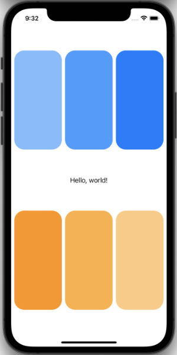
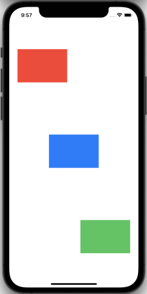

# Exercice 2 : S'approprier la création de vues

1. Explorez le potentiel des vues en suivant le tutoriel [Design an interface](https://developer.apple.com/tutorials/develop-in-swift/design-an-interface).
    
5. Créez un nouveau projet pour explorer SwiftUI et reproduisez l'écran suivant dans la vue principale. Prenez le temps d'ajuster l'indentation avec les touches <kbd>⌘ Cmd</kbd>+<kbd>A</kbd> puis <kbd>⌃ Ctrl</kbd>+<kbd>I</kbd>.

    { width="250" }

6. Reproduisez les écrans suivants, un par projet.

    { width="200" }
    { width="200" }
    { width="200" }
