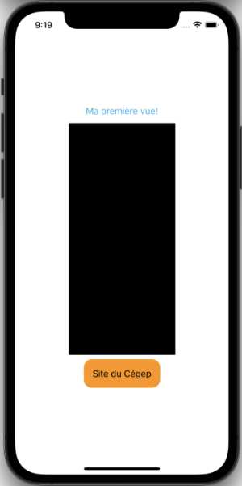
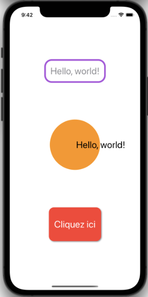

# Exercice 2 : S'approprier la création de vues

1. Configurez Xcode pour qu'il utilise une indentation de deux espaces.
2. Configurez Xcode pour que les touches <kbd>⌘ Cmd</kbd>+<kbd>⌫ Retour arrière</kbd> permettent de supprimer une ligne entière.
3. Explorez le potentiel des vues en suivant le tutoriel [Creating and combining views](https://developer.apple.com/tutorials/swiftui/creating-and-combining-views).
    1. Notez que dans la section 2, étapes 2 à 4, l'inspecteur SwiftUI n'est plus disponible. Il faut passer par l'éditeur de code pour modifier le texte et la police.

        ```swift title="SwiftUI"
        Text("Turtle Rock")
          .font(.title)
        ```

    2. À la section 3, étape 2, vous devez passer par le menu **View / Show Library** pour afficher la bibliothèque d'objets.
    3. À la section 4, étape 2, l'option de menu est maintenant **File / New / File from Template**.
4. Suivez les leçons suivantes de la série [Your First iOS and SwiftUI App: An App From Scratch](https://www.raywenderlich.com/17493408-your-first-ios-and-swiftui-app-an-app-from-scratch) sur le site de Ray Wenderlich :
    1. 1\. Introduction
    2. 3\. Challenge: Make a Programming To-Do List (jusqu'à environ la minute 2:42, pas besoin de réaliser le défi).
    3. 4\. SwiftUI Views

        !!! Note
            Il n'est plus possible de faire glisser une vue directement dans le canevas, il faut la faire glisser dans l'éditeur de code.

            Aussi, la prévisualisation en mode paysage se fait désormais comme ceci :

            ```swift title="SwiftUI"
            #Preview(traits: .landscapeLeft) {
              ContentView()
            }
            ```

    4. 5\. SwiftUI View Modifiers

        !!! Note
            Les types dynamiques peuvent être visualisés à partir de l'icône **Device Settings** (en forme de deux commutateurs superposés) située au bas du canevas.

            Aussi, le modifieur `.kerning()` peut désormais être placé après `.multilineTextAlignment()`.

5. Créez un nouveau projet pour explorer SwiftUI et reproduisez l'écran suivant dans la vue principale. Prenez le temps d'ajuster l'indentation avec les touches <kbd>⌘ Cmd</kbd>+<kbd>A</kbd> puis <kbd>⌃ Ctrl</kbd>+<kbd>I</kbd>.

    { width="250" }

6. Reproduisez les écrans suivants, un par projet.

    { width="200" }
    { width="200" }
    { width="200" }
