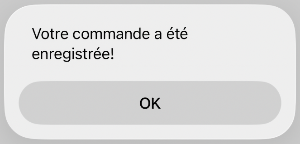
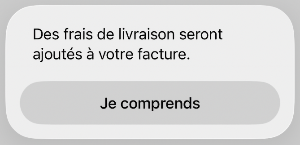
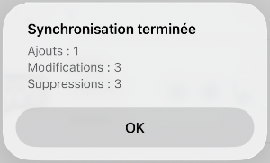
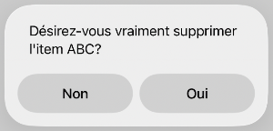
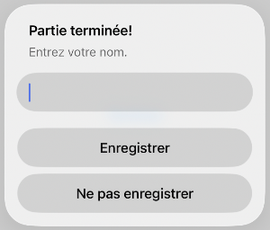

# Afficher un message à l'usager

## Simple texte pour afficher un message

Quand une application doit fournir une rétroaction à l'usager, il est possible de le faire avec un simple texte.

Ce texte pourrait être affiché seulement si une condition est en place.

```swift title="SwiftUI"
VStack {
  ...
  if afficherMessage {
    Text(message)
  }
}
```

Il est même possible d'afficher le message pendant quelques secondes (principe du minuteur ou **timer**) et de faire en sorte qu'il se cache tout seul.

```swift title="SwiftUI"
VStack {
  ...
  if afficherMessage {
    Text(message)
      .onAppear {
        DispatchQueue.main.asyncAfter(deadline: .now() + 3) {
          afficherMessage = false
        }
      }
  }
}
```

## Message popup avec .alert()

La méthode [alert()](https://developer.apple.com/documentation/swiftui/view/alert(_:ispresented:presenting:actions:message:)-8584l) permet d'afficher un du texte dans une boîte flottante (**popup**).

Son principe est le suivant : on appelle la méthode en fournissant notamment une valeur au paramètre `isPresented`. La valeur de ce paramètre doit provenir d'une variable avec liaison, donc précédée par un signe $. Ce peut être par exemple une variable déclarée avec l'attribut `@State`.

Le popup s'affichera seulement quand ce paramètre prendra la valeur true.

### Alerte avec bouton OK

Par défaut, le texte de l'alerte s'affichera dans une boîte avec un bouton OK qui permet de la refermer.

```swift title="SwiftUI"
struct ContentView: View {
  @State private var afficherAlerte: Bool = false

  var body: some View {
    Button("Commander") {
      afficherAlerte = true
    }
    .alert("Votre commande a été enregistrée!", isPresented: $afficherAlerte) {
    }
  }
}
```

ou, si votre bouton utilise cette autre syntaxe :

```swift title="SwiftUI"
Button(action: {
  afficherAlerte = true
}) {
  Text("Commander")
}
.alert("Votre commande a été enregistrée!", isPresented: $afficherAlerte) {
}
```



Attention : la [Structure Alert](https://developer.apple.com/documentation/swiftui/alert) ne doit plus être utilisée. Elle est obsolète depuis iOS 13.0 et macOS 10.15.

```swift title="SwiftUI"
Button("Test") {
  afficherAlerte = true
}
.alert(isPresented: $afficherAlerte) {
  Alert(title: Text("Bonjour!"))
}
```

### Alerte avec bouton personnalisé

Il est possible de changer le texte du bouton principal en définissant un bouton dont le rôle est `.cancel`.

```swift title="SwiftUI"
Button("Faire livrer") {
  afficherAlerte = true
}
.alert("Des frais de livraison seront ajoutés à votre facture.", isPresented: $afficherAlerte) {
  Button("Je comprends", role: .cancel) {
  }
}
```



### Alerte avec code à exécuter

Au besoin, vous pouvez ajouter du code qui sera exécuté lors du clic sur le bouton.

```swift title="SwiftUI"
Button(action: {
  ...
  if ... {
    termine = true
  }
}) {
  Text("Jouer")
}
.alert("Partie terminée!", isPresented: $termine) {
  Button("OK", role: .cancel) {
    reinitialiserPartie()
  }
}
```

### Alerte avec message plus substantiel

Le paramètre `message` permet d'afficher plus d'information.  
Remarquez dans cet extrait de code comment le message est séparé en plusieurs lignes grâce à l'utilisation de """.

```swift title="SwiftUI"
Button("Synchroniser") {
   ...
 }
.alert("Synchronisation terminée", isPresented: $afficherPopup) {
 } message: {
  Text("""
  Ajouts : \(ajouts)
  Modifications : \(modifications)
  Suppressions : \(suppressions)
  """)
 }
```



### Alerte qui pose une question

L'alerte peut contenir autant de boutons que désiré, ce qui ouvre la porte à une foule de possibilités, par exemple poser une question.

**Notez cependant que généralement, [.confirmationDialog](quelques-vues-swiftui.md#demander-une-confirmation-avec-confirmationdialog) est plus approprié pour demander une confirmation.**

Lorsqu'une alerte est utilisée pour poser une question, il est important de montrer clairement à l'usager qu'il peut accepter (ex : bouton OK ou Oui) ou refuser (ex : bouton Annuler ou Non) ce qui lui est demandé.

Notez que sur iOS, le bouton .cancel sera toujours situé à gauche, peu importe dans quel ordre vous avez placé les boutons.

```swift title="SwiftUI"
Button("Supprimer") {
  afficherAlerte = true
}
.alert("Désirez-vous vraiment supprimer l'item ABC?", isPresented: $afficherAlerte) {
  Button("Oui") {
    // code pour effectuer le traitement
  }
  Button("Non", role: .cancel) {
  }
}
```



### Alerte qui saisit de l'information

Depuis iOS 16, la méthode .alert() permet de saisir de l'information, par exemple à l'aide d'un [TextField](les-formulaires-swiftui.md#textfield).

Il n'est pas possible de construire une vue complexe mais l'ajout de quelques TextFields est accepté.

Si vous avez besoin d'un texte supplémentaire, vous pouvez utiliser la syntaxe avec un message.

```swift title="SwiftUI"
.alert("Partie terminée!", isPresented: $afficherAlerte) {
  TextField("", text: $nom)
  Button("Enregistrer") {
    // code pour effectuer le traitement
  }
  Button("Ne pas enregistrer", role: .cancel) {
  }
 }
 message: {
  Text("Entrez votre nom.")
 }
```



### Alerte attachée à autre chose qu'un bouton

L'exemple classique consiste à utiliser .alert() avec un bouton comme dans les exemples plus haut.

Mais sachez que l'alerte n'est pas obligée d'être rattachée directement au bouton qui déclenche son affichage. L'alerte peut être rattachée à une autre vue, par exemple un VStack.

```swift title="SwiftUI"
VStack {
  ...
  Button(action: {
    if ... {
      texte = "Réussi"
    }
    else {
      texte = "Raté"
    }
    afficherAlerte = true
  }) {
    Text("Tester")
  }
}
 .alert(texte, isPresented: $afficherAlerte) {
 }
```

??? info "Pour plus d'information"

    « Alerts ». Apple developer. <https://developer.apple.com/design/human-interface-guidelines/alerts>

    « alert(_:isPresented:presenting:actions:message:) ». Apple. <https://developer.apple.com/documentation/swiftui/view/alert(_:ispresented:presenting:actions:message:)-8584l>

    « iOS 15 Alerts in SwiftUI ». YouTube - Stewart Lynch . <https://www.youtube.com/watch?v=NC_c7WfSRTk>
