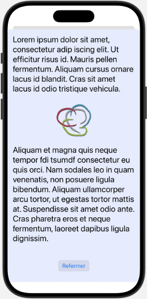
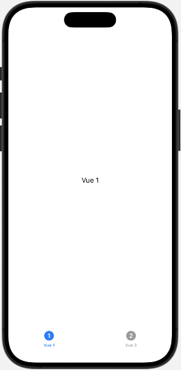
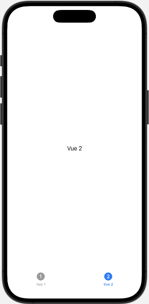
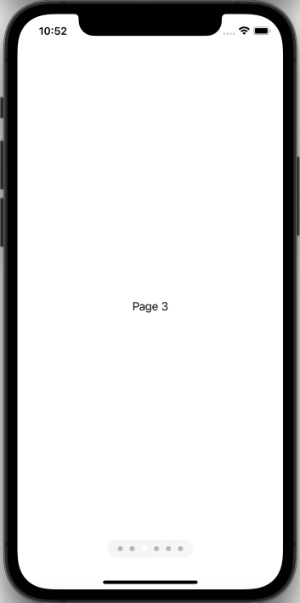

# Aller plus loin avec les applications multivues

## Retourner à n'importe quelle vue de la pile (NavigationPath)

Dans une application SwiftUI qui utilise un ou plusieurs [NavigationLink](les-applications-multivues.md), il est possible de revenir à la vue précédente :

- à l'aide du [bouton de retour](fonctions-obsoletes-ou-anciennes-syntaxes.md#texte-du-bouton-de-retour-dans-la-vue-enfant) généré automatiquement par SwiftUI
- à l'aide de [la méthode dismiss()](fonctions-obsoletes-ou-anciennes-syntaxes.md#texte-du-bouton-de-retour-dans-la-vue-enfant)

Il est également possible de dépiler la pile d'appel vers la vue désirée et non seulement vers la vue précédente.

Ceci est réalisé à l'aide de la structure [NavigationPath](https://developer.apple.com/documentation/swiftui/navigationpath) qui doit être passée en paramètre au NavigationStack. Cette structure permet de retenir ce qui est dans la pile des vues.

Pour pouvoir dépiler comme désiré, le NavigationLink devra travailler avec [.navigationDestination()](les-applications-multivues.md).

```swift title="Fichier ContentView.swift"
struct ContentView: View {
  @State private var path = NavigationPath()

  var body: some View {
    NavigationStack(path: $path) {
      List {
        NavigationLink(value: Item(id: 1, titre: "Item 1")) {
          Text("Détails de l'item 1")
        }
        NavigationLink(value: Item(id: 2, titre: "Item 2")) {
          Text("Détails de l'item 2")
        }
        NavigationLink(value: Item(id: 3, titre: "Item 3")) {
          Text("Détails de l'item 3")
        }
      }
      .navigationDestination(for: Item.self) { item in
        VueDetail(item: item, path: $path)  // la vue enfant pourra modifier le path pour dépiler vers la vue désirée
      }
      .navigationTitle("Mon application")
    }
  }
}
```

Supposons que la vue enfant appelle elle aussi d'autres vues enfant. Et cette dernière pourrait aussi appeler d'autres vues alors la pile peut devenir assez longue.

J'ai ajouté une barre d'outils à toutes les vues enfant afin de permettre de retourner à une vue donnée.

Cette barre d'outils permet de :

- reculer d'un niveau en dépilant un élément : `path.removeLast()`
- retourner directement à la page d'accueil en réinitialisant la pile : `path = NavigationPath()`
- retourner à un niveau donné en dépilant jusqu'à ce que la pile contienne le nombre désiré d'éléments.

```swift title="Fichier VueDetail.swift"
struct VueDetail: View {
  var item: Item
  @Binding var path: NavigationPath

  var body: some View {
    VStack {
      ...
      Text(item.titre)
      ...
      NavigationLink(value: item) {
        Text("Suggestions")
      }
      .buttonStyle(.bordered)
    }
    .navigationTitle(item.titre)
    .toolbar {
      ToolbarVuesEnfant(path: $path)
    }
  }
}
```

```swift title="Fichier ToolbarVuesEnfant.swift"
struct ToolbarVuesEnfant: ToolbarContent {
  @Binding var path: NavigationPath

  var body: some ToolbarContent {
    ToolbarItem(placement: .bottomBar, content: {
      Button(action: {
        path.removeLast()   // fait la même chose que dismiss()
      }) {
        Text("Précédent")
      }
    })

    ToolbarItem(placement: .status, content: {
      Button(action: {
        path = NavigationPath()
      }) {
        Text("Accueil")
      }
    })

    ToolbarItem(placement: .bottomBar, content: {
      Button(action: {
        while path.count > 2 {
          path.removeLast()
        }
      }) {
        Text("Niveau 2")
      }
    })
  }
}
```

??? info "Pour plus d'information"

    « SwiftUI NavigationStack: Revolution of nested navigation with SwiftUI  ». Medium. <https://medium.com/@mdyamin/navigationstack-revolution-of-nested-navigation-with-swiftui-7a00782b974b>

    « Reverse Engineering SwiftUI’s NavigationPath Codability ». Point free. <https://www.pointfree.co/blog/posts/78-reverse-engineering-swiftui-s-navigationpath-codability>

## Action au toucher d'un NavigationLink en plus du changement de vue

Quand on touche (**tap**) un NavigationLink, la vue associée est automatiquement affichée.

Mais que faire si on veut effectuer une action supplémentaire, par exemple afficher de l'information dans la sortie Standard?

À première vue, on serait portés à ajouter un `.onTapGesture` mais ceci écraserait l'action par défaut, c'est à dire l'affichage de la vue associée.

La solution consiste à ajouter un `.onAppear` directement au NavigationLink pour réaliser les opérations désirées.

```swift title="SwiftUI"
NavigationStack {
  List(items) { item in
    NavigationLink(destination: VueDetail(item: item)
      .onAppear {
        print(item.code)
    }) {
      Text("\(item.code) - \(item.titre)")
    }
  }
  ...
}
```

## Vue qui s'affiche par-dessus une autre : .sheet()

La méthode [sheet()](https://developer.apple.com/documentation/swiftui/view/sheet(ispresented:ondismiss:content:)) permet d'afficher une vue par-dessus ce qui est présentement à l'écran.

Son comportement ressemble à celui de [alert()](quelques-vues-swiftui.md#message-popup-avec-alert). Voici cependant quelques différences :

- `alert()` affiche un petit popup alors que `sheet()` affiche un popup qui remplit presque tout l'écran.
- `alert()` est conçu pour avoir automatiquement un bouton qui permet de refermer le popup alors que `sheet()` se referme par défaut en faisant glisser le popup vers le bas.
- `alert()` permet d'afficher des informations simples et possiblement d'effectuer de la saisie d'informations simples alors que `sheet()` permet d'afficher un écran plus sophistiqué.

Voici un exemple d'application qui affiche un popup avec `sheet()`.

```swift title="Fichier ContentView.swift"
struct ContentView: View {
  @State private var afficher: Bool = false

  var body: some View {
    VStack {
      ...
      Button("Afficher ma vue", action: {
        afficher = true
      })
      .buttonStyle(.bordered)
    }
    .sheet(isPresented: $afficher) {
      MaVue()
    }
  }
}
```

En ajoutant un bouton qui fait un [dismiss()](https://developer.apple.com/documentation/swiftui/environmentvalues/dismiss), il devient possible de refermer le popup en cliquant sur ce bouton.

Il est tout de même possible de le refermer en le faisant glisser vers le bas.

```swift title="Fichier ConditionsUtilisation.swift"
struct MaVue: View {
  @Environment(\.dismiss) private var dismiss

  var body: some View {
    VStack {
      ...
      Button("Refermer", action: {
        dismiss()
      })
      .buttonStyle(.bordered)
    }
    .padding()
  }
}
```

Dans cette impression d'écran, on voit le `sheet()` pour lequel j'ai mis un fond lilas afin de bien le repérer.

La petite zone grise dans le haut apparaît automatiquement. Elle a pour but de rappeler à l'usager qu'il y a une autre vue sous le `sheet()`.



??? info "Pour plus d'information"

    « sheet(isPresented:onDismiss:content:) ». Apple. <https://developer.apple.com/documentation/swiftui/view/sheet(ispresented:ondismiss:content:)>

    « SwiftUI Sheet Explained: Modal Views for iOS Apps ». BugFender. <https://bugfender.com/blog/swiftui-sheet/>

    « SwiftUI Sheet: Modal, Bottom, and full screen presentation in iOS ». Swifty Place. <https://www.swiftyplace.com/blog/swiftui-sheets-modals-bottom-sheets-fullscreen-presentation-in-ios>

## TabView

La structure [TabView](https://developer.apple.com/documentation/swiftui/tabview) permet de naviguer entre différentes vues d'une application SwiftUI.

Il s'agit d'une technique à la fois alternative et complémentaire à [ToolbarContent](la-barre-de-navigation.md#configurer-les-barres-doutils).

Elle crée des éléments cliquables au bas de l'écran et permet de préciser le contenu de la vue active.

Elle se charge automatiquent d'identifier l'élément cliquable actif.

```swift title="SwiftUI"
TabView {
  VueUn()
    .tabItem {
      Label("Vue 1", systemImage: "1.circle")
    }
  VueDeux()
    .tabItem {
      Label("Vue 2", systemImage: "2.circle")
    }
}
```

 

### Défilement horizontal

Si on ne précise pas de tabItem, la structure TabView permet de faire défiler horizontalement les pages à l'écran.

Il est donc possible de passer d'une page (d'une vue) à l'autre en faisant glisser la vue active vers la gauche ou vers la droite.

Les informations affichées dans le TabView sont accompagnées de points qui indiquent l'emplacement de la vue active par rapport à l'ensemble du TabView.

Par défaut, ces points ne sont pas visibles mais ils sont bel et bien là puisque si on tape à l'endroit où ils apparaîtraient normalement, la page change.

Dans l'extrait de code qui suit, le modifieur `.tabViewStyle(.page)` active le changement de page par glissement.

Le modifieur .`indexViewStyle(.page(backgroundDisplayMode: .always))` assure que les points seront visibles.

```swift title="SwiftUI"
struct ContentView: View {
  var body: some View {
    TabView {
      Text("Page 1")
       Text("Page 2")
       Text("Page 3")
       Text("Page 4")
       Text("Page 5")
       Text("Page 6")
    }
    .tabViewStyle(.page)
    .indexViewStyle(.page(backgroundDisplayMode: .always))
  }
}
```



??? info "Pour plus d'information"

    « SwiftUI Tabview Tutorial: How to Customize the Tab Bar ». Swifty Place. <a href="https://www.swiftyplace.com/blog/tabview-in-swiftui-styling-navigation-and-more" target="_blank" rel="nofollow
