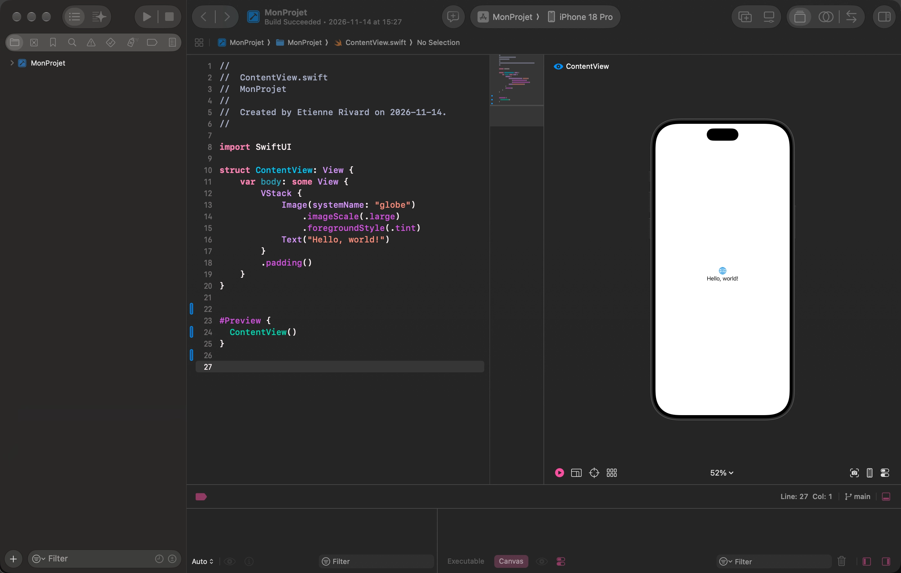
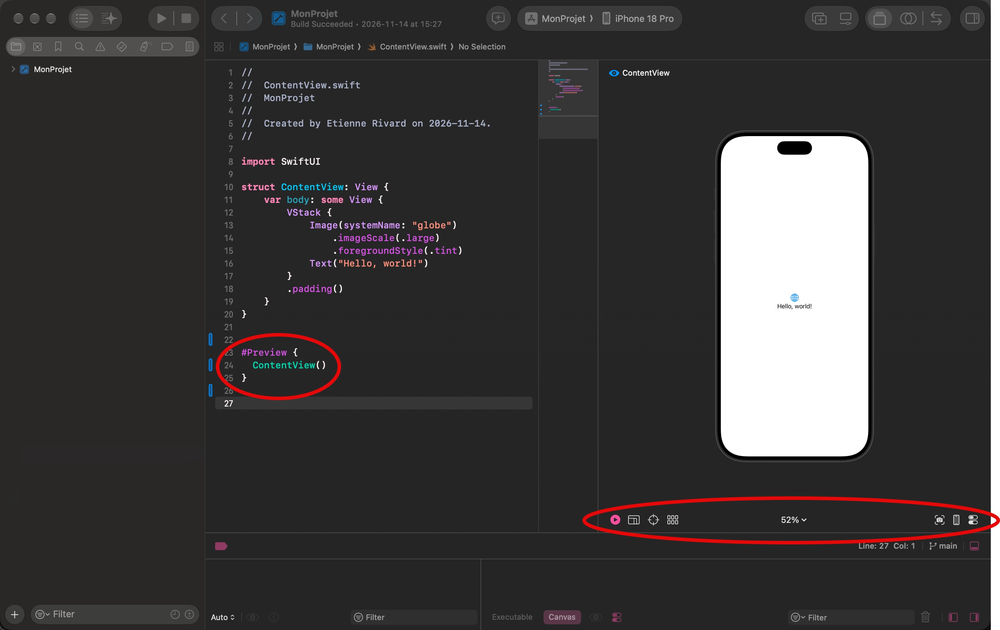
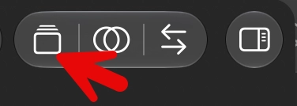
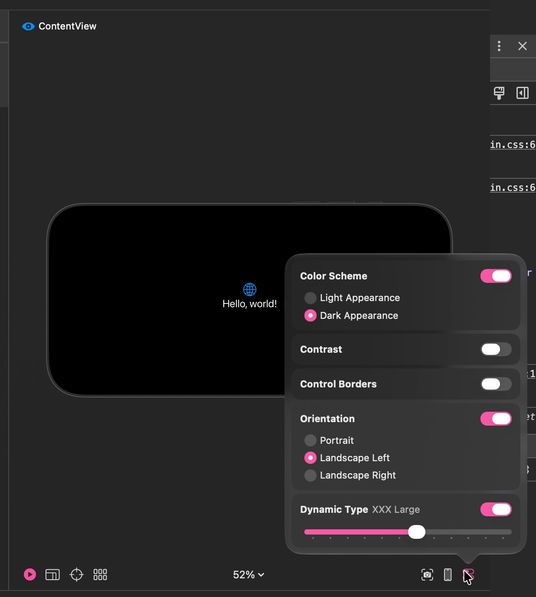
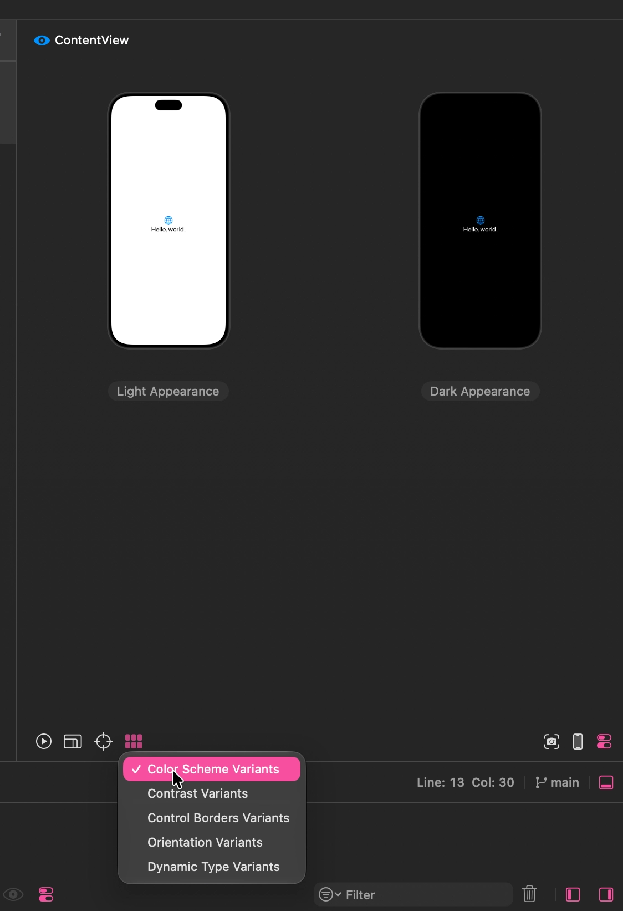
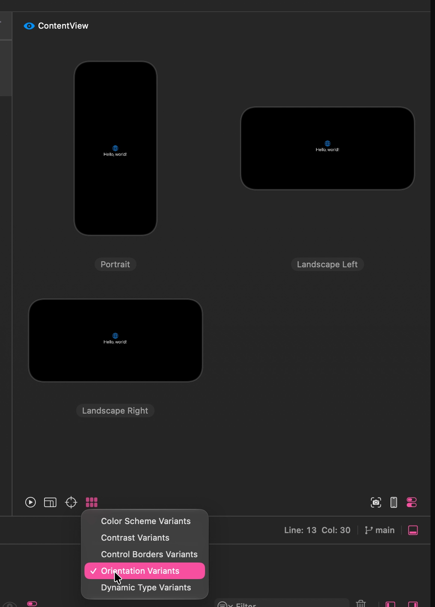
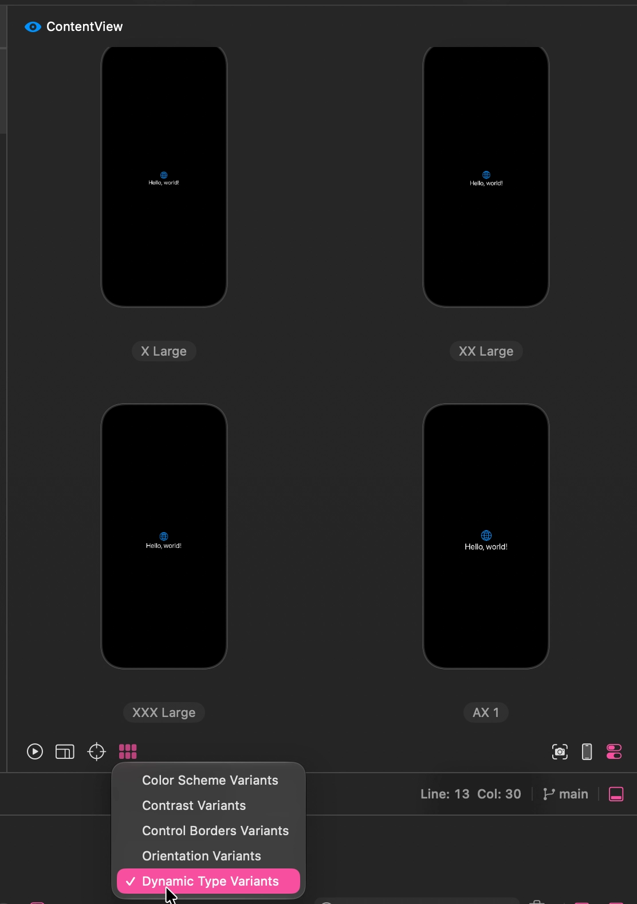
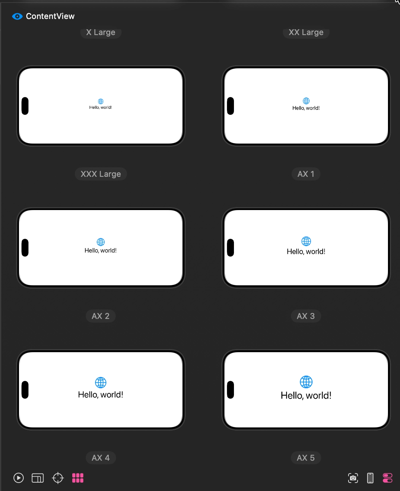
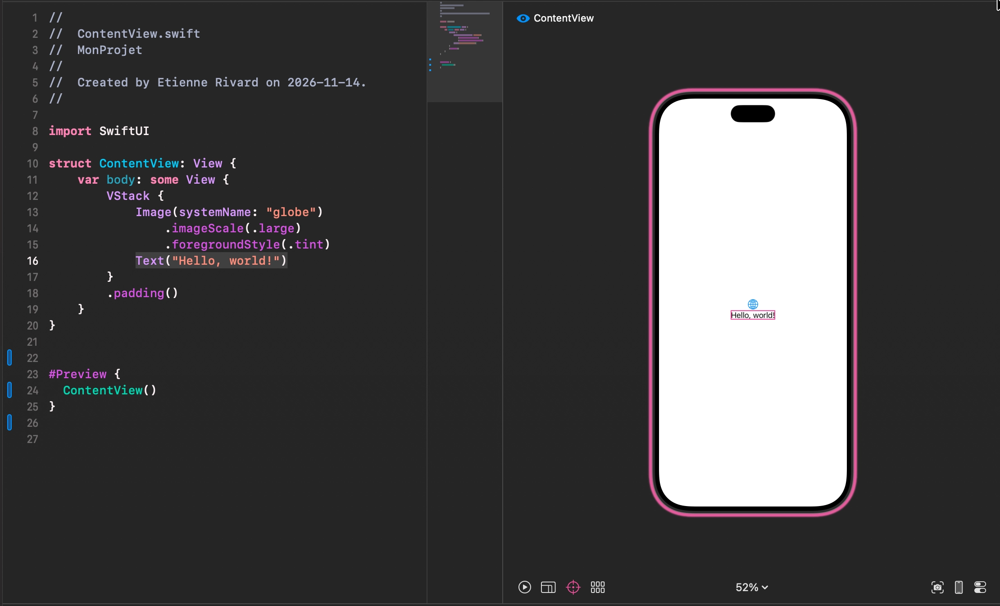

# Canevas  

# Qu'est-ce que le canevas?

Dans Xcode, le canevas, aussi appelé **fenêtre Preview**, est une représentation graphique du iPhone. On le retrouve à droite de l'éditeur de code source.

Lorsque vous développez une vue, le canevas montre immédiatement l'apparence qu'elle prendra.



Attention : les fonctionnalités du canevas sont limitées. Même si on peut y effectuer certaines tâches, son rôle principal consiste à vous monter le visuel de l'application.

Le simulateur offre plus de possibilités pour tester une application.

# Afficher / cacher le canevas

Par défaut, lorsque vous ouvrez un projet dans Xcode, le canevas apparaît à l'écran.

L'apparence du canevas est dictée entre autres par les boutons qui sont au bas de la zone du canevas.



Le menu **Editor** / **Canvas** permet d'afficher ou de cacher le canevas.

Il est également possible de cacher le canevas et de le réafficher à l'aide du bouton suivant : 

  

Il est situé dans le coin supérieur droit de l'écran.  

## Si le canevas n'est pas affiché

Assurez-vous que ces trois critères soient respectés :

- Le fichier actif dans Xcode est une structure qui répond au protocole `View`.

  ```swift title="SwiftUI"
  struct MaVue: View {
  ```
- Après la définition de la vue, il y a une macro `#Preview` qui appelle la vue.

  ```swift title="SwiftUI"
  #Preview {
    MaVue()
  }
  ```
- Dans Xcode, quand on clique sur l'icône en haut à droite de la fenêtre (ou dans le menu **Editor** / **Canvas**, l'option **Canvas** est cochée).

Si le canevas ne s'affiche toujours pas, ceci peut être dû à un problème dans la définition de la vue ou même à un **caractère accentué dans le nom du projet**.  

# Prévisualiser dans différentes modes/orientations

Par défaut, Xcode affiche le canevas en mode clair et en position verticale. La taille du texte est fixée à l'aide du type dynamique `large`.

## Icône au bas de la zone du canevas

Les icônes au bas de la zone du canevas permettent de modifier l'apparence du canevas sans avoir à modifier le code.

### Icône Device Settings

L'icône **Device Settings** (en forme de deux commutateurs superposés) permet de modifier l'apparence du canevas présentement affiché.

 

### Icône Variants

L'icône **Variants** (en forme de damier) permet d'afficher plusieurs canevas dans différentes variantes.

Notez que pour revenir à l'affichage d'un seul canevas, il faut cliquer sur l'icône **Live** (en forme de flèche), lui aussi au bas de la zone du canevas.

Voici un aperçu de configurations possibles.

{width=300} {width=300}

{width=300}

### Combinaison

Il est possible de combiner différentes options dans **Device Settings** et dans **Variants** afin de répondre à nos besoins, comme dans cet exemple où on a choisi **Dynamic Type Variants**, **Dark appearance** et **Orientation Landscape Right**.



# Forcer le rafraîchissement des données en cache du canevas

En temps normal, le canevas est rafraîchi au fur et à mesure que vous entrez du code dans l'éditeur de code source ou dans l'inspecteur de propriétés.

Parfois, cependant, il demeure figé dans un état quelconque.

Ou pire : il ne s'affiche pas et indique qu'il y a une erreur alors que tout semble normal.

Ceci peut arriver notamment lorsque la structure d'une base de données SwiftData est modifiée. Il faut comprendre que le canevas travaille avec ses propres données en cache sans interagir avec la vraie base de données.

Peu importe ce qui cause les problèmes d'affichage du canevas, le rafraîchissement du cache du canevas est une solution à envisager.

Ceci est réalisé à l'aide d'une commande entrée dans une fenêtre Terminal sur le Mac.

Notez que cette procédure supprimera toutes les données en cache du simulateur, incluant les préférences utilisateur.

- Ouvrez une fenêtre Terminal. Le dossier n'a pas d'importance.
- Entrez cette commande :

  ```text title="Terminal"
  xcrun simctl --set previews delete all
  ```

  Ceci supprimera les fichiers présents dans le dossier `/Users/monnom/Library/Developer/Xcode/UserData/Previews/Simulator Devices`.

## Si la commande ne fonctionne pas

Si vous obtenez le message « xcrun: error: unable to find utility ""simctl", not a developer tool or in PATH », ceci signifie que vous devez installer les outils en ligne de commande de Xcode (Xcode command line tools).

Pour y arriver :

- Dans Xcode, rendez-vous dans le menu **Xcode** / **Settings**.
- Cliquez dans l'onglet **Locations**.
- Dans la zone **Command Line Tools**, sélectionnez la dernière version disponible même si elle était déjà sélectionnée.
- Si vous n'êtes pas administrateur sur votre ordinateur, un code d'administrateur et son mot de passe vous seront demandés.
- Vous pouvez maintenant relancer la commande `xcrun simctl --set previews delete all`.

Notez qu'il est également possible d'installer les outils en ligne de commande de Xcode à l'aide de cette commande :

```text title="Terminal"
xcode-select --install
```

# Faire apparaître un cadre bleu alentour de la vue sélectionnée

Il est intéressant de faire apparaître sur le canevas un cadre bleu (ou couleur d'accent configuré dans votre mac) alentour de l'élément qui est sélectionné dans l'éditeur de code source.

Pour y parvenir, vous devez placer le canevas en mode **Selectable** en cliquant sur le trosième icône dans le bas du canevas.

Dans l'image qui suit, on voit que le `Text()` dans le code correspond au texte `Hello, world!` sur le canevas.


