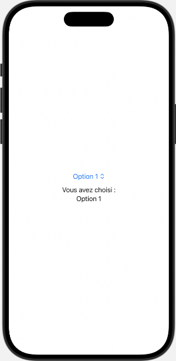
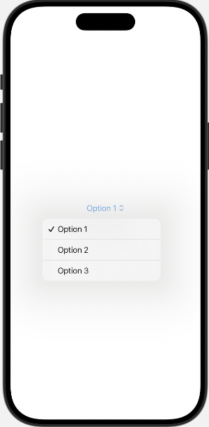
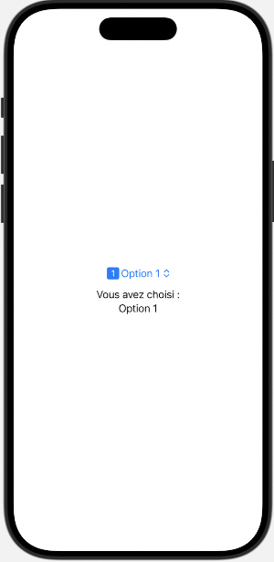
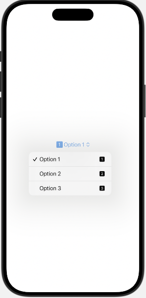

# Picker

Dans cette fiche :

- [Picker](choisir-une-option.md)
  - [Picker avec un tableau de String](choisir-une-option.md)
  - [Picker avec instances d'une structure ou d'une classe](choisir-une-option.md)
  - [Picker avec une énumération](choisir-une-option.md)
- [Utilisation d'une valeur optionnelle](choisir-une-option.md)
- [Picker dans un menu](choisir-une-option.md)

## Picker

La structure [Picker](https://developer.apple.com/documentation/swiftui/picker) permet de lister des options et d'identifier celle qui est présentement sélectionnée.

Le Picker pourra être utilisé dans différents contextes, par exemple un formulaire ou un menu.

Les options d'un Picker sont mutuellement exclusives, comme c'est le cas avec des boutons radio.

### Picker avec un tableau de String

Quand on travaille avec un tableau de String, le Picker retiendra directement la chaîne sélectionnée.

Il faut déclarer une variable d'état pour retenir cette valeur.

```swift title="SwiftUI"
struct ContentView: View {
  let options: [String] = [
    "Option 1",
    "Option 2",
    "Option 3"
  ]

  @State private var optionChoisie: String   // On aurait pu l'initialiser directement à "Option 1".
                                             // Le code est plus intéressanat si on l'initialise à la première valeur du tableau.
                                             // Comme il est trop tôt pour référer au tableau ici,
                                             // il faut passer par le constructeur.

  init() {
    optionChoisie = options[0]
  }

  var body: some View {
    VStack {
      Picker("Choisissez une option", selection: $optionChoisie) {
        ForEach(options, id: \.self) { option in
          Text(option)
        }
      }

      Text("Vous avez choisi :")
      Text(optionChoisie)
    }
    .padding()
  }
}
```

 

### Picker avec instances d'une structure ou d'une classe

Il est possible de travailler avec un tableau dont chaque élément est une instance d'une structure ou d'une classe qui répond au protocole [Identifiable](https://developer.apple.com/documentation/swift/identifiable).

```swift title="Swift"
struct Option: Identifiable {
    var id: Int = 0
    var texte: String = ""
    var icone: String = ""
}
```

À ce moment, le Picker retiendra **l'identifiant** de l'option sélectionnée.

```swift title="SwiftUI"
Struct ContentView: View {
    let options: [Option] = [
        Option(id: 1, texte: "Option 1", icone: "1.square.fill"),
        Option(id: 2, texte: "Option 2", icone: "2.square.fill"),
        Option(id: 3, texte: "Option 3", icone: "3.square.fill")
    ]

    @State private var idOptionChoisie: Int = 1

    var body: some View {
        VStack {
            Picker("Choisissez une option", selection: $idOptionChoisie) {
                ForEach(options) { option in
                    Label(option.texte, systemImage: option.icone)
                }
            }
            Text("Vous avez choisi :")
            if let option = options.first(where: { $0.id == idOptionChoisie }) {
              Text(option.texte)
            }
            else {
              Text("Option invalide")
            }
        }
    }
}
```

 

### Picker avec une énumération

Voyons maintenant comment travailler avec une [énumération](le-langage-swift-reference.md#les-enumerations).

L'énumération doit répondre au protocole [CaseIterable](https://developer.apple.com/documentation/swift/caseiterable).

```swift title="SwiftUI"
enum Option: String, CaseIterable {
  case option1 = "Option 1"
  case option2 = "Option 2"
  case option3 = "Option 3"
}
```

Cette fois, le Picker retiendra une référence au cas sélectionné dans l'énumération.

```swift title="SwiftUI"
struct ContentView: View {
  @State private var optionChoisie: Option = .option1

  var body: some View {
    VStack {
      Picker("Choisissez une option", selection: $optionChoisie) {
        ForEach(Option.allCases, id: \.self) { option in
          Text(option.rawValue)
        }
      }

      Text("Vous avez choisi :")
      Text(optionChoisie.rawValue)
    }
    .padding()
  }
}
```

## Utilisation d'une valeur optionnelle

Si le picker est associé à une variable qui peut prendre la valeur nil et que vous ne prenez pas les précautions nécessaires, vous obtiendrez le message « Picker: the selection "nil" is invalid and does not have an associated tag, this will give undefined results. ».

Pour régler ce problème, il faut utiliser [.tag() dans Picker](https://developer.apple.com/documentation/swiftui/picker) pour préciser :

- la valeur de l'option, soit celle qui sera assignée à la variable du Picker qui recueille l'option choisie (ici : valeurChoisie)
- le type de l'option, qui doit correspondre au type de la variable qui recueille l'option choisie.

```swift title="SwiftUI"
struct ContentView: View {
  let valeurs = ["A", "B", "C"]
  @State private var valeurChoisie: String?

  var body: some View {
    ...
    Picker("", selection: $valeurChoisie) {
      ForEach(valeurs, id: \.self) { valeur in
        Text(valeur).tag(valeur as String?)
      }
    }
  }
}
```

Si vous désirez permettre la sélection de la valeur nil, il faut procéder comme suit :

```swift title="SwiftUI"
struct ContentView: View {
  let valeurs = ["A", "B", "C"]
  @State private var valeurChoisie: String?

  var body: some View {
    ...
    Picker("", selection: $valeurChoisie) {
      Text("Aucune valeur").tag(nil as String?)
      ForEach(valeurs, id: \.self) { valeur in
        Text(valeur).tag(valeur as String?)
      }
    }
  }
}
```

## Picker dans un menu

Si vous désirez créer un menu avec un crochet devant l'option sélectionnée, vous pouvez placer un picker dans le menu. [Les détails sont ici](le-menu.md).
