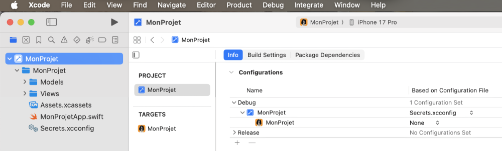
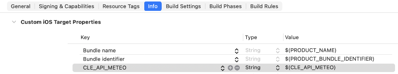
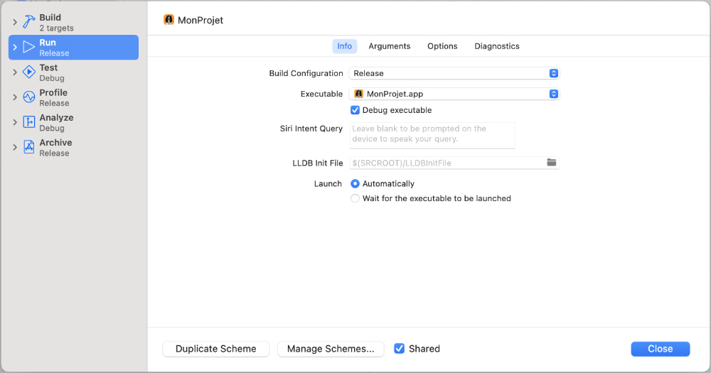

# Configurations et clés d'API

## Configurations dans une énumération

Dans tout type d'application, c'est une bonne pratique de centraliser les configurations de base.

Par exemple, une application pourrait avoir besoin de coder en dur l'URL de base d'un API, la version minimale d'une bibliothèque, des valeurs par défaut, le nombre de produits affiché par par page, etc.

Avec SwiftUI, l'utilisation d'une énumération placée dans son propre fichier permet de centraliser toutes les configurations au même endroit.

Plusieurs développeurs aiment nommer ce fichier `AppConfig.swift` et le placer directement à la racine du projet.

```swift title="Fichier AppConfig.swift"
enum AppConfig {
  static let urlApi = "https://urlapi.com"
  static let versionMinimale = 3.2

  static let icones: [String: String] = [
    "01d": "soleil",
    "02d": "soleil-nuages",
    "03d": "nuages",
    "09d": "pluie",
  ]
}
```

Pour utliser une configuration :

```swift title="SwiftUI"
let url = URL(string: AppConfig.urlApi)
```

Attention : cette technique ne doit pas servir pour stocker des informations sensibles.

La technique pour cela est expliquée dans la fiche « [Stocker une clé d'API de façon sécurisée pendant le développement](configurations-et-cles-d-api.md#stocker-une-cle-dapi-de-facon-securisee-pendant-le-developpement) ».

## Stocker une clé d'API de façon sécurisée pendant le développement

Lorsqu'une application utilise des données sensibles, par exemple une clé d'API, il faut stocker ces informations de façon sécurisée. En effet, puisque tout le contenu d'un fichier .app peut être facilement exploré, il ne faut jamais qu'une information sensible y soit inscrite directement.

Pendant la phase de développement, les fichiers de configuration Xcode sont tout à fait indiqués pour cette tâche.

L'astuce consiste à inscrire la clé d'API dans un fichier de configuration qui sera lié à l'application en phase de développement **mais pas en phase de production**.

La technique pour sécuriser une clé d'API en production est tout à fait différente. Les détails sont exposés dans la fiche « [Stocker une clé d'API de façon sécurisée pour la production](configurations-et-cles-d-api.md#stocker-une-cle-dapi-de-facon-securisee-pour-la-production) ».

Pour l'instant, concentrons-nous sur la phase de développement.

Dans cette fiche :

- [Création du fichier de configuration](configurations-et-cles-d-api.md#stocker-une-cle-dapi-de-facon-securisee-pendant-le-developpement)
- [Lier le fichier de configuration](configurations-et-cles-d-api.md#stocker-une-cle-dapi-de-facon-securisee-pendant-le-developpement)
- [Ajout d'une entrée dans info.plist](configurations-et-cles-d-api.md#stocker-une-cle-dapi-de-facon-securisee-pendant-le-developpement)
- [Extraction des informations](configurations-et-cles-d-api.md#stocker-une-cle-dapi-de-facon-securisee-pendant-le-developpement)
- [Utilisation de la donnée retrouvée](configurations-et-cles-d-api.md#stocker-une-cle-dapi-de-facon-securisee-pendant-le-developpement)

### Création du fichier de configuration

Pour créer le fichier de configuration :

- Dans votre projet Xcode, rendez-vous dans **File** / **New** / **File from Template**.
- Défilez jusqu'à la section **Other**.
- Sélectionnez **Configuration Settings File**.
- Puisque le fichier contiendra des informations sensibles, j'ai choisi de nommer ce fichier `Secrets.xcconfig`.

Il est important d'ajouter le fichier de configuration dans le fichier `.gitignore` car les informations sensibles ne doivent pas être soumises à Git.

Dans le fichier de configuration, il suffit de créer des paires `cle = valeur`.

Remarquez que dans l'en-tête du fichier, Xcode a pris soin d'indiquer dans un commentaire un URL vers la documentation de ce type de fichier.

```text title="Fichier secrets.xcconfig"
// Configuration settings file format documentation can be found at:
// https://developer.apple.com/documentation/xcode/adding-a-build-configuration-file-to-your-project

CLE_API_METEO = 2fa6caa92319.....8efa130d78d59B0
```

### Lier le fichier de configuration

Le projet peut [utiliser différents fichiers de configuration pour le développement et pour la production](https://developer.apple.com/documentation/xcode/adding-a-build-configuration-file-to-your-project#Map-build-settings-to-a-build-configuration). C'est pour cette raison que le fichier de configuration est intéressant : il est facile de configurer l'application pour ne pas l'utiliser en production.

Pour permettre l'utilisation du fichier de configuration pendant le développement seulement :

- Dans le navigateur de projet, cliquez sur le nom du projet.
- Sélectionnez votre cible dans la section centrale **PROJECT**.
- Rendez-vous dans l'onglet **Info**.
- Dans la zone **Configurations**, cliquez sur le chevron (>) vis-à-vis **Debug**.
- Il est possible d'utiliser des configurations au niveau du projet (le premier `MonProjet` visible) et au niveau de la cible (**target**), c'est-à-dire le `MonProjet` imbriqué.

  Dans notre cas, il est suffisant de lier le fichier de configuration au niveau du projet.

  Important : IL NE FAUT PAS sélectionner le fichier de configuration dans la section **Release**.



### Ajout d'une entrée dans info.plist

Les fichiers .xcconfig ne sont utilisés que pour la compilation. Le code de l'application ne peut pas lire directement les informations qui y sont entrées.

Pour rendre notre clé disponible, il faut faire un [ajout dans info.plist](info-plist.md#ajouter-une-paire-cle-valeur-dans-infoplist).

- Dans le navigateur de projet de Xcode, cliquez sur le nom du projet.
- Sélectionnez votre cible dans la section centrale **TARGET**.
- Rendez-vous dans l'onglet **Info**.
- Dans la section **Custum iOS Target Properties**, pointez la souris vis-à-vis n'importe quelle clé puis cliquez sur +.
- Donnez un nom à la clé, par exemple `CLE_API_METEO`. Cette clé doit être de type String. Sa valeur sera constituée d'un signe $ avec, entre parenthèses, le nom de la clé à retrouver dans le fichier de configuration, par exemple `$(CLE_API_METEO)`.

  

### Extraction des informations

Pour extraire des données de ce fichier, nous allons ajouter une propriété dans le fichier [AppConfig.swift](configurations-et-cles-d-api.md#configurations-dans-une-enumeration) qui contient les différentes configurations de l'application.

Si vous n'avez pas déjà créé un tel fichier, ajoutez-le maintenant.

L'extraction de la donnée sensible se fera comme suit :

```swift title="Fichier AppConfig.swift"
enum AppConfig {
  static let uneCle = "une valeur"
  static var cleApiMeteo: String {
    Bundle.main.infoDictionary?["CLE_API_METEO"] as? String ?? ""
  }
}
```

Au besoin, une propriété calculée permettra de mieux réagir en cas de problème :

```swift title="Fichier AppConfig.swift"
enum AppConfig {
  static let uneCle = "une valeur"
  static var cleApiMeteo: String {
    guard let cle = Bundle.main.infoDictionary?["CLE_API_METEO"] as? String else {
      // on pourrait faire autre chose ici
      return ""
    }
    return cle
  }
}
```

### Utilisation de la donnée retrouvée

 Il est maintenant possible de retrouver l'information comme suit :

```swift title="SwiftUI"
let cle = AppConfig.cleApiMeteo
```

### Pour plus d'information

« Youtube@NoahDoesCoding97 ». SwiftUI API Key Management (2025): Secure Your App's Keys [Best Practices Guide]. <https://www.youtube.com/watch?v=6DWCZpL7fBE>

## Stocker une clé d'API de façon sécurisée pour la production

Lorsqu'une application SwiftUI est déployée en production, il est important que son code ne contienne pas d'information sensible, par exemple une clé d'API. Ceci ouvrirait un trou de sécurité puisqu'il est possible d'explorer le fichier .app et ainsi avoir accès à cette clé.

Il y a une autre raison de ne pas stocker une clé d'API dans le .app : ceci obligerait à déployer une mise à jour de l'application si la clé devait être modifiée.

Une technique intéressante pour contourner ce problème consiste à coder un service Web qui servira d'intermédiaire entre l'application et le service Web qui nécessite la clé d'API.

L'application appellera ce service Web et ce dernier, qui contient la clé d'API, pourra appeler l'autre service.

De cette façon, la clé d'API ne sera jamais exposée au client.

Cette méthode comporte des limites : puisque l'URL du service intermédiaire est stocké dans le .app, un utilisateur pourrait retrouver cet URL et l'utiliser pour accéder au service avec API.

Afin de limiter les risques, il est possible de restreindre le nombre d'appels réalisés dans un laps de temps donné. Ceci rend les tentatives de vol moins intéressantes pour les utilisateurs malveillants.

Voici un exemple de service Web intermédiaire.

Les informations sensibles seront stockées dans un fichier en dehors de la racine Web.

```php title="Fichier /safe-config/serviceintermediaire-config.inc (safe-config doit être hors de la racine Web)"
<?php
  return [
    'cleApi' => '2fa6caa92319.....8efa130d78d59B0',
];
```

Le code du service Web ressemblera à ceci :

```php title="Fichier serviceintermediaire/index.php"
$ip = $_SERVER['REMOTE_ADDR'];
$maxRequetes = 10;
$periodeSecondes = 60;

// fonction à coder pour vérifier si cette adresse IP dépasse le nombre de requêtes permises
if (!verifierRateLimit($ip, $maxRequetes, $periodeSecondes)) {
    http_response_code(429);   // Too Many Requests
    echo json_encode(['erreur' => 'Trop de requêtes. Réessayez plus tard.', JSON_PRETTY_PRINT | JSON_UNESCAPED_UNICODE | JSON_UNESCAPED_SLASHES]);
    exit;
}

$dossierRacine = dirname(__FILE__, 2); // ajuster selon le niveau de hiérarchie du fichier actuel
$config = require "$dossierRacine/safe-config/serviceintermediaire-config.inc";
$urlService = "https://le-service-web.com/api={$config['cleApi']}";
$payload = ... ;  // si le service avec API attend des données d'entrée dans le body de la requête HTTP

// appel de l'API à l'aide de curl
$ch = curl_init($urlService);   // curl handle

curl_setopt_array($ch, [
    CURLOPT_RETURNTRANSFER => true,
    CURLOPT_POST => true,
    CURLOPT_POSTFIELDS => $payload,
    CURLOPT_HTTPHEADER => [
        'Content-Type: application/json',
    ],
]);

$response = curl_exec($ch);
$status = curl_getinfo($ch, CURLINFO_HTTP_CODE);
curl_close($ch);

http_response_code($status);   // le code d'état HTTP du service avec API sera transmis au .app
echo $response;   // la réponse du service avec API sera transmise au .app
```

Dans l'application SwiftUI, le fichier de configuration pointera vers un URL différent lorsque l'application est compilée pour la production.

```text title="Fichier AppConfig.swift"
enum AppConfig {
  static var cleApi: String {
    Bundle.main.infoDictionary?["CLE_API"] as? String ?? ""
  }

  static let latitude = 46.06006562773594
  static let longitude = -71.94396914603335

  static var urlServiceWeb: String {
    #if DEBUG
      return "https://...?lat=\(latitude)&lon=\(longitude)&lang=fr&units=metric&appid=\(cleApi)"
    #else
      return "https://serviceintermediaire.com?lat=\(latitude)&lon=\(longitude)"
    #endif
  }
   ...
}
```

L'application pourra retrouver le bon URL comme suit :

```swift title="SwiftUI"
guard let url = URL(string: AppConfig.urlServiceWeb) else {
  throw URLError(.badURL)
 }
```

## Compiler l'application pour la production

Xcode permet de compiler une application en mode développement (**Debug**) ou en mode production (**Release**).

Pour compiler l'application pour la production :

- Dans Xcode, rendez-vous dans **Product** / **Scheme** / **Edit Scheme**.
- Dans la zone de gauche, cliquez sur **Run**.
- Choisissez l'onglet **Info**.
- Dans la zone **Build Configuration**, choisissez **Release**.



Après avoir lancé la compilation en cliquant sur le bouton Play, le fichier .app à déployer peut être retrouvé dans le menu **Product** / **Show Build Folder in Finder**.

Son chemin complet sera sous la forme `/Users/monnom/Library/Developer/Xcode/DerivedData/MonProjet-dsasphlsfyjrssglslplkxhspxis/Build/Products/Release-iphoneos/MonProjet.app`.
