## Color

La structure [Color](https://developer.apple.com/documentation/swiftui/color) permet de représenter une couleur.

!!! warning "Attention" 
    Ne codez pas en dur les couleurs dans votre code. Ceci rend plus difficile la gestion des modes Apparence Claire vs Apparence Sombre.

### Couleurs prédéfinies

La structure Color propose des propriétés de classe pour définir des couleurs standard :

- Color.black
- Color.blue
- Color.gray
- Color.green
- Color.orange
- Color.pink
- Color.purple
- Color.red
- Color.white
- Color.yellow

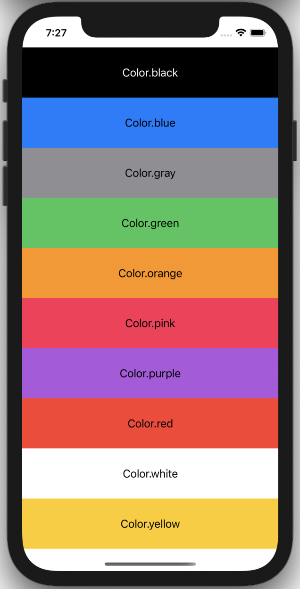

??? Code   
    ```swift title="views/UneCouleur.swift"  
    import SwiftUI

    struct UneCouleur: View {
        var fg: Color;
        var bg: Color;
        var body: some View {
            Text("Color." + bg.description)
                .frame(maxWidth: .infinity, minHeight: 80)
                .foregroundStyle(fg)
                .background {
                    Rectangle()
                        .fill(bg)
                }
        }
    }
    ```   
    
    ```swift title="ContentView.swift"  
    import SwiftUI

    struct Couleur: Identifiable {
        var id: UUID = UUID()
        var fg: Color
        var bg: Color
    }

    var couleurs = [
        Couleur(fg: Color.white, bg: Color.black),
        Couleur(fg: Color.black, bg: Color.blue),
        Couleur(fg: Color.black, bg: Color.green),
        Couleur(fg: Color.black, bg: Color.orange),
        Couleur(fg: Color.black, bg: Color.pink),
        Couleur(fg: Color.black, bg: Color.purple),
        Couleur(fg: Color.black, bg: Color.red),
        Couleur(fg: Color.black, bg: Color.white),
        Couleur(fg: Color.black, bg: Color.yellow),
            ]

    struct ContentView: View {
        var body: some View {
            VStack(spacing: 0) {
                ForEach(couleurs) { c in
                    UneCouleur(fg:c.fg, bg:c.bg)}
            }
        }
    }
    ```


Les couleurs peuvent être utilisées dans des méthodes qui attendent en paramètre une structure Color.

```swift title="SwiftUI"
Text("Texte rouge")
  .foregroundColor(.red)
```

### Rôles ou statuts

La structure Color propose également des propriétés de classe pour choisir une couleur par son statut ou son rôle plutôt que par son nom :

- [Color.accentColor](https://developer.apple.com/documentation/swiftui/color/accentcolor) (par défaut : bleu)
- [Color.clear](https://developer.apple.com/documentation/swiftui/color/clear) (blanc en mode Apparence Claire ou noir en mode Apparence Sombre)
- [Color.primary](https://developer.apple.com/documentation/swiftui/color/primary) (noir en mode Apparence Claire ou blanc en mode Apparence Sombre)
- [Color.secondary](https://developer.apple.com/documentation/swiftui/color/secondary) (noir avec transparence en mode Apparence Claire ou blanc avec transparence en mode Apparence Sombre))

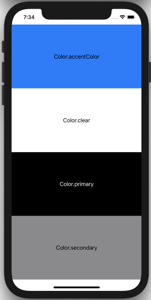


??? Code   
    ```swift title="views/UneCouleur.swift"  
    struct UneCouleur: View {
        var fg: Color;
        var bg: Color;
        private var desc: String {
            let result = bg.description.prefix(1).lowercased() + bg.description.dropFirst()
            return result.description.replacingOccurrences(of: "Provider()", with: "")
            
        }
        var body: some View {
            Text("Color." + desc)
                .frame(maxWidth: .infinity, minHeight: 175)
                .foregroundStyle(fg)
                .background {
                    Rectangle()
                        .fill(bg)
                }
        }
    }
    ```   
    
    ```swift title="ContentView.swift"  
    import SwiftUI

    struct Couleur: Identifiable {
        var id: UUID = UUID()
        var fg: Color
        var bg: Color
    }

    var couleurs = [
        Couleur(fg: Color.white, bg: Color.accentColor),
        Couleur(fg: Color.black, bg: Color.clear),
        Couleur(fg: Color.white, bg: Color.primary),
        Couleur(fg: Color.black, bg: Color.secondary),
            ]

    struct ContentView: View {
        var body: some View {
            VStack(spacing: 0) {
                ForEach(couleurs) { c in
                    UneCouleur(fg:c.fg, bg:c.bg)}
            }
        }
    }

    ```


## Mode Apparence Claire vs mode Apparence Sombre

Le propriétaire d'un iPhone peut choisir d'afficher les applications en mode Apparence Claire, en mode Apparence Sombre  ou en mode automatique.

Puisque c'est l'utilisateur qui contrôle le mode d'affichage, l'application que vous développez doit pouvoir fonctionner dans les deux modes.

### Coder en fonction des deux modes

Vous devez toujours avoir les deux modes en tête quand vous codez.

#### Problème des couleurs codées en dur

Prenons le cas suivant : le développer a choisi de coder en dur les couleurs à utiliser.

S'il a spécifié que la couleur doit être noir et que le fond devient noir lors du changement de mode, le texte ne sera plus visible.

```swift title="SwiftUI"
Text("Hello, world!")
  .foregroundColor(Color.black)
```

Pour voir le résultat de ce code en mode clair et en mode sombre, cliquez sur l'icône **Variants** (en forme de damier) au bas de la zone du canevas puis choisissez **Color Scheme Variants**.

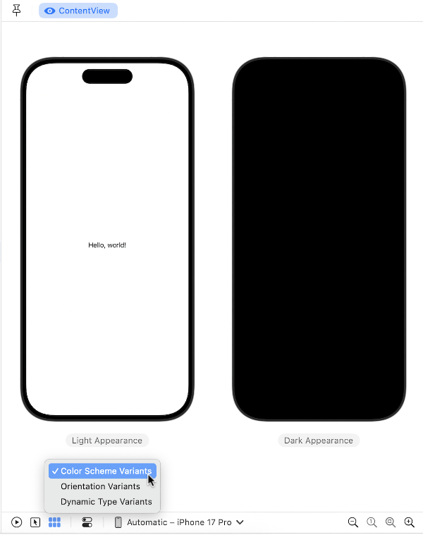

#### Ajustement automatique des couleurs

Il faut privilégier l'utilisation des [propriétés de classe](../complements/quelques-vues-swiftui.md#color)   `.primary`, `.secondary`, etc. pour identifier les couleurs.

Il est également intéressant de définir nos propres couleurs personnalisées en mode clair et en mode sombre.

Dans l'exemple qui suit, la couleur `messageBienvenue` est différente selon que l'écran est sombre ou clair.

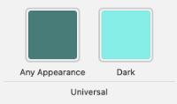

```swift title="SwiftUI"
Text("Hello, world!")
  .foregroundColor(Color.messageBienvenue)
```

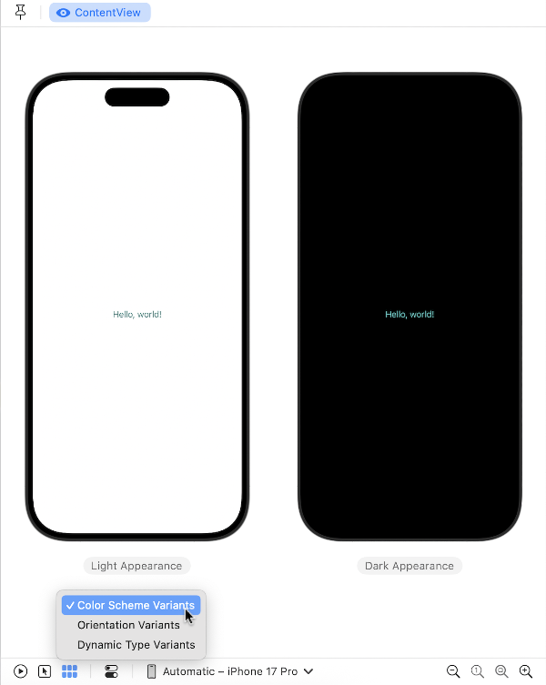

#### Ajuster la couleur selon le mode

Dans certains contextes, il peut être judicieux de choisir nous-mêmes la couleur selon le mode.

```swift title="SwiftUI"
struct ContentView: View {
  @Environment(\.colorScheme) var colorScheme

  var body: some View {
    ...
    ZStack {
      Rectangle()
        .fill(Color.primary)
      Text("Hello, world!")
        .foregroundColor(colorScheme == .light ? .white : .black)
        .padding()
    }
    ...
  }
}
```

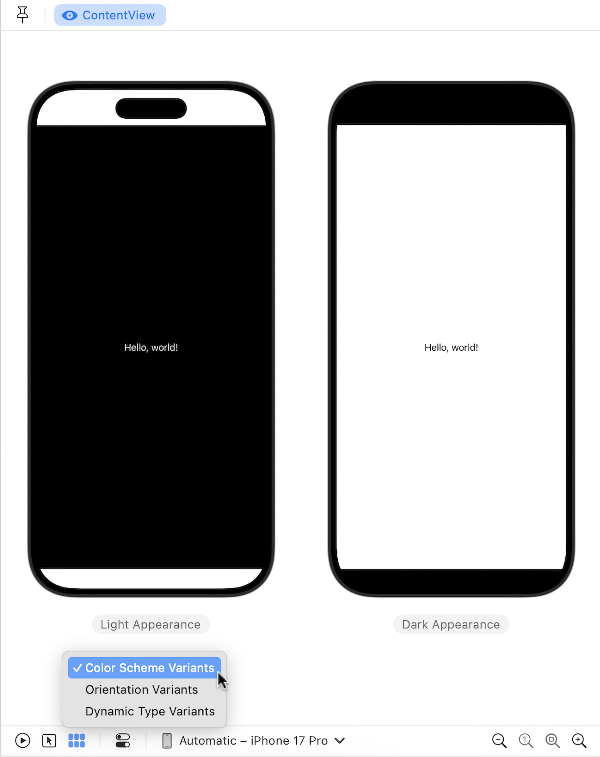

### Tester les deux modes

Pour éviter les mauvaises surprises quand l'usager passe d'un mode à l'autre, il faut tester l'application dans les deux modes.

#### Configuration dans le simulateur

Pour tester le tout dans le simulateur de Xcode, lancez le simulateur puis rendez-vous dans **Réglages** / **Dévelopeur** puis cochez **Appearence sombre**.

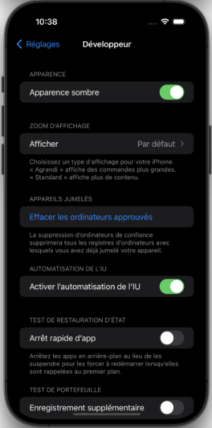

#### Configuration sur iPhone

1. **Réglages**   
2. **Affichage et luminosité**   
3. Cochez **Claire** ou **Sombre**.  

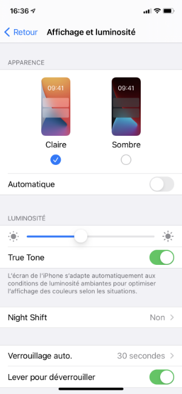

## Configurer la couleur d'accent

La couleur d'accent d'une application peut être modifiée.

Pour la configurer, cliquez sur `Assets.xcassets` dans la zone de gauche.

Dans la zone centrale, cliquez sur `AccentColor`.

Juste à sa droite, un carré vous permet de choisir la couleur qui correspondra à AccentColor.

Cliquez sur ce carré et définissez ses paramètres dans l'éditeur de propriétés à droite.

!!! note "Note"  
    Si l'éditeur de propriétés n'apparaît pas, cliquez sur l'icône **Hide or show the Inspectors** dans le coin supérieur droit de l'écran. 
    
    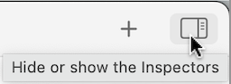

Au besoin, cliquez sur **Show Color Panel** afin de sélectionner la couleur dans une roue de couleurs.

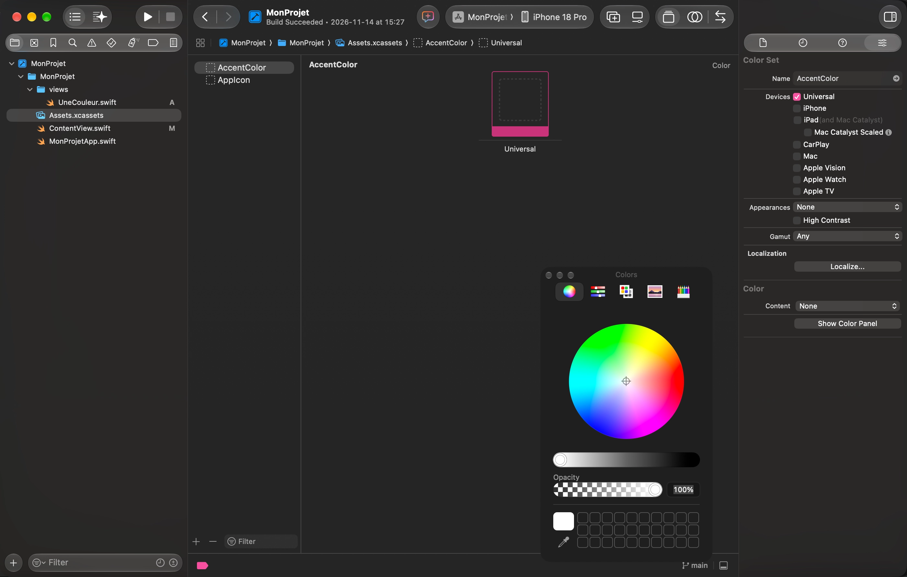

Par défaut, il n'y a qu'une couleur d'accent. Il est possible de définir une couleur différente pour le mode sombre ou pour le mode clair à l'aide de la liste déroulante <kbd>Appearances</kbd>.

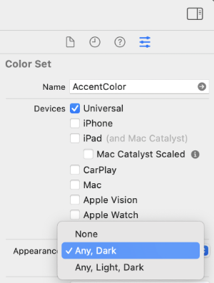

Sans rien changer à votre code, les vue qui utilisent `Color.accentColor` seront désormais de la nouvelle couleur.

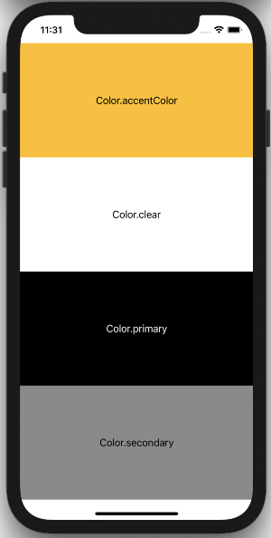

## Pâlir une couleur

A l'aide de [l'opacité](../complements/quelques-modifieurs.md#modifieur-opacity), il est possible d'obtenir une couleur plus pâle en mode Clair ou plus foncée en mode Sombre.

```swift title="SwiftUI"
struct ContentView: View {

  var body: some View {
    ZStack {
      Rectangle()
        .fill(.blue)
        .opacity(0.5)
      Text("Color.blue, opacity 0.5")
        .foregroundColor(.primary)
        .padding()
    }
    ...
  }
}
```

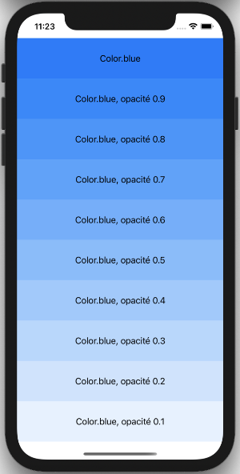


??? Code   
    ```swift title="views/UneCouleur.swift"  
    import SwiftUI

    struct UneCouleur: View {
        var fg: Color
        var bg: Color
        var opacite: Double
        private var desc: String {
            let result = bg.description.prefix(1).lowercased() + bg.description.dropFirst()
            return result.description.replacingOccurrences(of: "Provider()", with: "") + " opacité " + String(opacite)
            
        }
        var body: some View {
            Text("Color." + desc)
                .frame(maxWidth: .infinity, minHeight: 80)
                .foregroundStyle(fg)
                .background {
                    Rectangle()
                        .fill(bg)
                        .opacity(opacite)
                }
        }
    }
    ```   
    
    ```swift title="ContentView.swift"  
    import SwiftUI

    struct Couleur: Identifiable {
        var id: UUID = UUID()
        var fg: Color
        var bg: Color
        var opacite: Double
    }

    var couleurs = [
        Couleur(fg: Color.primary, bg: Color.blue, opacite: 1),
        Couleur(fg: Color.primary, bg: Color.blue, opacite: 0.9),
        Couleur(fg: Color.primary, bg: Color.blue, opacite: 0.8),
        Couleur(fg: Color.primary, bg: Color.blue, opacite: 0.7),
        Couleur(fg: Color.primary, bg: Color.blue, opacite: 0.6),
        Couleur(fg: Color.primary, bg: Color.blue, opacite: 0.5),
        Couleur(fg: Color.primary, bg: Color.blue, opacite: 0.4),
        Couleur(fg: Color.primary, bg: Color.blue, opacite: 0.3),
        Couleur(fg: Color.primary, bg: Color.blue, opacite: 0.2),
        Couleur(fg: Color.primary, bg: Color.blue, opacite: 0.1),
            ]

    struct ContentView: View {
        var body: some View {
            VStack(spacing: 0) {
                ForEach(couleurs) { c in
                    UneCouleur(fg:c.fg, bg:c.bg, opacite: c.opacite)}
            }
        }
    }

    ```


ou, en mode Sombre :

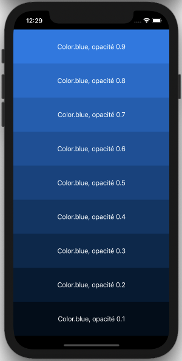


## Couleurs RGB

Vous avez la possibilité de spécifier la couleur de votre choix à l'aide de codes RGB. Mais attention : cette couleur ne s'ajustera jamais au mode Sombre ou Clair. Assurez-vous de bien tester votre application dans ces deux modes.

Si vous choisissez tout de même de poursuivre avec cette technique, vous devez spécifier un nombre situé entre 0 et 1 pour indiquer le pourcentage de rouge, de vert puis de bleu.

Par exemple, pour obtenir du brun à l'aide du code RGB 137 68 18, vous devrez diviser chaque nombre par 255 et les utiliser dans le constructeur de Color :

```swift title="SwiftUI"
Circle()
  .fill(Color(red: 0.54, green: 0.27, blue: 0.07))
```

## Définir vos propres couleurs personnalisées

Dans une application SwiftUI, vous pouvez définir vos propres couleurs personnalisées. Ceci facilitera la maintenance du code en plus de permettre de spécifier la nuance de couleur à utiliser en mode clair et en mode sombre.

Pour créer une couleur personnalisée, cliquez sur le + au bas de la zone centrale qui liste les ressources du projet puis sélectionnez **Color Set**.

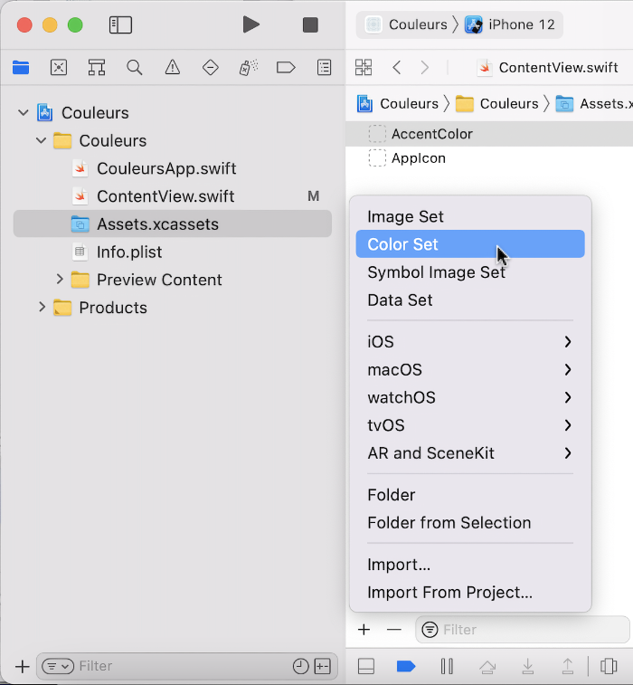

Donnez un nom à la nouvelle couleur.

Le nom doit être sémantique, c'est-à-dire qu'il identifie le contexte plutôt que la couleur (ex : `sousTitre` plutôt que `grisPale`).

Il n'y a pas de norme officielle pour nommer les couleurs personnalisées mais les bonnes pratiques recommandent d'utiliser la casse Pascal, c'est-à-dire un nom qui débute par une majuscule, avec une majuscule au début de chaque mot suivant.

Spécifiez ensuite la couleur à utiliser à l'aide de l'éditeur de propriétés. Il faut spécifier une couleur pour chacun des modes présentés.

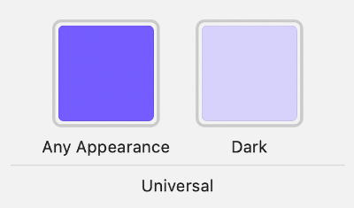

Et pour utiliser cette couleur, deux syntaxes sont possibles.

Avec cette première option, le nom doit débuter par une minuscule même s'il a été défini en casse Pascal.

Ceci est dû à une génération automatique d'un membre statique basé sur le nom de la couleur. Ce membre est toujours en casse chameau (débute par une minuscule et majuscule au début de chaque mot suivant).

```swift title="SwiftUI"
Text("Hello, world!")
 .foregroundColor(Color.sousTitre)
```

Avec cette deuxième option, le nom doit respecter la casse utilisée lors de la création de la couleur personnalisée.

```swift title="SwiftUI"
Text("Mon sous-titre")
  .foregroundColor(Color("SousTitre"))
```

## Modifier la couleur d'une image par programmation

SwiftUI permet de modifier les couleurs d'une image par programmation grâce à différentes méthodes qui permettent de jouer sur les profils colorimétriques d'une image, par exemple :

- .renderingMode() (pour remplir complètement une image à l'aide d'une couleur)
- [.brightness()](https://developer.apple.com/documentation/swiftui/view/brightness(_:))
- [.saturation()](https://developer.apple.com/documentation/swiftui/view/saturation(_:))
- [.contrast()](https://developer.apple.com/documentation/swiftui/view/contrast(_:))
- [.opacity()](https://developer.apple.com/documentation/swiftui/view/opacity(_:))
- [.colorMultiply()](https://developer.apple.com/documentation/swiftui/view/colormultiply(_:))
- [.hueRotation()](https://developer.apple.com/documentation/swiftui/view/huerotation(_:))
- [.colorInvert()](https://developer.apple.com/documentation/swiftui/view/colorinvert())

Voici quelques exemples visuels.

Dans la première impression d'écran, l'image du haut est l'originale et les autres ont été ajustées par programmation. Dans les suivantes, l'image de gauche est l'originale et celle de droite a été ajustée.

```swift title="SwiftUI"
struct ContentView: View {
    var body: some View {
        VStack {
            Image("roger")
                .resizable()
                .scaledToFit()
            HStack(spacing: 0) {
                VStack {
                    Text(".renderingMode")
                    Image("roger")
                        .renderingMode(.template)
                        .resizable()
                        .scaledToFit()
                        .foregroundColor(.blue)
                }
                VStack {
                    Text(".brightness")
                    Image("roger")
                        .resizable()
                        .scaledToFit()
                        .brightness(0.2)
                }
            }
            HStack(spacing: 0) {
                VStack {
                    Text(".saturation")
                    Image("roger")
                        .resizable()
                        .scaledToFit()
                        .saturation(1.5)
                }
                VStack {
                    Text(".contrast")
                    Image("roger")
                        .resizable()
                        .scaledToFit()
                        .contrast(1.9)
                }
            }
        }
    }
}
```

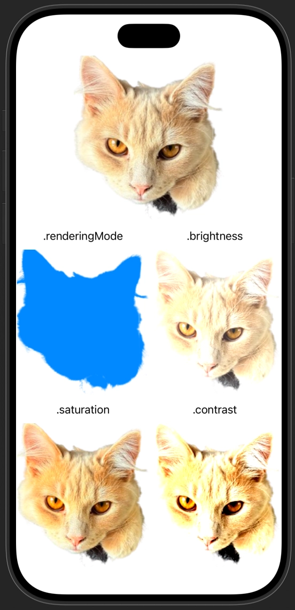

 Si vous travaillez avec une image dont les traits principaux sont en noir, voici une astuce pour transformer les traits noirs dans la couleur de votre choix.

```swift title="SwiftUI"
HStack {
  Image("oiseau")
    .resizable()
    .scaledToFit()
  Image("oiseau")
    .resizable()
    .scaledToFit()
    .colorInvert()   // colorMultiply n’a aucun effet sur le noir. En inversant les couleurs, le fond devient noir (et reste donc inchangé), tandis que les traits, devenus blancs, seront affectés par le filtre
    .colorMultiply(Color(red: 0, green: 1, blue: 1))   // laisser à 0 la couleur désirée au final car tout sera inversé
    .colorInvert()   // le noir redevient blanc et les traits prennent la couleur qui était à 0
}
```


Si vous avez en main une image colorée (clipart ou photo), il est possible d'utiliser `.hueRotation()` pour décaler toutes les couleurs de l'image le long du cercle chromatique.

```swift title="SwiftUI"
HStack {
  Image("ballon_plage")
    .resizable()
    .scaledToFit()
  Image("ballon_plage")
    .resizable()
    .scaledToFit()
    .hueRotation(.degrees(150))   // tester différentes valeurs jusqu'à l'obtention du rendu désiré
 }
```

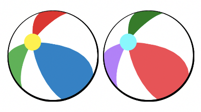
