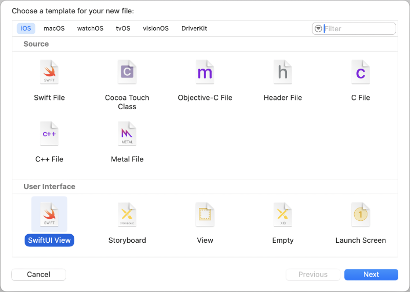
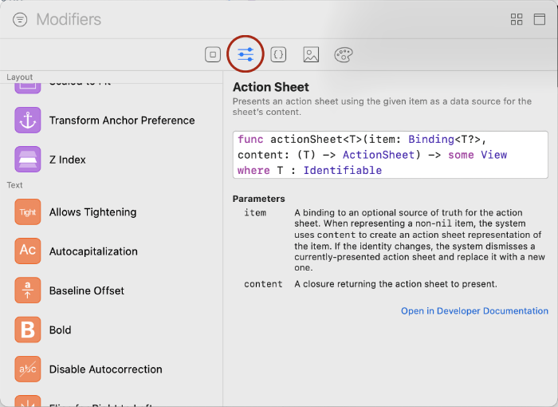
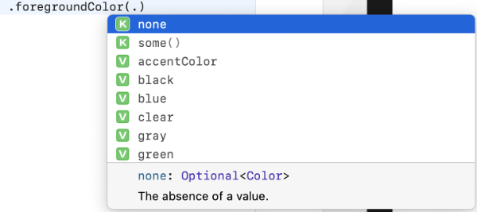
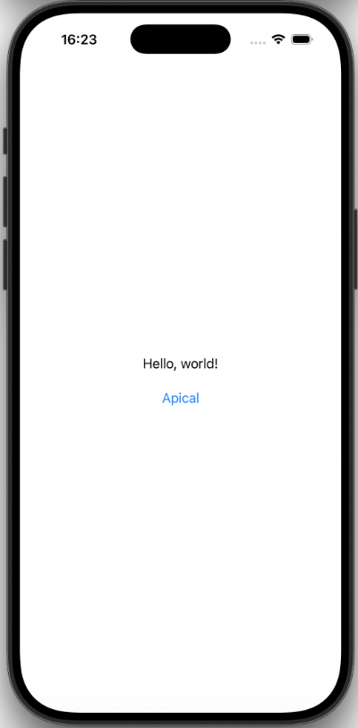
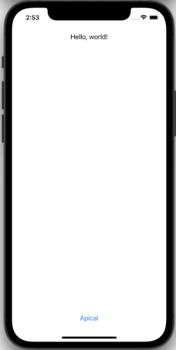
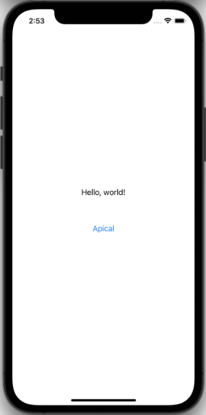
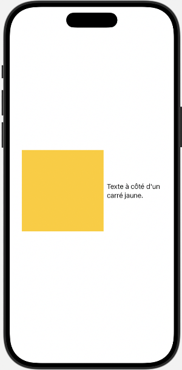

# Principes de développement d'une interface

Apple nous propose quelques grands principes à suivre pendant le développement d'une interface.

Par exemple :

- Il faut s'assurer que l'utilisateur voit tout le contenu important sans avoir à zoomer ni à faire défiler l'écran.
- Il faut utiliser des contrôles conçus pour les écrans tactiles.
- Il faut s'assurer que les éléments cliquables sont suffisamment éloignés des autes éléments pour qu'il soit facile de les atteindre avec un doigt.

## Pour plus d'information

« UI Design Dos and Don’ts ». Apple. <https://developer.apple.com/design/tips/>

# Les vues

Dans SwiftUI, tout ce qui apparaît à l'écran est une vue. En fait, les éléments visuels tels que `Text()` ou `Image()` sont vues puisqu'il s'agit de structures qui répondent au protocole `View`.

Par défaut, lors de la création du projet, une vue a déjà été créée pour vous : `ContentView`. Elle est placée dans le fichier ContentView.swift

```swift title="Fichier ContentView.swift"
struct ContentView: View {
  ...
}
```

Une vue peut définir un écran complet ou encore une petite partie d'écran.

Une vue peut contenir d'autres vues, que ce soient des vues fournies par SwiftUI, par exemple `Text()` ou `Image()`, ou encore des vues que vous aurez créées dans un autre fichier du projet.

Pour ajouter une vue dans un projet SwiftUI :

- Rendez-vous dans le menu **File** / **New** / **File from Template**.
- Cliquez sur **SwiftUI View**.

  

Le nom d'une vue doit respecter **LaCassePascal**.  
De plus, il est d'usage de placer toutes les vues dans un dossier nommé `Views`.

## Pour plus d'information

« View fondamentals ». Apple. <https://developer.apple.com/documentation/swiftui/view-fundamentals>

« Your First iOS and SwiftUI App: An App From Scratch (tutoriel vidéo) ». Ray Wenderlich. <https://www.raywenderlich.com/17493408-your-first-ios-and-swiftui-app-an-app-from-scratch>

# Les modifieurs

Les modifieurs permettent de définir certains aspects de l'apparence d'une vue.

On placera le modifieur juste après le nom de la vue. Il peut être placé sur la même ligne ou encore sur la ligne suivante, décallé d'une tabulation.

```swift title="SwiftUI"
Text("Hello, world!")
  .padding()
```

## Liste des modifieurs

Tous les modifieurs sont disponibles à partir de la bibliothèque d'objets.  
Une fois la fenêtre de la bibliothèque ouverte, cliquez sur le deuxième icône. Les modifieurs apparaîtront dans la colonne de gauche, classés selon la vue à laquelle ils s'appliquent.

Répérez le modifieur désiré puis faites-le glisser dans l'éditeur de code à l'endroit désiré.



## Paramètres, types prédéfinis et types dynamiques

Certains modifieurs attendent des paramètres, d'autres pas.

Lorsqu'un paramètre est attendu, Xcode pourra faire des suggestions à l'aide de sa fonctionnalité d'autocomplétion.

Il y a souvent des valeurs prédéfinies qui peuvent être utilisées. Il s'agit de valeurs définies dans des énumérations. **À chaque fois qu'il est possible d'utiliser une valeur prédéfinie, il est préférable de l'utiliser plutôt que d'entrer un nombre.**

Pour connaître ces valeurs, ouvrez la parenthèse qui suit le modifieur, entrez le point caractéristique pour utiliser une énumération et choisissez parmi les valeurs proposées.



## Types dynamiques

Pour la taille du texte, il est conseillé d'utiliser un type dynamique, c'est-à-dire un mot qui représente une taille qui sera automatiquement ajustée selon le réglage de taille de police choisi par l’usager sur son appareil.

```swift title="SwiftUI"
Text("Hello, world!")
  .font(.body)
```

## Enchaînements

Chaque modifieur retourne une instance d'une vue. Ceci nous permet d'enchaîner plusieurs modifieurs d'affilée.

```swift title="SwiftUI"
Text("Hello, world!")
  .padding()
  .font(.title)
  .foregroundColor(.gray)
  .overlay(
    RoundedRectangle(cornerRadius: 20)
    .stroke(Color.purple, lineWidth: 5)
  )
```

Notez que l'ordre d'apparition des modifieurs peut avoir une influence sur le résultat final.

Par exemple, si on ajoute un padding avant une bordure comme dans l'extrait de code précédent, la bordure sera appliquée sur le texte ET le padding donc elle ne sera pas collée au texte.


Et si on applique le padding après la bordure :

```swift title="SwiftUI"
Text("Hello, world!")
  .font(.title)
  .foregroundColor(.gray)
  .overlay(
    RoundedRectangle(cornerRadius: 20)
    .stroke(Color.purple, lineWidth: 5)
  )
  .padding()
```


## Type entrant et type sortant

Certains modifieurs s'appliquent à tout ce qui répond au protocole `View`.

D'autres ne s'appliquent qu'aux vues d'un type précis, par exemple le modifieur `[bold()](https://developer.apple.com/documentation/swiftui/text/bold())` ne s'applique qu'aux vues de type [`Text`](https://developer.apple.com/documentation/swiftui/text).

Il en va de même pour le type retourné par les modifieurs. Certains retournent une instance d'une structure précise, par exemple **Text**, alors que d'autres retournent une instance du protocole [`View`](https://developer.apple.com/documentation/swiftui/view).

Dans le cas où le modifieur retourne un `View`, il ne pourra être suivi que par des modifieurs qui s'appliquent à n'importe quel `View`. Si vous avez besoin d'un modifieur qui s'applique seulement à un `Text`, il faudra le placer avant ceux qui retournent un `View`.

Si l'ordre n'est pas le bon, vous obtiendrez un message du genre « Value of type 'some View' has no member 'bold' ».


## Retrouver le type retourné par un modifieur

Pour connaître le type sortant des modifieurs directement dans Xcode :

- Dans votre code, faites un clic droit sur le modifieur désiré puis choisissez **Show Quick Help**.
- On voit ici que la valeur de retour de `padding()` est de type `some View`. Sans entrer dans les détails techniques, retenez que le mot `some` est utilisé devant un protocole.

  

## Pour plus d'information

« Configuring Views ». Apple. <https://developer.apple.com/documentation/swiftui/configuring-views>

# Les contrôles d'empilement (VStack, HStack, ZStack)

Si une vue contient plusieurs vues, par exemple deux vues de type Text, elles doivent être placées dans une vue invisible qu'on appellera **contrôle d'empilement** (**stack**).

Les contrôles d'empilement dictent comment les vues seront positionnées l'une par rapport à l'autre.

Il en existe trois principaux :

- VStack (l'une sous l'autre)
- HStack (l'une à côté de l'autre)
- ZStack (l'une par-dessus l'autre, par exemple une image par-dessus une zone rectangulaire)

```swift title="SwiftUI"
VStack {
    Text("Hello, world!")
        .padding()
    Link("ProfInfo",
        destination: URL(string: "https://mobile1.profinfo.ca")!)
 }
```



## Paramètres des contrôles d'empilement

Les contrôles d'empilement peuvent recevoir des paramètres pour ajuster leur apparence.

Par exemple, on pourrait forcer un espacement entre les éléments d'un VStack.

```swift title="SwiftUI"
VStack(spacing: 20) {
  ...
}
```

ou aligner à gauche les éléments empilés :

```swift title="SwiftUI"
VStack(alignment: .leading) {
  ...
}
```

## Pour plus d'information

« Plan Your Layout Hierarchy ». Apple. <https://developer.apple.com/documentation/swiftui/building-layouts-with-stack-views>

« Working with Stacks in SwiftUI ». Learn app making. <https://learnappmaking.com/stacks-vstack-hstack-swiftui-how-to/>

« Adjusting the space between views ». Apple. <https://developer.apple.com/tutorials/swiftui-concepts/adjusting-the-space-between-views>

« SwiftUI Tutorial: Layout Tools ». Karin Prater. <https://karinprater.medium.com/swiftui-tutorial-layout-tools-211b9663befe>

# Les espaceurs (Spacer)

La structure [Spacer()](https://developer.apple.com/documentation/swiftui/spacer) permet d'ajouter un espaceur (en anglais **spacer**) afin d'ajouter de l'espace automatiquement avant, après ou entre des vues afin de remplir l'écran.

Il s'utilisent à l'intérieur d'un `HStack` ou d'un `VStack`.

```swift title="SwiftUI"
VStack {
    Text("Hello, world!")
        .padding()
    Spacer()
    Link("Notes de cours",
        destination: URL(string: "https://mobile1.profinfo.ca")!)
        .padding()
}
```

Dans cet exemple, les modifieurs `padding()` assurent que le contrôle ne soit pas collé au bord de l'écran et le `Spacer()` ajoute l'espace requis entre les deux vues pour remplir l'écran en hauteur.



Il est possible d'appliquer des modifieurs à un `Spacer()` pour contrôler sa taille et son apparence.

```swift title="SwiftUI"
VStack {
  Text("Hello, world!")
    .padding()
  Spacer()
    .frame(height: 25)
  Link("ProfInfo",
        destination: URL(string: "https://mobile1.profinfo.ca")!)
    .padding()
}
```



# Les formes et le dessin

SwiftUI propose quelques formes prédéfinies : Rectangle, RoundedRectangle, Capsule, Ellipse, Circle.

Voici quelques exemples d'utilisation.

```swift title="SwiftUI"
ZStack {
  Rectangle()
    .fill(.yellow)
  Text("Texte sur fond jaune.")
 }
```


```swift title="SwiftUI"
HStack {
  Rectangle()
    .fill(.yellow)
    .frame(width: 200, height: 200)

  Text("Texte à côté d'un carré jaune.")
 }
```



## Pour plus d'information

« SwiftUI’s built-in shapes ». Hacking with Swift. <https://www.hackingwithswift.com/quick-start/swiftui/swiftuis-built-in-shapes>
