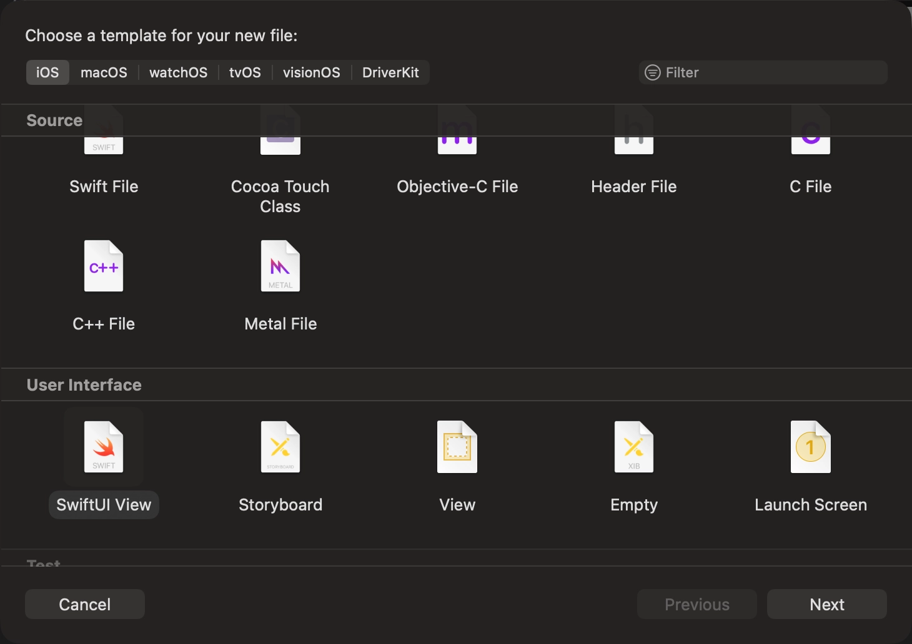
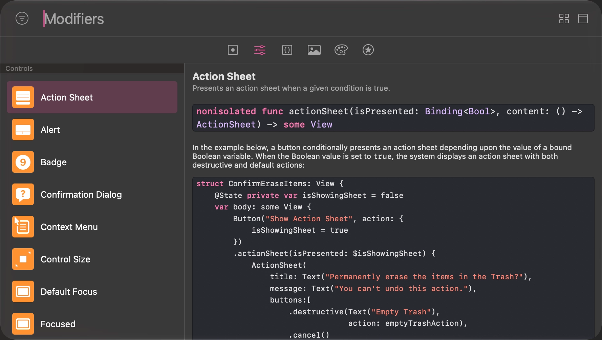
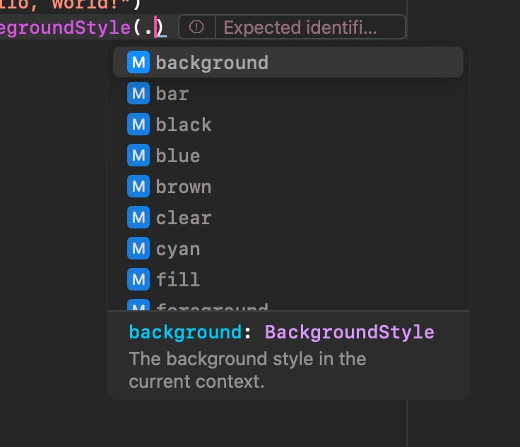
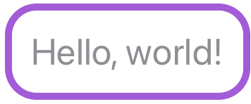
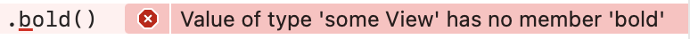
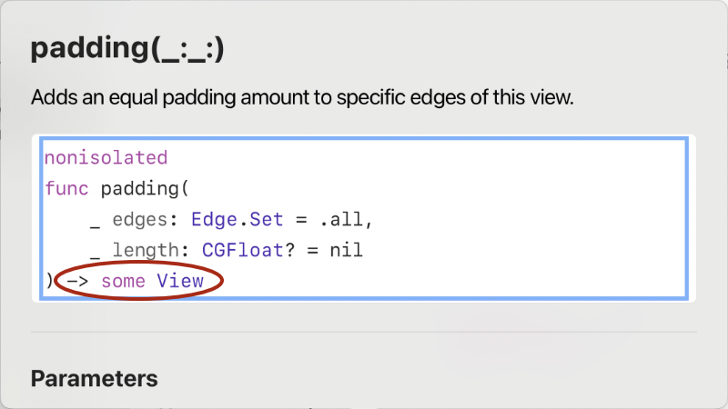
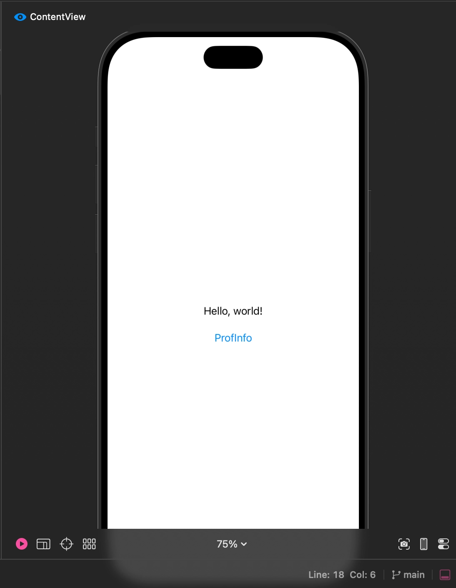
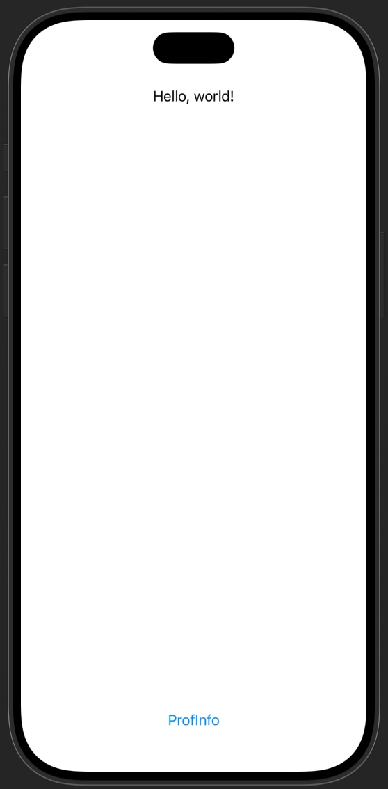
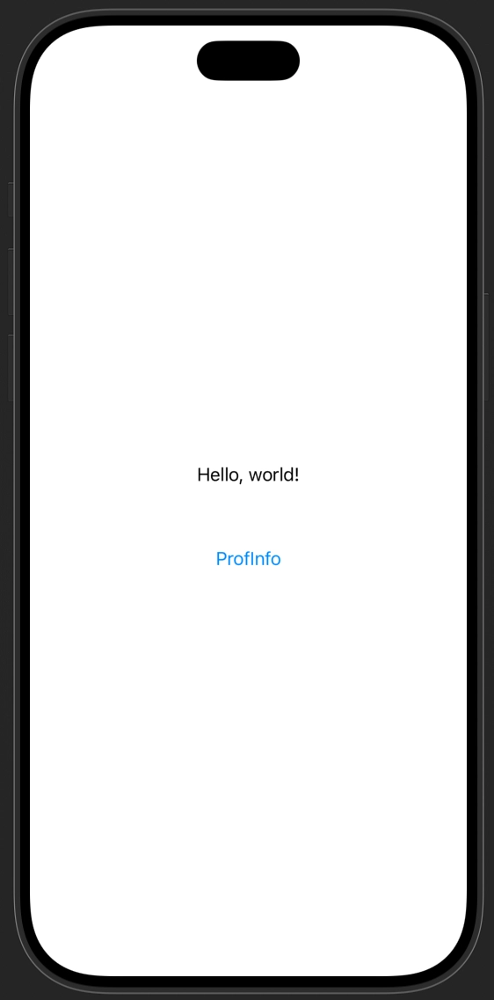
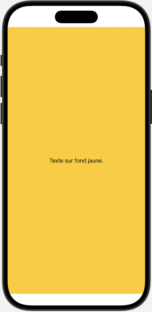

## Principes de développement d'une interface

- l'utilisateur doit voir tout le contenu important sans avoir à zoomer ni à faire défiler l'écran.
- utiliser des contrôles conçus pour les écrans tactiles.
- les éléments cliquables doivent suffisamment éloignés des autres éléments pour qu'il soit facile de les atteindre avec un doigt.

??? info "Pour plus d'information"

    « UI Design Dos and Don’ts ». Apple. <https://developer.apple.com/design/tips/>

## Les vues

Dans SwiftUI, tout ce qui apparaît à l'écran est une vue. En fait, les éléments visuels tels que `Text()` ou `Image()` sont des vues puisqu'il s'agit de structures qui répondent au protocole `View`.

Par défaut, une vue a déjà été créée pour vous : `ContentView`.   

```swift title="Fichier ContentView.swift"
struct ContentView: View {
  ...
}
```

Une vue peut être : 

- L'écran au complet
- Une partie de l'écran
- Un composant, tel que  `Text()` ou `Image()`
- Une structure créée par le programmeur 

Pour ajouter une vue dans un projet SwiftUI :

- Le menu **File** / **New** / **File from Template**.
- **SwiftUI View**.

  

Important :  

- Le nom d'une vue doit respecter **LaCassePascal**.   
- Toutes les vues vont dans un dossier nommé `Views`.  

??? info "Pour plus d'information"

    « View fondamentals ». Apple. <https://developer.apple.com/documentation/swiftui/view-fundamentals>

    « Your First iOS and SwiftUI App: An App From Scratch (tutoriel vidéo) ». Ray Wenderlich - Kodeco. <https://www.kodeco.com/17493408-your-first-ios-and-swiftui-app-an-app-from-scratch>

## Les modifieurs

Les modifieurs permettent de définir certains aspects de l'apparence d'une vue.

On placera le modifieur juste après le nom de la vue.

```swift title="SwiftUI"
Text("Hello, world!")
  .padding()
```

### Liste des modifieurs

- <kbd>⌘ Cmd</kbd>+<kbd>⇧ Shift</kbd>+<kbd>L</kbd> : Affiche la bibliothèque d'objets  
- 2e icône : les modifieurs  
- Glisser le bon modifieur dans l'éditeur de code  



### Paramètres, types prédéfinis et types dynamiques

!!! important  
    À chaque fois qu'il est possible d'utiliser une valeur prédéfinie, il est préférable de l'utiliser plutôt que d'entrer un nombre. 

Pour connaître ces valeurs possibles des paramètres :  

1. ouvrez la parenthèse qui suit le modifieur  
1. entrez le point   
1. choisissez parmi les valeurs proposées.  



### Types dynamiques

Pour la taille du texte, il est conseillé d'utiliser un type dynamique, c'est-à-dire un mot qui représente une taille qui sera automatiquement ajustée selon le réglage de taille de police choisi par l’usager sur son appareil.

```swift title="SwiftUI"
Text("Hello, world!")
  .font(.body)
```

### Enchaînements

Chaque modifieur retourne une instance d'une vue. Ceci nous permet d'enchaîner plusieurs modifieurs d'affilée.

```swift title="SwiftUI"
Text("Hello, world!")
  .padding()
  .font(.title)
  .foregroundStyle(.gray)
  .overlay(
    RoundedRectangle(cornerRadius: 20)
    .stroke(Color.purple, lineWidth: 5)
  )
```

!!! important   
  L'ordre d'apparition des modifieurs peut avoir une influence sur le résultat final  


Par exemple, si on ajoute un padding avant une bordure comme dans l'extrait de code précédent, la bordure sera appliquée sur le texte ET le padding donc elle ne sera pas collée au texte.



Et si on applique le padding après la bordure :

```swift title="SwiftUI"
Text("Hello, world!")
  .font(.title)
  .foregroundStyle(.gray)
  .overlay(
    RoundedRectangle(cornerRadius: 20)
    .stroke(Color.purple, lineWidth: 5)
  )
  .padding()
```


### Type entrant et type sortant

En général, un modifieur retourne le même type pour lequel il fonctionne. 

Ex :

**bold()** fonctionne pour une vue de type `Text`, alors il retourne une vue `Text`. 

**padding() fonctionne pour une vue de type `View`, alors il retourne une vue `View`. 

Dans le cas où le modifieur retourne un `View`, il ne pourra être suivi que par des modifieurs qui s'appliquent à n'importe quel `View`. Si vous avez besoin d'un modifieur qui s'applique seulement à un `Text`, il faudra le placer avant ceux qui retournent un `View`.

Si l'ordre n'est pas le bon, vous obtiendrez un message du genre `Value of type 'some View' has no member 'bold'`{ .erreur }.



### Retrouver le type retourné par un modifieur

Pour connaître le type sortant des modifieurs directement dans Xcode :  
  
- clic droit sur le modifieur  
- **Show Quick Help**.  

  

??? info "Pour plus d'information"

    « Configuring Views ». Apple. <https://developer.apple.com/documentation/swiftui/configuring-views>

## Les contrôles d'empilement (VStack, HStack, ZStack)

Si une vue contient plusieurs vues, par exemple deux vues de type Text, elles doivent être placées dans une vue invisible qu'on appellera **contrôle d'empilement** (**stack**).

Les contrôles d'empilement dictent comment les vues seront positionnées l'une par rapport à l'autre.

Il en existe trois principaux :

- VStack (l'une sous l'autre)
- HStack (l'une à côté de l'autre)
- ZStack (l'une par-dessus l'autre, par exemple une image par-dessus une zone rectangulaire)

```swift title="SwiftUI"
VStack {
    Text("Hello, world!")
        .padding()
    Link("ProfInfo",
        destination: URL(string: "https://mobile1.profinfo.ca")!)
 }
```

{width=300}

### Paramètres des contrôles d'empilement

- Pour forcer un espacement entre les éléments d'un VStack :  

```swift title="SwiftUI"
VStack(spacing: 20) {
  ...
}
```

- aligner à gauche les éléments empilés :

```swift title="SwiftUI"
VStack(alignment: .leading) {
  ...
}
```

??? info "Pour plus d'information"

    « Plan Your Layout Hierarchy ». Apple. <https://developer.apple.com/documentation/swiftui/building-layouts-with-stack-views>

    « Working with Stacks in SwiftUI ». Learn app making. <https://learnappmaking.com/stacks-vstack-hstack-swiftui-how-to/>

    « Adjusting the space between views ». Apple. <https://developer.apple.com/tutorials/swiftui-concepts/adjusting-the-space-between-views>

    « SwiftUI Tutorial: Layout Tools ». Karin Prater. <https://karinprater.medium.com/swiftui-tutorial-layout-tools-211b9663befe>

## Les espaceurs (Spacer)

Un Spacer() ajoute de l'espace automatiquement avant, après ou entre des vues afin de remplir l'écran.

Il s'utilisent à l'intérieur d'un `HStack` ou d'un `VStack`.

```swift title="SwiftUI"
VStack {
    Text("Hello, world!")
        .padding()
    Spacer()
    Link("Notes de cours",
        destination: URL(string: "https://mobile1.profinfo.ca")!)
        .padding()
}
```

Dans cet exemple, les modifieurs `padding()` assurent que le contrôle ne soit pas collé au bord de l'écran et le `Spacer()` ajoute l'espace requis entre les deux vues pour remplir l'écran en hauteur.

{width=300}

Il est possible d'appliquer des modifieurs à un `Spacer()` pour contrôler sa taille et son apparence.

```swift title="SwiftUI"
VStack {
  Text("Hello, world!")
    .padding()
  Spacer()
    .frame(height: 25)
  Link("ProfInfo",
        destination: URL(string: "https://mobile1.profinfo.ca")!)
    .padding()
}
```

{width=300}

## Les formes et le dessin

Quelques formes prédéfinies :   

- Rectangle  
- RoundedRectangle  
- Capsule  
- Ellipse  
- Circle  

Voici quelques exemples d'utilisation.

```swift title="SwiftUI"
ZStack {
  Rectangle()
    .fill(.yellow)
  Text("Texte sur fond jaune.")
 }
```



```swift title="SwiftUI"
HStack {
  Rectangle()
    .fill(.yellow)
    .frame(width: 200, height: 200)

  Text("Texte à côté d'un carré jaune.")
 }
```


??? info "Pour plus d'information"

    « SwiftUI’s built-in shapes ». Hacking with Swift. <https://www.hackingwithswift.com/quick-start/swiftui/swiftuis-built-in-shapes>
