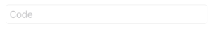
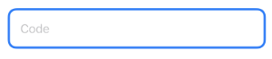
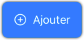
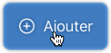
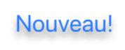
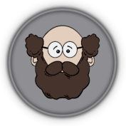
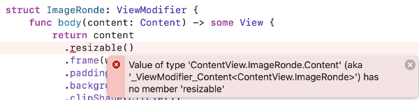

# Créer nos propres styles

## Styles personnalisés

À mesure que notre application grossit, il devient difficile d'assurer une cohérence entre les styles des différentes vues (boutons, textes, contrôles de saisie) auxquels nous avons appliqué de nombreux modifieurs.

Pour faciliter notre travail, il est possible d'utiliser des styles préprogrammés et même de définir nos propres styles personnalisés.

Dans un dossier nommé `Styles`, les styles personnalisés seront définis dans un fichier dont le nom est en CassePascal (ex : IconeToolbar, ExtensionText).

Je vous explique ici comment définir un style avec différentes techniques :

- [Protocole ...Style](creer-nos-propres-styles.md#styles-personnalises)
- [Modifieurs de vues](creer-nos-propres-styles.md#styles-personnalises)
- [Extensions](creer-nos-propres-styles.md#styles-personnalises)

### Protocole ...Style

Que ce soit avec un style préprogrammé ou un style personnalisé, il est possible d'appliquer le style à certaines vues à l'aide d'une structure qui répond à un protocole spécifique :

- Label - [LabelStyle()](https://developer.apple.com/documentation/swiftui/labelstyle)
- TextField - [TextFieldStyle()](https://developer.apple.com/documentation/swiftui/textfieldstyle)
- Button - [ButtonStyle()](https://developer.apple.com/documentation/swiftui/buttonstyle)
- List - [ListStyle()](https://developer.apple.com/documentation/swiftui/liststyle)
- Toggle - [ToggleStyle()](https://developer.apple.com/documentation/swiftui/togglestyle)
- etc.

Des exemples suivent dans les prochaines sections.

#### Styles préprogrammés

Quelques styles préprogrammés sont disponibles. Par exemple, dans la documentation officielle de [TextFieldStyle()](https://developer.apple.com/documentation/swiftui/textfieldstyle), on voit que ces types peuvent être utilisés :

- DefaultTextFieldStyle
- PlainTextFieldStyle
- RoundedBorderTextFieldStyle
- SquareBorderTextFieldStyle

```swift title="SwiftUI"
TextField("Code", text: $code)
  .textFieldStyle(RoundedBorderTextFieldStyle())
  .padding()
```



#### Styles personnalisés

Il est possible de définir nos propes styles.

On définira une structure qui répond à un protocole dont le nom se termine par `Style`.

Sa méthode _body() (ou makeBody(), selon le protocole utilisé) contiendra la liste des modifieurs associés à ce style.

```swift title="Fichier Styles/MonTextFieldStyle.swift"
struct MonTextFieldStyle: TextFieldStyle {
  func _body(configuration: TextField<_Label>) -> some View {
    configuration
      .padding()
      .background(
        RoundedRectangle(cornerRadius: 10, style: .continuous)
          .stroke(Color.blue, lineWidth: 3)
      )
      .padding()
  }
}
```

```swift title="Fichier ContentView.swift"
struct ContentView: View {
  ...
  var body: some View {
    ...
    TextField("Code", text: $code)
      .textFieldStyle(MonTextFieldStyle())
    ...
  }
}
```



ou, pour que le style soit appliqué à tous les TextField du VStack :

```swift title="SwiftUI"
VStack {
  TextField("Code", text: $code)
  TextField("Titre", text: $titre)
  TextField("Auteur", text: $auteur)
}
.textFieldStyle(MonTextFieldStyle())
```

#### Bouton dont le style réagit au clic

Dans le cas d'un bouton, il est intéressant de voir une petite modification de l'apparence au moment où on clique sur le bouton.

Voici un style personnalisé qui permet de changer légèrement l'apparence du bouton sur le clic.

```swift title="Fichier Styles/MonButtonStyle.swift"
struct MonButtonStyle: ButtonStyle {
  func makeBody(configuration: Configuration) -> some View {
    configuration.label
      .padding()
      .background(
        Color.blue.opacity(configuration.isPressed ? 0.5 : 1)
      )
      .foregroundColor(.white)
      .cornerRadius(8)
  }
}
```

```swift title="Fichier ContentView.swift"
struct ContentView: View {
  ...
  var body: some View {
    ...
    Button(action: {}) {
      Label("Ajouter", systemImage: "plus.circle")
    }
    .buttonStyle(MonButtonStyle())
    ...
  }
}
```



Et quand on clique sur le bouton :



#### Style avec paramètres

Pour créer un style qui réagira différemment selon la valeur d'un paramètre, voir la fiche « [Styles avec paramètres](creer-nos-propres-styles.md#styles-avec-parametres) ».

### Modifieurs de vues (ViewModifier)

Pour certains types de vues, il n'est pas possible de définir directement un style personnalisé. C'est le cas notamment avec Text() et avec Image().

Qu'à celà ne tienne, une autre technique nous permet de définir l'apparence de façon globale : [ViewModifier()](https://developer.apple.com/documentation/swiftui/viewmodifier). Ce modifieur permet d'appliquer un style personnalisé à n'importe quelle vue.

Son fonctionnement est très semblables à celui des styles prédéfinis. Cependant, contrairement à l'approche des styles, il faudra ici retourner une vue.

#### Exemple avec du texte

Voici comment styliser du texte de façon efficace et non répétitive lorsque plusieurs éléments textuels nécessitent une apparence semblable.

```swift title="Fichier Styles/TexteAccent.swift"
struct TexteAccent: ViewModifier {
  func body(content: Content) -> some View {
    return content
      .font(.system(.largeTitle))
      .padding()
      .foregroundColor(Color.accentColor)
      .shadow(color: .gray, radius: 5, x: 0, y: 8)
  }
}
```

```swift title="Fichier ContentView.swift"
struct ContentView: View {
  ...
  var body: some View {
    ...
    Text("Nouveau!")
      .modifier(TexteAccent())
    ...
  }
}
```



#### Exemple avec une image

Le modifieur que je vous propose permet d'entourer n'importe quelle image d'un cercle gris avec bordure et ombrage.

```swift title="Fichier Styles/ImageRonde.swift"
struct ImageRonde: ViewModifier {
  func body(content: Content) -> some View {
    return content
      .frame(width: 75.0, height: 75.0)
      .padding()
      .background(Color.gray)
      .clipShape(Circle())
      .shadow(radius: 5)
      .overlay(Circle().stroke(Color.gray, lineWidth: 2))
      .padding(1)
  }
 }
```

```swift title="Fichier ContentView.swift"
struct ContentView: View {
  ...
  var body: some View {
    ...
    Image("bob")
      .resizable()
      .modifier(ImageRonde())
    ...
  }
}
```



### Extensions

Dans le dernier exemple, j'ai été obligée d'appliquer le modifieur `resizable()` à l'image. Il aurait été plus intéressant d'ajouter ce modifieur directement dans le ViewModifier mais ceci causait l'erreur « Value of type 'ContentView.ImageRonde.Content' (aka '_ViewModifier_Content<ContentView.ImageRonde>') has no member 'resizable' ».



Ceci se produit parce que le ViewModifier doit pouvoir être appliqué à n'importe quelle vue.

Il faudra utiliser une extension pour pouvoir utiliser des modifieur spécifiques à un type de vue, par exemple à une Image.

Si l'extension définit plusieurs styles pour un type de vue, tous pourront être placés dans le même fichier.

```swift title="Fichier Styles/ExtensionImage.swift"
extension Image {
  func imageRonde() -> some View {
    self
      .resizable()
      .frame(width: 75.0, height: 75.0)
      .padding()
      .background(Color.gray)
      .clipShape(Circle())
      .shadow(radius: 5)
      .overlay(Circle().stroke(Color.gray, lineWidth: 2))
      .padding(1)
  }
}
```

```swift title="Fichier ContentView.swift"
struct ContentView: View {
  ...
  Image("bob").imageRonde()
  ...
}
```

#### Extension avec paramètres

Tout comme pour les styles, il est possible de passer un paramètre à une extension. Voir la fiche « [Styles avec paramètres](creer-nos-propres-styles.md#styles-avec-parametres) ».

??? info "Pour plus d'information"

    «  SwiftUI Custom Styling  ». The SwiftUI Lab. <https://swiftui-lab.com/custom-styling/>

## Styles avec paramètres

Il est possible de créer un style qui réagira différemment selon la valeur d'un paramètre.

```swift title="Fichier Styles/MonButton.swift"
struct MonButton: ButtonStyle {
  var actif: Bool = true

  func makeBody(configuration: Configuration) -> some View {
    configuration.label
      .padding()
      .background(actif ? Color.cyan : Color.gray)
      .foregroundColor(.white)
      .cornerRadius(8)
      .opacity(actif ? 1 : 0.5)
  }
}
```

Voici un exemple d'utilisation de ce style :

```swift title="Fichier ContentView.swift"
struct ContentView: View {
  @State private var plein: Bool = false

  var body: some View {
    ...
    Button(action: {}) {
      Label("Ajouter", systemImage: "plus.circle")
    }
    .buttonStyle(MonButton(actif: !plein))
    ...
  }
}
```

### Extension avec paramètres

Tout comme pour les styles, il est possible de passer un paramètre à une extension.

```swift title="Fichier Styles/ExtensionImage.swift"
extension Image {
  func ImageRonde(dimension: Double = 200) -> some View {
    self
      .resizable()
      .frame(width: dimension, height: dimension)
      .padding()
      .background(Color.gray)
      .clipShape(Circle())
      .shadow(radius: 5)
      .overlay(Circle().stroke(Color.gray, lineWidth: 2))
      .padding(1)
  }
}
```

Et pour l'utiliser :

```swift title="Fichier ContentView.swift"
struct ContentView: View {
  ...
  Image("bob").ImageRonde(dimension: 100)
  ...
}
```
