# Créer un projet dans XCode  

Dans l'écran d'accueil, cliquez sur **New Project** et sélectionnez **Choose Template...**.  

  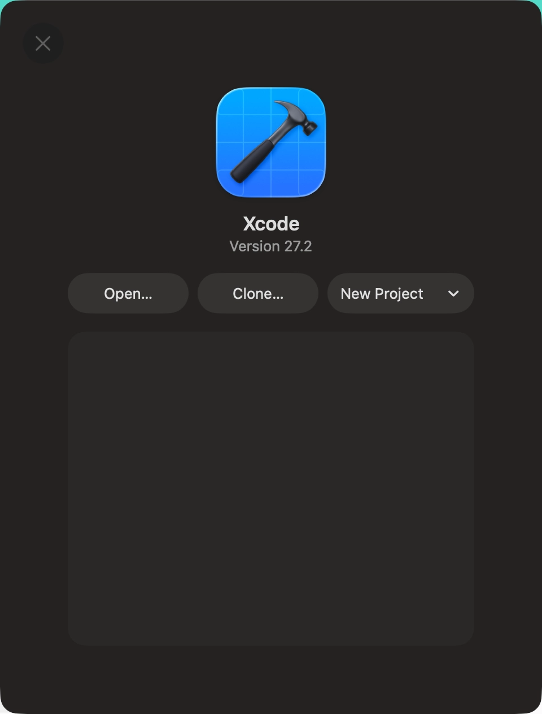{ width="400" }

  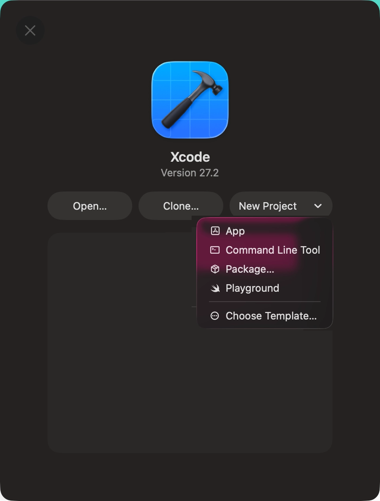{ width="400" }

Dans l'écran suivant, **sélectionnez l'onglet **iOS**** puis le type d'application **App**.  

  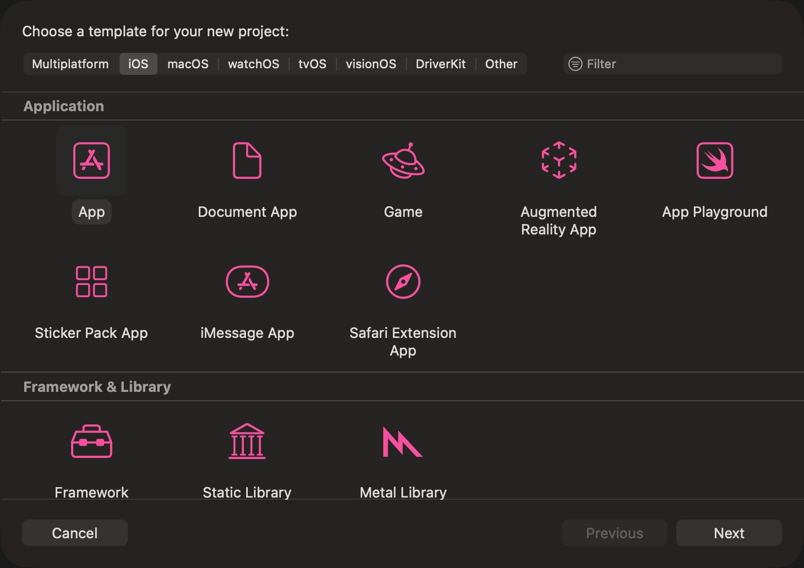{ width="600" }

Dans l'écran qui suit, entrez ces informations :  

  - **Product Name** : Nom qui identifie votre projet, en casse mixte.  

!!! warning
      Il ne faut pas utiliser de caractères accentués sinon, vous n'aurez pas accès à la prévisualisation à l'aide du canevas.  

  - **Team** : Si vous ou votre organisation avez un compte Apple Developer Program, entrez votre code ici. Ceci vous permettra éventuellement de déployer votre application sur le App Store.

!!! Note    
    Si vous n'avez pas de compte Apple Developer Program, laissez cette case à blanc. Votre Apple ID sera utilisé pour créer un Team personnel qui vous permettra de télécharger l'application sur un iPhone ou sur un iPad pour le tester de façon temporaire. Vous ne pourrez pas la distribuer sur le App Store.

  - **Organization identifier** : Ceci servira à créer l'identifiant unique du paquet qui contiendra votre application (Bundle ID).

    Entrez votre nom de domaine en format inverse (en anglais : **reverse domain name service notation** ou **reverse-DNS notation**), par exemple `com.mondomaine`.

    Si vous ne possédez pas de nom de domaine, entrez une chaine du genre `com.nomfamilleprenom`.  

  - **Interface** : SwiftUI  
  - **Language** : Swift  
  - **Testing System** : Sélectionnez le système de tests unitaires désiré ou `None` si vous ne souhaitez pas effectuer de tests unitaires  
  - **Storage** : Si votre application doit utiliser une base de données locale, choisissez `SwiftData`. Si votre application n'utilise aucune base de données, choisissez `None`.  

    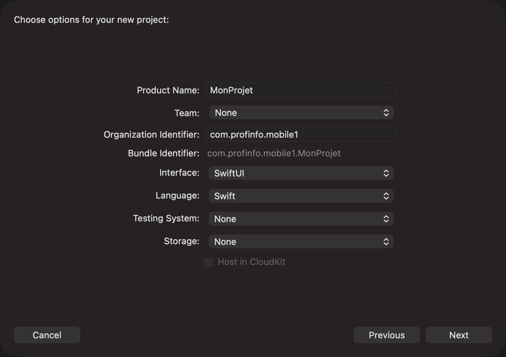{ width="400" }  

- Après avoir cliqué sur **Next**, vous devrez préciser à quel endroit enregistrer votre projet.  
- Le projet est maintenant créé. Il contient du code de base selon le modèle et le type d'application que vous avez choisi.  
- Après quelques instants, vous voyez même un aperçu de l'écran généré par le programme. Attention : ceci n'est qu'un aperçu et non un simulateur. Vous n'aurez accès qu'à quelques fonctionnalités dans cet écran.  

  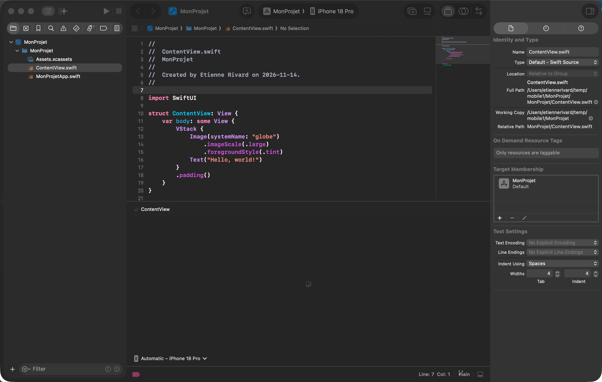{ width="800" }


## Lancer l'application dans le simulateur

Dans un projet Xcode, vous pouvez sélectionner le type d'appareil que vous désirez simuler. Ceci peut être réalisé dans le menu **Product** / **Destination** ou encore directement dans la barre d'outils.

Pour effectuer cette configuration à partir de la barre d'outils, cliquez sur la zone qui présente le nom de votre projet. En anglais, cette zone s'appelle **Scheme menu**. On y retrouve le nom du projet (**scheme**) à gauche et l'appareil de destination à droite.

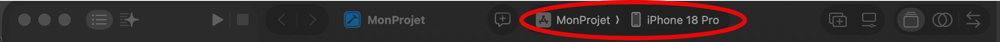{ width="800" }

Une liste des périphériques disponibles sera affichée. Choisissez le périphérique que vous désirez simuler.

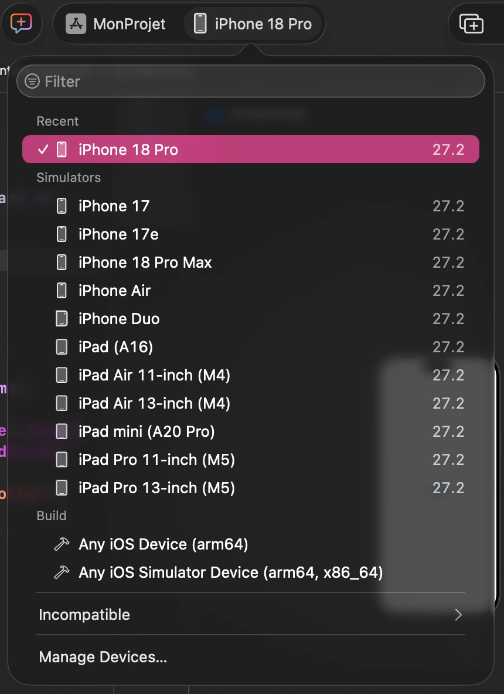{ width="400" }

Cliquez sur le bouton **Start the active scheme** pour lancer le simulateur. Patientez pendant le chargement.

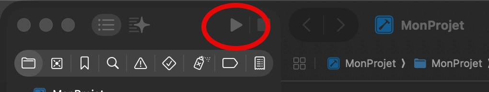{ width="400" }

Une image de iPhone apparaîtra à l'écran avec l'application exécutée à l'intérieur.

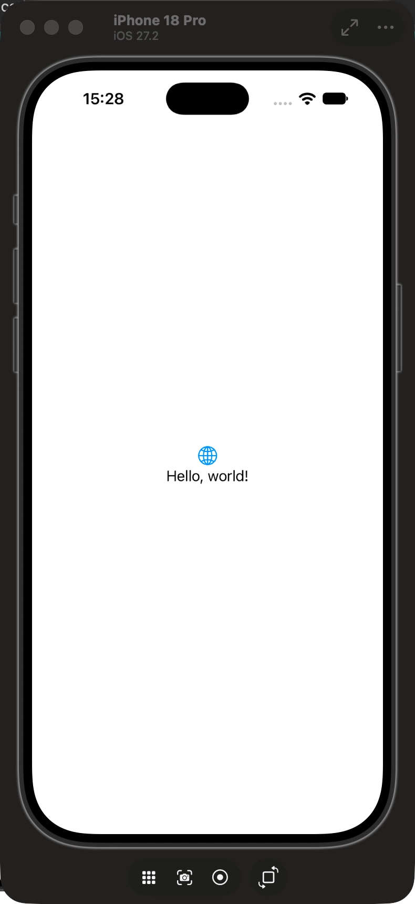{ width="300" }


## Les fichiers du projet initial

Par défaut, un projet de type App pour iOS basé sur SwiftUI contiendra les fichiers suivants.

| Fichier | Description  
| -- | -- 
| `MonProjet / MonProjetApp.swift` | le point de départ de l'application  
| `MonProjet / ContentView.swift` | définit ce qui sera affiché à l'écran  
| `MonProjet / Assets.xcassets` |  ressources de l'application. C'est là que seront enregistrées l'AppIcon, les couleurs personnalisées et les images utilisées par l'application.  
| `MonProjet / Preview Content / Preview Assets.xcassets` |  autre fichier de ressources, présentement vide  

### Fichier MonProjetApp.swift

Ce fichier, avec l'instruction `@main`, est le point d'entrée de l'application.

Il définit une [structure](https://docs.swift.org/swift-book/LanguageGuide/ClassesAndStructures.html).  

Dans notre fichier, cette structure répond au [protocole](https://docs.swift.org/swift-book/LanguageGuide/Protocols.html) `App`. 

En gros, quand une structure répond à un protocole, ceci assure que la structure définira les propriétés et méthodes imposées par ce protocole.

Le protocole `App` exige la définition d'une propriété `body`.

Ici, la propriété `body` de la structure charge la vue nommée `ContentView`.

```swift title="MonProjetApp.swift"
import SwiftUI

@main
struct MonProjetApp: App {
    var body: some Scene {
        WindowGroup {
            ContentView()
        }
    }
}
```

### Fichier ContentView.swift

Ce fichier définit une structure qui répond au protocole [View](https://developer.apple.com/documentation/swiftui/view).

Elle définit dans sa propriété `body` ce qui sera affiché à l'écran. Par défaut, c'est simplement un objet `Text` avec les mots « Hello World! ». Classique! Le texte est accompagné d'une image. Le texte et l'image sont placés dans un `VStack` afin qu'ils soit empilés verticalement.

Reconnaissez-vous le nom `ContentView`? C'est le nom de la vue qui a été chargée dans le fichier `MonProjetApp.swift`. Voilà pourquoi cette vue est affichée dès le chargement de l'application.

Au bas de la structure, on retrouve la macro `#Preview` qui est utilisée par Xcode pour la prévisualisation.

```swift title="ContentView.swift"
import SwiftUI

struct ContentView: View {
    var body: some View {
        VStack {
            Image(systemName: "globe")
                .imageScale(.large)
                .foregroundStyle(.tint)
            Text("Hello, world!")
        }
        .padding()
    }
}

#Preview {
    ContentView()
}
```

### Pour plus d'information

« SwiftUI Essentials - Creating and Combining Views ». Apple.com. <https://developer.apple.com/tutorials/swiftui/creating-and-combining-views>


## Section #Preview

La section `#Preview`, généralement présente juste après le code d'une vue, permet elle aussi de configurer comment le ou les canevas seront affichés.

### Apparence claire ou sombre

Par défaut, le canevas est affiché en mode clair.

Pour passer au mode sombre :

```swift
#Preview {
  ContentView().preferredColorScheme(.dark)
}
```

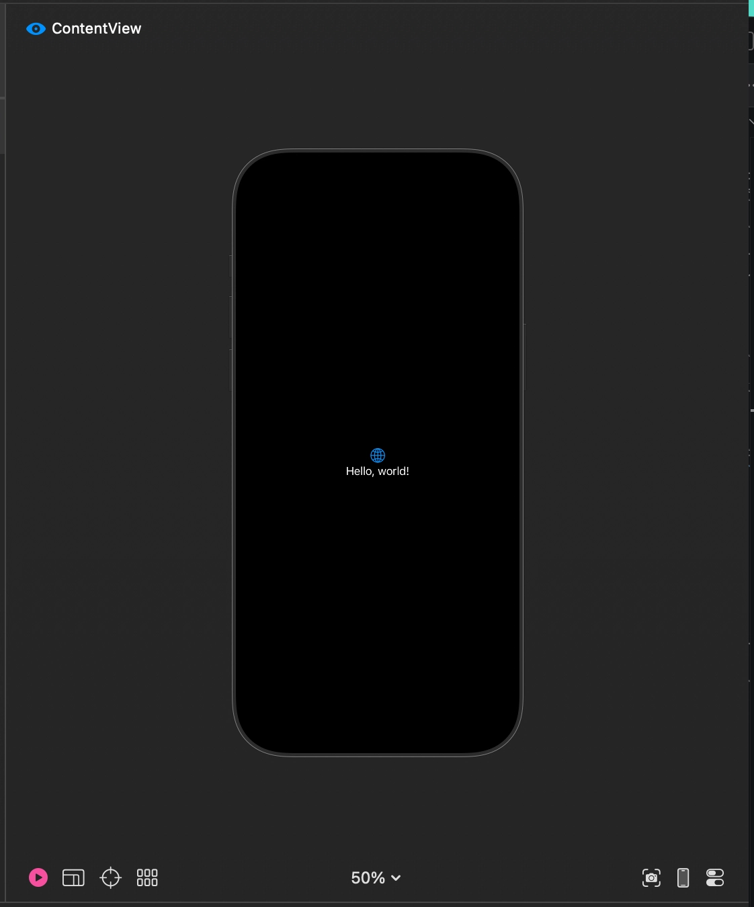{ width="400" }

### Orientation

Par défaut, le canevas est présenté en orientation portrait.

Pour modifier l'orientation, il faut ajouter un paramètre directement sur la ligne `#Preview`.

```swift
#Preview(traits: .landscapeLeft) {
  ContentView()
}
```

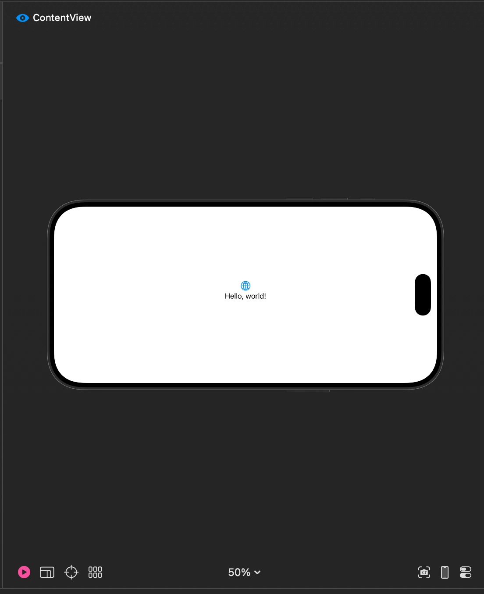{ width="400" }

### Types dynamiques

Le canevas peut vous montrer l'apparence de votre application avec différentes tailles de police à condition que vous ayez utilisé les types dynamiques, qui permettent à l’application de s’adapter automatiquement à la taille de texte choisie par l’usager dans les réglages de son appareil.

Pour modifier la taille de police dans le canevas :

```swift
#Preview {
  ContentView().environment(\.dynamicTypeSize, .xxxLarge)
}
```

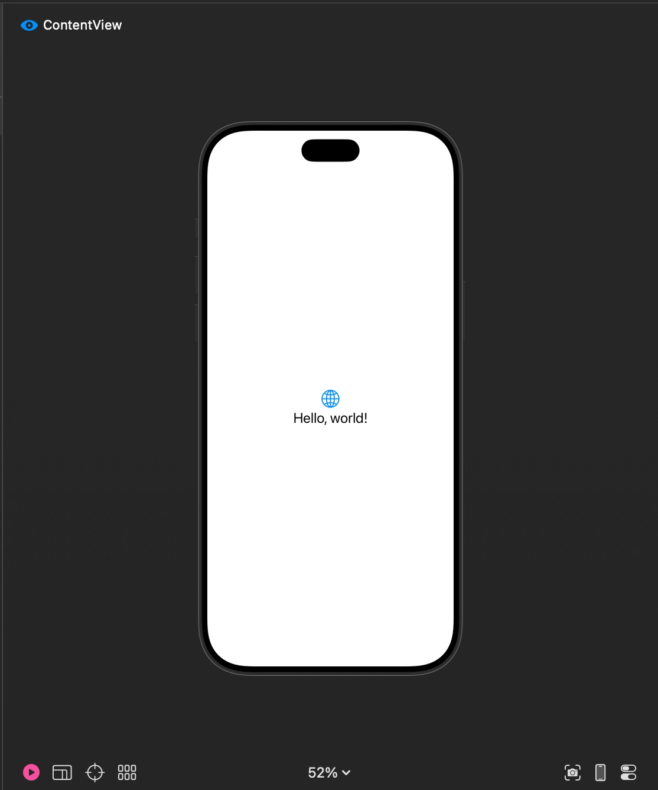{ width="400" }  

### Plusieurs #Preview

Une option est intéressante : on peut définir plusieurs zones `#Preview` afin de permettre de choisir l'une ou l'autre par un simple clic sur un bouton.

```swift
#Preview {
  ContentView().preferredColorScheme(.light)
}

#Preview {
  ContentView().preferredColorScheme(.dark)
}
```
=== "Clair"
    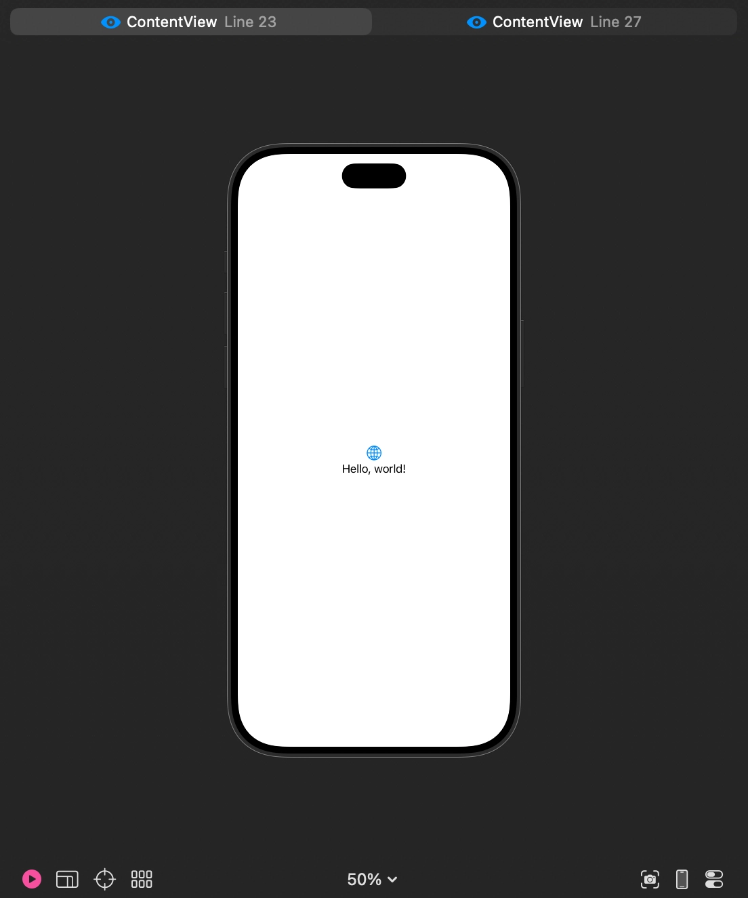{ width="400" }   

=== "Sombre"
    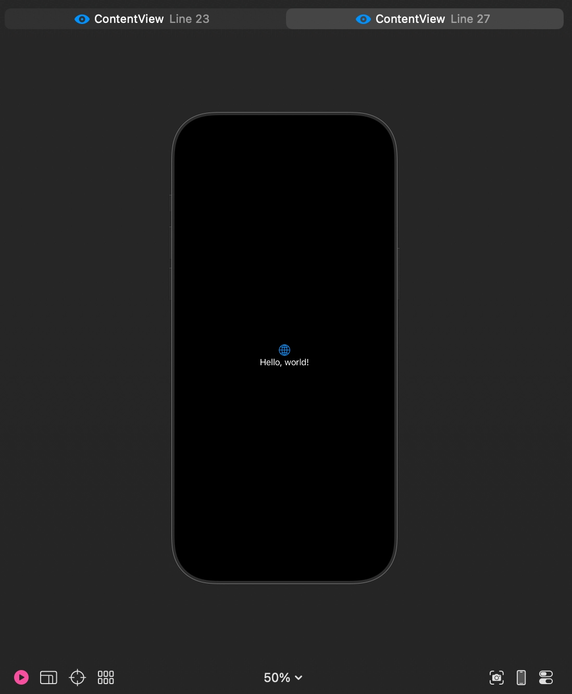{ width="400" }

Si désiré, on peut donner un nom à chaque bouton.

```swift
#Preview("Clair") {
  ContentView().preferredColorScheme(.light)
}

#Preview("Sombre") {
  ContentView().preferredColorScheme(.dark)
}
```

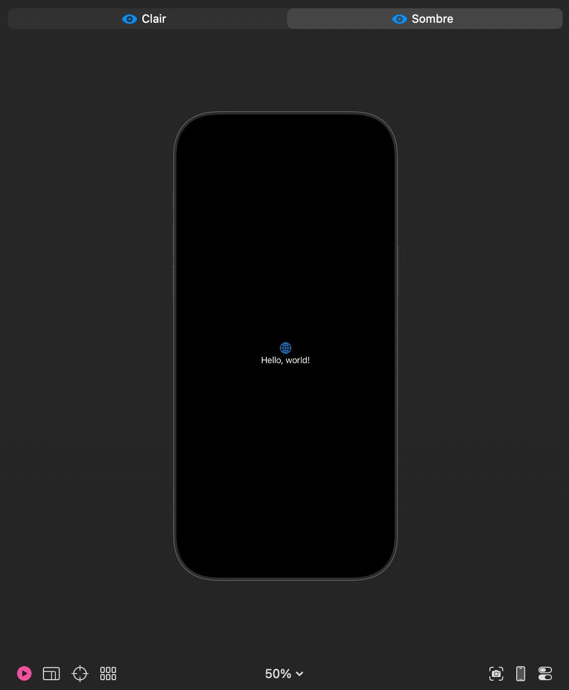{ width="400" }