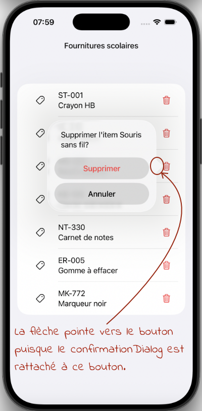
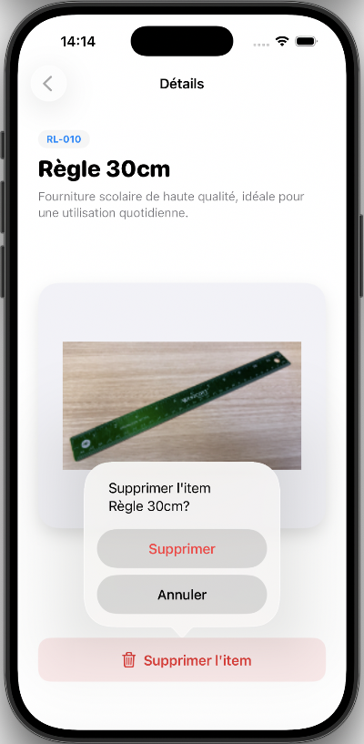

# CRUD avec SwiftData

## Opérations CRUD avec SwiftData (ajouter, modifier ou supprimer des données)

Avec SwiftData, effectuer des opération CRUD (**Create, Read, Update, Delete**) est un charme.

### Insert

L'insertion de données consiste à instancier un nouvel objet puis à faire appel à [modelContext.insert()](https://developer.apple.com/documentation/swiftdata/modelcontext/insert(_:)).

Je vous présente ici l'insertion à l'intérieur de ContentView mais cela pourrait avoir lieu dans n'importe quelle autre vue.

```swift title="SwiftUI"
import SwiftData
...

struct ContentView: View {
  @Environment(\.modelContext) var modelContext
  ...

  var body: some View {
    ...
    Button(action: {
      let item = Item(code: "abc", titre: "Item abc")
      modelContext.insert(item)
      do {
        try modelContext.save()
      } catch {
        print("Impossible d'insérer l'item: \(error)")
        ... // mécanisme pour afficher un message à l'usager
      }
    }) {
      Text("Enregistrer")
    }
    .buttonStyle(.bordered)
    ...
  }
}
```

### Delete

Pour supprimer un enregistrement, il est important d'avoir en main un objet qui a été instancié à partir d'une requête.

La façon la plus traditionnelle consiste à créer le bouton de suppression à même la liste qui affiche les données.

#### Suppression simple

Le traitement consistera à appeler [modelContext.delete()](https://developer.apple.com/documentation/swiftdata/modelcontext/delete(_:)).

```swift title="SwiftUI"
List(items) { item in
  VStack(alignment: .leading) {
    HStack {
      Text("\(item.code) - \(item.titre)")
      Spacer()
      Button(
        role: .destructive,
        action: {
          modelContext.delete(item)
          do {
            try modelContext.save()
          } catch {
            print("Impossible de supprimer l'item: \(error)")
            ... // mécanisme pour afficher un message à l'usager
          }
      }) {
        Image(systemName: "trash")
      }
    }
  }
}
```

#### Confirmation avant suppression

Il est d'usage de demander confirmation avant suppression puisque cette opération est irréversible.

La technique est expliquée dans la fiche « [Demander une confirmation avec .confirmationDialog()](quelques-vues-swiftui.md#demander-une-confirmation-avec-confirmationdialog) ».

Il faudra adapter le code présenté afin qu'il fasse un `modelContext.delete()` plutôt que de retirer un élément d'un tableau.

#### Vider une table entière

Pour supprimer tous les enregistrements d'une table, il suffit d'appeler la méthode `delete()` avec le modèle comme paramètre.

```swift title="SwiftUI"
do {
  try modelContext.delete(model: Item.self)
  try modelContext.save()
} catch {
  print("Impossible de supprimer tous les items.")
  ...  // mécanisme pour afficher un message à l'usager
 }
```

### Update

La mise à jour sera généralement effectuée à partir d'un formulaire qui aura été affiché à partir de la liste d'items. On sera ainsi assurés que c'est le bon enregistrement qui est mis à jour.

Contrairement à l'ajout et à la suppression, il suffit de mettre à jour l'objet pour que les données soient enregistrées dans la base de données.

```swift title="SwiftUI"
Button(
  action: {
    item.code = code
    item.titre = titre
    do {
      try modelContext.save()
    } catch {
      print("Impossible de mettre à jour l'item: \(error)")
      ... // mécanisme pour afficher un message à l'usager
    }
}) {
  Text("Enregistrer")
}
```

### Dangers de l'enregistrement automatique sans save()

Par défaut, les modifications au modelContext seront automatiquement réflétées dans la base de données, sans nécessiter un appel à `modelContext.save()`. Ce comportement est pratique mais il n'est pas sans danger. De plus, il peut être désactivé.

Quand l'enregistrement automatique est activé, l'usager aura l'impression que les données sont enregistrées sur-le-champ. Dans les faits, l'enregistrement aura lieu à des moments précis, par exemple lorsque l'application passe en arrière-plan ou revient au premier-plan ou encore lorsque la boucle courante se termine. Ce délai peut être de quelques fractions de secondes mais s'étire parfois sur plusieurs secondes.

Il y a des situations où ce délai peut causer des mauvais fonctionnements de l'application, par exemple :

- Le cas le plus classique survient si l'application est refermée immédiatement après la mise à jour en mémoire, avant que l'enregistrement sur disque n'ait été réalisé. Les modifications sont alors perdues.
- Le délai d'enregistrement peut également poser problème si on ajoute un enregistrement puis qu'on appelle immédiatement une fonction qui utilise cet enregistrement.

Dans tous les cas, pour assurer que l'enregistrement soit réalisé sans délai, il faut faire appel à `modelContext.save()`.

Dans cet exemple, le code doit appeler une fonction qui synchronise la base de données locale avec une base de données distante via un service Web.

```swift title="SwiftUI"
let item = Item(code: "abc", titre: "Item abc")
 modelContext.insert(item)

do {
   try modelContext.save() // sans ceci, l'item n'est pas encore disponible pour la synchro
} catch {
  print("Impossible d'ajouter l'item: \(error)")
  ...   // mécanisme pour afficher un message à l'usager
}

 synchroniserBD()
```

### Erreur « Thread 1: Fatal error: Observation Registrar was not found on Model »

Si vous obtenez l'erreur « Thread 1: Fatal error: Observation Registrar was not found on Model » lors de l'ajout, de la modification ou de la suppresison d'un enregistrement, assurez-vous que le modèle ne répond pas au protocole `CustomReflectable`.

En effet, il semble y avoir un conflit entre le protocole `CustomReflectable` et le mécanisme d'observation utilisé par SwiftData.

??? info "Pour plus d'information"

    « Adding and editing persistent data in your app ». Apple. <https://developer.apple.com/documentation/swiftdata/adding-and-editing-persistent-data-in-your-app/>

    « Deleting persistent data from your app ». Apple. <https://developer.apple.com/documentation/swiftdata/deleting-persistent-data-from-your-app>

    « Creating, editing, and deleting model objects ». Hacking with Swift. <https://www.hackingwithswift.com/quick-start/swiftdata/creating-editing-and-deleting-model-objects>

    «  When does SwiftData autosave data?  ». Hacking with Swift. <https://www.hackingwithswift.com/quick-start/swiftdata/when-does-swiftdata-autosave-data>

    « How to save a SwiftData object ». Hacking with Swift. <https://www.hackingwithswift.com/quick-start/swiftdata/how-to-save-a-swiftdata-object>

## Insérer ou supprimer des données d'une table enfant

Lorsqu'une requête SwiftData implique une table parent et une table enfant, par exemple des catégories avec, pour chacune, des items, les opérations sur la table enfant doivent être réalisées par manipulation de la variable initialisée par @Query et non à partir du modelContext.

En effet, si vous travaillez avec modelContext pour ajouter ou supprimer un élément dans la table enfant, les modifications ne seront pas immédiatement reflétées dans la vue parent puisque la variable initialisée par @Query ne sera pas mise à jour.

Note : la technique que je vous présente ici doit être utilisée lorsque les données de la table parent sont retrouvées par @Query et qu'on désire modifier les données de la table enfant.   
  
Si c'est la table enfant qui est initialisée avec @Query, on travaillera directement avec modelContext.

### Suppression

Dans cet exemple, on travaille avec une vue qui affiche les catégories et, pour chacune, un lien qui permet d'afficher les items de la catégorie.

La requête va donc chercher les données de la table parent (categories), ce qui donne accès aux données de la table enfant (items).

```swift title="Fichier ContentView.swift"
struct ContentView: View {
  @Query(sort: \Categorie.titre) var categories: [Categorie]

  var body: some View {
    ...
    List (categories) { categorie in
      NavigationLink(value: categorie) {
        Text(categorie.titre)
      }
    }
    .navigationDestination(for: Categorie.self) { categorie in
      ListeItems(categorie: categorie)
    }
    ...
  }
}
```

Si on veut, pour une catégorie donnée, supprimer un des items, il ne faut pas procéder comme suit :

```swift title="Fichier ListeItems.swift"
struct ListeItems: View {
  var categorie: Categorie

  var body: some View {
    VStack {
      List (categorie.items.sorted(by: {$0.code < $1.code})) { item in
        HStack {
          Text("\(item.code) - \(item.titre)")
          Spacer()
            Button(
              role: .destructive,
              action: {
                modelContext.delete(item) // ceci ne met pas à jour la vue qui a fait le @Query
            }) {
               Image(systemName: "trash")
                 .padding(.leading)
            }
          }
        }
      ...
    }
  }
}
```

 Il faut plutôt faire ceci, ce qui mettra à jour la variable initialisée par @Query.

SwiftData comprendra qu'il doit supprimer un item de la base de données.

```swift title="Fichier ListeItems.swift"
Button(
  role: .destructive,
  action: {
    // ici, on recherche dans un tableau d'items l'élément qui correspond à l'item sur leqel on vient de cliquer
    if let index = categorie.items.firstIndex(where: {$0.persistentModelID == item.persistentModelID}) {
      categorie.items.remove(at: index)
      do {
        try modelContext.save()
      } catch {
        print("Impossible de supprimer l'item: \(error)")
      }
    }
}) {
  Image(systemName: "trash")
    .padding(.leading)
}
```

### Ajout

Dans cet exemple, un tableau de catégories (table parent) a été initialisé à l'aide de @Query.

À un endroit donné dans l'application, un bouton permet d'ajouter un item dans une catégorie donnée.

Pour ajouter un enregistrement dans la table enfant, il ne faut pas procéder comme suit :

```swift title="Swift"
Button(action: {
  // ceci ne sera visible que lors du prochain chargement de l'application puisque la modification n'affecte pas directement la variable initialisée par @Query.
  modelContext.insert(Item(...))
 }) {
  Text("Enregistrer")
 }
```

Il faut plutôt manipuler la propriété qui réfère à la table enfant. SwiftData comprendra qu'il doit insérer un enregistrement dans la table enfant.

```swift title="Swift"
Button(action: {
  categorie.items.append(Item(...))
  do {
    try modelContext.save()
  } catch {
    print("Impossible d'ajouter l'item: \(error)")
  }
}) {
  Text("Enregistrer")
 }
```

## @Bindable

Le modificateur de propriété (**property wrapper**) [@Bindable](https://developer.apple.com/documentation/swiftui/bindable) permet de créer des liaisons sur les propriétés d'un objet observable (modèle SwiftData ou autre classe qui utilise la macro `@Observable`).

Autrement dit, quand un objet est passé en paramètre à une vue enfant et que cette dernière le décore avec `@Bindable`, la vue enfant pourra utiliser les propriétés de l'objet dans une vue qui demande une liaison (**binding**), par exemple un `TextField`.

Dans cet exemple, la vue parent initialise une liste de catégories et la vue enfant permet de modifier directement les propriétés de la catégorie choisie.

```swift title="Vue parent (SwiftUI)"
struct ListeCategories: View {
  @Query(sort: \Categorie.titre) var categories: [Categorie]
  @State private var categorieAEditer: Categorie? = nil
  ...

  var body: some View {
    ...
    List {
      ForEach(categories) { categorie in
        ...
        Button(action: {
          categorieAEditer = categorie
        }) {
          Image(systemName: "pencil")
        }
        .buttonStyle(.bordered)
        ...
      }
    }
    // le paramètre doit s'appeler item!
    .sheet(item: $categorieAEditer) { categorie in
      EditerCategorie(categorie: categorie)
    }
  }
}
```

Dans la vue enfant, la déclaration avec `@Bindable` permet d'utiliser les propriétés de l'objet dans un `TextField`.

Remarquez qu'il n'est pas possible d'annuler les modifications en cours puisque l'objet est édité directement.

```swift title="Vue enfant (SwiftUI)"
struct EditerCategorie: View {
  @Environment(\.modelContext) var modelContext
  @Environment(\.dismiss) var dismiss

  @Bindable var categorie: Categorie

  var body: some View {
    // La vue est affichée dans un sheet, qui ne fait pas partie de la pile de navigation.
    // Il faut lui ajouter un NavigationStack pour pouvoir avec un navigationTitle et un toolbar.
    NavigationStack {
      Form {
        Section("Titre") {
          TextField("Titre", text: $categorie.titre)
        }
      }
      .toolbar {
        ToolbarItem(placement: .confirmationAction) {
          Button("Enregistrer") {
            sauvegarder()
          }
        }
      }
       .navigationTitle("Modifier la catégorie")
    }
  }

  /// Force la sauvegarde immédiate puis referme la vue
  private func sauvegarder() {
    do {
      try modelContext.save()
      dismiss()
    } catch {
      print("Impossible d'enregistrer les informations: \(error)")
    }
  }
}
```

### Exemple sans le @Bindable

Si on ne travaille pas avec `@Bindable`, on a plus de contrôle sur ce qui peut être réalisé (ex : validation, possibilité d'annulation).

Par contre, il y a quelques étapes supplémentaires à mettre en place :

- déclarer une variable d'état pour chaque propriété à éditer
- initialiser les variables d'état à partir de l'objet reçu en paramètre
- lors de l'enregistrement, initialiser les propriétés de l'objet à partir de ces valeurs.

Le code de la vue parent demeure inchangé.

```swift title="Vue enfant (SwiftUI)"
struct EditerCategorie: View {
  @Environment(\.modelContext) var modelContext
  @Environment(\.dismiss) var dismiss

  var categorie: Categorie
  @State private var titre: String = ""

  var body: some View {
    // La vue est affichée dans un sheet, qui ne fait pas partie de la pile de navigation.
    // Il faut lui ajouter un NavigationStack pour pouvoir avec un navigationTitle et un toolbar.
    NavigationStack {
      VStack {
        Form {
          Section("Titre") {
            TextField("Titre", text: $titre)
          }
        }
        .toolbar {
          ToolbarItem(placement: .cancellationAction) {
            Button("Annuler") {
              dismiss()
            }
          }
          ToolbarItem(placement: .confirmationAction) {
            Button("Enregistrer") {
              sauvegarder()
            }
            .disabled(titre.trimmingCharacters(in: .whitespaces).isEmpty)
          }
        }
         .navigationTitle("Modifier la catégorie")
        .onAppear {
          // on ne peut pas initialiser le titre directement lors de la déclaration sinon on obtient l'erreur Cannot use instance member 'categorie' within property initializer; property initializers run before 'self' is available
          titre = categorie.titre
        }
      }
    }
  }

  /// Sauvegarde les modifications puis referme la vue
  private func sauvegarder() {
    categorie.titre = titre
    do {
      try modelContext.save()
      dismiss()
    } catch {
      print("Impossible d'enregistrer les informations: \(error)")
    }
  }
}
```

## Demander une confirmation avec .confirmationDialog()

La méthode [confirmationDialog()](https://developer.apple.com/documentation/swiftui/view/confirmationdialog(_:ispresented:titlevisibility:presenting:actions:)-9ibgk) permet d'afficher une boîte de confirmation sous forme de popup, pour permettre à l'usager d'accepter ou de refuser une proposition.

### confirmationDialog vs alert

Le fonctionnement de `confirmationDialog` ressemble à celui de [alert](quelques-vues-swiftui.md#message-popup-avec-alert) : une variable d'état contrôle si le popup doit être affiché ou non et on peut définir quels boutons seront affichés et quelles actions ils déclencheront.

Voici comment choisir entre une alerte et une boîte de confirmation :

- L'alerte, qui apparaît au centre de l'écran, sera généralement utilisée pour afficher un message à l'usager ou lui demander de prendre action.
- La boîte de confirmation, quant à elle, apparaît normalement vis-à-vis la vue qui a déclenché son affichage. Elle est utilisée pour demander à l'usager de confirmer une action qu'il a réalisée, par exemple un clic sur une icône de suppression.

### Fonctionnement du confirmationDialog

La boîte de confirmation est constituée d'un message suivi d'au moins un bouton, qui permet de réaliser l'action.

Depuis iOS 26, il n'y a plus de bouton d'annulation par défaut. De plus, si un bouton a le rôle `.cancel`, il ne sera pas affiché. Un bouton `.cancel` est requis seulement lorsqu'il y a des actions à réaliser lorsque l'usager clique en dehors de la boîte de confirmation.

Je vous propose une technique qui permet d'afficher un bouton d'annulation. Cette technique permet de gérer à la fois le clic sur le bouton d’annulation et la fermeture du dialogue lorsqu’on clique à l’extérieur.

Remarquez l'utilisation d'une vue enfant qui définit chaque élément de la liste. Ceci est essentiel pour que chaque ligne possède son propre état, ce qui permet à SwiftUI d'afficher le popup vis-à-vis la ligne sur laquelle l'usager a cliqué.

Remarquez également comment la vue enfant réussit à modifier la liste, qui est définie dans la vue parent. La vue enfant ne modifie pas directement la liste. Elle reçoit en paramètre une fonction qui permet de modifier la liste.

Notez que si la liste avait été tirée d'une base de données SwiftData, il n'aurait pas été obligatoire de passer une fonction en paramètre pour la modifier. En effet, la vue enfant peut accéder aux données via `@Environment(\.modelContext)` et toute modification effectuée via le modelContext est automatiquement reflétée partout dans l'application.

Toutefois, passer une fonction en paramètre pour modifier la liste demeure une bonne pratique puisque ça permet de garder la vue enfant indépendante de la source des données qui pourrait être, par exemple, un tableau en mémoire, une base de données, un appel réseau. La logique métier se trouve centralisée dans la vue parent, ce permet une séparation propre entre l'interface et la logique.

```swift title="Fichier ContentView.swift"
struct ContentView: View {

  @State private var items: [Item] = [
    Item(id: 1, code: "ST-001", titre: "Crayon HB"),
    Item(id: 2, code: "RL-010", titre: "Règle 30cm"),
    Item(id: 3, code: "MS-202", titre: "Souris sans fil"),
    Item(id: 4, code: "KB-105", titre: "Clavier mécanique"),
    Item(id: 5, code: "NT-330", titre: "Carnet de notes"),
    Item(id: 6, code: "ER-005", titre: "Gomme à effacer"),
    Item(id: 7, code: "MK-772", titre: "Marqueur noir")
  ]

  var body: some View {
    NavigationStack {
      List(items) { item in
        // vue enfant obligatoire pour que le popup s'affiche au bon endroit
        UnItem(item: item) {
          items.removeAll { $0.id == item.id }   // ceci est le code de la fonction qui est passée en paramètre à la vue enfant
          ...   // autres opérations au besoin
        }
      }
      .toolbar(content: {
        ToolbarItem(placement: .principal, content: {
          Text("Fournitures scolaires")
        })
      })
    }
  }
}
```

```swift title="Fichier UnItem.swift"
struct UnItem: View {
  let item: Item
  let onDelete: () -> Void   // ce code est défini dans la vue parent

  @State private var afficherPopup: Bool = false

  var body: some View {
    HStack(spacing: 4) {
      Image(systemName: "tag")
        .padding(10)
        .frame(width: 70)
      VStack(alignment: .leading) {
        Text(item.code)
        Text(item.titre)
      }

      Spacer()

      Button(role: .destructive, action: {
        afficherPopup = true
      }) {
        Image(systemName: "trash")
          .padding(.trailing)
      }
      .buttonStyle(.borderless)
      .confirmationDialog("Supprimer l'item \(item.titre)?", isPresented: $afficherPopup, titleVisibility: .visible) {
        Button("Supprimer", role: .destructive) {
          onDelete()
          print("Item \(item.code) supprimé.")
        }

        // depuis iOS 26 : on ajoute un bouton d'annulation qui n'a pas le rôle .cancel
        Button("Annuler") {
          print("Bouton Annuler cliqué")
          nettoyage()
        }

        // depuis iOS 26 : ce bouton ne sera jamais affiché mais il permet de dire quoi faire quand on clique en dehors du popup
        Button("", role: .cancel) {
          print("Clic en dehors du popup")
          nettoyage()
        }
      }
    } // fin HStack
  }

  func nettoyage() {
    print("Opération nettoyage")
  }
}
```



### Et si le bouton qui appelle le confirmationDialog n'est pas dans une liste?

Le bouton qui permet d'afficher le `confirmationDialog` pourrait être placé en dehors d'une liste, par exemple dans le bas d'une vue de détail.

Puisque la vue de détail est une vue enfant, elle a déjà son propre état. Elle peut donc contenir le `confirmationDialog` ainsi que tout le code qui l'entoure.

Si le `confirmationDialog` mène à une suppression, une fois la suppression réalisée, il faudra penser à utiliser [dismiss()](les-applications-multivues.md) pour refermer la vue de détail.

Remarquez qu'ici encore, le `confirmationDialog` a été attaché directement au bouton pour qu'il apparaisse vis-à-vis ce dernier.

```swift title="Fichier DetailsItem.swift"
struct DetailsItem: View {
  let item: Item
  let onDelete: () -> Void   // ce code est défini dans la vue parent

  @State private var afficherPopup: Bool = false
  ...

  var body: some View {
    VStack {
      ...
      Button(role: .destructive, action: {
        afficherPopup = true
      }) {
        Label("Supprimer l'item", systemImage: "trash")
        ...
      }
      .confirmationDialog("Supprimer l'item \(item.titre)?", isPresented: $afficherPopup, titleVisibility: .visible) {
        Button("Supprimer", role: .destructive) {
          onDelete()
          dismiss()
        }
        Button("Annuler") { nettoyage() }
        Button("", role: .cancel) { nettoyage() }
      }
    }
    ...
  }
  ...
}
```


