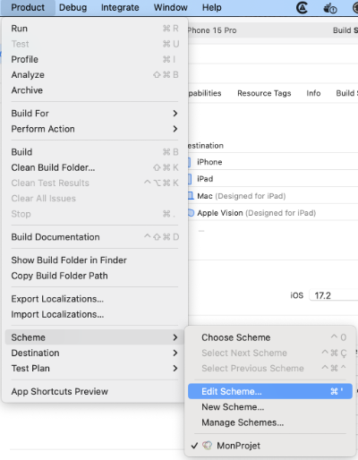
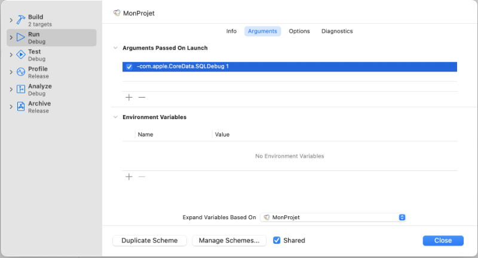
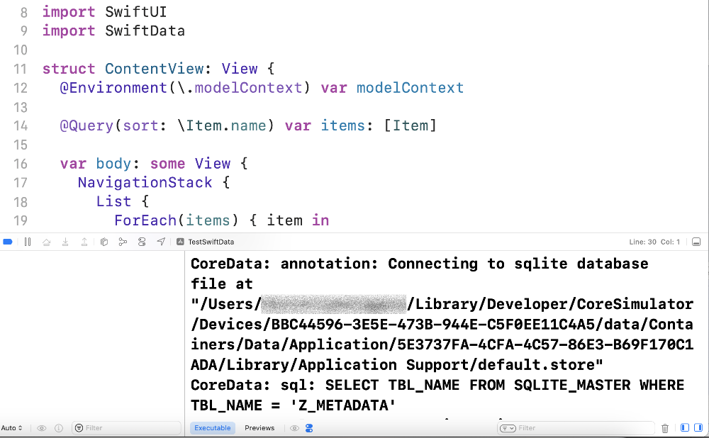

# Déboguer avec SwiftData

Quand vous utilisez SwiftData dans votre application SwiftUI, quelques techniques peuvent aider au débogage.

Dans cette fiche :

- [print() et protocole CustomStringConvertible](debogage-avec-swiftdata.md)
- [dump() et protocole CustomReflectable](debogage-avec-swiftdata.md)
- [Informations de débogage du schéma de compilation](debogage-avec-swiftdata.md)

## print() et protocole CustomStringConvertible

Le protocole `CustomStringConvertible` ressemble beaucoup à la méthode toString() que l'on retrouve dans d'autres langages, notamment JavaScript.

Il permet de déterminer quelle chaîne sera affichée si l'on demande d'afficher une instance de la classe, par exemple à l'aide de `print()`.

Voici ce que `print()` affiche par défaut avec une instance d'un modèle SwiftData.

```text title="Sortie Standard"
MonProjet.Item
```

Pour que le modèle se conforme au protocole `CustomStringConvertible`, il faut définir une propriété `description`.

```swift title="Swift"
@Model
final class Item: CustomStringConvertible {
  var code: String
  var titre: String

  var description: String {
    return "Instance de Item : le code: \(code), le titre: \(titre)"   // ce texte peut prendre la forme qui vous convient
  }

  ...

}
```

Voici désormais le résultat de la commande `print()` sur une instance de cette classe :

```text title="Sortie Standard"
Instance de Item : le code: 123, le titre: Item 123
```

Notez que si vous utilisez `dump()`, vous obtiendrez l'affichage configuré dans `description` suivi d'autres informations de débogage.

```text title="Sortie Standard"
▿ Instance de Item : le code: 123, le titre: Item 123
  - _code: MonProjet.Item._SwiftDataNoType
  - _titre: MonProjet.Item._SwiftDataNoType
  - _$backingData: (Extended Existential)
  ▿ _$observationRegistrar: Observation.ObservationRegistrar
    ▿ extent: Observation.ObservationRegistrar.(unknown context at $7ffc15b294b0).Extent #1
      ▿ context: Observation.ObservationRegistrar.Context
        ▿ state: Observation._ManagedCriticalState<Observation.ObservationRegistrar.(unknown context at $7ffc15b29580).State>
          - buffer: Observation._ManagedCriticalState<Observation.ObservationRegistrar.(unknown context at $7ffc15b29580).State>.(unknown context at $7ffc15b293cc).LockedBuffer #2
            ▿ super: Swift.ManagedBuffer<Observation.ObservationRegistrar.(unknown context at $7ffc15b29580).State, Swift.UnsafeRawPointer>
              ▿ header: Observation.ObservationRegistrar.(unknown context at $7ffc15b29580).State
                - id: 0
                 - observations: 0 key/value pairs
                 - lookups: 0 key/value pairs
```

## dump() et protocole CustomReflectable

Le protocole `CustomReflectable` permet notamment de déterminer quelles informations sont affichées lorsque la commande `dump()` est utilisée avec une instance de la classe.

Il est plus puissant que `CustomStringConvertible`.

Attention : les instances d'un [modèle SwiftData](swiftdata.md#adapter-le-modele-et-lapplication-pour-swiftdata) qui répond au protocole `CustomReflectable` pourraient générer l'erreur « Thread 1: Fatal error: Observation Registrar was not found on Model » lorsqu'elles sont utilisées pour ajouter, modifier ou supprimer des données.

### Sans CustomReflectable

Par défaut, `dump()` affiche beaucoup de données sur une instance d'un modèle SwiftData mais peu d'informations utiles. La valeur des propriétés de l'objet n'est même pas affichée.

```text title="Sortie Standard"
▿ MonProjet.Item #0
  - _code: MonProjet.Item._SwiftDataNoType
  - _titre: MonProjet.Item._SwiftDataNoType
  - _$backingData: (Extended Existential)
  ▿ _$observationRegistrar: Observation.ObservationRegistrar
    ▿ extent: Observation.ObservationRegistrar.(unknown context at $7ffc15b294b0).Extent #1
      ▿ context: Observation.ObservationRegistrar.Context
        ▿ state: Observation._ManagedCriticalState<Observation.ObservationRegistrar.(unknown context at $7ffc15b29580).State>
          - buffer: Observation._ManagedCriticalState<Observation.ObservationRegistrar.(unknown context at $7ffc15b29580).State>.(unknown context at $7ffc15b293cc).LockedBuffer #2
            ▿ super: Swift.ManagedBuffer<Observation.ObservationRegistrar.(unknown context at $7ffc15b29580).State, Swift.UnsafeRawPointer>
              ▿ header: Observation.ObservationRegistrar.(unknown context at $7ffc15b29580).State
                - id: 0
                 - observations: 0 key/value pairs
                 - lookups: 0 key/value pairs
```

### Avec CustomReflectable

En conformant la classe au protocole `CustomReflectable`, il devient possible de spécifier exactement ce que l'on souhaite voir afficher.

Ici, j'ai choisi d'afficher la valeur de chaque propriété.

```swift title="Swift"
@Model
final class Item: CustomReflectable {
  var code: String
  var titre: String

  ...

  var customMirror: Mirror {
    return Mirror(
      self,
      children: [
        "le code": code,
        "le titre": titre,
      ],
      displayStyle: .struct
    )
  }
}
```

Voici désormais le résultat de la commande `dump()` sur une instance de cette classe :

```text title="Sortie Standard"
▿ MonProjet.Item #0
  - le code: "123"
  - le titre: "Item 123"
```

Si vous utilisez plutôt `print()`, vous obtiendrez ceci :

```text title="Sortie Standard"
Item(le code: "123", le titre: "Item 123")
```

## Informations de débogage du schéma de compilation

Il est possible de demander à Xcode de vous fournir automatiquement de l'information sur les tâches réalisées par SwiftData.

Vlous y verrez notamment l'emplacement exact de la base de données de même que les requêtes SQL effectuées.

Pour y parvenir, vous devez ajouter un argument au schéma de compilation (en anglais : **scheme**).

- Rendez-vous dans le menu **Product** / **Scheme** / **Edit Scheme**.

  
- Dans l'onglet **Run** / **Arguments**, section **Arguments Passed On Launch**, entrez la chaîne `-com.apple.CoreData.SQLDebug 1`

  
- Lancez l'application et voyez les informations fournies par SwiftData.

  
