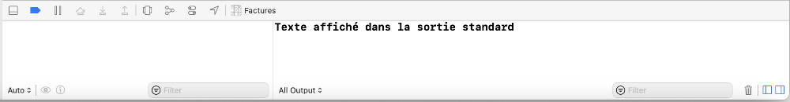
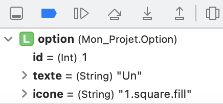
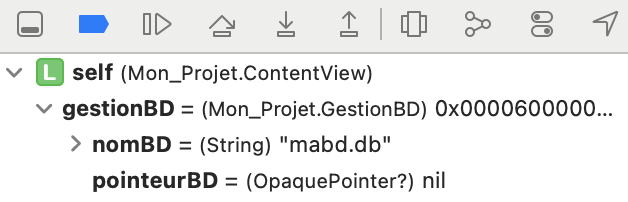
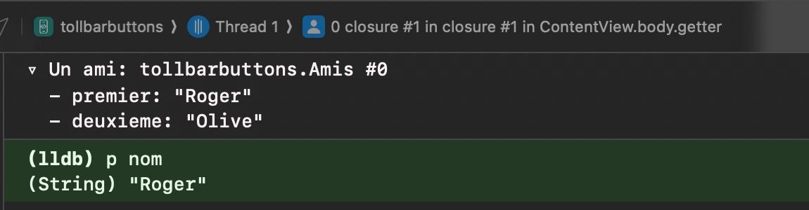
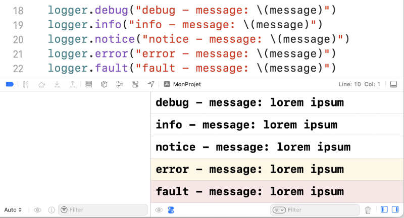
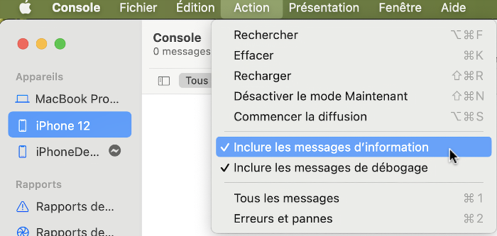
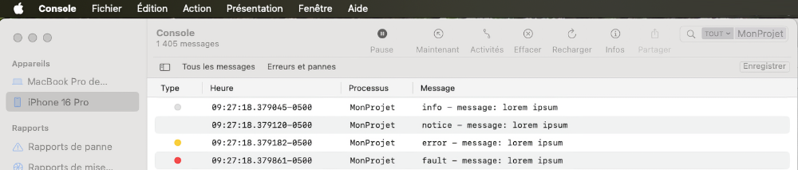
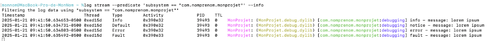
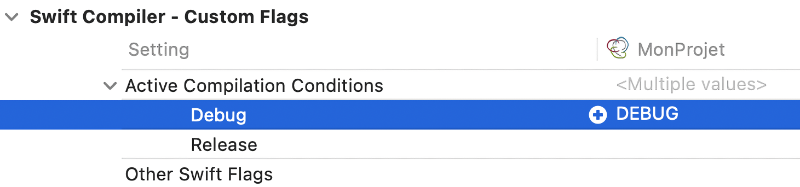
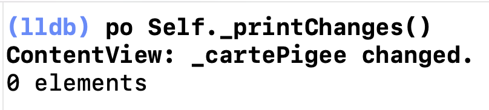

# Déboguer une application SwiftUI

## print(), debugPrint, dump()

Voici trois fonctions qui permettent d'afficher des informations de débogage dans la sortie Standard, que l'on retrouve dans le bas de l'écran de Xcode.

### print()

La fonction [print()](https://developer.apple.com/documentation/swift/1541053-print) est l'une des fonctions qui permettent d'afficher de l'information dans la sortie Standard.

Elle sera utilisée dans du code exécutable, par exemple dans le code d'une fonction ou dans le code d'un bouton, et non dans la définition de la vue.

```swift title="SwiftUI"
Button("Cliquez ici") {
  ...
  print("Texte affiché dans la sortie standard")
 }
```

Sous Xcode, la sortie standard apparaît au bas de l'écran.



Cet exemple n'est pas très utile. Plutôt, vous voudrez afficher la valeur d'une variable ou la valeur d'une expression.

```swift title="SwiftUI"
Button("Cliquez ici") {
  ...
  print(maVariable)
}
```

Ceci fonctionnera pour les variables d'un type simple ou pour les instances d'une structure mais pas pour les instances d'une classe.

Par exemple, si on a une instance de la classe `Item` nommée `item`, l'instruction `print(item)` affichera seulement le type de la variable :

```text title="Sortie Standard"
MonProjet.Item
```

### print directement dans le body()

Il est possible d'utiliser la fonction `print()` dans le `body()`.

Par contre, si vous ne prenez pas les précautions nécessaires, vous obtiendrez le message d'erreur `Type '()' cannot conform to 'View'; only struct/enum/class types can conform to protocols`{ .erreur } :

```swift title="SwiftUI"
var body: some View {
  ...
  print("Texte affiché dans la sortie standard")
  Text("Hello, world!")
 }
```

Il faut faire ceci :

```swift title="SwiftUI"
var body: some View {
  ...
  print("Texte affiché dans la sortie standard")
  return Text("Hello, world!")
 }
```

Autre solution :

```swift title="SwiftUI"
var body: some View {
  ...
  let _ = print("Texte affiché dans la sortie standard")
  Text("Hello, world!")
 }
```

### debugPrint()

La fonction [debugPrint()](https://developer.apple.com/documentation/swift/debugprint(_:separator:terminator:)) ressemble beaucoup à `print()`. La différence, c'est qu'elle donne des informations de plus, par exemple le type des informations affichées.

Tout comme `print()`, elle ne permet pas d'afficher les informations d'une instance de classe.

### dump()

La fonction [dump()](https://developer.apple.com/documentation/swift/dump(_:to:name:indent:maxdepth:maxitems:)) permet elle aussi d'afficher de l'information dans la sortie standard.

Son principal avantage : elle permet d'afficher la valeur des propriétés d'une instance de classe.

Par exemple, si on a une instance de la classe `Item` nommée `item`,  l'instruction `dump(item)` affichera ceci dans la sortie Standard :

```text title="Sortie Standard"
▿ MonProjet.Item #0
  - id: 1
  - code: "000A1"
  - titre: "Item 1"
```

??? info "Pour plus d'information"

    « Swift's print(), debugPrint(), String(reflecting:), Mirror(reflecting:) and dump() ». swiftjectivec.com. <https://www.swiftjectivec.com/swift-debug-print-print-dump-mirror-reflection/>

## Afficher une variable dans le débogueur de Xcode

### 

Grâce au débogueur, il est possible de voir la valeur des variables sans avoir à modifier le code.

Il suffit de placer un point d'arrêt à un endroit où cette variable est visible.

Le débogueur affichera les valeurs d'une variable locale à condition que cette variable soit visible à l'endroit où le point d'arrêt est placé.

```swift title="SwiftUI"
init() {
  ...
  if let option = options.randomElement() {
    // valeur des propriétés de l'objet option visibles si on place un point d'arrêt ici
  }
}
```



### Propriétés d'une vue

Lorsqu'une propriété est déclarée dans une vue, par exemple dans ContentView, il est possible de voir la valeur de la propriété quand on place un point d'arrêt dans n'importe quelle méthode de cette vue puisque les propriétés sont visibles dans toutes les méthodes de la structure.

```swift title="SwiftUI"
struct ContentView: View {
  private var gestionBD: GestionBD = GestionBD(nomBD: "mabd.db")

  init() {
    // variable gestionBD visible si on place un point d'arrêt ici
  }

  var body: some View {
   // variable gestionBD également visible si on place un point d'arrêt ici
  }
  ...
}
```



## Fenêtre de débogage de bas niveau (lldb : Low-Level Debugger)

Pour mieux déboguer une application dans Xcode, il est possible d'utiliser la commande `p` dans la fenêtre de débogage de bas niveau (**lldb**: **Low-Level Debugger**) pour faire afficher la valeur recherchée.

Cette fenêtre apparaît au bas de l'écran de Xcode pendant que l'application est arrêtée sur un point d'arrêt. On y voit l'invite (lldb).

Par exemple, pour trouver la valeur de la variable `nom` :

- Placez un point d'arrêt dans le code à l'endroit où vous désirez voir la valeur de la variable.
- Lancez le programme et attendez qu'il arrive au point d'arrêt. La fenêtre lldb apparaîtra au bas de l'écran de Xcode.
- Dans la fenêtre lldb, ajoutez l'instruction :

  ```text title="Fenêtre lldb"
  p nom
  ```

  

Plusieurs commandes peuvent afficher des valeurs dans la fenêtre lldb :

- `p` (ou `print`) : évalue une variable ou une expression en donnant diverses informations dont le type.
- `e` (ou `expression`) : presque identique à `p` sauf qu'il est possible d'ajouter des options à la commande.
- `po` : appelle la méthode `debugDescription` ou `description` de l'objet.
- `v` : évalue une variable (ne peut pas évaluer une expression) mais ceci lui donne l'avantage d'être plus rapide.

```text title="Fenêtre lldb"
po gagnants.contains(nom)
```

### Évaluer une variable d'état (@State)

Dans le cas d'une variable d'état, il faudra ajouter une barre en bas devant le nom de la variable.

```text title="Fenêtre lldb"
p _maVariableDEtat
```

Si vous omettez la barre en bas alors qu'elle est requise, vous obtiendrez le message `error: Couldn't lookup symbols`{ .erreur }.

Notez que dans certains cas, la valeur de la variable d'état ne sera modifiée que lors du prochain rafraîchissement de l'écran.

??? info "Pour plus d'information"

    « The complete guide to Debug Swift code with LLDB ». Andela. <https://andela.com/insights/the-complete-guide-to-debug-swift-code-with-lldb/>

    « Debugging Swift code with LLDB ». Ahmed Sulaiman. <https://medium.com/@ahmedsulaiman/debugging-swift-code-with-lldb-b30c5cf2fd49>

## Travailler avec un fichier journal (log)

[Apple recommande de travailler avec le système journal unifié](https://developer.apple.com/documentation/os/logging) (**unified logging system**) pour enregistrer des messages à partir d'une application.

Un tel système offre plusieurs avantages :

- Les informations sont enregistrées sur disque et donc peuvent être consultées en tout temps pendant le développement de même que lorsque l'application est installée sur un appareil mobile (pratique, par exemple, pour aider à cerner un problème intermittent sur un appareil mobile).
- La date et l'heure sont automatiquement enregistrées.
- Il est possible de choisir le niveau du message (débogage, d'avertissement, d'erreur, etc.) afin de mieux gérer les informations enregistrées.
- Le système journal unifié de Apple stocke les informations en format binaire, ce qui réduit l'espace disque requis.

Les messages peuvent être enregistrés dans le système journal unifié à l'aide de l'objet Logger.

### Niveau du message

Il est possible de travailler avec des messages différents niveaux.

| Type | Méthode | Quand l'utiliser | Persistance |
| --- | --- | --- | --- |
| Débogage | .debug | Informations de débogaage | aucune |
| Information | .info | Informations utiles mais non essentielles | Persistance seulement avec l'option log collect |
| Avertissement | .notice | Informations essentielles pour aider à cerner un problème | Oui, jusqu'à la limite de stockage |
| Erreur | .error | Erreurs rencontrées pendant l'exécution de l'application | Oui, jusqu'à la limite de stockage |
| Faute | .fault | Erreur sévère, bogue | Oui, jusqu'à la limite de stockage |

### Logger

La méthode privilégiée pour enregistrer de l'information dans un fichier journal consiste à utiliser l'objet [Logger](https://developer.apple.com/documentation/os/logger).

```swift title="Swift"
import OSLog
...

let logger = Logger()
...

logger.debug("test")
```

Pour travailler avec une variable, il faut utliser l'interpolation de chaînes.

```swift title="Swift"
logger.debug("Problème rencontré: \(erreur)")
```

### Consulter le journal

L'information du journal peut être lue de différentes façons :

- directement dans Xcode
- à l'aide de l'application Console (installée par défaut)
- avec la commande `log` au Terminal

#### Xcode

Dans Xcode, les message apparaîtront dans la sortie standard au bas de l'écran.



#### Application Console

- Lancez l'application Console à l'aide de Spotlight (<kbd>⌘ Cmd</kbd>+<kbd>Espace</kbd> puis taper `console`).
- Sélectionnez l'appareil à gauche. Les simulateurs utilisés dans Xcode apparaîtront parmi les autres appareils.
- Rendez-vous dans le menu **Action** pour inclure les messages d'information et de débogage.

  
- Dans le haut de la fenêtre, cliquez sur **Commencer**.
- Pour limiter le nombre de messages affichés, tapez le nom de votre projet dans la zone de recherche.
- Lancez votre application dans le simulateur. Les messages seront affichés.

  Une pastille de couleur indique le niveau du message. Les avertissements n'ont aucune pastille.

  Notez que lors de mes tests, les messages de débogage n'apparaissaient pas même si j'avais activé l'option **Inclure les messages de débogage**.

  

#### Terminal

La commande `log` permet d'afficher le contenu du système journal unifié selon les critères demandés.

Pour afficher seulement les messages journalisés par une application dans le simulateur, il faut prendre le soin d'instancier le Logger avec des paramètres. Vous pouvez entrer ce qui vous plaît comme catégorie.

```swift title="Swift"
let logger = Logger(subsystem: "com.nomprenom.monprojet", category: "debugging")
```

Les message seront affichés en temps réel à l'aide de cette commande :

```text title="Terminal"
log stream --predicate 'subsystem == "com.nomprenom.monprojet"' --info
```

Lancez ensuite votre application et voyez les messages apparaître au fur et à mesure qu'ils sont générés.



Appuyez sur <kbd>⌃ Ctrl</kbd> + <kbd>C</kbd> pour arrêter l'affichage.

Remarquez que contrairement à `log stream`, `log show` permet de voir les messages actuellement présents dans le journal unifié.

Par exemple, pour voir si une clé USB a été branchée à l'ordinateur dans les 30 dernières minutes :

```text title="Terminal"
log show --last 30m --predicate 'eventMessage contains "mounted"' --info
```

Si l'affichage est très long et que vous désirez l'arrêter, appuyez sur <kbd>⌃ Ctrl</kbd> + <kbd>C</kbd>.

??? info "Pour plus d'information"

    « OSLog and Unified logging as recommended by Apple ». SwiftLee. <https://www.avanderlee.com/workflow/oslog-unified-logging/>

    « The Simplest Swift Logging That Could Possibly Work ». Scalyr. <https://www.sentinelone.com/blog/getting-started-swift-logging>

## Constante de débogage

Pendant le développement d'une application SwiftUI, il est intéressant de travailler avec une constante qui indique que l'application est en mode débogage.

Ceci permettra notamment d'ajouter des [blocs de compilation conditionnelle](https://docs.swift.org/swift-book/ReferenceManual/Statements.html#:~:text=Conditional%20Compilation%20Block) (**Conditional Compilation Block**) qui ne seront compilés que pendant le développement de l'application.

- Dans le navigateur de projet de Xcode (s'il n'est pas visible, cliquez sur l'icône de chemise  dans la zone de gauche), cliquez sur le nom du projet.
- Rendez-vous dans l'onglet **Build Settings**.
- Dans le sous-onglet **All**, section **Swift Compiler - Custom Flags**, assurez-vous que la configuration **Debug** contienne la valeur `DEBUG`.

  

Dans votre code, l'instruction `#if DEBUG` permettra de compiler un bloc de code seulement lorsque le mode débogage est activé.

```swift title="Swift"
#if DEBUG
  Text("Débogage")
 #endif
```

??? info "Pour plus d'information"

    « Statements - Conditional Compilation Block ». Swift. [https://docs.swift.org/swift-book/ReferenceManual/Statements.html](https://docs.swift.org/swift-book/ReferenceManual/Statements.html#:~:text=A conditional%20compilation%20block%20allows%20code%20to%20be%20conditionally%20compiled)

## Self._printChanges

Pour vous aider à déterminer qu'est-ce qui a causé un rafraîchissement de la vue, vous pouvez utiliser l'instruction `po Self._printChanges()` dans la fenêtre de débogage de bas niveau.

L'instruction peut également être utilisée directement dans le code.

### Fenêtre de débogage de bas niveau

Dès qu'un point d'arrêt est rencontré, entrez cette commande à l'invite **lldb** et Xcode vous affichera quelle variable a causé le rafraîchissement.



### Directement dans le code

Lorsque cette commande est utilisée directement dans le code, vous voyez en tout temps ce qui a causé le rafraîchissement de la vue.

Mais attention : si vous utilisez cette instruction directement dans la vue sans prendre de précautions, vous obtiendrez le message d'erreur `Type '()' cannot conform to 'View'`{ .erreur }.

Pour régler ce problème :

```swift title="SwiftUI"
var body: some View {
  let _ = Self._printChanges()
  NavigationStack {
    ...
  }
}
```

??? info "Pour plus d'information"

    « Debugging SwiftUI views: what caused that change? ». SwiftLee. <https://www.avanderlee.com/swiftui/debugging-swiftui-views/>

## Déboguer une application sur le iPhone

Si vous devez déboguer une application qui utilise un capteur ou une autre fonctionnalité qui requiert que l'application roule sur le iPhone, vous serez heureux d'apprendre que vous pouvez avoir accès à toutes les fonctionnalités de débogage de Xcode.

Pour y parvenir, il suffit d'[installer l'application sur le téléphone à partir de Xcode](installer-une-application-swiftui-sur-iphone.md#installation-sans-passer-par-lappstore).

Tant que le téléphone est branché à Xcode, tous les outils de débogage sont disponibles : points d'arrêt, [console lldb](deboguer-une-application-swiftui.md#fenetre-de-debogage-de-bas-niveau-lldb-low-level-debugger), etc.
