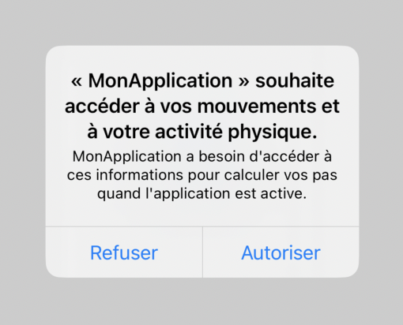
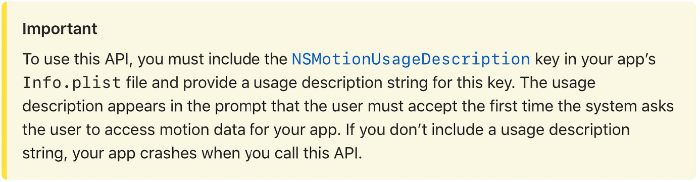
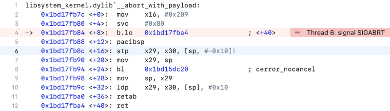
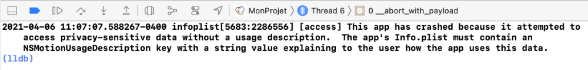
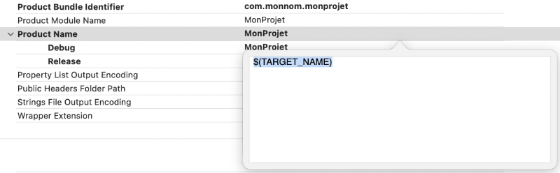
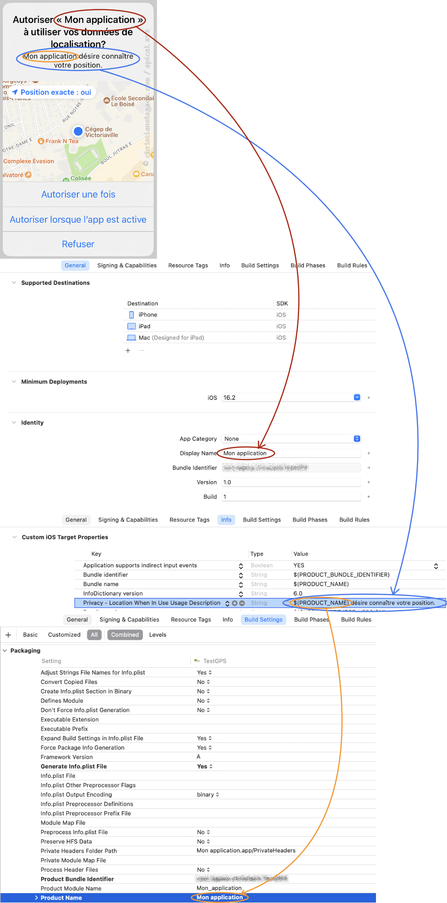
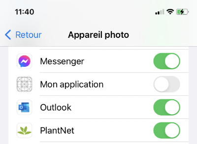

# Demander une permission

## Permission requise pour travailler avec un capteur

Certaines classes intéragissent avec des capteurs afin de fournir des informations dont l'usage est en lien avec le respect de la vie privée.

Lorsqu'une application utilise une telle classe, il faut demander à l'usager la permission d'utiliser des données en lien avec sa vie privée.

Ceci consiste à [ajouter une clé dans Info.plist](info-plist.md#ajouter-une-paire-cle-valeur-dans-infoplist) afin d'indiquer à l'usager pourquoi l'application veut utiliser ces informations.

Le nom exact de la clé est précisé dans la documentation officielle de la classe en question.

Grâce à cette clé, lorsque l'application sera lancée, une boîte de dialogue demandera à l'usager la permission d'utiliser ces informations. L'usager devra accepter pour que l'application puisse fonctionner.

### Quelles fonctionnalités nécessitent l'ajout d'une clé dans Info.plist?

Lorsque c'est requis, la documentation indique clairement qu'il faut ajouter une entrée dans Info.plist. Pour chacune des classes en cause, on retrouve un avertissement du genre[1](https://developer.apple.com/documentation/coremotion/cmpedometer) :

Si vous ne le faites pas, l'application plantera ou les fonctionnalités qui requièrent cette clé ne seront pas activées.

Dans le cas où l'application plante, vous obtiendrez dans Xcode un écran qui indique que l'application a envoyé un code SIGABRT (SIGnal ABoRT).

Et au bas de l'écran, vous aurez un message qui indique plus clairement ce qui a causé ce signal.

Par exemple, dans le cas d'une application qui utilise la classe CMPedometer, le message indique que l'application n'a pas de clé [NSMotionUsageDescription](https://developer.apple.com/documentation/bundleresources/information_property_list/nsmotionusagedescription) dans son fichier Info.plist.

Pour que l'application puisse fonctionner, vous devez [ajouter une clé dans Info.plist](info-plist.md#ajouter-une-paire-cle-valeur-dans-infoplist).

Dans la clé nouvellement ajoutée, la valeur doit correspondre au texte qui indique pourquoi l'application a besoin d'accéder à ces informations.

Ce pourrait être quelque chose du genre « $(PRODUCT_NAME) a besoin d'accéder à ces informations pour calculer vos pas quand l'application est active. ».

### Source

1. « CMPedometer ». Apple. <https://developer.apple.com/documentation/coremotion/cmpedometer>

??? info "Pour plus d'information"

    « Requesting Authorization for Location Services ». Apple. <https://developer.apple.com/documentation/corelocation/requesting_authorization_for_location_services>

## Variable $(PRODUCT_NAME)

Plusieurs variables sont disponibles pour configurer la valeur qui correspond à une clé dans [Info.plist](info-plist.md#ajouter-une-paire-cle-valeur-dans-infoplist).

L'une de celles que vous utiliserez probablement est `$(PRODUCT_NAME)` pour représenter la chaîne qui identifie le nom de l'application avec, si requis, espaces et accents.

Pour voir ce que cette variable affichera :

- Dans le navigateur de projet, cliquez sur le nom du projet.
- Cliquez sur l'onglet **Build Settings**.
- Dans la section **Packaging**, retrouvez l'entrée **Product Name**.
- Le nom de produit peut être différent en développement et en production. Par défaut, les deux sont initialisés par la variable $(TARGET_NAME). Il s'agit d'une chaîne qui, par défaut, est identique au nom du dossier de l'application. Il est possible de changer cela pour utiliser la chaîne de votre choix, par exemple en ajoutant un espace entre les mots ou des caractères accentués où cela est requis.

  

Voici une illustration de la provenance du texte qui apparaît dans la boîte de dialogue.

##

## Modifier la permission une fois qu'elle a été donnée

Pendant que vous développez une application, il peut être utile de retirer une permission ou de changer son niveau afin de poursuivre vos tests.

Il est possible de le faire directement sur le iPhone.

Voici quelques exemples de permissions que vous pourriez vouloir changer.

### Permisison d'utiliser la caméra

Pour modifier la permission d'utliser la caméra :

- Rendez-vous dans **Réglages** / **Confidentialité et sécurité** / **Appareil photo**.
- Le iPhone vous présente une liste des applications qui ont demandé la permission d'utiliser la caméra.
- Retrouvez votre application dans la liste.
- Grisez le contrôle de bascule si vous ne souhaitez plus que cette application ait accès à la caméra.

  Dans le cas où vous souhaitez que l'application vous demande à nouveau la permission, vous devez supprimer l'application puis l'installer à nouveau.

  

### Permision de localisation

Pour modifier la permission de localisation :

- Rendez-vous dans **Réglages** / **Confidentialité et sécurité** / **Service de localisation**.
- Cliquez sur le nom de votre application dans la liste.
- Choisissez le niveau de permission désiré.

  Les options seront légèrement différentes selon la clé ajoutée dans Info.plist.

  Dans tous les cas, une des options permet de préciser que la permission devra être demandée à nouveau lors du prochain lancement de l'application.

  |  |  |
  | --- | --- |
  | Autoriser l'accès à votre position | Autoriser l'accès à votre position avec toujours |
  | Application avec clé NSLocationWhenInUseUsageDescription | Application avec clé NSLocationAlwaysAndWhenInUseUsageDescription |
