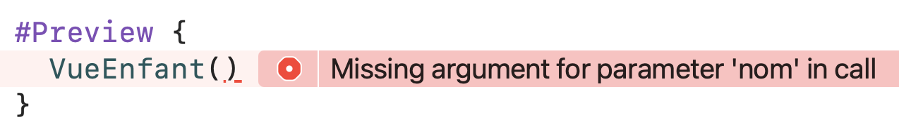
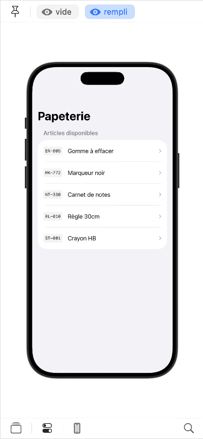

# Données pour le canevas (#Preview)

## Données SwiftData affichées dans le canevas (#Preview)

Lorsque les données d'une application mobile iOS sont chargées à l'aide de SwiftData ([@Query](swiftdata.md#requetes-pour-retrouver-les-donnees-de-la-base-de-donnees-query)), il faut ajuster la prévisualisation pour que des données apparaissent dans le canevas.

### Prévisualiser avec les données en mémoire initialisées par le modelContainer

Le canevas travaille avec des données en mémoire. Il n'a pas accès à la base de données.

Pour prévisualiser l'application avec des données, une technique intéressante consiste à réutiliser [le modelContainer qui ajoute les données initiales dans la base de données](swiftdata.md#inserer-des-donnees-initiales-dans-la-base-de-donnees).

Ceci permettra au canevas d'exécuter la requête `@Query` à partir de données en mémoire, initialisées par le `modelContainer`.

```swift title="SwiftUI"
#Preview("rempli") {
  ContentView()
    .modelContainer(preloadAppContainer)
}
```

### Prévisualiser lorsqu'aucune donnée n'est disponible

Il est également utile d'ajouter un deuxième `#Preview` pour visualiser l'interface lorsqu'aucune donnée n'est disponible.

Plutôt que d'utliser un `modelContainer` qui fait des insertions de données, on travaillera avec un `modelContainer` vide.

```swift title="SwiftUI"
#Preview("vide") {
  ContentView()
    .modelContainer(for: Categorie.self, inMemory: true)
}
```

Dans la zone du canevas, on peut passer d'un `#Preview` à l'autre à l'aide des boutons dans le haut de la zone.

Il est désormais plus facile de prévisualiser la vue responsable du `@Query` lorsque la requête fournit des données à afficher et lorsqu'aucune donnée ne répond à cete requête.

 

### Réinitialiser les données du canevas

Si, après avoir modifié les données en faisant des tests dans le canevas, vous désirez remettre les données initiales en place, suivez les instructions sur cette fiche : « [Forcer le rafraîchissement des données en cache du canevas](canevas.md) ».

### Pour plus d'information

« How to use SwiftData in SwiftUI previews ». Hacking with Swift. <https://www.hackingwithswift.com/quick-start/swiftdata/how-to-use-swiftdata-in-swiftui-previews>

## Ajuster la prévisualisation d'une vue qui contient un @Binding ou un @Bindable

Lorsqu'une vue enfant a des propriétés déclarées avec `@Binding` ou avec `@Bindable`, ou même des propriétés en lecture seule, il faut apporter des ajustements à sa prévisualisation pour que tout fonctionne.

Si vous laissez la prévisualisation telle quelle, vous obtenez le message « Missing argument for parameter ... in call ».



Lorsqu'une vue déclare une propriété en lecture seule dont la valeur provient de la vue parent, il suffit de passer une valeur en paramètre dans l'appel de la vue à l'intérieur du `#Preview`. Mais ceci ne fonctionne pas pour une propriété déclarée avec `@Binding` ou `@Bindable`.

Dans cette fiche, je vous expose différentes techniques pour ajuster le `#Preview` pour des paramètres `@Binding` ou `@Bindable` :

- [Fournir une valeur aux propriétés](donnees-pour-le-canevas-preview.md#ajuster-la-previsualisation-dune-vue-qui-contient-un-binding-ou-un-bindable)
  - [Déclaration d'une variable d'état dans le #Preview](donnees-pour-le-canevas-preview.md#ajuster-la-previsualisation-dune-vue-qui-contient-un-binding-ou-un-bindable)
  - [Liaison avec une valeur immuable (.constant())](donnees-pour-le-canevas-preview.md#ajuster-la-previsualisation-dune-vue-qui-contient-un-binding-ou-un-bindable)
  - [Vue intermédiaire](donnees-pour-le-canevas-preview.md#ajuster-la-previsualisation-dune-vue-qui-contient-un-binding-ou-un-bindable)
- [Pour voir le titre de la vue enfant et les barres d'outils](donnees-pour-le-canevas-preview.md#ajuster-la-previsualisation-dune-vue-qui-contient-un-binding-ou-un-bindable)

### Fournir une valeur aux propriétés

Voici quelques techniques pour que le `#Preview` puisse fournir une valeur aux propriétés.

#### Déclaration d'une variable d'état dans le #Preview

Il est possible de déclarer une variable d'état directement dans le `#Preview`.

Il faut faire précéder cette variable par la macro [@Previewable](https://developer.apple.com/documentation/SwiftUI/Previewable()).

```swift title="SwiftUI"
struct VueEnfant: View {
  @Binding var nom: String

  var body: some View {
    ...
    .navigationTitle("Vue enfant")
  }
}

#Preview {
  @Previewable @State var nom: String = "Annie"
  VueEnfant(nom: $nom)
}
```

Ceci fonctionne également lorsque la liaison est réalisée sur un objet.

```swift title="SwiftUI"
struct AutreVueEnfant: View {
  @Binding var nom: String
  @Binding var item: Item

  var body: some View {
    ...
    .navigationTitle("Autre vue enfant")
  }
}

#Preview {
  @Previewable @State var nom: String = "Annie"
  @Previewable @State var item: Item = Item(code: "C", titre: "Item C")
  AutreVueEnfant(nom: $nom, item: $item)
}
```

`@Previewable` peut être utilisé pour spécifier un paramètre `@Bindable`. Cette fois, il ne faut pas ajouter de `$` devant le nom de la variable.

```swift title="SwiftUI"
struct VueAvecBindable: View {
  @Bindable var points: Int

  var body: some View {
    ...
    .navigationTitle("Vue avec @Bindable")
  }
}

#Preview {
  @Previewable @State var points: Int = 25
  VueAvecBindable(points: points)
}
```

#### Liaison avec une valeur immuable (.constant())

La méthode [.constant()](https://developer.apple.com/documentation/swiftui/binding/constant(_:)) peut être utilisée lors de l'appel de la vue dans le `#Preview`. Cette syntaxe est réservée pour les paramètre déclarés avec `@Binding`. Elle ne fonctionne pas avec les `@Bindable`.

Elle permet de créer une valeur immuable, qui sera utilisée pour la liaison.

```swift title="SwiftUI"
struct VueEnfant: View {
  @Binding var nom: String

  var body: some View {
    ...
    .navigationTitle("Vue enfant")
  }
}

#Preview {
  VueEnfant(nom: .constant("Annie"))
}
```

Notez que l'utilisation de `.constant()` est requise seulement pour les propriétés déclarées avec `@Binding`.

Si la vue enfant a une propriété en lecture seule (donc déclarée sans `@Binding` ni `@Bindable`), vous devez simplement fournir la valeur.

```swift title="SwiftUI"
struct EncoreUneVueEnfant: View {
  var uneVariable: UnType

  var body: some View {
    ...
    .navigationTitle("Encore une vue enfant")
  }
}

#Preview {
  EncoreUneVueEnfant(uneVariable: UnType())   // la variable n'a pas de binding donc pas de .constant() ici
}
```

Si vous utilisez `.constant()` alors que ce n'est pas requis, vous obtiendrez un message du genre « Type '...' has no member 'constant' ».

#### Vue intermédiaire

Certains développeurs aiment travailler avec une vue intermédiaire qui pourra initialiser les variables requises pour les liaisons.

```swift title="SwiftUI"
struct VueEnfant: View {
  @Binding var nom: String

  var body: some View {
    ...
    .navigationTitle("Vue enfant")
  }
}

#Preview {
  return VueIntermediaire()

  struct VueIntermediaire: View {
    @State var nom: String = "Annie"

    var body: some View {
      VueEnfant(nom: $nom)
    }
  }
}
```

La technique de la vue intermédiaire peut être utilisé pour spécifier un paramètre `@Bindable`. Cette fois, il ne faut pas ajouter de `$` devant le nom de la variable.

```swift title="SwiftUI"
struct VueAvecBindable: View {
  @Bindable var points: Int

  var body: some View {
    ...
    .navigationTitle("Vue enfant")
  }
}

#Preview {
  return VueIntermediaireBindable()

  struct VueIntermediaireBindable: View {
    @State var points: Int = 25

    var body: some View {
      VueAvecBindable(points: points)
    }
  }
}
```

### Pour voir le titre de la vue enfant et les barres d'outils

Jusqu'ici, les techniques présentées permettent de prévisualiser le corps de la vue mais le contenu du `.navigationTitle()` et du `.toolbar()` n'apparaissent pas.

Ceci est dû au fait que `NavigationStack` est défini dans la vue parent mais il n'est pas redéfini dans la vue enfant.

Donc, si la vue enfant est appelée directement par le `#Preview`, le `.navigationTitle()` et le `.toolbar()` sont ignorés puisqu'ils ne sont pas définis à l'intérieur d'un `NavigationStack`.

Pour régler le problème, il suffit d'ajouter le `NavigationStack` dans le `#Preview`.

```swift title="SwiftUI"
#Preview {
  @Previewable @State var nom: String = "Annie"

  NavigationStack {
    VueEnfant(nom: $nom)
  }
}
```

## Ajuster la prévisualisation d'une vue qui reçoit en paramètre des données provenant de SwiftData

Dans une vue qui effectue une requête à la base de données à l'aide de `@Query`, il est facile de prévisualiser la vue avec ses données : il suffit de préciser dans le `#Preview` le `modelContainer` à utiliser pour générer des données en mémoire, tel que démontré dans la fiche « [Données SwiftData affichées dans le canevas (#Preview)](swiftdata.md#donnees-swiftdata-affichees-dans-le-canevas-preview) ».

Lorsqu'il s'agit d'une vue enfant qui reçoit en paramètre des données SwiftData, la technique est différente.

Prenons l'exemple d'une vue enfant qui reçoit une catégorie en paramètre afin d'afficher les items de cette catégorie.

```swift title="SwiftUI"
struct ListeItems: View {
  var categorie: Categorie

  var body: some View {
    ...
  }
}
```

Je vous montre ici comment mettre en place un `modelContainer` dans le `#Preview` afin de fournir des données de prévisualisation à la vue.

Je vous propose de créer deux canevas. Le premier pour illustrer ce qui sera affiché quand la liste à afficher est vide et un second pour illustrer une liste remplie.

```swift title="SwiftUI"
#Preview("vide") {
  let categorie = Categorie(
    titre: "Informatique",
    items: []
  )

  let config = ModelConfiguration(isStoredInMemoryOnly: true)
  let container = try! ModelContainer(for: Categorie.self, configurations: config)

  container.mainContext.insert(categorie)

  return NavigationStack {
    VueEnfant(categorie: categorie)
  }
  .modelContainer(container)
}

#Preview("rempli") {
  let categorie = Categorie(
    titre: "Papeterie",
    items: [
      Item(code: "ST-001", titre: "Crayon HB"),
      Item(code: "RL-010", titre: "Règle 30cm"),
      Item(code: "NT-330", titre: "Carnet de notes"),
      Item(code: "ER-005", titre: "Gomme à effacer"),
      Item(code: "MK-772", titre: "Marqueur noir"),
    ]
  )

  let config = ModelConfiguration(isStoredInMemoryOnly: true)
  let container = try! ModelContainer(for: Categorie.self, configurations: config)

  container.mainContext.insert(categorie)

  return NavigationStack {
    VueEnfant(categorie: categorie)
  }
  .modelContainer(container)
}
```

Dans la zone du canevas, on peut passer d'un `#Preview` à l'autre à l'aide des boutons dans le haut de la zone.

Il est désormais plus facile de prévisualiser la vue enfant lorsqu'elle a des données à afficher et lorsqu'elle n'en a pas.

 

### Pourquoi le modelContainer est-il requis?

Si vous tentez de créer un `#Preview` qui ne fait qu'instancier une catégorie sans passer par un `modelContainer`, la prévisualisation semblera fonctionner à première vue.

Cependant, certaines opérations seront erronées.

Par exemple, si la vue enfant affiche le nombre d'items dans la catégorie et que la vue permet la suppression d'un item, un `#Preview` avec `modelContainer` ajustera le nombre alors qu'un `#Preview` sans `modelContainer` gardera le nombre original intact.

Ceci n'est qu'un exemple parmi tant d'autres.

Pour cette raison, il faut toujours prendre soin d'ajouter un `modelContainer` dans le `#Preview` d'une vue dont les données proviennent de SwiftData.
