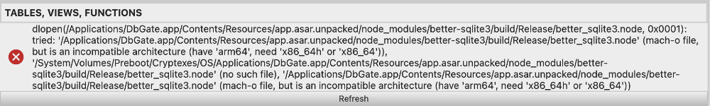
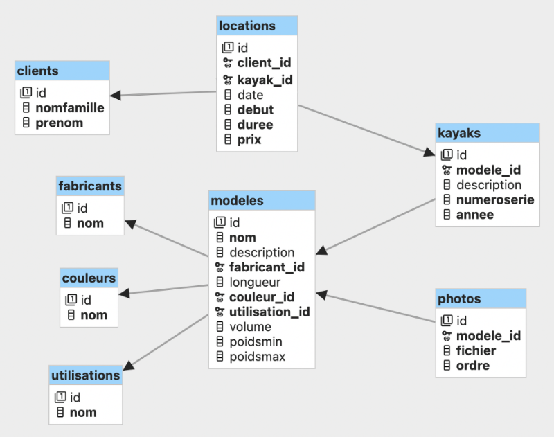

# Éditeur Visuel SQLite : DbGate

## Installation de DbGate

DbGate est un éditeur visuel pour MySQL, PostgreSQL, MS SQL, MongoDB et SQLite.

Il fonctionne sous Windows, Linux, macOS et dans un navigateur Web.

Vous pouvez télécharger DBGate à partir de ce lien : <https://dbgate.org/>

La dernière fois que j'ai visité ce site, la version payante était présentée par défaut. Prenez soin de cliquer sur l'onglet **DBGate Community**.

Vous devez télécharger la version qui correspond au type de puce de votre processeur.

Pour le connaître, rendez-vous dans le menu **** / **À propos de ce Mac**. Le type de puce apparaît dans la zone **Processeur** ou **Puce** selon le cas.

|  |  |
| --- | --- |
| Puce Intel | Puce Apple |
| Puce Intel | Puce Apple silicon |

Si vous avez une puce Intel, sélectionnez **Installer Intel (x86)**.

Si vous avez une puce Apple, sélectionnez **Installer Apple (arm64)**.

Si la version téléchargée ne correspond pas au type de puce du processeur de votre ordinateur, vous obtiendrez un message du genre `dlopen... (mach-o file, but is an incompatible architecture (have 'arm64', need 'x86_64h' or 'x86_64')`{ .erreur } lorsque vous tenterez d'ouvrir une base de données.

??? info "Pour plus d'information"

    « Documentation ». DbGate. <https://dbgate.org/docs/>

## Travailler avec DBGate

Pour ouvrir une base de données dans [DBGate](editeur-visuel-sqlite-dbgate.md#installation-de-dbgate), il faut ajouter une connexion.

- Dans la zone **Connections**, cliquez sur le +.
- Sélectionnez le type de connexion SQLite.
- Dans la zone **Database file**, retrouvez le chemin complet de la base de données.
- Vous pouvez nommer et enregistrer votre connexion si vous pensez la réutiliser. Sinon, vous pouvez simplement cliquer sur **Connect**.

Il est maintenant possible de voir les tables et leurs données puis d'effectuer les manipulations désirées soit par SQL (**File** / **New query**) ou à l'aide de l'interface graphique.

IMPORTANT : quand vous effectuez des modifications dans une base de données dans l'interface graphique, vous devez cliquer sur **Save** au bas de l'écran pour que les modifications soient effectives.

### Schéma de la base de données (structure de la BD)

Pour voir la structure de la base de données sous forme de schéma :

- Rendez-vous dans le menu **File** / **New ER diagram**.
- Faites glisser les tables de la zone de gauche vers la zone de droite puis réorganisez-les selon votre besoin.

