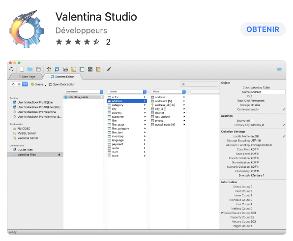
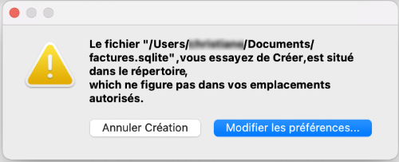
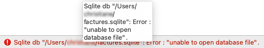
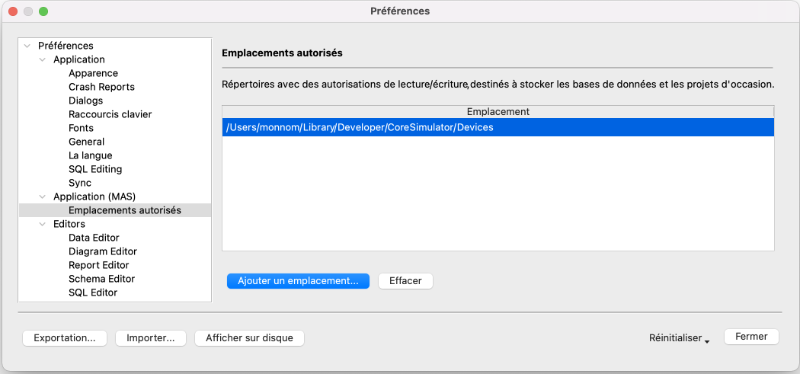
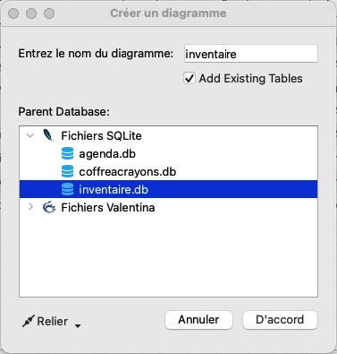
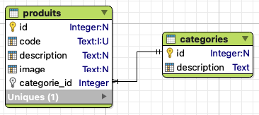
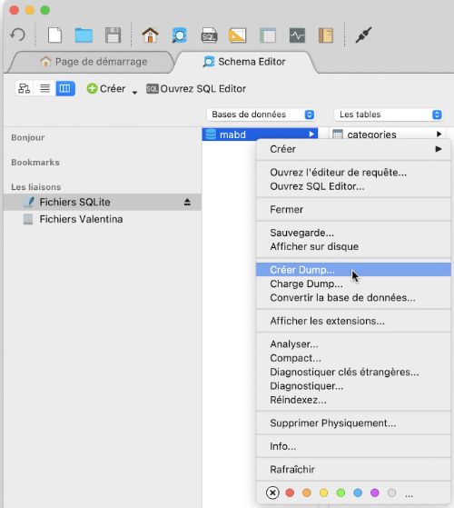
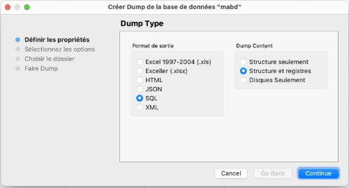

# Éditeur Visuel SQLite : Valentina Studio

## Installer Valentina Studio

[Valentina Studio Free](https://www.valentina-db.com/en/valentina-studio-overview) est un outil graphique pour gérer vos bases de données.

Il est gratuit et fonctionne sous macOS, Windows et Linux. Une version payante est disponible pour accéder à plus d'options.

Valentina Studio permet de gérer les bases de données SQLite, MySQL, mssql et PostgreSQL.

### Installation sous macOS

La façon la plus simple de l'installer sous macOS est de passer par l'App Store.

## Configurer les emplacements autorisés dans Valentina Studio

Avant de débuter votre travail avec une base de données SQLite, vous devez vous assurer que Valentina Studio dispose des accès requis sur le dossier.

Cette précaution est nécessaire notamment si vous avez installé Valentina Studio à partir de l'App Store. Ce type d'installation est plus sécuritaire puisque l'application est installée en [bac à sable](https://fr.wikipedia.org/wiki/Sandbox_(s%C3%A9curit%C3%A9_informatique)) (**sandbox**), c'est-à-dire qu'elle fonctionne en isolement par rapport au système d'exploitation.

Si vous ne donnez pas les accès au dossier de la base de données, vous pourriez obtenir le message « Le fichier "..." vous essayez de créer est situé dans le répertoire, which ne figure pas dans vos emplacements autorisés. » (ouf, problème de traduction ici!) ou, lors de l'édition des données d'une BD existante : « Sqlite db "...: Error : "unable to open database file". ».

Pour configurer les emplacements autorisés :

- Rendez-vous dans le menu **Modifier** / **Préférences**.
- Dans la zone de gauche, sélectionnez **Emplacements autorisés**.
- Cliquez sur **Ajouter un emplacement** puis entrez le chemin du dossier dans lequel se trouve la base de données à éditer. Le dossier choisi et ses sous-dossiers pourront être utilisés par Valentina Studio.

### Pour plus d'information

« Preferences Dialog - Allowed Locations Help ». Valentina. <http://valentina-db.com/docs/dokuwiki/v7/doku.php?id=valentina:products:vstudio:help:dialogs:preferences:allowed_locations>

## Générer un diagramme de la base de données

Un diagramme de base de données permet d'avoir un visuel de la structure de la base de données et, si les contraintes d'intégrité référencielles sont en place, des liens entre ses tables.

Pour créer un diagramme de base de données sous Valentina Studio :

- Ouvrez la base de données désirée.
- Cliquez sur l'icône **Diagram Editor** ().
- Dans le bas de l'écran, cliquez sur **Nouveau diagramme**.
- Donnez un nom au diagramme et cochez **Add Existing Tables**.
- Dans la zone **Parent Database**, rtrouvez la base de données ouverte plus tôt puis cliquez sur **D'accord**.

  

Et voilà le résultat!

Par défaut, les champs des tables sont affichés en ordre alphabétique à l'exception de la clé primaire qui est toujours placée en premier.

Je vous propose de modifier cette configuration de façon permanente et pour toutes les bases de données :

- Rendez-vous dans le menu **Modifier** / **Préférences**.
- Sélectionnez **Editors** / **Schema Editor**.
- Enlevez le crochet devant **Sort fields**.

## Générer un script SQL avec Valentina Studio

Dans plusieurs SGBD, par exemple MySQL, la technique pour sauvegarder une base de données consiste à réaliser une exportation, ce qui génère un script SQL.

La base de données SQLite est contenue dans un fichier. Il est facile de créer une sauvegarde de la base de données simplement en copiant son fichier.

Les script SQL sont tout de même une avenue intéressante avec SQLite.

En plus de servir de sauvegarde, ils permettent de modifier manuellement la structure ou les données de la BD et de regénérer le tout rapidement.

Pour générer un script SQL de la base de données avec Valentina Studio :

- Ouvrez la base de données.
- Dans l'onglet **Schema Editor**, faites un clic droit sur la BD puis choissez **Créer Dump**.

  
- Dans l'écran **Créer Dump**, choisissez le format de sortie **SQL**.

  La traduction fait défaut dans la zone **Dump Content**. Vous devez choisir entre :

  - Structure seulement
  - Structure et données (indiqué par Structure et registres)
  - Données seulement (indiqué par Disques seulement).

  
- Choisissez les options désirées dans les écrans suivants et le script sera enregistré à l'endroit que vous aurez spécifié.
