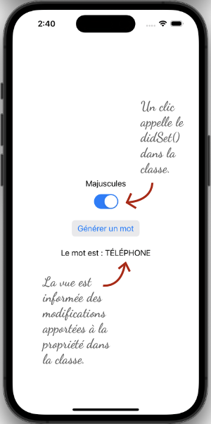
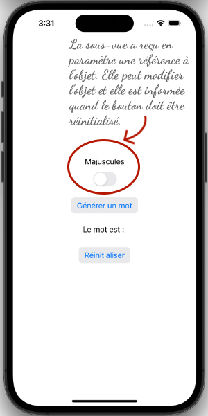
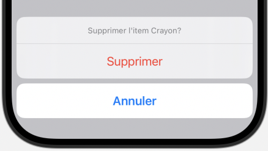
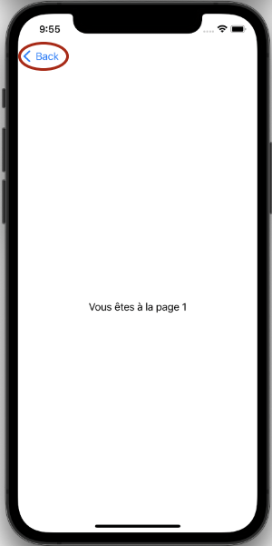
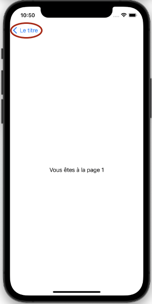
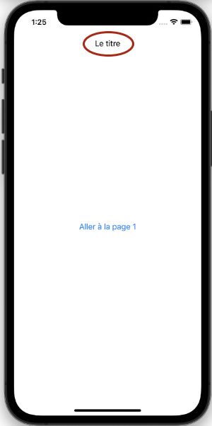
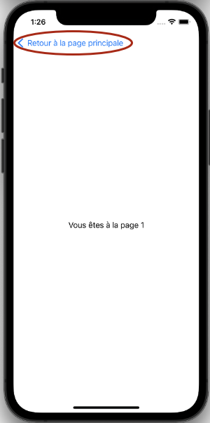

# Fonctions obsolètes ou anciennes syntaxes

## onChange() avant iOS 17

Depuis iOS 17, [la syntaxe de onChange()](reagir-a-un-changement.md) a été simplifiée.

Dans les extaits de code qui suivent, je vous montre comment le [onChange()](https://developer.apple.com/documentation/swiftui/view/onchange(of:perform:)) était réalisé avant iOS 17.

Si vous utilisez cette syntaxe avec iOS 17 ou plus, vous obtiendrez un message du genre « 'onChange(of:perform:)' was deprecated in iOS 17.0: Use `onChange` with a two or zero parameter action closure instead. ».

```swift title="SwiftUI"
struct ContentView: View {
  @State private var uneVariable: String = ""

  var body: some View {
    VStack {
      ...
    }
    // syntaxe avant iOS 17
    .onChange(of: uneVariable, perform: { nouvelleValeur in
      print(uneVariable)   // affiche la nouvelle valeur
      print(nouvelleValeur)   // affiche la nouvelle valeur
      ...
    })
  }
}
```

#### Ignorer la valeur

Si, dans le bloc de code, vous n'avez pas besoin de travailler avec la valeur de la variable, vous pouvez l'ignorer en utilisant une barre de soulignement.

```swift title="SwiftUI"
struct ContentView: View {
  @State private var uneVariable: String = ""

  var body: some View {
    VStack {
      ...
    }
    // syntaxe avant iOS 17
    .onChange(of: uneVariable, perform: { _ in
      ...
    })
  }
}
```

#### Valeur originale vs valeur modifiée

Dans le cas où vous avez besoin de connaître la valeur originale de même que la nouvelle valeur, vous pouvez mettre le vrai nom de la variable entre crochets carrés, devant le nom que vous désirez donner à la nouvelle valeur.

```swift title="SwiftUI"
struct ContentView: View {
  @State private var uneVariable: String = ""

  var body: some View {
    VStack {
      ...
    }
    // syntaxe avant iOS 17
    .onChange(of: uneVariable, perform: { [uneVariable] nouvelleValeur in
      print(uneVariable)   // affiche la valeur originale
      print(nouvelleValeur)   // affiche la nouvelle valeur
    })
  }
}
```

## ObservableObject, @Published et @StateObject

La macro [@Observable](observer-les-changements-a-un-objet.md) n'existe que depuis iOS 17, sorti en septembre 2023.

Auparavant, le mécanisme d'observation nécessitait trois choses :

- Une classe qui répond au protocole [ObservableObject](https://developer.apple.com/documentation/combine/observableobject)
- Une ou plusieurs propriétés de cette classe marquées avec [@Published](https://developer.apple.com/documentation/combine/published)
- Dans la vue qui utilise la classe, une propriété qui observe un objet de cette classe, marquée par [@StateObject](https://developer.apple.com/documentation/swiftui/stateobject)

Ce mécanisme fonctionne encore mais la macro `@Observable` est plus simple à utiliser.

Voici un exemple de classe qui définit un objet observable à l'aide de l'ancienne technique.

```swift title="SwiftUI (avant iOS 17)"
class Position: ObservableObject {
  @Published var x: Double = 0.0
  @Published var y: Double = 0.0
  @Published var z: Double = 0.0

  func modifierPosition() {
    ...   // mécanisme pour modifier une ou plusieurs propriétés publiées
  }
}
```

Et voici un exemple de vue qui doit surveiller un objet de cette classe.

Au même titre qu'une [variable d'état](l-etat-dans-swiftui.md), les variables observées forcent le rafraîchissement de la vue dès qu'elles sont modifiées.

```swift title="SwiftUI (avant iOS 17)"
struct ContentView: View {
  @StateObject private var position: Position = Position()   // l'objet est instancié ici

  var body: some View {
    ...
    Text(position.x)   // sera rafraîchi dès que la propriété change dans la classe
  }
}
```

Prenez note qu'au lieu de `@StateObject`, il est possible de [travailler avec @ObservableObject dans une sous-vue](fonctions-obsoletes-ou-anciennes-syntaxes.md#partager-un-objet-observe-entre-deux-vues-stateobject-vs-observedobject) ou encore avec [@EnvironmentObject](https://developer.apple.com/documentation/swiftui/environmentobject) si l'objet [a été rendu disponible à tous les descendants](https://www.hackingwithswift.com/quick-start/swiftui/how-to-use-environmentobject-to-share-data-between-views).

### Initialisation dans le constructeur

Si vous devez passer par le constructeur pour initialiser un objet décoré avec @StateObject, quelques précautions s'imposent sinon, vous obtiendrez un message du genre « Cannot assign to property: '...' is a get-only property ».

D'abord, il faut faire précéder le nom de la propriété par une barre de soulignement. En effet, on travaille ici avec une propriété encapsulée, aussi appelée **propriété privée sous-jacente** (en anglais : **backing property**) qui a été créée automatiquement lors de la déclaration de la variable décorée avec @StateObject.

Ensuite, il faut utiliser [StateObject(wrappedValue:...)](https://developer.apple.com/documentation/swiftui/stateobject#Initialize-state-objects-using-external-data) pour faire l'initialisation.

Voici un exemple avec une classe qui se charge d'appeler un API dont l'URL est fourni à l'extérieur de la vue.

```swift title="SwiftUI (avant iOS 17)"
struct ContentView: View {

 @StateObject private var appelAPI: AppelAPI  // on ne peut pas instancier l'objet ici puisqu'il nous manque une information

init(chaineURL: String) {
  _appelAPI = StateObject(wrappedValue: AppelAPI(chaineURL: chaineURL))
}
```

### Pour plus d'information

« Migrating from the Observable Object protocol to the Observable macro ». Apple. <https://developer.apple.com/documentation/swiftui/migrating-from-the-observable-object-protocol-to-the-observable-macro>

« Data Flow in SwiftUI ». Tyler Kirtland. <https://blog.rocketinsights.com/data-flow-in-swiftui/>

« How to use @ObservedObject to manage state from external objects ». Hacking with Swift. <https://www.hackingwithswift.com/quick-start/swiftui/how-to-use-observedobject-to-manage-state-from-external-objects>

## Partager un objet observé entre deux vues : @StateObject vs @ObservedObject

Note : ces notions ne sont plus applicables si vous utiisez [@Observable](observer-les-changements-a-un-objet.md) plutpôt que [ObservableObject](fonctions-obsoletes-ou-anciennes-syntaxes.md#observableobject-published-et-stateobject).

Tel que décrit dans la fiche « [ObservableObject, @Published et @StateObject](fonctions-obsoletes-ou-anciennes-syntaxes.md#observableobject-published-et-stateobject) », lorsque vous déclarez un objet avec avec [@StateObject](https://developer.apple.com/documentation/swiftui/stateobject), vous vous assurez que la vue sera rafraîchie à chaque fois qu'une propriété publiée de cet objet sera modifiée, que ce soit fait dans la classe de l'objet ou directement dans la vue qui utilise l'objet.

La classe de cet objet doit répondre au protocole [ObservableObject](https://developer.apple.com/documentation/combine/observableobject) et au moins une de ses propriétés doit être déclarée avec l'attribut [@Published](https://developer.apple.com/documentation/combine/published).

Le même comportement se produit si vous décorez l'objet avec l'attribut [@ObservedObject](https://developer.apple.com/documentation/swiftui/observedobject).

Alors, quelle est la différence entre ces deux attributs et comment déterminer lequel utiliser?

Réponse rapide :

Il faut utiliser `@StateObject` lorsqu'on instancie l'objet à observer et réserver `@ObservedObject` pour les sous-vues qui reçoivent une référence à l'objet.

Voici maintenant les explications.

### Différences

Si vous utilisez `@ObservedObject` au moment où l'objet est instancié, la variable retrouvera sa valeur initiale à chaque fois que la vue est recréée.

Ce ne sera pas le cas avec `@StateObject` : la variable conservera sa valeur même si la vue est recréée.

### Lequel utiliser?

Prenons l'exemple d'une classe nommée `MotHasard`.

Dans cette classe, il y a différentes façons de modifier la propriété `mot`, notamment en appelant la méthode `nouveauMot()` ou en modifiant la valeur de la propriété `majuscules`.

```swift title="Swift"
class MotHasard: ObservableObject {
  var mots = ["abeille", "tableau", "voiture", "chat", "téléphone"]
  @Published var mot: String = ""
  @Published var majuscules: Bool = false {
    didSet {
      if majuscules {
        mot = mot.uppercased()
      }
      else {
        mot = mot.lowercased()
      }
    }
  }

  func nouveauMot() {
    mot = mots.randomElement()!

    if majuscules {
      mot = mot.uppercased()
    }
  }

  func reinitialiser() {
    mot = ""
    majuscules = false
  }
}
```

#### Vue principale : @StateObject

La vue qui se charge d'instancier l'objet à observer doit le déclarer avec `@StateObject`.

Comme pour les variables d'état (`@State`), il faut soit donner une valeur initiale dès la déclaration, soit [donner la valeur initiale dans le constructeur init()](fonctions-obsoletes-ou-anciennes-syntaxes.md#observableobject-published-et-stateobject).

De plus, cette propriété devrait être déclarée privée.

```swift title="SwiftUI"
struct ContentView: View {
  @StateObject private var motHasard = MotHasard()

  var body: some View {
    VStack {
      Text("Majuscules")
      Toggle(isOn: $motHasard.majuscules) {}
        .labelsHidden()
        .tint(.accentColor)

      Button(action: {
        motHasard.nouveauMot()
      }) {
        Text("Générer un mot")
      }
      .buttonStyle(.bordered)
      .padding()

      Text("Le mot est : \(motHasard.mot)") // sera automatiquement rafraîchi dès que la valeur change
    }
  }
}
```



#### Sous-vue : @ObservedObject

Si une sous-vue a besoin elle aussi de travailler avec cette variable, elle pourra la recevoir en la déclarant avec l'attribut `@ObservedObject`.

La sous-vue n'instanciera pas l'objet ni lors de sa déclaration, ni dans le constructeur puisque l'objet lui aura été passé en paramètre par la vue principale.

Pour démontrer ceci, j'ai déplacé dans une sous-vue le bouton bascule qui permet de passer en lettres majuscules.

J'ai ajouté cette sous-vue à la vue principale en lui founissant une référence à l'objet observé.

Afin de démontrer que la sous-vue peut elle aussi être informée des modifications, j'ai ajouté à la vue principale un bouton pour réinitialiser l'objet.

```swift title="Vue parent (SwiftUI)"
struct ContentView: View {
  @StateObject private var motHasard = MotHasard()  // l'objet est instancié ici

  var body: some View {
    VStack {
      MajusculesView(motHasard: motHasard)

      Button(action: {
        motHasard.nouveauMot()
      }) {
        Text("Générer un mot")
      }
      .buttonStyle(.bordered)
      .padding()

      Text("Le mot est : \(motHasard.mot)") // sera automatiquement rafraîchi dès que la valeur change

      Button(action: {
        motHasard.reinitialiser()
      }) {
        Text("Réinitialiser")
      }
      .buttonStyle(.bordered)
      .padding()
    }
  }
}
```

```swift title="Vue enfant (SwiftUI)"
struct MajusculesView: View {
  @ObservedObject var mot: MotHasard   // reçoit une référence à l'objet

  var body: some View {
    VStack {
      Text("Majuscules")
      Toggle(isOn: $motHasard.majuscules) {}
        .labelsHidden()
        .tint(.accentColor)
    }
  }
}
```



#### Si la vue qui déclare l'objet est contenue dans une autre vue

Dans les exemples précédents, vous auriez pu utiliser indifféremment `@StateObject` ou `@ObservedObject`. L'application fonctionnera correctement dans tous les cas.

Cependant, si la vue qui déclare l'objet était elle-même contenue dans une autre vue, l'utlisation de `@ObservedObject` poserait problème.

Pour démontrer cela, j'ai déplacé tout le code du `ContentView` dans une sous-vue que j'ai appelée `AccueilView`.

Dans le `ContentView`, je fais appel à `AccueilView`.

Afin de voir ce qui se passe quand la vue est rafraîchie, j'ai ajouté une variable bidon dont la valeur peut être modifiée à l'aide d'un bouton.

```swift title="SwiftUI"
struct ContentView: View {
  @State private var variablePourRafraichirEcran: Int = 0

  var body: some View {
    VStack {
      AccueilView()

      Button(action: {
        variablePourRafraichirEcran += 1
      }) {
        Text("Incrémenter pour rafraîchir la vue")
      }
      .buttonStyle(.bordered)
      .padding()

      Text("\(variablePourRafraichirEcran)")
    }
  }
}
```

Dans ce code, un clic sur le bouton d'incrémentation forcera le rafraîchissement de la vue puisque le nombre à afficher sera différent.

Si, dans AccueilView, l'objet est déclaré avec `@StateObject`, tout fonctionne bien.

Dans le cas où l'objet est déclaré avec `@ObservedObject`, le rafraîchissement de la vue fera en sorte que l'objet observé sera recréé et donc qu'il ne retiendra plus le mot généré ni l'état des majuscules.

Voilà pourquoi il faut utiliser `@StateObject` lorsqu'on instancie l'objet à observer et réserver `@ObservedObject` pour les sous-vues qui reçoivent une référence à l'objet.

### Pour plus d'information

« @StateObject vs. @ObservedObject: The differences explained ». Swift Lee. <https://www.avanderlee.com/swiftui/stateobject-observedobject-differences/>

« How to use @ObservedObject to manage state from external objects ». Hacking with Swift. <https://www.hackingwithswift.com/quick-start/swiftui/how-to-use-observedobject-to-manage-state-from-external-objects>

« SwiftUI: @State vs @StateObject vs @ObservedObject vs @EnvironmentObject ». Telstra Purple. <https://purple.telstra.com/blog/swiftui---state-vs--stateobject-vs--observedobject-vs--environme>

## .confirmationDialog() avant iOS 26

La méthode [confirmationDialog()](quelques-vues-swiftui.md#demander-une-confirmation-avec-confirmationdialog) permet d'afficher une boîte de confirmation sous forme de popup, pour permettre à l'usager d'accepter ou de refuser une proposition.

Avant iOS 26, le fonctionnement de `confirmationDialog()` était légèrement différent du comportement actuel, par exemple :

- Le popup était affiché dans le bas de l'écran, plutôt que vis-à-vis l'élément qui a déclenché son apparition.
- Le popup affichait toujours un bouton d'annulation. Il était possible de l'ajouter manuellement (bouton avec rôle `.cancel`). Si aucun n'était défini, il y en avait un ajouté automatiquement. Aujourd'hui, un bouton avec le rôle `.cancel` ne sera pas affiché dans le popup.

Voici un exemple de popop de confirmation avant iOS 26.

```swift title="SwiftUI (iOS < 26)"
// role: .destructive pour mettre en rouge
 Button(role: .destructive, action: {
  afficherPopup = true
 }) {
  Image(systemName: "trash")
    .padding(.trailing)
 }
 .confirmationDialog("Supprimer l'item \(nomItem)?", isPresented: $afficherPopup, titleVisibility: .visible) {
  Button("Supprimer", role: .destructive) {
    ...   // appelle la fonction de suppression
  }
 }
```



Dans une vue `List`, il était parfois préférable d'attacher le `.confirmationDialog()` au `List` plutôt qu'au bouton à l'intérieur de la liste.

Ceci était le cas, notamment, lorsqu'on obtenait le message d'erreur  « The compiler is unable to type-check this expression in reasonable time ».

```swift title="SwiftUI (iOS < 26)"
 List(items) { item in
  ...
  Button(role: .destructive, action: {
    afficherPopup = true
    itemASupprimer = item   // pour que le code sache quel item supprimer
  }) {
    Image(systemName: "trash")
  }
 }
 .confirmationDialog(itemASupprimer != nil ? "Supprimer l'item \(itemASupprimer!.titre)?" : "Supprimer l'item?", isPresented: $afficherPopup, titleVisibility: .visible) {
  Button("Supprimer", role: .destructive) {
    if itemASupprimer != nil {
      ...   // appelle la fonction de suppression
      itemASupprimer = nil
    }
  }
  Button("Annuler", role: .cancel) {
    itemASupprimer = nil
  }
 }
```

## Texte du bouton de retour dans la vue enfant

Depuis iOS 26, dans une vue enfant, le bouton de retour affiche un simple chevron (<).

Ce comportement était différent avant iOS 26.

Si vous ciblez une ancienne version, ces explications sont pour vous!

Dans cette fiche :

- [Texte par défaut](fonctions-obsoletes-ou-anciennes-syntaxes.md#texte-du-bouton-de-retour-dans-la-vue-enfant)
- [Titre de la vue parent comme libellé du lien de retour](fonctions-obsoletes-ou-anciennes-syntaxes.md#texte-du-bouton-de-retour-dans-la-vue-enfant)
- [Utiliser un texte différent du titre comme lien de retour](fonctions-obsoletes-ou-anciennes-syntaxes.md#texte-du-bouton-de-retour-dans-la-vue-enfant)

### Texte par défaut

Lorsqu'une vue est affichée à partir d'un [NavigationLink](les-applications-multivues.md) et que la vue principale n'a pas de `.navigationTitle()`, le texte par défaut du lien de retour est **Back**.



Remarquez que si l'application [supporte le français](la-localisation-traduction.md#application-swiftui-bilingue) et que le périphérique est configuré en français, le texte par défaut du bouton de retour sera plutôt **Retour**.

### Titre de la vue parent comme libellé du lien de retour

Dans le cas où [un titre](la-barre-de-navigation.md#configurer-le-titre-de-lapplication) a été défini dans la vue qui contient le `NavigationLink`, c'est ce titre qui sera utilisé par défaut.

Il y a une exception : si le titre est trop long pour le périphérique choisi, SwiftUI utilisera le texte par défaut : Back ou Retour.

Voici donc un exemple avec un titre qui n'est pas trop long.

```swift title="Vue parent (SwiftUI)"
struct ContentView: View {
  var body: some View {
    NavigationStack {
      VStack {
        NavigationLink(destination: Text("Vous êtes à la page 1")) {
          Text("Aller à la page 1")
        }
      }
      .navigationTitle("Le titre")
      .navigationBarTitleDisplayMode(.inline)
    }
  }
}
```

Résultat dans la vue enfant :



Notez que si vous utilisez un `ToolbarItem` avec l'emplacement `.principal` pour spécifier le titre, ce sera sans effet sur le libellé du lien de retour.

### Utiliser un texte différent du titre comme lien de retour

Le titre de la vue principale peut être obtenu à l'aide de deux techniques :

- `.navigationTitle()`, qui change le lien de retour
- `ToolbarItem` avec l'emplacement `.principal`, qui n'a pas d'effet sur le lien de retour

Il est possible de jouer avec ces deux techniques pour définir un lien de retour différent du titre de l'application.

Pour que cela fonctionne, il faut absolument que le `.navitationTitle()` soit suivi de `.navigationBarTitleDisplayMode(.inline)` afin que les deux titres utilisent le même emplacement, soit le centre de la barre de navigation.

```swift title="Vue parent (SwiftUI)"
struct ContentView: View {
  var body: some View {
    NavigationStack {
      VStack {
        NavigationLink(destination: Text("Vous êtes à la page 1")) {
          Text("Aller à la page 1")
        }
      }
      .navigationTitle("Retour à la page principale")
      .navigationBarTitleDisplayMode(.inline)
      .toolbar(content: {
        ToolbarItem(placement: .principal, content: {
          Text("Le titre")
        })
      })
    }
  }
}
```

On voit ici le titre sur la vue principale et le libellé du lien de retour sur la vue enfant.

 

## Consommer un service Web (technique traditionnelle)

Avant iOS 15, on utilisait une technique dite traditionnelle pour effectuer un appel à un API.

Cette technique travaillait avec une fermeture (en anglais: **closure**), c'est-à-dire un bloc de code fourni en paramètre qui s'exécute une fois que la réponse du serveur est reçue. La fermeture était exécutée sur un fil d'exécution en arrière-plan et il fallait faire appel à `DispatchQueue.main.async` pour mettre à jour l'interface graphique.

Depuis iOS 15, il est préférable de travailler avec une [technique plus moderne](consommer-un-service-web-avec-swiftui.md#consommer-un-service-web-pour-synchroniser-les-donnees), qui fait appel à `async/await`.

Voici donc comment on s'y prenait avec la technique traditionnelle.

```swift title="SwiftUI"
/**
 Appelle le service Web qui synchronise les données dans le nuage.
*/
func appelerService(items: [Item]) {
  // Tente d'encoder les items en JSON
  guard let itemsJSON = try? JSONEncoder().encode(items) else {
    print("Impossible d'encoder les items en JSON")
    return
  }

  // URL du service Web
  guard let url = URL(string: "http://127.0.0.1/monapi/synchro-items.php") else {
    print("URL invalide")
    return
  }

   // Initialisation de la requête. On y précise l'URL, le Content-Type, la méthode HTTP et les données en entrée
  var request = URLRequest(url: url)
  request.setValue("application/json", forHTTPHeaderField: "Content-Type")
  request.httpMethod = "POST"
  request.httpBody = itemsJSON

  // Appel asynchrone
  // L'appel du service Web retournera des données (data) s'il réussi.
  // Sinon, il retournera une erreur (error), jamais les deux.
  let appel = URLSession.shared.dataTask(with: request) { data, response, error in
    // Au besoin, response permet de retrouver le code d'état HTTP retourné par le service Web ainsi que le type mime
    // if let httpResponse = response as? HTTPURLResponse {
    //   let etatHTTP = httpResponse.statusCode
    //   print("Code d'état HTTP : \(etatHTTP)")
    //   print(httpResponse.mimeType ?? "Type mime inconnu")
    // }

    // Si data existe, c'est que l'appel a réussi.
    if let data = data {

      // Décode la réponse
      if let reponseDecodee = try? JSONDecoder().decode(ReponseDuService.self, from: data) {

        // print(reponseDecodee)

        // Retourne au fil d'exécution principal
        DispatchQueue.main.async {
          // Si désiré, on peut initialiser ici une variable d'état afin que le résultat de l'opération soit visible à l'écran.
          self.reponseDuService = reponseDecodee
          ...
        }

        // Fin du traitement
        return
      }
      else {
        print("Impossible de décoder la réponse")
        print("Chaîne JSON reçue: \(String(describing: String(data: data, encoding: .utf8)))")
        ...   // mécanisme pour afficher un message à l'usager
        return
      }
    }

    print("L'appel de l'API a échoué: \(error?.localizedDescription ?? "Erreur inconnue")")
    ...   // mécanisme pour afficher un message à l'usager
  }

  // La session est initialisée en mode suspendu. Il faut appeler resume() pour que l'appel ait lieu.
  appel.resume()
}
```
