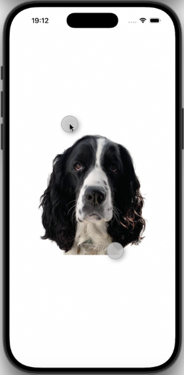

# Gestuelle (gesture)

## Gestuelle (TapGesture, GragGesture, MagnificationGesture, etc.)

Il est possible de faire réagir notre application SwiftUI à différentes gestuelles.

Parmi les gestes les plus courants, on retrouve :

- [TapGesture](https://developer.apple.com/documentation/swiftui/tapgesture)
- [LongPressGesture](https://developer.apple.com/documentation/swiftui/longpressgesture)
- [DragGesture](gestuelle-gesture.md#deplacer-une-vue-a-laide-de-draggesture)
- [MagnifyGesture](https://developer.apple.com/documentation/swiftui/magnifygesture) (notez que MagnificationGesture est obsolète)
- [RotationGesture](https://developer.apple.com/documentation/swiftui/rotationgesture)

Certaines gestuelles peuvent être utilisées à l'aide d'une méthode qui débute par « on » suivi du nom de la gestuelle. Il s'agit de raccourcis qui simplifient l’utilisation des gestes les plus courants mais qui ne donnent pas accès à toutes les options.

- [onTapGesture()](https://developer.apple.com/documentation/SwiftUI/View/onTapGesture(count:perform:))
- [onLongPressGesture()](https://developer.apple.com/documentation/swiftui/view/onlongpressgesture(minimumduration:maximumdistance:perform:onpressingchanged:))

Voici un exemple avec une méthode qui débute par « on » :

```swift title="SwiftUI"
List(items) { item in
  Text(item.titre)
    .onTapGesture {
      selection = item   // selection permet de retenir l'item sur lequel l'usager a tapé
      print("Vous avez tapé sur l'item \(item.code)")
    }
 }
```

Et voici un autre exemple qui travaille directement avec la gestuelle :

```swift title="SwiftUI"
Circle()
  .frame(width: 50)
  .position(positionCercle)
  .gesture(
    DragGesture()
      .onChanged { value in
        positionCercle = value.location
      }
  )
```

Si c'est MagnifyGesture qui vous intéresse :

```swift title="SwiftUI"
struct ContentView: View {
  @State private var zoomEnCours: CGFloat = 0.0
  @State private var zoomTotal: CGFloat = 1.0

  var body: some View {
    Image("...")
      .resizable()
      .scaledToFit()
      .frame(width: 300)
      .scaleEffect(zoomTotal + zoomEnCours)
      .gesture(
        MagnifyGesture()
          .onChanged { value in
            zoomEnCours = value.magnification - 1
          }
          .onEnded { value in
            zoomTotal += zoomEnCours
            zoomEnCours = 0
          }
      )
  }
}
```

??? info "Pour plus d'information"

    « How to use gestures in SwiftUI ». Hacking with Swift. <https://www.hackingwithswift.com/books/ios-swiftui/how-to-use-gestures-in-swiftui>

## Déplacer une vue à l'aide de DragGesture

La gestuelle [DragGesture](https://developer.apple.com/documentation/swiftui/draggesture) permet de déplacer une vue, par exemple un cercle, à l'aide de la souris sur l'ordinateur ou à l'aide d'un doigt sur un appareil mobile.

Le secret, c'est de donner une position fixe à la vue dès le départ à l'aide du [modifieur .position()](quelques-modifieurs.md#modifieur-position).

Cette position sera une variable d'état afin de forcer le rafraîchissement de la vue dès qu'elle est modifiée.

Lorsque la valeur du DragGesture est modifiée (.onChanged), la nouvelle position est assignée à cette variable.

Optionnellement, il est possible d'effectuer une tâche lorsque le mouvement se termine (.onEnded). Ceci serait utile, par exemple, si on doit vérifier si la vue a atteint un but.

```swift title="SwiftUI"
struct ContentView: View {
  @State private var positionCercle: CGPoint = CGPoint(x: 100, y: 100)

  var body: some View {
    Circle()
      .frame(width: 50)
      .position(positionCercle)
      .gesture(
        DragGesture()
          .onChanged { value in
            positionCercle = value.location
          }
          .onEnded { value in
            ...
          }
      )
  }
}
```

Ce simple code (sans le .onEnded) permet de faire ceci à l'aide d'un doigt :

[](./images/SwiftUI-DragGesture.mp4)

## Reproduire des gestuelles sur le simulateur

Lorsqu'on teste une application sur le simulateur, certaines gestuelles peuvent être réalisées simplement avec la souris, par exemple le clic ou le déplacement (**drag**).

Pour d'autres gestuelles, par exemple celles qui nécessitent deux doigts, c'est moins évident.

Heureusement, Xcode a prévu quelques trucs pour s'en sortir.

### MagnifyGesture

Pour simuler le mouvement des doigts pour agrandir ou pour rapetisser une image (en anglais, on parlera de **pinch**) :

- Appuyez sur la touche <kbd>⌥ Option</kbd>. Deux cercles gris gris apparaîtront pour simuler deux doigts.

  
- Avec la souris, faites glisser l'un des cercles pour le rapprocher ou pour l'éloigner de l'autre.

Notez que ceci n'aura d'effet que si l'application est codée pour réagir à cette gestuelle.

??? info "Pour plus d'information"

    « Interacting with your app in the iOS and iPadOS simulator ». Apple. <https://developer.apple.com/documentation/xcode/interacting-with-your-app-in-the-ios-or-ipados-simulator>
