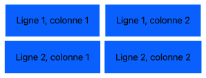
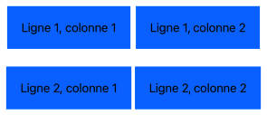

# Grid et LazyVGrid

SwiftUI propose quelques vues qui permettent de placer des vues en lignes et en colonnes.

Dans cette fiche :

- [Grid](grille-d-items.md)
- [LazyVGrid](grille-d-items.md)

## Grid

La vue [Grid](https://developer.apple.com/documentation/swiftui/grid) permet de placer des vues en lignes et en colonnes.

Le principe ressemble un peu à un tableau HTML : on définit des lignes avec `GridRow` (l'équivalent de `<tr>`) dans lesquelles on définit des vues (chaque vue est l'équivalent d'un `<td>`).

```swift title="SwiftUI"
Grid {
  GridRow {
    Text("Ligne 1, colonne 1")
    Text("Ligne 1, colonne 2")
  }
  GridRow {
    Text("Ligne 2, colonne 1")
    Text("Ligne 2, colonne 2")
  }
 }
```

Voici un exemple qui montre ce qui se passe de façon plus graphique.

```swift title="SwiftUI"
Grid {
  GridRow {
    Text("Ligne 1, colonne 1")
      .padding(20)
      .background(Color.blue)
    Text("Ligne 1, colonne 2")
      .padding(20)
      .background(Color.blue)
  }
  GridRow {
    Text("Ligne 2, colonne 1")
      .padding(20)
      .background(Color.blue)
    Text("Ligne 2, colonne 2")
      .padding(20)
      .background(Color.blue)
  }
 }
```



Il est possible de spécifier certains paramètres pour mieux contrôler l'apparence du Grid.

```swift title="SwiftUI"
Grid(horizontalSpacing: 5, verticalSpacing: 25) {
  ...
}
```



## LazyVGrid

La vue [LazyVGrid](https://developer.apple.com/documentation/swiftui/lazyvgrid) permet elle aussi de placer des vues en lignes et en colonnes.

Sa particularité : elle est plus efficace pour gérer une grande quantité d'informations à afficher.

De plus, elle permet de changer de ligne automatiquement quand les vues remplissent l'écran en largeur.

```swift title="SwiftUI"
LazyVGrid(columns: [
  GridItem(.flexible()),
  GridItem(.flexible())   // on aura deux colonnes
 ], spacing: 25) {
   ForEach(items) {item in
      // vue qui affiche un item
      // ...
   }
}
```

## Pour plus d'information

« How to position views in a grid using LazyVGrid and LazyHGrid ». Hacking with Swift. <https://www.hackingwithswift.com/quick-start/swiftui/how-to-position-views-in-a-grid-using-lazyvgrid-and-lazyhgrid>
