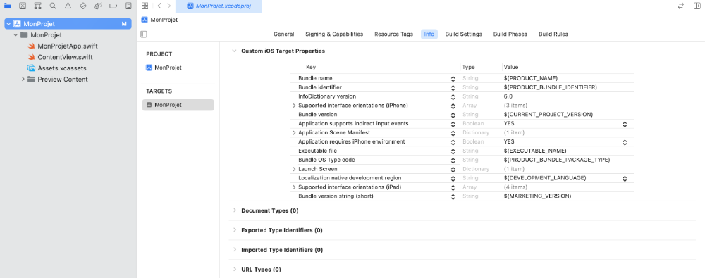
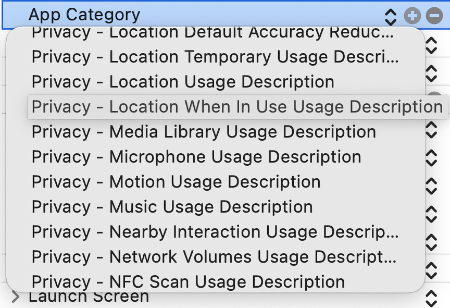
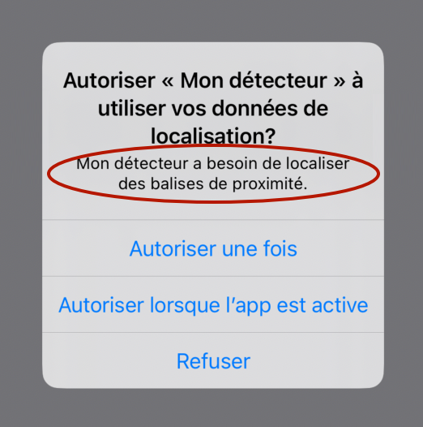

# Info.plist

## À quoi sert Info.plist?

[Info.plist (Information Property List)](https://developer.apple.com/documentation/bundleresources/information_property_list) est un espace de configuration créé par Xcode.

Il contient une série de paires clé-valeur qui indiquent au système comment interpréter le paquet dans lequel ces configurations sont placées.

Autrement dit, il permet de configurer l'application.

Sous Xcode 12 ou moins, il s'agissait d'un fichier et il était automatiquement créé avec tout projet SwiftUI.

Depuis Xcode 13, le fichier `Info.plist` n'est plus automatiquement créé avec un projet SwiftUI. Xcode le créera au besoin lors d'ajout de paires clé-valeur.

Les paires clé-valeur peuvent être retrouvées à partir du navigateur de projet / clic sur le nom du projet. Les paires sont distribuées dans différentes onglets, par exemple **Info** ou **Build Settings**.

Selon les notes de version de Apple[1](https://developer.apple.com/documentation/xcode-release-notes/xcode-13-release-notes):

> Projects created from several templates no longer require configuration files such as entitlements and Info.plist files. Configure common fields in the target’s Info tab, and build settings in the project editor. These files are added to the project when additional fields are used. (68254857)

### Source

1. « Xcode 13 Release Notes ». Apple. <https://developer.apple.com/documentation/xcode-release-notes/xcode-13-release-notes>

## Ajouter une paire clé-valeur dans Info.plist

Dans cette démonstration, je vais ajouter une configuration pour demander une permission à l'usager afin de pouvoir utiliser la localisation de l'appareil.

Pour ajouter la paire clé-valeur requise :

- Dans le navigateur de projet, cliquez sur le nom du projet.
- Sélectionnez votre cible dans la section centrale **TARGETS**.
- Rendez-vous dans l'onglet **Info**.
- Les paires clé-valeur sont regroupées par catégorie. La catégorie qui nous intéresse ici est **Custom iOS Target Properties**.

  
- Pour ajouter une clé, pointez la souris vis-à-vis n'importe quelle clé puis cliquez sur +.

  
- Entrez le nom de la clé désirée.

  

  Il est également possible de sélectionner la clé dans une liste en cliquant sur l'icône de double-chevrons. Dans cette liste, les clés sont représentées par leur description plutôt que par leur nom.

  

  Peu importe si vous avez entré le nom ou choisi une description, Xcode affichera la description de la clé.
- **Entrez finalement la valeur associée.**

  

  Cette valeur est importante. Son rôle dépend du type de clé qui est ajoutée.

  Par exemple, lorsque la clé ajoutée permet de demander une permission comme c'est le cas dans l'exemple plus haut, la valeur apparaîtra dans la fenêtre popup qui demande cette permission.

  
