# Installer une application SwiftUI sur iPhone

## Nom qui apparaît sous l'icône (Display name)

Par défaut, lorsqu'une application est installée sur un iPhone, le nom qui apparaît sous son icône correspond au nom du dossier du projet.

Remarquez que sur cette image, l'application n'a pas [de AppIcon](l-appicon.md#ajouter-un-appicon) défini.

Dans la plupart des cas, il serait préférable de redéfinir le nom qui apparaît sous l'icône, par exemple en ajoutant des espaces entre les mots ou en ajoutant des caractères accentués lorsque requis.

Pour modifier ce nom :

- Dans le navigateur de projet de Xcode (s'il n'est pas visible, cliquez sur l'icône de chemise  dans la zone de gauche), cliquez sur le nom du projet.

  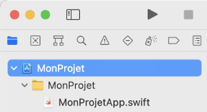
- Dans l'onglet **General**, section **Identity**, entrez le nom désiré dans la zone **Display Name**.

  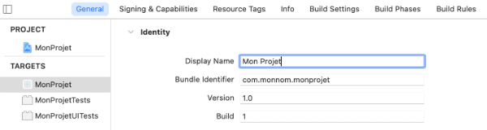
- Afin que le nouveau nom soit correctement pris en compte, vous devez demander une recompilation à neuf à l'aide du menu **Product** / **Clean Build Folder**.

  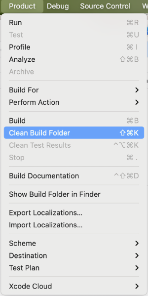

## Installation sans passer par l'AppStore

Il est possible d'installer (déployer) une application sur un iPhone sans passer par l'App Store.

Ce processus porte le nom de **sideload**.

Un **sideload** peut être réalisé à partir de fichiers .IPA, de fichiers .DEB ou encore à partir du code source de l'application.

Dans cet article, je vous montre comment procéder au **sideload** à partir du code source.

### Matériel requis

Cette technique nécessite un ordinateur Mac sur lequel Xcode est installé.

Vous aurez besoin évidemment du code source du projet que vous ouvrirez dans Xcode.

Il vous faudra également un compte iCloud (gratuit).

### Limites de la méthode

Idéalement, l'application devrait être associée à un compte Apple Developer Program ($) avant d'être installée sur un iPhone (**Signing & Capabilities** / **Team**). Ceci permet d'utiliser le **sideload** pour installer une application de façon durable.

Dans le cas où l'application est associée à compte de développeur personnel (**Personal Team** – gratuit), l'application peut être installée afin de réaliser des tests mais le certificat de l'application sera invalidé (**revoked**) après une semaine. De plus, le nombre d'applications installées à partir d'un compte de développeur personnel est limité à 3.

Si vous tentez d'ouvrir votre application sur le iPhone plus d'une semaine après l'avoir installée à partir d'un compte développeur personnel, vous obtiendrez le message « MonProjet n'est plus disponible ».

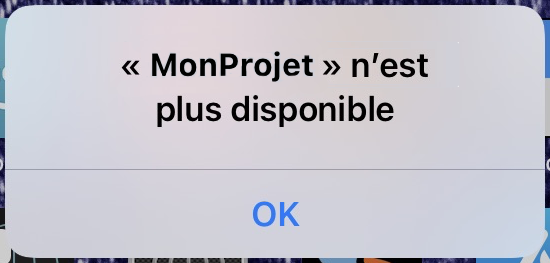

### Transférer l'application sur iPhone

- Branchez le iPhone à votre Mac à l'aide d'un câble.
- Déverrouillez le iPhone.
- Sur le iPhone, quand vous voyez la fenêtre qui demande si vous pouvez faire confiance à cet ordinateur, cliquez sur **Se fier**.

  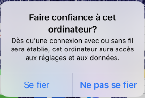
- Ouvrez votre projet dans Xcode.
- Rendez-vous dans le menu **Product** / **Destination** puis choisissez votre iPhone.

  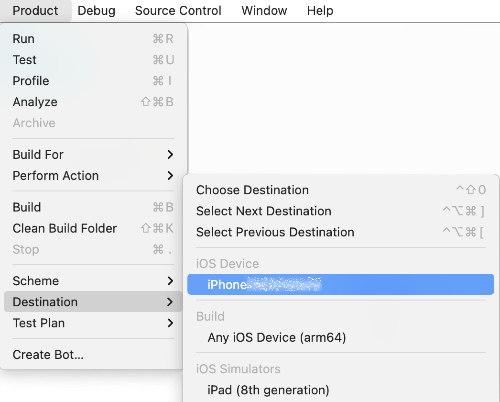

  Si vous voyez le message « Developer mode disabled » à côté du nom du téléphone, vous devrez effectuer ces manipulations.

  - 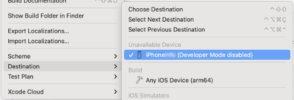

    Sur le iPhone, rendez-vous dans **Réglages**.
  - Cliquez sur **Confidentialité et sécurité**.
  - Au bas de l'écran, activez le mode développeur.
- Dans le navigateur de projet de Xcode (s'il n'est pas visible, cliquez sur l'icône de chemise  dans la zone de gauche), cliquez sur le nom du projet.

  
- Dans l'onglet **General**, section **Identity**, assurez-vous d'avoir un nom conforme pour le **Bundle Identifier**. Il s'agit généralement d'un nom de domaine en format inverse, par exemple com.mondomaine, ou si vous ne possédez pas de nom de domaine, d'une chaîne du genre com.nomfamilleprenom. Le tout sera suivi d'un point puis d'une chaîne pour identifier le projet.

  Vérifiez également la version de iOS requise pour l'application. Si le iPhone est à une version inférieure, vous devrez modifier le numéro de version dans la zone **Minimum Deployments**.

  Au passage, si ce n'est pas déjà fait, soignez le **Display Name** qui apparaîtra un peu partout, notamment sous l'icône de l'application.

  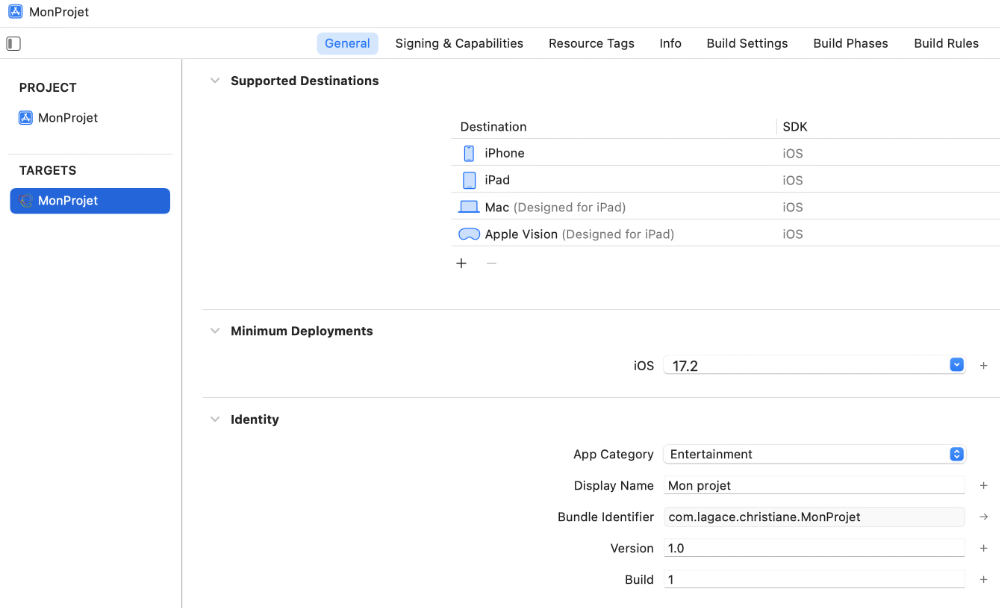
- Cliquez sur l'onglet **Signing & Capabilities**.
- Si votre compte iCloud n'est pas encore associé à Xcode, vous verrez le message « Signing for "MonProjet" requires a development team ».

  Cliquez sur **Add Account** vis-à-vis de **Team** puis fournissez votre code d'usager iCloud de même que votre mot de passe.

  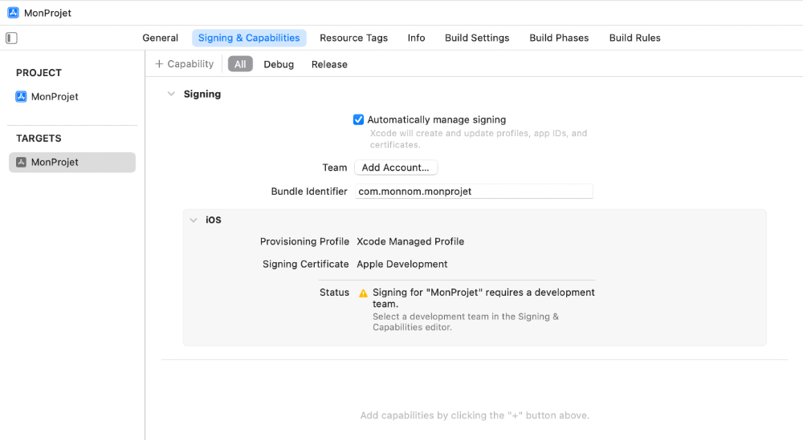
- Pour débuter le téléversement sur le téléphone, cliquez sur le bouton **Start the active scheme**.

  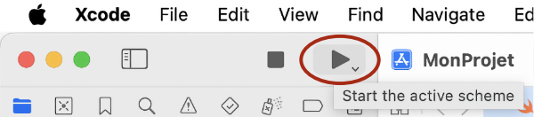
- Si un mot de passe vous est demandé (codesign veut accéder à la clé « Apple Development » de votre trousseau), Xcode attend le mot de passe associé à votre compte sur l'ordinateur. Ceci n'a pas besoin d'être un compte administrateur. Entrez le code que vous utilisez lorsque vous ouvrez le MacBook.

  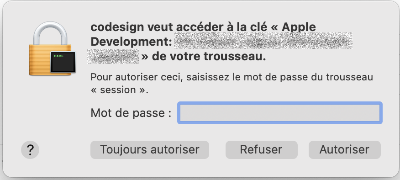
- L'application sera compilée et si tout se passe bien, elle sera installée sur le iPhone.

### Permettre l'exécution de l'application sur le iPhone

À ce stade, Xcode vous a peut-être affiché un message d'erreur du genre « The request to open "com.monnom.monprojet" failed. Verify that the Developer App certificate for your account is trusted on your device. Open Settings on the device and navigate to General -> VPN & Device Management, then select your Developer App certificate to trust it. ».

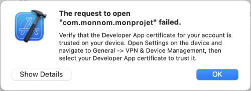

Un message équivalent apparaît du côté du téléphone : « Développeur non approuvé. Les réglages de gestion de votre appareil ne permettent pas l'utilisation des apps du développeur ... sur cet iPhone. Vous pouvez autoriser l'utilisation de ces apps dans Réglages. ».

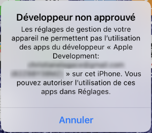

Pour autoriser l'exécution des applications associées à votre compte de développeur chez Apple :

- Rendez-vous dans **Réglages** / **Général** / **VPN et gestion de l'appareil**.
- Cliquez sur votre compte de développeur.

  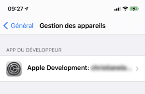
- Cliquez sur **Faire confiance à ...**.

  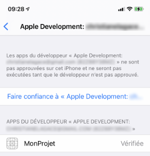

Vous pouvez désormais exécuter votre application sur ce iPhone.

### Installation sans câble après une première connexion

Il est possible d'installer une application sur un iPhone sans câble si ces conditions sont respectées :

- Xcode a été utilisé au moins une fois pour déployer une application sur ce iPhone par câble.
- Le Mac et le iPhone sont sur le même réseau Wi-Fi.
- Le réseau Wi-Fi ne bloque pas les connections pair-à-pair (**peer-to-peer**).
- Le iPhone est déverrouillé.

Pour savoir si Xcode reconnaît le iPhone sans câble :

- Assurez-vous que les conditions ci-haut sont respectées.
- Débranchez le câble qui relie le téléphone au Mac.
- Rendez-vous dans le menu **Window** / **Devices and Simulators**.
- Dans la zone de gauche, votre téléphone devrait être listé dans la zone **Connected**.

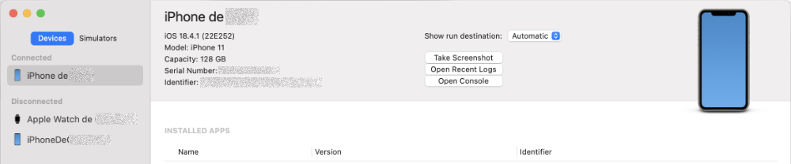

### Pour plus d'information

« Install iOS apps from outside the App Store ». 7 Labs. <https://7labs.io/mobile/iphone/install-apps-without-app-store.html>
