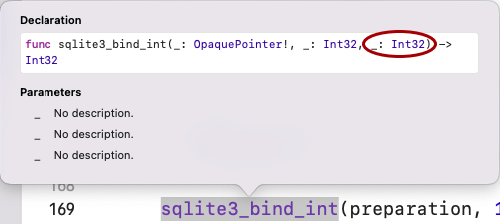

# Interagir avec SQLite sans ORM

## Ouverture de la base de données SQLite

Note : Cette fiche présente une technique pour travailler avec SQLite sans ORM.   
Depuis iOS 17, il est préférable de travailler avec [SwiftData](swiftdata.md#quest-ce-que-swiftdata).

SQLite est écrit en langage C. Pour utiliser son API dans un programme Swift, il faut notamment travailler avec des pointeurs C, par exemple avec des variables de type [OpaquePointer](https://developer.apple.com/documentation/swift/opaquepointer).

Il existe des bibliothèques qui offrent une interface plus intuitive pour travailler avec une BD SQLite. Cependant, une fois que les concepts de base sont bien compris, on voit bien que l'utilisation de ces bibliothèque n'est absolument pas nécessaire.

La bibliothèque principale pour interagir avec SQLite se nomme `SQLite3` et aucun fichier supplémentaire n'est requis. Il suffit d'ajouter une instruction `import`.

### Ouverture de la base de données

D'abord, vous devez vous assurer que [la base de données a été ajoutée au paquet de l'application](les-fichiers-du-paquet-de-l-application.md#ajouter-un-fichier-dans-le-paquet-de-lapplication).

Le code pour interagir avec la BD devrait idéalement être placé dans son propre fichier. J'ai choisi d'appeler le mien `GestionBD.swift`.

Le constructeur de la classe se chargera d'ouvrir la base de données. Le code pour cette opération sera placé dans la méthode `ouvrirBD()`.

```swift title="Fichier GestionBD.swift"
import Foundation
import SQLite3

/// Gestion d'une base de données SQLite.
class GestionBD {
  var nomBD: String = ""
  var pointeurBD: OpaquePointer? = nil

  /**
   Constructeur.

   - Parameters:
     - nomBD: nom de la base de données
  */
  init(nomBD: String) {
    self.nomBD = nomBD
  }

   /**
    Ouvre la base de données et initialise la propriété pointeurBD.
   */
  func ouvrirBD() {
    var reussi: Bool = false

    do {
      let fileManager = FileManager.default

      let urlApplicationSupport = try fileManager.url(for: .applicationSupportDirectory, in: .userDomainMask, appropriateFor: nil, create: true)
        .appendingPathComponent(nomBD)
      // print(urlApplicationSupport)

      // ouvre la base de données mais ne la crée pas si elle n'existe pas
      var codeRetour = sqlite3_open_v2(urlApplicationSupport.path, &pointeurBD, SQLITE_OPEN_READWRITE, nil)

      // si la base de données n'est pas trouvée, va chercher la version originale dans le paquet de l'application
      if codeRetour == SQLITE_CANTOPEN {
        print("Tentative de retrouver la base de données \(nomBD) dans le paquet.")

        if let urlPaquet = Bundle.main.url(forResource: nomBD, withExtension: "") { // ici, l'extension fait déjà partie du nom de la BD
          // print(urlPaquet)

          try fileManager.copyItem(at: urlPaquet, to: urlApplicationSupport)
          codeRetour = sqlite3_open_v2(urlApplicationSupport.path, &pointeurBD, SQLITE_OPEN_READWRITE, nil)
        } else {
          print("Erreur : la base de données \(nomBD) ne fait pas partie du paquet.")
        }
      }

      if codeRetour == SQLITE_OK {
        reussi = true;
      } else {
        print("La connexion à la base de données\(nomBD) a échoué : \(codeRetour)")
      }

    } catch {
      print("Erreur inattendue : \(error)")
    }

    if (!reussi) {
      // Selon la doc officielle : Whether or not an error occurs when it is opened, resources associated with the database connection handle should be released by passing it to sqlite3_close() when it is no longer required (source : https://www.sqlite.org/c3ref/open.html).
      sqlite3_close(pointeurBD)
      pointeurBD = nil
    }
  }

  ...   // coder ici les fonctions pour lire les données de la BD et pour effectuer les autres opérations CRUD requises.
}
```

### Utilisation de la classe

Maintenant, il est possible d'ouvrir la base de données dans notre vue comme suit :

```swift title="SwiftUI"
struct ContentView: View {

  let gestionBD: GestionBD = GestionBD(nomBD: "mabd.db")

  init() {
    gestionBD.ouvrirBD()
  }
  ...
}
```

Vous pouvez désormais poursuivre votre développement pour [afficher des données tirées de la base de données](interagir-avec-sqlite-sans-orm.md#afficher-des-donnees-tirees-de-la-bd).

??? info "Pour plus d'information"

    « SQLite With Swift Tutorial: Getting Started ». Ray Wenderlich. <https://www.raywenderlich.com/6620276-sqlite-with-swift-tutorial-getting-started>

    « Opening A New Database Connection ». SQLite. <https://www.sqlite.org/c3ref/open.html>

    « Result and Error Codes ». SQLite. <https://www.sqlite.org/rescode.html>

    « C-language Interface Specification for SQLite - List Of Functions ». SQLite. [https://www.sqlite.org/capi3ref.html](https://www.sqlite.org/capi3ref.html#:~:text=List Of Functions)

## Afficher des données tirées de la BD

Note : Cette fiche présente une technique pour travailler avec SQLite sans ORM.   
Depuis iOS 17, il est préférable de travailler avec [SwiftData](swiftdata.md#quest-ce-que-swiftdata).

Maintenant que notre application SwiftUI est capable de se [brancher à la base de données](interagir-avec-sqlite-sans-orm.md#ouverture-de-la-base-de-donnees-sqlite), il est possible d'afficher dans une vue les résultats d'une requête SQL.

### Modèles pour représenter chacune des tables de la BD

D'abord, vous aurez besoin d'un [modèle](le-modele.md#gerer-les-donnees-de-lapplication-en-memoire-initialiser-un-tableau-dinstances) pour chacune des tables.

Le modèle contiendra une propriété pour chaque champ de la table. Les types de données devront correspondre et les champs qui peuvent être à nuls devront correspondre à une propriété dont le type se termine par un point d'interrogation.

Une telle structure permettra notamment de travailler avec un tableau de ce modèle qui contiendra les résultats de la requête.

```swift title="Fichier Models/Item.swift"
import Foundation

struct Item: Identifiable {
  var id: Int
  var code: String
  var description: String
  var prix: Double
}
```

### Méthode pour effectuer le SELECT

Dans le [fichier de la classe GestionBD](interagir-avec-sqlite-sans-orm.md#ouverture-de-la-base-de-donnees-sqlite), ajoutons une méthode qui créera un tableau avec les résultats d'une requête SELECT.

Pour chaque champ de la requête SELECT, on retrouvera sa valeur à l'aide d'une fonction dont le nom est au format [sqlite3_column_xxxx()](https://www.sqlite.org/capi3ref.html#sqlite3_column_blob) où xxxx est remplacé par le type de la variable.

Le premier paramètre de cette fonction est toujours le pointeur créé lors de la préparation de la requête.

Le second paramètre est un nombre qui représente la position du champ dans la requête, 0 étant le premier champ.

```swift title="Fichier GestionBD.swift"
/**
 Retrouve la liste des items dans la base de données en ordre de code.

 - Returns: Tableau des items.
 */
func listeItems() -> [Item] {
  let requete: String = "SELECT id, code, description, prix FROM items ORDER BY code"
  var items: [Item] = []
  var preparation: OpaquePointer? = nil

  // prépare la requête
  if sqlite3_prepare_v2(pointeurBD, requete, -1, &preparation, nil) == SQLITE_OK {

    // exécute la requête et boucle dans les résultats
    while sqlite3_step(preparation) == SQLITE_ROW {

      // lecture d'un champ INTEGER
      let id = Int(sqlite3_column_int(preparation, 0)) // sans la conversion, on avait un Int32

      // lecture d'un champ TEXT
      let code = String(cString: sqlite3_column_text(preparation, 1))

      // lecture d'une chaîne qui peut être nulle
      var description = "-"

      if let pointeurColonne = sqlite3_column_text(preparation, 2) {
        description = String(cString: pointeurColonne)
      }

      // les autres types de champs n'ont rien de spécial à faire même s'ils peuvent être nuls dans la base de données
      // ici, le prix sera initialisés à 0 si le champ est nul
      let prix = Double(sqlite3_column_double(preparation, 3))

      items.append(Item(id: id, code: code, description: description, prix: prix))
    }
  } else {
    let erreur = String(cString: sqlite3_errmsg(pointeurBD))
    print("\nLa requête n'a pas pu être préparée : \(erreur)")
  }

  // libération de la mémoire
  sqlite3_finalize(preparation)

  return items
 }
```

### Booléens

Pour lire une valeur booléenne, on utilisera `sqlite3_column_int()`.

Puisque ceci donnera une valeur entière, il faudra reconvertir la valeur en booléen avant de poursuivre le travail.

Par exemple, si on désire retrouver la valeur d'un champ booléen nommé `reussi`, on obtiendra d'abord une valeur numérique. Pour convertir cette valeur en booléen, il faut créer un objet de type [NSNumber](https://developer.apple.com/documentation/foundation/nsnumber) puis utiliser sa propriété `boolValue`.

```swift title="Swift"
let reussiInt = Int(sqlite3_column_int(preparation, 9))   // cette variable est un Int
...
let reussi = NSNumber(value: reussiInt).boolValue
```

### Dates

Pour lire une date, on utilisera `sqlite3_column_text()`.

La conversion d'une chaîne en date est un peu délicate. Il faut connaître le format exact de la date et ne pas oublier de forcer la localisation et le fuseau horaire afin que le format de date ne soit pas influencé par les configurations de l'appareil.

```swift title="Swift"
let dateString = String(cString: sqlite3_column_text(preparation, 9)) // chaîne au format "2023-03-07 13:52:29.709"
...
 let dateFormatter = DateFormatter()
 dateFormatter.locale = Locale(identifier: "en_US_POSIX")
 dateFormatter.timeZone = TimeZone(secondsFromGMT: 0)
 dateFormatter.dateFormat = "yyyy-MM-dd HH:mm:ss.SSS"
 let dateajout = dateFormatter.date(from: dateString) // c'est une date nullable
```

Maintenant qu'on a en main une variable de type Date, il est possible de l'utiliser normalement... ou presque!

C'est que cette date pourrait être évaluée à nil. Donc, il faudra dire au programme quoi faire si jamais elle était à nil.

```swift title="Swift"
items.append(Item(..., date: dateajout ?? Date.now))
```

### Utilisation

Cet extrait de code affiche une liste d'items tirés de la base de données.

```swift title="SwiftUI"
init() {
  gestionBD.ouvrirBD()

  if gestionBD.pointeurBD != nil {
    items = gestionBD.listeItems()
  }
  else {
    items = []
  }
 }

var body: some View {
  VStack {
    if gestionBD.pointeurBD == nil {
      Text("Un problème empêche l'ouverture de la base de données.")
    } else {
      if items.count > 0 {
        List {
          ForEach (items) { item in
            VStack {
              Text(item.code)
              Text(item.description)
            }
          }
        }
      } else {
        Text("Il n'y a actuellement aucun item.")
      }
    }
  }
}
```

??? info "Pour plus d'information"

    « C-language Interface Specification for SQLite - List Of Functions ». SQLite. [https://www.sqlite.org/capi3ref.html](https://www.sqlite.org/capi3ref.html#:~:text=List Of Functions)

    « Result and Error Codes ». SQLite. <https://www.sqlite.org/rescode.html>

## Requête SQLite avec paramètres

Note : Cette fiche présente une technique pour travailler avec SQLite sans ORM.   
Depuis iOS 17, il est préférable de travailler avec [SwiftData](swiftdata.md#quest-ce-que-swiftdata).

Avec SQLite comme avec tout autre système de gestion de base de données, les requêtes qui contiennent des variables doivent faire l'objet d'une attention particulière.

Il ne faut jamais faire une concaténation pour monter une telle requête car ceci ouvre un trou de sécurité.

```swift title="Swift"
let requete: String = "SELECT code, description FROM items WHERE id=" + String(id)
```

La technique exposée dans la fiche « [Afficher des données tirées de la BD](interagir-avec-sqlite-sans-orm.md#afficher-des-donnees-tirees-de-la-bd) » doit être adaptée comme suit.

Chaque variable est remplacée par un point d'interrogation dans la requête.

Il doit y avoir un [sqlite3_bind_xxxx()](https://www.sqlite.org/c3ref/bind_blob.html) pour chacun des points d'interrogation. Ceci permet de préciser la valeur de chaque variable à utiliser.

Le premier paramètre de cette fonction est toujours le pointeur créé lors de la préparation de la requête.

Le deuxième paramètre représente la position du point d'interrogation dans la requête. Le premier point d'interrogation est en position 1.

Le troisième paramètre est la valeur que le point d'interrogation doit prendre. Les explications détaillées sont fournies [plus bas](interagir-avec-sqlite-sans-orm.md#requete-sqlite-avec-parametres).

```swift title="Swift"
func listeItems(id: Int) -> [Item] {
  let requete: String = "SELECT code, description FROM items WHERE id=?"
  var preparation: OpaquePointer? = nil

  if sqlite3_prepare_v2(pointeurBD, requete, -1, &preparation, nil) == SQLITE_OK {
    sqlite3_bind_int(preparation, 1, Int32(id));

    // exécute la requête
    // utiliser un if si la requête peut retrouver au maximum un enregistrement
    // utiliser un while si elle peut en retrouver plusieurs
    if sqlite3_step(preparation) == SQLITE_ROW {
        ...
    }
  }
  ...
}
```

Notez bien qu'avec `sqlite3_bind_xxxx()`, le premier ? correspond à la position 1 contrairement à `sqlite3_column_xxxx()` où le premier champ lu correspond à la position 0.

### Types de données

Il y a presque toujours des conversions de types à effectuer pour préciser la valeur à utiliser.

#### sqlite3_bind_int() pour les entiers et les booléens

Dans l'extrait de code précédent, la variable de type `Int` a dû être convertie au type `Int32` puisque c'est ce qui est attendu dans la méthode `sqlite3_bind_int()`, tel que démontré dans le **Quick help**.

```swift title="Swift"
sqlite3_bind_int(preparation, 1, Int32(id))
```



Dans le cas d'une valeur booléenne, on procédera comme suit :

```swift title="Swift"
sqlite3_bind_int(preparation, 1, Int32(actif ? 1 : 0))
```

#### sqlite3_bind_text() pour les chaînes de caractères et les dates

Puisqu'en SQLite, les dates sont représentées comme du texte, la fonction sqlite3_bind_text() permet de travailler autant avec une chaîne de caractère qu'avec une date.

##### Chaîne de caractères

Dans le cas d'un paramètre textuel, il faut tricotter un peu plus pour ne pas que les pointeurs C ne renvoient la mauvaise information.

Selon la documentation officielle[1](https://www.sqlite.org/c3ref/bind_blob.html#:~:text=The%20third%20argument):

> If the third parameter to sqlite3_bind_text() is not NULL, then it should be a pointer to well-formed UTF8 text.

Pour fournir le pointeur requis, on doit d'abord convertir la chaîne au type [NSString](https://developer.apple.com/documentation/foundation/nsstring) puis lui appliquer la méthode [.utf8String()](https://developer.apple.com/documentation/foundation/nsstring/1411189-utf8string).

```swift title="Swift"
sqlite3_bind_text(preparation, 1, NSString(string: nom).utf8String, -1, nil)
```

Tel qu'illustré dans l'exemple précédent, le quatrième paramètre sera généralement -1. En effet, une valeur négative indique qu'il faut prendre tous les caractères de la chaîne fournie[2](https://www.sqlite.org/c3ref/bind_blob.html#:~:text=the%20fourth%20parameter%20to%20sqlite3_bind_text).

> If the fourth parameter to sqlite3_bind_text() or sqlite3_bind_text16() is negative, then the length of the string is the number of bytes up to the first zero terminator.

Quand au cinquième paramètre, on ne l'utilise pas ici alors on lui fournira la valeur `nil`. Ce paramètre permettrait dans d'autres contextes de fournir un destructeur pour libérer la mémoire utilisée par l'objet fourni comme 3e paramètre.

##### Date

Pour utiliser une date dans une requête SQL, il faut d'abord se demander si on désire la date du jour ou une date contenue dans une variable.

Pour la date du jour, le plus simple est d'utiliser les fonctions SQLite pour la retrouver.

```swift title="Swift"
let requete: String = "INSERT INTO matable(code, titre, ajout) VALUES(?, ?, datetime('now', 'localtime'));"
```

ou, si vous avez besoin de la date sans l'heure :

```swift title="Swift"
let requete: String = "INSERT INTO autretable(nom, prenom, commentaire, date) VALUES(?, ?, ?, date('now'));"
```

Dans le cas où la date à utiliser dans la requête est contenue dans une variable de type [Date](https://developer.apple.com/documentation/foundation/date), il faut convertir la variable en texte à l'aide d'un [DateFormatter](https://developer.apple.com/documentation/foundation/dateformatter).

```swift title="Swift"
let formatter = DateFormatter()
formatter.dateFormat = "yyyy-MM-dd HH:mm:ss"
let dateString = formatter.string(from: uneDate)

sqlite3_bind_text(preparation, 1, NSString(string: dateString).utf8String, -1, nil)
```

#### sqlite3_bind_double()

Travailler avec une variable de type double est plutôt simple puisqu'il n'y a aucune conversion à réaliser.

```swift title="Swift"
sqlite3_bind_double(preparation, 1, nombre);
```

### Exemple avec un INSERT

Pour mieux vous guider, je vous fournis ici un exemple de code pour l'insertion de données.

```swift title="Swift"
func insererItem(code: String, description: String) -> Bool {

  let requete: String = "INSERT INTO items(code, description) VALUES(?, ?);"

  var retour = false;
  var preparation: OpaquePointer? = nil

  // prépare la requête
  if sqlite3_prepare_v2(pointeurBD, requete, -1, &preparation, nil) == SQLITE_OK {

    sqlite3_bind_text(preparation, 1, NSString(string: code).utf8String, -1, nil)
    sqlite3_bind_text(preparation, 2, NSString(string: description).utf8String, -1, nil)

    // exécute la requête
    if sqlite3_step(preparation) != SQLITE_DONE {
      let erreur = String(cString: sqlite3_errmsg(pointeurBD))
      print("\nErreur lors de l'insertion : \(erreur)")
    } else {
      retour = true
    }
  } else {
    let erreur = String(cString: sqlite3_errmsg(pointeurBD))
    print("\nLa requête n'a pas pu être préparée : \(erreur)")
  }

  // libération de la mémoire
  sqlite3_finalize(preparation)

  return retour
 }
```

### Sources

1. « Binding Values To Prepared Statements ». SQLite. [https://www.sqlite.org/c3ref/bind_blob.html - the third parameter](https://www.sqlite.org/c3ref/bind_blob.html#:~:text=The%20third%20argument)

2. « Binding Values To Prepared Statements ». SQLite. [https://www.sqlite.org/c3ref/bind_blob.html - the fourth parameter](https://www.sqlite.org/c3ref/bind_blob.html#:~:text=the%20fourth%20parameter%20to%20sqlite3_bind_text)

## Gérer les versions de la base de données en production

Note : Cette fiche présente une technique pour travailler avec SQLite sans ORM.   
Depuis iOS 17, il est préférable de travailler avec [SwiftData](swiftdata.md#quest-ce-que-swiftdata).

Une fois qu'une application est utilisée en production, il est possible que des ajustements à la base de données soient requis afin d'implanter de nouvelles fonctionnalités.

Voici les grandes étapes qui permettront de gérer les versions de la base de données.

- Créer une table nommée configurations.
- Cette table contiendra des paires clé-valeur. Elle contiendra trois champs : id, cle et valeur.
- Dans un des enregistrements, la clé sera `version_bd` et la version de la base de données sera stockée dans son champ valeur.
- Une fois l'application en production, si une nouvelle version de l'application demande des ajustements dans la base de données, il sera possible de vérifier par programmation le numéro de la version installée et d'ajuster la base de données en conséquence.

## Comment insérer des données dans une BD SQLite

Note : Cette fiche présente une technique pour travailler avec SQLite sans ORM.   
Depuis iOS 17, il est préférable de travailler avec [SwiftData](swiftdata.md#quest-ce-que-swiftdata).

Lorsqu'on connaît les principes pour interagir avec une base de données SQLite dans un projet SwiftUI, on comprend que l'insertion n'est pas plus compilquée que la lecture de données.

Voici les étapes pour y arriver :

- [Effectuer le branchement à la base de données](interagir-avec-sqlite-sans-orm.md#ouverture-de-la-base-de-donnees-sqlite). Ceci sera généralement fait dans la méthode `init()` du ContentView.
- Les données à afficher seront souvent saisies dans un formulaire.
- Une fois la saisie complétée, un bouton permettra [d'enregistrer les données](interagir-avec-sqlite-sans-orm.md#requete-sqlite-avec-parametres).
- Au besoin, un mécanisme permettra de [synchroniser les données dans l'infonuagique](synchronisation-des-donnees-locales-dans-le-nuage.md#approches-possibles-pour-la-synchronisation).
- Une fois la vue du formulaire refermée, il faudra que les nouvelles données [apparaissent automatiquement dans la liste de données](interagir-avec-sqlite-sans-orm.md#gerer-le-rafraichissement-de-la-liste-apres-insertion).
- Dans tous les cas, l'usager doit être informé de l'état de l'opération avec un message de succès ou d'erreur selon le cas.

## Gérer le rafraîchissement de la liste après insertion

Note : Cette fiche présente une technique pour travailler avec SQLite sans ORM.   
Depuis iOS 17, il est préférable de travailler avec [SwiftData](swiftdata.md#quest-ce-que-swiftdata).

Lorsqu'une application mobile présente une liste de valeurs tirée de la base de données et qu'une vue enfant peut ajouter, modifier ou supprimer ces valeurs, il faut trouver un mécanisme pour que la liste soit rafraîchie lorsque la vue principale est réaffichée après l'opération.

Avec la technique que je vous présente ici, la liste d'items sera une variable d'état et la vue enfant se chargera de réinitialiser la liste avant de se refermer.

Pour que les modifications apportées dans la vue enfant soit reflétées dans la vue parent, la liste sera déclarée dans vue enfant avec l'attribut @Binding.

```swift title="Vue parent (SwiftUI)"
struct VueParent: View {
  @State private var items: [Item]
  let gestionBD: GestionBD = GestionBD(nomBD: "mabd.db")
  ...

  init() {
    gestionBD.ouvrirBD()
    if gestionBD.pointeurBD != nil {
      items = gestionBD.listeItems()
    }
    else {
      items = []
   }
  }

  var body: some View {
    ...
    NavigationLink(destination: VueEnfant(items: $items, gestionBD: gestionBD)) {
      ...
    }
    ...
  }
}
```

```swift title="Vue enfant (SwiftUI)"
struct VueEnfant: View {
  @Environment(\.dismiss) private var dismiss

  @Binding var items: [Item]
  var gestionBD: GestionBD
  ...

  var body: some View {
    ...
    Button(action: {
      Enregistrer()
    }) {
      Text("Enregistrer")
    }
  }

  /**
   Enregistre les données du formulaire.
   */
  func Enregistrer() {
    if gestionBD.insererItem(...) {
      items = gestionBD.listeItems()
      dismiss()
    }
    else {
      ...
    }
  }
}
```

## Vérifier les modifications dans la base de données de l'application

Note : Cette fiche présente une technique pour travailler avec SQLite sans ORM.   
Depuis iOS 17, il est préférable de travailler avec [SwiftData](swiftdata.md#quest-ce-que-swiftdata).

Une application mobile qui interagit avec une base de données ne peut pas modifier directement la base de données livrée avec son paquet.

Elle doit [copier la base de données vers un dossier dans lequel elle peut écrire](interagir-avec-sqlite-sans-orm.md#ouverture-de-la-base-de-donnees-sqlite), par exemple `Application Support Directory`.

Si vous souhaitez consulter la base de données après que des données aient été modifiées par l'application, vous devrez retrouver le fichier dans lequel ces modifications ont eu lieu.

Pour retrouver les données modifiées lorsque l'application tourne dans le simulateur, consultez la fiche « [Retrouver un fichier dans le simulateur](les-fichiers-modifies-sur-un-appareil-mobile-ou-sur-le-simulateur.md) ».

Pour retrouver les données modifiées directement sur un appareil mobile, consultez la fiche « [Récupérer les données d'une application à partir du iPhone](les-fichiers-modifies-sur-un-appareil-mobile-ou-sur-le-simulateur.md) ».
