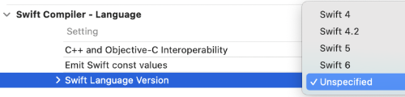
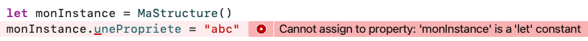

# Introduction à Swift

## Swift, SwiftUI, UIKit, Objective C, c'est quoi?

[Swift](https://developer.apple.com/swift/) est un langage de programmation pour développer des applications qui roulent dans le monde Apple, que ce soit sur un MacBook, un iPhone, une Apple Watch, etc.

Avant 2014, le langage utilisé était [Objective-C](https://developer.apple.com/library/archive/documentation/Cocoa/Conceptual/ProgrammingWithObjectiveC/Introduction/Introduction.html). Ce langage n'est pratiquement plus utilisé de nos jours puisque le code Swift est plus intuitif, concis et rapide.

Fait intéressant : Swift est également compatible avec Linux.

[SwiftUI](https://developer.apple.com/xcode/swiftui/) est un cadres d'application (**framework**) basé sur le langage Swift. Il a vu le jour en septembre 2019.

Pour exécuter du code écrit avec SwiftUI, l'appareil doit utiliser le système d'exploitation :

- sur iPhone : iOS 13.0 ou plus récent (sorti en septembre 2019)
- sur ordinateur : macOS 10.15 ou plus récent
- sur AppleTV : tvOS 13.0 ou plus récent
- sur Apple Watch : watchOS 6.0 ou plus récent

Pour développer des applications qui tournent sur les appareils moins récents, il faut plutôt utiliser [UIKit](https://developer.apple.com/documentation/uikit), le cadre d'application qui était utilisé avant SwiftUI, lui aussi basé sur Swift.

## Quelle version de Swift est utilisée?

Lorsque vous installez un version de Xcode, il vient avec une version précise de Swift.

L'arrimage entre les versions de Xcode et les versions de Swift sont données ici : <https://en.wikipedia.org/w/index.php?title=Xcode>.

Pour connaître la version de Swift installée sur votre Mac, ouvrez une fenêtre Terminal et entrez la commande :

```text title="Terminal"
swift -version
```

Sous Xcode 16.2, on obtiens ceci :

```text title="Résultat à l'écran"
monnom@MacBook-Pro-de-MonNom ~ %swift -version
swift-driver version: 1.115.1 Apple Swift version 6.0.3 (swiftlang-6.0.3.1.10 clang-1600.0.30.1)
Target: x86_64-apple-macosx15.0
```

Dans Xcode, il est possible de modifier la version de Swift pour un projet. Pour savoir laquelle est utilisée dans votre projet :

- Dans le navigateur de projet de Xcode (s'il n'est pas visible, cliquez sur l'icône de chemise  dans la zone de gauche), cliquez sur le nom du projet.
- Dans la zone centrale, cliquez sur le nom du projet dans la zone **PROJECT**.
- Rendez-vous dans l'onglet **Build Settings**.
- Faites défiler l'écran presque jusqu'en bas. Dans la section **Swift Compiler - Language**, vous voyez la version actuellement configurée.



## Variables, constantes et types de données

### Déclaration

Avec Swift, les mots-clés `var` et `let` permettent de déclarer respectivement des variables et des constantes.

- `var` : déclare une variable
- `let` : déclare une constante

```swift title="Swift"
var nom = "Annie"
let iterations = 10
```

Lorsque le type peut être déduit à partir de la valeur d'initialisation, Swift effectue automatiquement une inférence de type. Il n’est donc pas nécessaire de préciser le type, comme dans l'exemple précédent.

Si désiré, il est tout de même possible de spécifier le type.

```swift title="Swift"
var nom: String = "Annie"
let iterations: Int = 10
```

Dans le cas où le type de la variable ne peut pas être déterminé automatiquement, il est obligatoire de le préciser.

```swift title="Swift"
var nom: String
var montant: Decimal = 10.99   // sans le type, la variable aurait été de type Double
```

### Types de base

Les types de base en Swift sont :

- `Int` : nombre entier.   
  Il est également possible de spécifier sur combien de bits on désire stocker le nombre, par exemple 32 bits ou 64 bits, avec Int32 et Int64. Ceci affectera les valeurs minimales et maximales qui peuvent être stockées.   
  Int32 : -2147483648 à 2147483647  
  Int64 : -9223372036854775808 à 9223372036854775807  
  Cette précision n'est généralement pas nécessaire. Si vous travaillez sur un système en 64 bits, Int fera la même chose que Int64.
- `UInt` : Nombre entier non signé (**Unsigned**)
- `Double` : Nombre à virgule flottante codé sur 64 bits (15 décimales) - idéal pour calcul scientifique
- `Float` : Nombre à virgule flottante codé sur 32 bits (6 décimales) - idéal pour jeux, graphiques, animation
- `Bool` : Booléen
- `String` : chaîne de caractères.

Fait intéressant : on peut convertir une chaîne de caractères en tableau comme suit :

```swift title="Swift"
let tableauLettres = Array(nom) // ["A", "n", "n", "i", "e"]
```

### Type Decimal

Si vous développez une application qui doit travailler avec des valeurs monétaires, le type par excellence est [Decimal](https://developer.apple.com/documentation/foundation/decimal).

Decimal évite les erreurs d’arrondi associées aux nombres à virgule flottante.

```swift title="Swift"
let prix: Decimal = 69.44
```

Si on initialise une variable de type Decimal à partir d'une chaîne, il faut tenir compte que le résultat pourrait être nil si la chaîne n'était pas conforme.

Dans cet exemple, il est sécuritaire d'utiliser l'[opérateur de déballage forcé (!)](le-langage-swift-reference.md#les-optionnels) puisque la chaîne est codée en dur et qu'on est certains que la valeur pourra être convertie en Decimal.

```swift title="Swift"
let prix = Decimal(string: "69.44")!
```

Dans d'autres contextes, il est préférable d'utiliser [if let](le-langage-swift-reference.md#liaison-optionnelle-if-let-guard-let).

```swift title="Swift"
if let prix = Decimal(string: prixSaisi) {
  // ici, on a l'assurance que le prix est valide.
} else {
  message = "Veuillez spécifier un prix valide (ex : 12.50)"
}
```

Notez que pour convertir une chaîne en Decimal, ceci ne fonctionne pas car la structure Decimal n'a pas de constructeur avec un paramètre non nommé de type String.

```swift title="Swift"
let montantTexte = "12.25"
if let montantDecimal = Decimal(montantTexte) {
  ...
}
```

Pour que ça fonctionne, il faut préciser que le nom du premier paramètre est string.

```swift title="Swift"
let montantTexte = "12.25"
if let montantDecimal = Decimal(string: montantTexte) {
  ...
}
```

### Type CGFloat

Le type CGFloat est très utilisé dans le développement d’interfaces graphiques. Il représente un nombre à virgule flottante optimisé pour les calculs graphiques.

SwiftUI utilise CGFloat pour :

- les positions (x, y)
- les tailles (width, height)
- les angles
- les coordonnées dans l’espace graphique

```swift title="SwiftUI"
let largeur: CGFloat = 120
let opacite: CGFloat = 0.5
```

Techniquement, CGFloat est très proche de Double. Son avantage est qu'il s'adapte automatiquement à l'architecture de l'appareil (32 ou 64 bits).

Dans cet exemple, les paramètres pour .frame() et pour .opacity() sont automatiquement convertis en CGFloat.

```swift title="SwiftUI"
Circle()
  .frame(width: 100, height: 100)
  .opacity(0.5)
```

Par contre, si les valeurs étaient lues dans des variables, il faudrait s'assurer que le type de la variable est correctement spécifié ou qu'il a été correctement inféré.

```swift title="SwiftUI"
let largeur = 100 // ici, le type inféré est Int
...
Circle()
  .frame(width: largeur)   // erreur : Cannot convert value of type 'Int' to expected argument type 'CGFloat'
```

Pour régler ce problème, plusieurs approches sont possibles :

```swift title="SwiftUI"
let largeur: CGFloat = 100
...
Circle()
  .frame(width: largeur)
```

ou

```swift title="SwiftUI"
let largeur = 100
...
Circle()
  .frame(width: CGFloat(largeur))
```

ou encore

```swift title="SwiftUI"
let largeur = 100.0   // ici, le type inféré est Double
...
Circle()
  .frame(width: largeur)   // SwiftUI est souvent capable de faire une conversion automatique entre Double et CGFloat
```

### Instances de structures et de classes

Les mots-clés `var` et `let` permettent également de déclarer des instances de structures et de classes.

Petite mise en garde : si une instance d'une structure est déclarée avec `let`, l’instance devient entièrement immuable.

L'instance **ainsi que toutes ses propriétés** ne pourront pas être réassignées.

```swift title="Swift"
let monInstance = MaStructure()
 monInstance.unePropriete = "abc"
```

Ce code générera l'erreur « Cannot assign to property: 'monInstance' is a 'let' constant ».



Notez que ce comportement est différent de ce qu'on retrouve dans d'autres langages, par exemple [JavaScript](https://developer.mozilla.org/en-US/docs/Web/JavaScript/Reference/Statements/const).

Les classes réagissent différemment.

```swift title="Swift"
let monInstance = MaClasse()
monInstance.unePropriete = "abc"
```

Lorsqu'on a une instance d'une classe, il est possible de modifier ses propriétés même si l'instance a été déclarée avec `let`, à condition que la propriété ait elle-même été déclarée avec var dans la classe.

### Types opaques

Quand on déclare une variable, il est possible de lui donner un type opaque, c'est-à-dire de ne pas spécifier le type précis d'une variable.

Ceci sera fait à l'aide du mot-clé `some` suivi d'un protocole.

```swift title="SwiftUI"
var body: some View {
  ...
}
```

Ici, on voit que la variable `body` est d'un type qui répond au protocole `View` mais on ne connaît pas son type précis. Ce pourrait être un `Text`, un `VStack`, etc.

Sans entrer dans les détails techniques, disons que les types opaques permettent de [régler une problématique en n'exposant pas le type précis d'une variable](https://docs.swift.org/swift-book/LanguageGuide/OpaqueTypes.html).

### À quel endroit déclarer les variables dans SwiftUI?

Les variables et constantes qui doivent être utilisées dans toute une vue seront déclarées directement dans la structure de la vue, avant le `body`.

Dans l'exemple qui suit, le contexte dicte qu'on doit utiliser une constante.

```swift title="SwiftUI"
struct ContentView: View {
  let nom: String = "Annie"

  var body: some View {
    ...
  }
}
```

Il est possible de déclarer les variables et constantes avec une portée plus petite, par exemple direction dans l'action d'un bouton.

La variable ou constante n'existera pas en dehors du code de ce bouton.

```swift title="SwiftUI"
Button(action: {
  var nom: String = "Annie"
  ...
}) {
  Text("Vérifier")
}
```

### Pour plus d'information

« The Basics - Constants and Variables ». Swift. <https://docs.swift.org/swift-book/LanguageGuide/TheBasics.html#ID310>

« Swift Integer Quick Guide ». Use Your Loaf. <https://useyourloaf.com/blog/swift-integer-quick-guide/>

« Swift – Integer, Floating-Point Numbers ». Geeks for Geeks. <https://www.geeksforgeeks.org/swift-integer-floating-point-numbers/>

« Constants, Variables and Types ». Dimitri Racordon. <https://kyouko-taiga.github.io/swift-thoughts/tutorial/chapter-1/>
