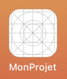
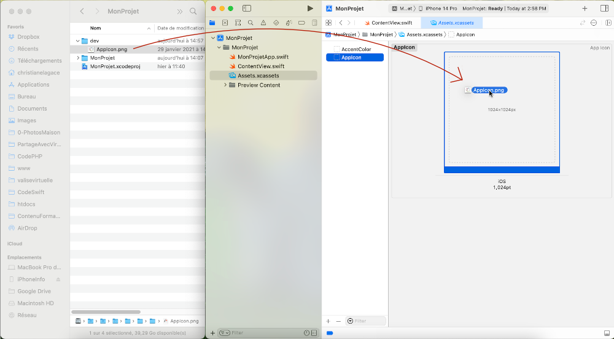

# L'AppIcon

## Ajouter un AppIcon

Avant de publier une application sur l'AppStore ou de l'installer directement sur un appareil, il convient de lui ajouter un AppIcon.

Si vous ne le faites pas, l'application apparaîtra comme suit :



Notez au passage le nom qui apparaît sous l'icône, [qui doit être ajusté](installer-une-application-swiftui-sur-iphone.md#nom-qui-apparait-sous-licone-display-name).

### Caractéristiques de l'image

Pour obtenir des résultats optimaux, l'image utilisée comme AppIcon devra répondre à ces critères :

- L'image source devra être aussi haute que large.
- Elle doit faire 1024 x 1024 pixels.
- Il peut être intéressant de prévoir une marge alentour de l'image.

Notez que si l'image a de la transparence, elle sera affichée sur fond blanc ou noir.

Les coins seront arrondis, comme sur l'exemple plus haut.

### Associer l'image à l'application

Pour utiliser cette images comme AppIcon de votre application :

- Ouvrez votre projet dans Xcode.
- Dans la zone de gauche, cliquez sur `Assets.xcassets`.
- Dans la zone centrale, cliquez sur **AppIcon**.
- Placez le Finder et Xcode côte-à-côte.
- Faites glisser votre image sur le carré marqué 1024x1024.

  

## Comment citer la source du AppIcon

À moins que vous soyez doués en design, il est fort probable que l'AppIcon de votre application SwiftUI proviendra du Web ou qu'il aura été généré par l'IA.

Dans un cas comme dans l'autre, vous devez citer sa source.

Dans votre projet Xcode, vous avez deux possibilités :

- Ajouter une ligne à cet effet dans le commentaire d'en-tête du fichier `ContentView.swift`

  ```swift title="Fichier ContentView.swift"
  // ContentView.swift
  // MonProjet
  //
  // Created by Christiane Lagacé on 2026-04-21.
  // Source du AppIcon : Gemini
  ```

  ou
- L'indiquer dans un fichier `readme.txt` placé dans le dossier `dev` de votre application (le dossier `dev` doit avoir été créé via le Finder et ne pas apparaître dans Xcode).

  ```text title="Fichier dev/readme.txt"
  Source du AppIcon : Gemini
  ```
