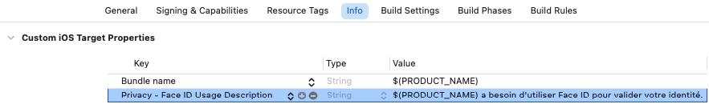
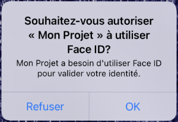
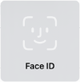
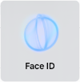
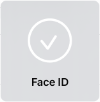
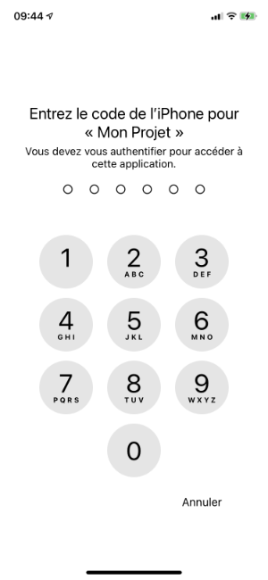
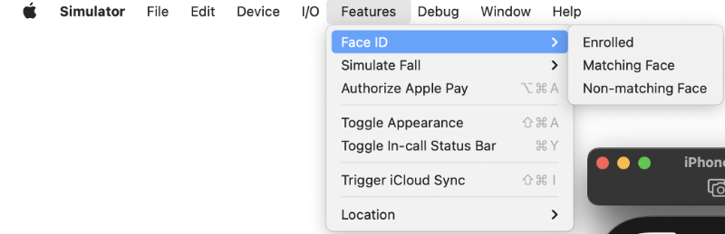
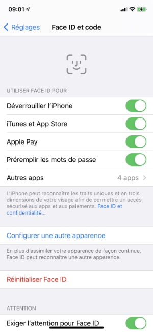
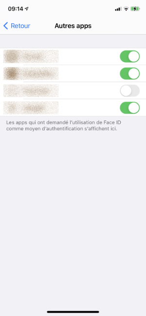
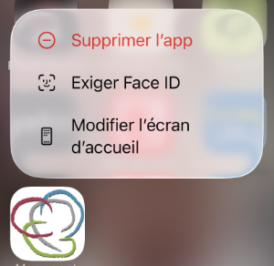

# L'authentification

## Face ID

À la base, on sait que l'usager est authentifié sur son appareil mobile s'il peut accéder aux applications. Cependant, certaines applications qui manipulent des informations sensibles peuvent augmenter la sécurité en demandant une nouvelle authentification lors de leur ouverture.

La fonctionnalité Face ID est disponible pour déverrouiller l'appareil depuis iPhone X.

Si Face ID n'est pas disponible ou [s'il a été désactivé](l-authentification.md#desactiver-face-id), le code que je vous propose demandera à l'usager d'entrer le mot de passe de son téléphone.

Pour que votre application demande une authentifiation lors de son ouverture, suivez ces étapes :

- Pour pouvoir travailler avec la classe [LAContext](https://developer.apple.com/documentation/localauthentication/lacontext), qui permet d'utiliser l'authentification par données biométriques, vous devez ajouter la clé [NSFaceIDUsageDescription](https://developer.apple.com/documentation/bundleresources/information_property_list/nsfaceidusagedescription) [dans Info.plist](demander-une-permission.md). Cette clé correspond au nom « Privacy - Face ID Usage Description ».

  J'aime lui donner la valeur « $(PRODUCT_NAME) a besoin d'utiliser Face ID pour valider votre identité. » ou encore « Vous devez vous authentifier pour accéder à cette application. ».

  

  Une fois que l'authentification sera codée, la valeur que vous donnez à la clé NSFaceIDUsageDescription apparaîtra sous le message « Souhaitez-vous autoriser " Mon Projet " à utiliser Face ID? » la première fois que l'application sera lancée sur le iPhone.

  
- Afin de maximiser la réutilisation du code entre applications, je vous conseille de placer le code d'authentification dans sa propre classe. Les changements seront transmis à la vue principale grâce au [mécanisme d'observation](observer-les-changements-a-un-objet.md).

  ```swift title="Fichier Authentification.swift (SwiftUI)"
  import Foundation
  import LocalAuthentication

  enum Statut {
    case authentifie, nonAuthentifie
  }

  @Observable
  class Authentification {
    var statut: Statut = .nonAuthentifie
    var demandeFaite: Bool = false   // permet au programme de réagir différemment avant que authentifier() ait été appelée
    @ObservationIgnored
    let context = LAContext()
    var error: NSError?

    func authentifier() {
      // Avec .deviceOwnerAuthentication (plutôt que .deviceOwnerAuthenticationWithBiometrics), demandera une authentification par code si Face ID n'est pas disponible.
      guard context.canEvaluatePolicy(.deviceOwnerAuthentication, error: &error) else {
        print(error?.localizedDescription ?? "Can't evaluate policy")
        return
      }

      let justificationSiFaceIDNonDisponible = "Authentication is required to access this application."   // Vous devez vous authentifier pour accéder à cette application.

      Task {
        do {

          try await context.evaluatePolicy(.deviceOwnerAuthentication, localizedReason: justificationSiFaceIDNonDisponible )
          self.statut = .authentifie
          self.demandeFaite = true
        } catch let error {
          self.demandeFaite = true
        }
      }
    }
  }
  ```
- Dans ContentView, instanciez un objet Authentification. Dans le onAppear(), appelez la méthode authentifier(). Affichez les détails sensibles de la vue seulement si l'authentification a eu lieu.

  ```swift title="Fichier ContentView.swift (SwiftUI)"
  struct ContentView: View {
    @State private var authentification: Authentification = Authentification()
    ...

    var body: some View {
      NavigationStack {
        VStack {
          if authentification.statut == .nonAuthentifie {
            if !authentification.demandeFaite {
              ProgressView()
            }
            else {
              // arrivera ici si l'usager clique sur Annuler sur l'écran Face ID ou sur l'écran de saisie de son code
              // ou si l'authentification n'a pas été complétée après 5 minutes
              Text("Vous devez être authentifié pour accéder à cette application.")
                .padding()
            }
          }
          else {
            ...
          }
        }
        .onAppear(perform: {
          // ne refera pas l'authentification si on passe à une autre vue puis qu'on revient à celle-ci
          if authentification.statut == .nonAuthentifie {
            authentification.authentifier()
          }
        })
      }
    }
  }
  ```
- Au lancement de votre application sur un iPhone, l'usager verra l'animation de Face ID pendant que l'authentification a lieu.

  
- Dans le cas où Face ID ne fonctionne pas, l'usager sera invité à entrer son code d'authentification avec, en plus du message standard, la justification que vous avez passée en paramètre lors de l'appel à `context.evaluatePolicy()`.

  

## Tester Face ID sur le simulateur de Xcode

Le simulateur de Xcode ne contient pas le matériel nécessaire pour l'identification biométrique.

Par contre, il permet de tester une application qui requiert une authentification Face ID.

Dans le menu du simulateur, rendez-vous dans l'option **Features** / **Face ID**.

Si vous cochez **Enrolled**, vous choisissez de simuler un appareil qui supporte Face ID.

Vous devez ensuite choisir entre :

- **Matching Face** pour voir comment l'application se comporte quand le visage est reconnu.
- **Non-matching Face** pour tester le cas contraire.



Dans le cas où le simulateur vous demande plutôt un mot de passe, vous devez entrer le mot de passe que vous utilisez lorsque vous ouvrez votre MacBook.

## Désactiver Face ID

Si votre iPhone est muni de Face ID, il est possible de désactiver cette fonctionnalité.

Ceci sera utile, notamment, pour tester une application mobile qui fait appel à Face ID et qui doit réagir correctement lorsque la fonctionnalité n'est pas disponible.

Pour désactiver Face ID :

- Rendez-vous dans **Réglages** / **Face ID et code**.
- Entrez votre code lorsque demandé.
- Vous pouvez choisir pour quelles tâches Face ID est disponible ou non. Si vous désirez tester le fonctionnement d'une application, cliquez sur **Autres apps**.
- Dans l'écran suivant, vous verrez chacune des applications pour lesquelles vous avez accepté d'utiliser Face ID. Décochez l'application pour laquelle Face ID ne doit plus être disponible.

 

## Prévisualiser une vue qui utilise FaceID

Quand une application utilise [Face ID](l-authentification.md#face-id), le canevas de la vue qui fait appel à Face ID affichera par défaut que l'authentification n'a pas réussi.

Si on veut voir la vue telle qu'elle apparaît une fois l'authenfication réussie, il faut apporter une modification à la vue ainsi qu'au #Preview.

Regardons d'abord le #Preview. Il s'agit d'instancier une variable d'authentification et de modifier ses propriétés comme si l'authentification avait eu lieu.

```swift title="SwiftUI"
#Preview {
 var authentification = Authentification()

ContentView(authentification: authentification)
  .onAppear() {
    authentification.statut = .authentifie
    authentification.demandeFaite = true
  }
}
```

Pour que ça fonctionne, il faut que la vue soit prête à recevoir l'authentification en paramètre. Il suffit de s'assurer que la variable d'état ne soit pas privée.

```swift title="SwiftUI"
struct ContentView: View {
  @State var authentification: Authentification = Authentification()
  ...
}
```

Le canevas affichera désormais la vue comme si une authentification réussie avait eu lieu.

## Option « Exiger Face ID »

Depuis iOS 18, il est possible de sécuriser n'importe quelle application (ou presque!) derrière Face ID.

Ceci permet, par exemple, de prêter votre téléphone à un enfant pour jouer à un jeu sans craindre qu'il n'accéde à des applications sensibles.

Pour activer Face ID, il suffit d'effectuer un appui long sur la tuile d'une application et de choisir **Exiger Face ID**.



Cette option n'est pas disponible pour certaines tuiles, par exemple les raccourcis vers des sites Web.

Si cette option est disponible par défaut, pourquoi alors un développeur souhaiterait-il coder une application avec Face ID?

C'est une question de séparation des responsabilités. Une application qui est codée avec Face ID garantit une sécurité systématique tandis que la fonctionnalité iOS repose sur le choix de l'utilisateur.
