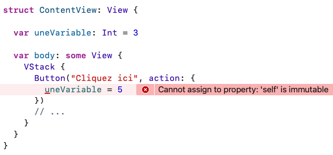

# Les variables qui définissent l'état de la vue (View State)


Une vue SwiftUI se rafraîchit lors d'un changement à ses variables d'état.  

## Déclarer une variable d'état

Dans SwiftUI, on déclare les variables d'état dans la vue à l'aide du modificateur de propriété (**property wrapper**) `@State` :

```swift title="SwiftUI"
struct ContentView: View {

    @State private var maVariableDEtat: Bool = false
    @State private var autreVariableDEtat: String = ""

    var body: some View {
        ...
    }
}
```

!!! important "Important"  
    Les variables d'état doivent toujours être privées (**private**). Il faut toujours leur donner une valeur de départ.

Notez que si le code de la vue doit modifier la valeur d'une variable déclarée dans sa structure et que cette variable n'a pas été déclarée avec `@State`, vous obtiendrez le message `Cannot assign to property: 'self' is immutable`{ .erreur }.



Comme le message l'indique, une structure est immuable par défaut. Puisque ContentView est une structure, ses propriétés ne peuvent pas être modifiées directement.

La solution consiste à ajouter `@State` devant cette variable.

## Modifier une variable d'état  

Normalement, la modification d'une variable d'état est en réaction à une action utilisateur.  

Par exemple, un clic de bouton :  

```swift title="SwiftUI"
struct ContentView: View {

  @State private var quantite: Int = 0

  var body: some View {
    VStack {
      Text("Quantité: \(quantite)")
      Button("Incrémenter", action: {
        quantite += 1
      })
      // ...
    }
  }
}
```

Autre exemple : la variable d'état pourrait être modifiée par une valeur entrée par l'usager dans un contrôle de saisie, par exemple un TextField.

```swift title="SwiftUI"
TextField("Valeur:", text: $variableDEtatDeTypeString)
```

Remarquez l'utilisation du $ devant le nom de la variable d'état. Ceci ajoute une liaison (**binding**), ce qui signifie que la valeur entrée dans le TextField modifiera la variable d'état et vice-versa.

## Utiliser une variable d'état

Les variables d'état seront souvent affichées directement dans l'écran, comme dans l'exemple présenté plus haut qui affiche une quantité.

Dans d'autres cas, elles pourront être utilisées dans une condition afin de moduler ce qui est affiché et comment les choses sont affichées dans la vue.

Voici quelques exemples qui pourraient répondre à vos besoins. J'ai utilisé ici une variable d'état booléenne.

```swift title="SwiftUI"
if maVariableDEtat {
    Text("Je suis affiché seulement si vrai")
 }
```

```swift title="SwiftUI"
Text("Je suis bleu si c'est vrai")
    .foregroundColor(maVariableDEtat ? .blue : .red)
```

```swift title="SwiftUI"
Image(systemName: maVariableDEtat ? "checkmark.square" : "square")
```

```swift title="SwiftUI"
Button(action: {
    maVariableDEtat.toggle()
 }) {
    Text("Cliquez ici")
 }
 .alert("Bonjour!", isPresented: $maVariableDEtat) {
 }
```

Dans cet exemple, la valeur de la variable d’état détermine si l’alerte est affichée ou non.

??? info "Pour plus d'information"

    « SwiftUI State (vidéo) ». Ray Wenderlich. <https://www.raywenderlich.com/17493408-your-first-ios-and-swiftui-app-an-app-from-scratch/lessons/12>

    « Structure State ». Apple. <https://developer.apple.com/documentation/swiftui/state>

    « A guide to SwiftUI’s state management system ». Swift by Sundell. <https://www.swiftbysundell.com/articles/swiftui-state-management-guide/>

    « Safely Updating The View State ». The SwiftUI Lab. <https://swiftui-lab.com/state-changes/>
