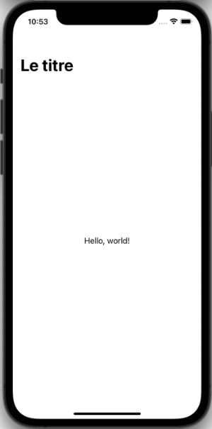
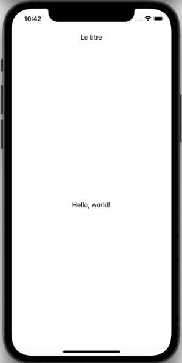
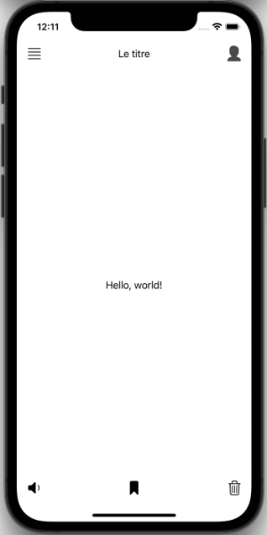

# La barre de navigation

## Configurer le titre de l'application

Il est intéressant d'ajouter un titre dans la bare de navigation, dans le haut de la fenêtre d'une application mobile. Cette barre peut contenir le titre de l'application et possiblement des icônes ou du texte qui donnent accès à des fonctionnalités de votre choix.

### NavigationStack

Avec SwiftUI, il est possible d'ajouter un titre en englobant le contenu de la vue dans un [NavigationStack](https://developer.apple.com/documentation/swiftui/navigationstack), qui est disponible depuis iOS 16.

Dans sa forme la plus simple, le titre de l'application sera fourni à l'aide de la méthode [navigationTitle()](https://developer.apple.com/documentation/swiftui/view/navigationtitle(_:)-5di1u).

Notez que la vue [NavigationView](https://developer.apple.com/documentation/swiftui/navigationview) et sa méthode [navigationBarTitle()](https://developer.apple.com/documentation/swiftui/view/navigationbartitle(_:)-6p1k7) sont obsolètes.

Voici donc comment définir le titre de l'application à l'aide de NavigationStack et navigationTitle().

```swift title="SwiftUI"
struct ContentView: View {
  var body: some View {
    NavigationStack {
      Text("Hello, world!")
        .navigationTitle("Le titre")
    }
  }
}
```



Dans les faits, une vue est rarement composée d'un seul élément.

**Tout le contenu de la vue doit être à l'intérieur du NavigationStack.**

On retrouvera généralement quelque chose du genre :

```swift title="SwiftUI"
struct ContentView: View {
  var body: some View {
    NavigationStack {
      VStack {
        Text("Hello, world!")
        // ...
      }
      .navigationTitle("Le titre")
    }
  }
}
```

### Titre plus petit

Si vous préférez un titre plus petit et centré, il est possible d'ajuster le code comme ceci :

```swift title="SwiftUI"
struct ContentView: View {
  var body: some View {
    NavigationStack {
      VStack {
        Text("Hello, world!")
        // ...
      }
      .navigationTitle("Le titre")
      .navigationBarTitleDisplayMode(.inline)
    }
  }
}
```



Visuellement, on obtiendra le même résultat en définissant un `ToolbarItem` avec l'emplacement `.principal`.

```swift title="SwiftUI"
struct ContentView: View {
  var body: some View {
    NavigationStack {
      VStack {
        Text("Hello, world!")
        // ...
      }
      .toolbar(content: {
        ToolbarItem(placement: .principal, content: {
          Text("Le titre")
        })
      })
    }
  }
}
```

### Où placer le .navigationTitle?

Il est important de placer le titre de l'application après le contrôle d'empilement principal, **à l'intérieur** du `NavigationStack`.

```swift title="SwiftUI"
struct ContentView: View {
  var body: some View {
    NavigationStack {
      VStack {
        Text("Hello, world!")
        // ...
      }
      .navigationTitle("Le titre")
    }   // fin NavigationStack
  }
}
```

Notez que la vue principale devra être entièrement incluse dans le NavigationStack. Ceci ne fonctionnera pas :

```swift title="SwiftUI"
struct ContentView: View {
  var body: some View {
    NavigationStack {
      Text("Hello, world!")
        .navigationTitle("Le titre")
    }
    VStack {
      Text("Hello, world!")
        .padding()
      Image("bonjour")
    }
  }
}
```

### Pour plus d'information

« Working with Toolbar in SwiftUI ». AppCoda. <https://www.appcoda.com/swiftui-toolbar/>

## Configurer les barres d'outils

### Deux barres d'outils

Il est possible d'ajouter du texte ou des icônes dans la [barre de navigation](https://developer.apple.com/design/human-interface-guidelines/navigation-bars) (**navigation bar**) située dans le haut complètement de l'application. Cette barre est aussi appelée [barre d'outils](https://developer.apple.com/documentation/swiftui/toolbars) (**toolbar**). Sur macOS, elle s'appelle [barre de titre](https://developer.apple.com/documentation/swiftui/configure-your-apps-navigation-titles) (**title bar**).

Une seconde barre d'outils est disponible dans le bas de l'écran.

C'est la structure [ToolbarItem](https://developer.apple.com/documentation/swiftui/toolbaritem) qui permet de définir le contenu des barres d'outils.

Pour chaque ajout, on précisera la position [à l'aide d'une de ces valeurs](https://developer.apple.com/documentation/swiftui/toolbaritemplacement).

Emplacements sémantiques :

- automatic
- principal
- status

Emplacements selon le type d'action :

- primaryAction
- secondaryAction
- confirmationAction
- cancellationAction
- desctructiveAction
- navigation

Emplacements avec une position explicite :

- topBarLeading
- topBarTrailing
- bottomBar
- bottomOrnament
- keyboard
- accessoryBar

L'emplacement exact dépendra des options utilisées puisque certains se placent par exemple au centre par défaut mais se déplacent à gauche lorsqu'une autre option est centrée.

```swift title="SwiftUI"
struct ContentView: View {
  var body: some View {
    NavigationStack {
      // contenu de la vue
      // ...
      .toolbar(content: {
        ToolbarItem(placement: .principal, content: {
          Text("Le titre")
        })
        ToolbarItem(placement: .topBarLeading, content: {
          //...
        })
        ToolbarItem(placement: .topBarTrailing, content: {
          //...
        })
        ToolbarItem(placement: .bottomBar, content: {
          //...
        })
        ToolbarItem(placement: .status, content: {
          //...
        })
        ToolbarItem(placement: .bottomBar, content: {
          //...
        })
      })   // fin .toolbar
    }   // fin NavigationStack
  }   // fin body
}   // fin ContentView
```



### Code des barres d'outils dans son propre fichier

Afin de rendre le tout plus lisible, il est possible de placer le code des barres d'outils dans son propre fichier.

Le nom de la structure doit respecter LaCassePascal.  
Le code sera placé dans un fichier qui porte le même nom que la structure, dans un dossier nommé `Views`.

```swift title="Fichier Views/ToolbarPrincipal.swift"
struct ToolbarPrincipal: ToolbarContent {

  ...   // on pourrait ici déclarer des propriétés requises pour la barre d'outils

  var body: some ToolbarContent {
    ToolbarItem(placement: .principal, content: {
      Text("Le titre")
    })
    ToolbarItem(placement: .topBarLeading, content: {
      //...
    })
    ToolbarItem(placement: .topBarTrailing, content: {
      //...
    })
    ToolbarItem(placement: .bottomBar, content: {
      //...
    })
    ToolbarItem(placement: .status, content: {
      //...
    })
    ToolbarItem(placement: .bottomBar, content: {
      //...
    })
  }
}
```

Chaque vue pourra utiliser les barres d'outils ainsi codées et, si désiré, ajouter leurs propres barres d'outils.

```swift title="Fichier de la vue (ex : ContentView.swift)"
NavigationStack {
  // contenu de la vue
  //...
  .toolbar {
    // texte ou icône propre à cette vue (si requis)
    ToolbarItem(... {
      //...
    })
    // textes ou icônes communs à plusieurs vues
    ToolbarPrincipal()
  }
}
```

### Pour plus d'information

« Navigation bar swiftui ». Eon's swift blog. <https://eon.codes/blog/2023/11/18/navigation-bar-swiftui/>
