# La localisation (traduction)

## Application SwiftUI bilingue

La localisation d'une application SwiftUI est réalisée grâce à un fichier de ressources qui, pour chaque langue supportée, recherche une clé et retrouve le texte dans la langue correspondante.

La langue utilisée correspondra à la langue configurée sur le périphérique, par exemple le iPhone ou le simulateur.

### Ajouter une langue à l'application

Pour que l'application puisse être affichée en français, vous devez y ajouter une langue.

- Dans le navigateur de projet de Xcode (s'il n'est pas visible, cliquez sur l'icône de chemise  dans la zone de gauche),  cliquez sur le nom du projet.
- Dans la zone centrale, assurez-vous que le projet soit sélectionné sous **PROJECT**.
- Rendez-vous dans l'onglet **Info**.
- Dans la section **Localizations**, cliquez sur le + puis sélectionnez la langue à ajouter.

  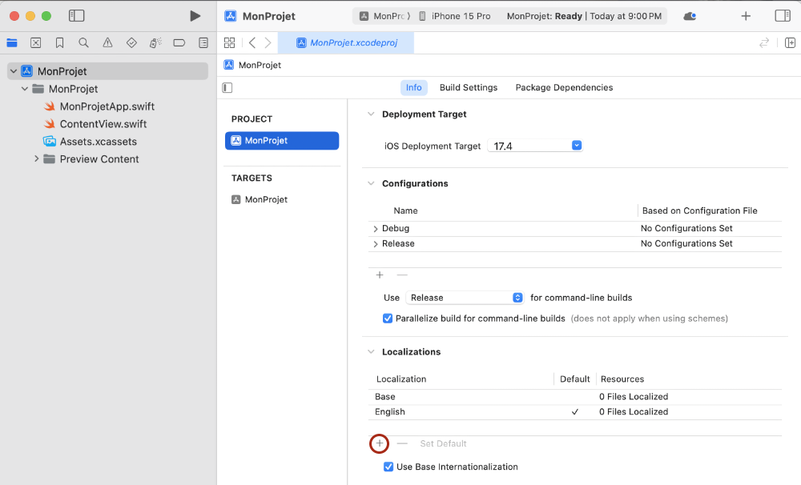
- Si Xcode vous demande la langue de référence pour les chaînes à localiser, acceptez les valeurs par défaut. Ceci se produira seulement si vous ajoutez une langue alors que des chaînes localisées ont déjà été importées dans le projet.

  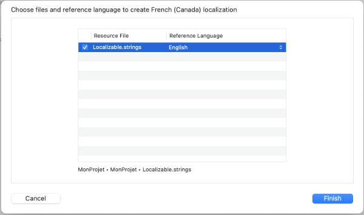
- Vous voyez maintenant que le projet est prêt à supporter deux langues : la langue de développement qui est l'anglais par défaut et le français que vous venez d'ajouter.  
    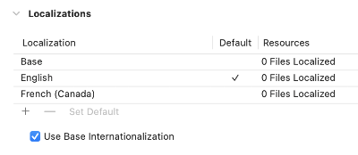  
  Note : la localisation nommée Base sera utilisée pour les ressources qui supportent la substitution de chaîne lors de l'exécution. Vous pouvez l'ignorer pour l'instant.  
  > Use the Base localization for resources that support string substitution at runtime, such as storyboard, XIB, and Siri intent definition files.[1](https://developer.apple.com/documentation/xcode/adding-support-for-languages-and-regions)
- Pour changer la langue par défaut, aussi appelée langue de programmation (celle utilisée dans le code), cliquez sur la langue désirée puis cliquez sur **Set Default**.

### Extraction automatique des chaînes à localiser

Xcode est capable d'extraire automatiquement certaines chaînes à localiser à partir des vues de l'application.

En fait, les chaînes extraites automatiquement sont :

- les chaînes utilisées directement dans une vue Text ou dans une autre vue dont le paramètre est de type [LocalizedStringKey](https://developer.apple.com/documentation/swiftui/localizedstringkey), par exemple Button
- les chaînes déclarées avec le type [LocalizedStringKey](https://developer.apple.com/documentation/swiftui/localizedstringkey)
- les chaînes passées à la macro [NSLocalizedString](https://developer.apple.com/documentation/foundation/nslocalizedstring),  qui est un héritage de UIKit. Cette approche permet de laisser un commentaire à l'intention de la personne qui effectuera la traduction.

Il faudra probablement ajuster le code de l'application pour que toutes les chaînes à localiser soient correctement extraites.

#### Ajustement du code

Vous devez vous assurer que les chaînes à localiser répondent à une des conditions ci-haut.

Par exemple, plutôt que de faire ceci :

```swift title="SwiftUI"
let messageErreur: String = "L'opération n'a pas pu être complétée."
...
Text(messageErreur)   // cette chaîne ne sera pas localisée
```

Il faut faire ceci :

```swift title="SwiftUI"
Text("L'opération n'a pas pu être complétée.")
```

ou, si on doit passer par une variable :

```swift title="SwiftUI"
let messageErreur: LocalizedStringKey = "L'opération n'a pas pu être complétée."
...
Text(messageErreur)
```

Voici un autre exemple, cette fois avec un tableau qui contient des chaînes à localiser.

```swift title="SwiftUI"
let tableau: [LocalizedStringKey] = ["un", "deux", "trois"]
```

Il est également possible de travailler avec NSLocalizedString.

```swift title="SwiftUI"
let messageErreur: String = NSLocalizedString("L'opération n'a pas pu être complétée.", comment: "Message d'erreur")
...
Text(messageErreur)
```

ou encore :

```swift title="SwiftUI"
let tableau = [
  NSLocalizedString("un", comment: ""),
  NSLocalizedString("deux", comment: ""),
  NSLocalizedString("trois", comment: "")
]
```

#### Valeurs tirées de la base de données

Les valeurs tirées de la base de données ne doivent pas être localisées.

#### Chaines qui contiennent une variable

Dans le cas où une chaîne à localiser contient une variable, on ne localisera que la partie statique de la chaîne.

La partie variable sera insérée dynamiquement lors de l'exécution de l'application.

Prenons l'exemple du texte suivant :

```swift title="SwiftUI"
Text("Items pour la catégorie \(categorie.titre)")
```

La chaîne localisée contiendra un espace réservé pour la variable : "Items pour la catégorie **%@**".

Dans le cas où la variable dans la chaîne est un entier, on aura plutôt un "Blablabla: **%lld**" (**long long digit**, ce qui correspond à une variable Int64).

Mais rassurez-vous, vous n'avez pas à créer cette chaîne manuellement, Xcode le fera pour vous dans les étapes plus bas.

#### Configuration pour permettre l'extraction

Par défaut, tout est en place pour permettre l'extraction automatique des chaînes.

Pour vous en assurer :

- Dans le navigateur de projet, cliquez sur le nom du projet.
- Dans la zone centrale, assurez-vous que le projet soit sélectionné sous **TARGETS**.
- Rendez-vous dans l'onglet **Build Settings**.
- Dans le sous-onglet **All**, section **Localization**, la configuration **Use Compiler to Extract Swift Strings** doit être à `Yes`.

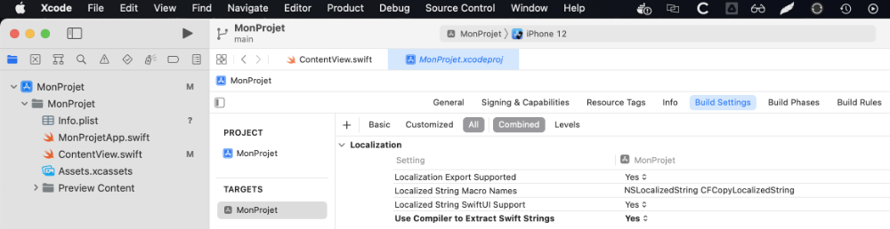

#### Extraction des chaînes

Maintenant, pour générer les chaînes à localiser, rendez-vous dans le menu **Product** / **Export Localizations**.

Vous pouvez conserver le nom suggéré (ex : `MonProjet Localization`). Je vous conseille d'enregistrer les fichiers de localisation dans un dossier nommé `dev`, sous le dossier du projet.

Pour lancer l'extraction, cliquez sur **Export**.

Les chaînes à localiser seront contenues dans un fichier `.xcloc` (Xcode Localization Catalog) pour chaque langue supportée.

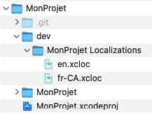

Lorsqu'ils auront été correctement localisés, vous devrez importer ces fichiers dans votre projet.

### Localisation des chaînes

À ce stade, vous avez en main un fichier `en.xcloc` et un fichier `fr-CA.xcloc` qui contiennent toutes les chaînes à localiser. Puisqu'ils ne font pas encore partie du projet, il est possible d'envoyer ces fichiers à la personne en charge de la traduction sans avoir à lui transférer tout le projet Xcode.

Pour ouvrir un fichier .xcloc, retrouvez-le dans le Finder puis double-cliquez sur son nom. Ceci l'ouvrira dans Xcode.

Dans la zone de gauche, ouvrez la structure jusqu'à **Localizable**. Vous verrez alors les informations de localisation.

Ici, on voit le contenu du fichier `en.xcloc` dans un projet où la langue par défaut (celle utilisée dans le code) a été modifiée pour fr-CA.

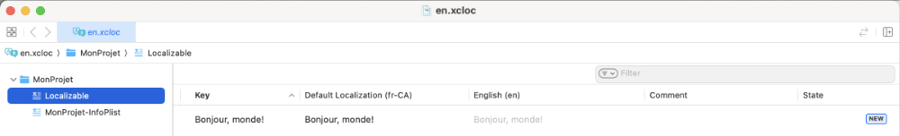

Pour chaque chaîne à localiser, vous retrouverez ces informations :

- Dans la colonne **Key**, vous voyez la clé que vous devez utiliser dans votre code pour obtenir la chaîne correspondante.
- Dans la seconde colonne (sur l'image : **Default Localization (fr-CA)**),  vous voyez la chaîne qui sera utilisée dans la langue de programmation de l'application.
- La troisième colonne (sur l'image : **English (en)**), représente la chaîne qui corrrespond à la langue dans la quelle vous êtes actuellement en train de faire la localisation. Si la chaîne apparaît grisée, c'est que la localisation n'a pas encore été faite pour cette chaîne.
- La colonne **Comment** permet de voir le commentaire que le développeur a ajouté au code (ex : paramètre `comment` d'un Text) pour aider le traducteur dans sa tâche.
- 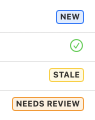La colonne **State** permet d'indiquer l'état de la localisation pour une chaîne :
  - nouveau terme à traduire (icône **New**)
  - terme déjà traduit (icône en forme de crochet)
  - terme qui a déjà été traduit mais qui n'est plus utilisé par l'application (icône **Stale**)
  - lorsque le développeur modifie du code qui peut affecter une localisation, il peut en informer les traducteurs en faisant clic droit sur une entrée du fichier localisé / **Mark for review**. Le terme aura maintenant l'icône **Needs review**.

D'autres informations à localiser sont disponibles à partir de la zone de gauche, dans **InfoPlist**. Vous y retrouverez notamment le nom de l'application ainsi que les valeurs que vous avez entrées dans [Info.plist](info-plist.md#a-quoi-sert-infoplist).

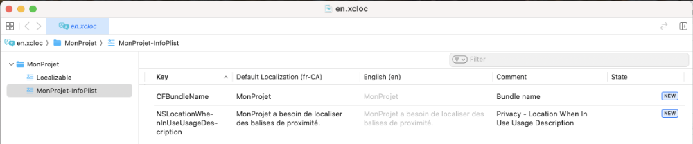

### Importation dans le projet

Pour ajouter un fichier de localisation à votre projet, rendez-vous dans le menu **Product** / **Import Localizations**.

Retrouvez le fichier .xcloc à importer.

Une fois l'importation effectuée, vous verrez un nouveau fichier dans le navigateur de projet : `Localizable.strings`.

Si vous l'ouvrez dans Xcode, vous verrez les paires clé-valeur que vous avez configurées.

#### Contenu du fichier Localizable.strings

### Nouvelles chaînes à localiser

Si de nouvelles chaînes doivent être localisées après avoir importé un fichier de localisation, vous pouvez refaire le processus d'extraction des chaînes.

Les localisations déjà réalisées seront conservées et les nouvelles chaînes auront la mention New.

Vous pourrez réimporter ce fichier de localisation une fois la localisation terminée.

### Langue du simulateur

#### Icône Réglages

Lorsque le simulateur est en cours d'exécution, il est possible de modifier sa langue en cliquant sur son icône **Réglages** puis de choisir **Général** / **Langues et régions**.

Il est possible de spécifier plusieurs langues. Tel qu'indiqué dans l'écran de configuration, les apps et les sites Web utiliseront la première langue de cette liste qu'ils prennent en charge.

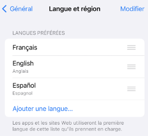

Cette configuration ne touchera que le simulateur en cours d'exécution, avec la version du périphérique en cours, par exemple iPhone 15 Pro.

#### Edit Scheme

Il est possible d'apporter une modification au projet dans Xcode afin que tous les simulateurs voient leurs réglages modifiés.

- Dans Xcode, rendez-vous dans le menu **Product** / **Scheme** / **Edit Scheme**.
- Sélectionnez l'option **Run**.
- Dans l'onglet **Options**, la configuration **App Language** permet de spécifier la langue désirée.

  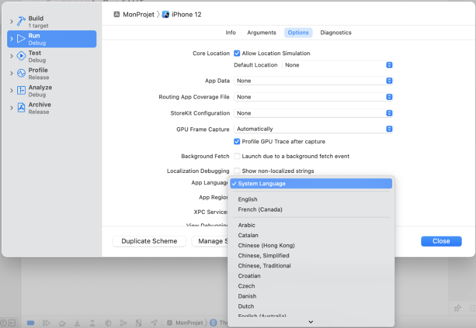

### Afficher les chaînes dans la langue du périphérique

Une fois les étapes de localisation complétées, à chaque fois qu'une chaîne est affichée, par exemple à l'aide d'une vue `Text`, SwiftUI recherchera la chaîne mentionnée parmi les clés dans le fichier de localisation.

#### Comment SwiftUI détermine la langue à utiliser

La localisation à utiliser est :

- la première langue qui apparaît dans la liste des langues du périphérique
- dans le cas où cette langue n'est pas supportée par l'application : la seconde langue configurée sur le périphérique
- si la liste des langues du périphérique est épuisée : la langue par défaut de l'application

Prenons l'exemple d'un téléphone et d'une application avec ces configurations.

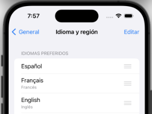 

La première langue du périphérique est l'espagnol. Mais comme cette langue n'est pas supportée par l'application, il faut vérifier la suivante.

La seconde langue du périphérique est le français. Puisque cette langue est supportée par l'application, c'est elle qui sera utilisée.

Si aucune des langues du périphérique n'avait été supportée par l'application, c'est la langue par défaut de l'application qui aurait été utilisée, soit l'anglais (identifiée par un crochet).

#### Comment SwiftUI retrouve la chaîne à afficher

Si vous entrez dans une vue `Text("ABC")`, SwiftUI recherchera la clé `ABC` dans la langue de localisation à utiliser.

Si jamais la clé ne s'y trouvait pas ou si elle n'a pas été localisée, il affichera directement le texte de la clé, soit `ABC`.

??? info "Pour plus d'information"

    « SwiftUI Localization Tutorial for iOS: Getting Started ». Ray Wenderlich. <https://www.raywenderlich.com/27469286-swiftui-localization-tutorial-for-ios-getting-started>

    « Localization with SwiftUI, how to preview your localized content ». Benoit Pasquier. <https://benoitpasquier.com/localization-swiftui-how-top-preview-localized-content/>

    « How to decide the user’s locale in Swift ». Medium. <https://medium.com/@hdmdhr/how-to-decide-the-users-locale-in-swift-251caf3346b9>

    «  The Missing String Catalogs FAQ for Localization in Xcode 15  ». Fline Dev. <https://www.fline.dev/the-missing-string-catalogs-faq-for-xcode-15/>

## Tenir compte de la localisation dans le canevas

Lorsqu'une application a été [correctement localisée](la-localisation-traduction.md#application-swiftui-bilingue), le canevas peut afficher les chaînes localisées si vous lui fournissez une indication sur la langue attendue.

```swift title="SwiftUI"
#Preview {
  ContentView()
  .environment(\.locale, .init(identifier: "fr"))
}
```

Dans le cas où une application est localisée différement selon la région pour une même langue, il est possible de préciser le code de la région après le code du pays.

```swift title="SwiftUI"
#Preview {
  ContentView()
  .environment(\.locale, .init(identifier: "fr_CA"))
}
```

Il est possible de préciser plus d'une version du Preview, par exemple une par langue. Des boutons en haut de la prévisualisation permettront de passer facilement d'une langue à l'autre.

```swift title="SwiftUI"
#Preview("français") {
  ContentView()
  .environment(\.locale, .init(identifier: "fr"))
}

#Preview("anglais") {
  ContentView()
  .environment(\.locale, .init(identifier: "en"))
}
```

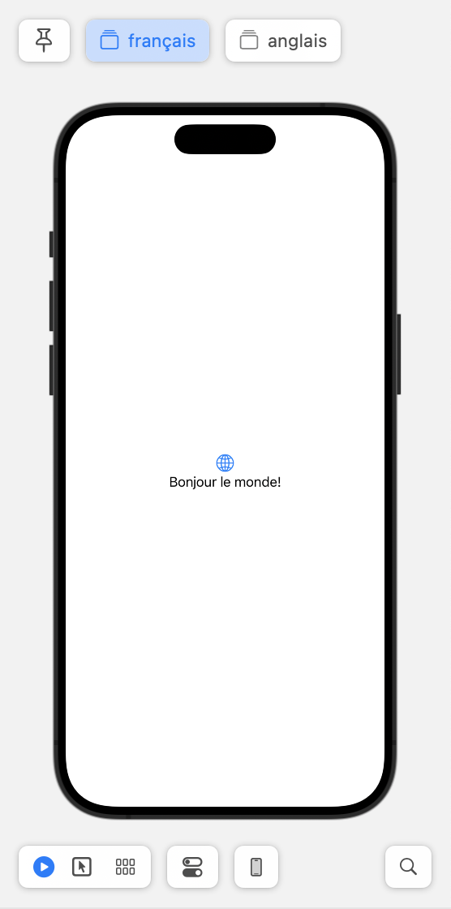
