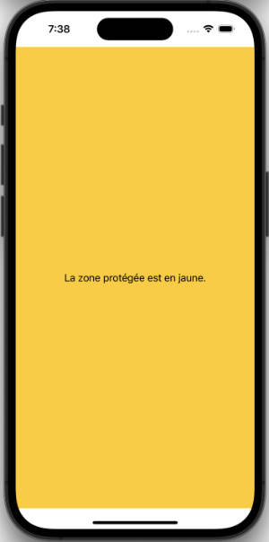
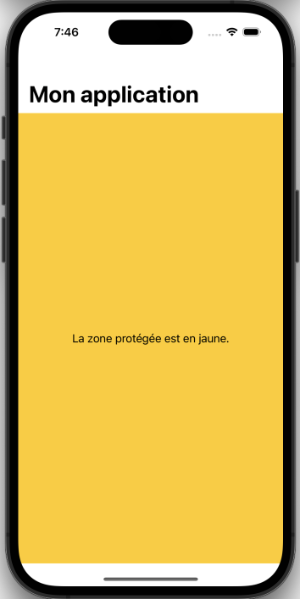
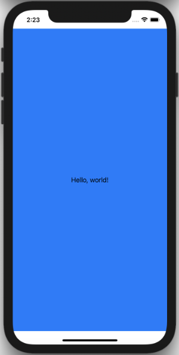
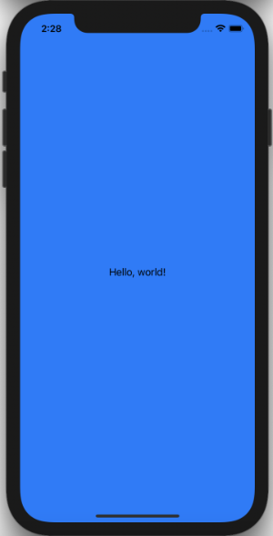
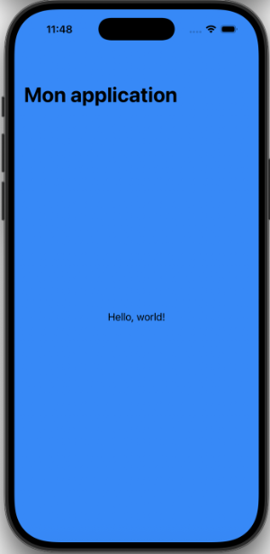

# La zone protégée

## Zone protégée (safe area)

La zone protégée (en anglais : **safe area**) représente la zone dans laquelle il est sécuritaire d'afficher du contenu. Il s'agit de la quasi-totalité de l'écran, à laquelle on retire une zone dans le haut et dans le bas.

Ces zones sont réservées à des tâches spécifiques. Par exemple, le iPhone peut y afficher la barre de navigation, qui contient le titre de l'application, ainsi que, possiblement, des icônes ou des boutons.

La taille de la zone protégée varie selon la façon dont la vue est codée.

Dans le cas où l'application n'a pas de barre navigation :

```swift title="SwiftUI"
var body: some View {
  ZStack {
    Rectangle()
      .foregroundColor(.yellow)
    Text("La zone protégée est en jaune.")
  }
}
```



Avec une barre de navigation :

```swift title="SwiftUI"
var body: some View {
  NavigationStack {
    ZStack {
      Rectangle()
        .foregroundColor(.yellow)
      Text("La zone protégée est en jaune.")
    }
    .navigationTitle("Mon application")
  }
 }
```



## Fond d'écran qui recouvre tout l'écran

Je vous présente ici des techniques pour modifier le fond d'écran d'une application SwiftUI.

Dans cette fiche :

- [Si on ne tient pas compte de la zone protégée](la-zone-protegee.md#fond-decran-qui-recouvre-tout-lecran)
- [Couleur de fond](la-zone-protegee.md#fond-decran-qui-recouvre-tout-lecran)
  - [Technique du ZStack](la-zone-protegee.md#fond-decran-qui-recouvre-tout-lecran)
  - [Technique du .background()](la-zone-protegee.md#fond-decran-qui-recouvre-tout-lecran)
- [Image de fond](la-zone-protegee.md#fond-decran-qui-recouvre-tout-lecran)
  - [Technique du .background()](la-zone-protegee.md#fond-decran-qui-recouvre-tout-lecran)
  - [Technique du ZStack](la-zone-protegee.md#fond-decran-qui-recouvre-tout-lecran)

### Si on ne tient pas compte de la zone protégée

Une technique de base pour modifier la couleur de fond de l'écran consiste à utiliser un `ZStack` avec une couleur et le reste de la vue sera affiché par-dessus.

Si on ne prend pas certaines précautions, seule la [zone protégée](la-zone-protegee.md#zone-protegee-safe-area) est recouverte.

```swift title="SwiftUI"
struct ContentView: View {
  var body: some View {
    ZStack {
      Color.blue
      Text("Hello, world!")
        .padding()
    }
  }
}
```



Voici donc comment régler le problème.

### Couleur de fond

Pour appliquer une couleur sur tout le fond de l'écran, je vous propose différentes façons de procéder.

#### Technique du ZStack

La technique du `ZStack` présentée plus haut doit être légèrement modifiée pour que la couleur recouvre l'écran entier.

Il suffit d'utiliser le modifieur [ignoresSafeArea()](https://developer.apple.com/documentation/swiftui/view/ignoressafearea(_:edges:)).

```swift title="SwiftUI"
struct ContentView: View {
  var body: some View {
    ZStack {
      Color.blue
        .ignoresSafeArea()
      VStack {
        Text("Hello, world!")
          .padding()
        ...   // autres vues ici au besoin
      }
    }
  }
}
```



Ceci fonctionne également pour les applications avec [barre de titre](la-barre-de-navigation.md#configurer-le-titre-de-lapplication).

On voit que la couleur remplira tout l'espace, même celui sous le titre.

```swift title="SwiftUI"
struct ContentView: View {
  var body: some View {
    NavigationStack {
      ZStack {
        Color.blue
          .ignoresSafeArea()
        VStack {
          Text("Hello, world!")
            .padding()
          ...   // autres vues ici au besoin
        }
      }
      .navigationTitle("Mon application")      }
    }
  }
}
```



Attention : dans le cas où le `ZStack` ou même le `NavigationStack` comprend lui-même un padding, il faut prendre soin d'enlever ce ou ces paddings pour que la couleur aille jusqu'au bord.

Remarquez que le padding appliqué au texte n'a pas d'effet sur la couleur de fond.

```swift title="SwiftUI"
struct ContentView: View {
  var body: some View {
    NavigationStack {
      ZStack {
        Color.blue
          .ignoresSafeArea()
        VStack {
          Text("Hello, world!")
            .padding()
          ...   // autres vues ici au besoin
        }
      }   // fin ZStack
      .padding()
      .navigationTitle("Mon application")      }
    }   // fin NavigationStack
    .padding()
  }
}
```

#### Technique du .background()

Le fond d'écran peut également être défini à l'aide du modifieur [.background()](https://developer.apple.com/documentation/swiftui/adding-a-background-to-your-view) appliqué à la vue englobante, ici le `VStack`.

Le `.background()` sert à couvrir le fond de la vue auquel il est appliqué.

Pour que la couleur de fond recouvre tout l'écran, il faut s'assurer que `VStack` soit « gonflé » pour être aussi grand que son parent (l'écran). Ceci peut être réalisé avec le modifieur [.containerRelativeFrame()](https://developer.apple.com/documentation/swiftui/view/containerrelativeframe(_:alignment:)).

```swift title="SwiftUI"
struct ContentView: View {
  var body: some View {
    VStack {
      Text("Hello, world!")
        .padding()
      ...   // autres vues ici au besoin
    }
    .containerRelativeFrame([.horizontal, .vertical])
    .background(
      Color.blue
    )
  }
}
```

### Image de fond

Dans le cas où on veut utiliser une image comme fond d'écran, il faut que l'image puisse être redimensionnée ([resizable()](https://developer.apple.com/documentation/swiftui/image/resizable(capinsets:resizingmode:))) et que ses proportions soient conservées tout en permettant de remplir l'espace disponible ([scaledToFill()](https://developer.apple.com/documentation/swiftui/view/scaledtofill())).

#### Technique du .background()

La technique recommandée consiste à utiliser le modifieur `.background()`.

Tout comme avec une couleur, il faut « gonfler » le VStack pour qu'il soit aussi grand que son parent.

```swift title="SwiftUI"
var body: some View {
  NavigationStack {
    VStack {
      Text("Hello, world!")
        .padding()
      ...   // autres vues ici au besoin
    }
    .containerRelativeFrame([.horizontal, .vertical])
    .background(Image("mon-image")
      .resizable()
      .scaledToFill()
      .ignoresSafeArea()
    )
    .navigationTitle("Mon application")
  }
}
```

#### Technique du ZStack

Il est déconseillé d'utiliser la technique du `ZStack` pour placer une image en arrière-plan pour l'écran entier.

En effet, dans certains cas, ceci peut causer des problèmes de mise en page pour les autres éléments de la vue.

Ceci est dû au fait que le `ZStack` est étiré au-delà de l'écran puisque l'image peut déborder en largeur ou en hauteur.

Le système de coordonnées de la vue sera donc relatif à un point qui pourrait ne pas être visible à l'écran, ce qui peut causer un comportement incohérent.

```swift title="SwiftUI"
var body: some View {
  NavigationStack {
    ZStack {
      Image("mon-image")
        .resizable()
        .scaledToFill()
        .ignoresSafeArea()
      VStack {
        ...
      }
    }
    .navigationTitle("Mon application")
  }
 }
```
