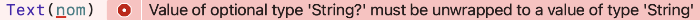

# Le langage Swift (référence)

## Variables, constantes et types de données

Dans cette fiche :

- Déclaration
- Types de base
- Type Decimal
- Type CGFloat
- Instances de structures et de classes
- Types opaques
- À quel endroit déclarer les variables dans SwiftUI?

### Déclaration

Avec Swift, les mots-clés `var` et `let` permettent de déclarer respectivement des variables et des constantes.

- `var` : déclare une variable
- `let` : déclare une constante

```swift title="Swift"
var nom = "Annie"
let iterations = 10
```

Lorsque le type peut être déduit à partir de la valeur d'initialisation, Swift effectue automatiquement une inférence de type. Il n’est donc pas nécessaire de préciser le type, comme dans l'exemple précédent.

Si désiré, il est tout de même possible de spécifier le type.

```swift title="Swift"
var nom: String = "Annie"
let iterations: Int = 10
```

Dans le cas où le type de la variable ne peut pas être déterminé automatiquement, il est obligatoire de le préciser.

```swift title="Swift"
var nom: String
var montant: Decimal = 10.99   // sans le type, la variable aurait été de type Double
```

### Types de base

Les types de base en Swift sont :

- `Int` : nombre entier.   
  Il est également possible de spécifier sur combien de bits on désire stocker le nombre, par exemple 32 bits ou 64 bits, avec Int32 et Int64. Ceci affectera les valeurs minimales et maximales qui peuvent être stockées.   
  Int32 : -2147483648 à 2147483647  
  Int64 : -9223372036854775808 à 9223372036854775807  
  Cette précision n'est généralement pas nécessaire. Si vous travaillez sur un système en 64 bits, Int fera la même chose que Int64.
- `UInt` : Nombre entier non signé (**Unsigned**)
- `Double` : Nombre à virgule flottante codé sur 64 bits (15 décimales) - idéal pour calcul scientifique
- `Float` : Nombre à virgule flottante codé sur 32 bits (6 décimales) - idéal pour jeux, graphiques, animation
- `Bool` : Booléen
- `String` : chaîne de caractères.

Fait intéressant : on peut convertir une chaîne de caractères en tableau comme suit :

```swift title="Swift"
let tableauLettres = Array(nom) // ["A", "n", "n", "i", "e"]
```

### Type Decimal

Si vous développez une application qui doit travailler avec des valeurs monétaires, le type par excellence est [Decimal](https://developer.apple.com/documentation/foundation/decimal).

Decimal évite les erreurs d’arrondi associées aux nombres à virgule flottante.

```swift title="Swift"
let prix: Decimal = 69.44
```

Si on initialise une variable de type Decimal à partir d'une chaîne, il faut tenir compte que le résultat pourrait être nil si la chaîne n'était pas conforme.

Dans cet exemple, il est sécuritaire d'utiliser l'[opérateur de déballage forcé (!)](le-langage-swift-reference.md#les-optionnels) puisque la chaîne est codée en dur et qu'on est certains que la valeur pourra être convertie en Decimal.

```swift title="Swift"
let prix = Decimal(string: "69.44")!
```

Dans d'autres contextes, il est préférable d'utiliser [if let](le-langage-swift-reference.md#liaison-optionnelle-if-let-guard-let).

```swift title="Swift"
if let prix = Decimal(string: prixSaisi) {
  // ici, on a l'assurance que le prix est valide.
} else {
  message = "Veuillez spécifier un prix valide (ex : 12.50)"
}
```

Notez que pour convertir une chaîne en Decimal, ceci ne fonctionne pas car la structure Decimal n'a pas de constructeur avec un paramètre non nommé de type String.

```swift title="Swift"
let montantTexte = "12.25"
if let montantDecimal = Decimal(montantTexte) {
  ...
}
```

Pour que ça fonctionne, il faut préciser que le nom du premier paramètre est string.

```swift title="Swift"
let montantTexte = "12.25"
if let montantDecimal = Decimal(string: montantTexte) {
  ...
}
```

### Type CGFloat

Le type CGFloat est très utilisé dans le développement d’interfaces graphiques. Il représente un nombre à virgule flottante optimisé pour les calculs graphiques.

SwiftUI utilise CGFloat pour :

- les positions (x, y)
- les tailles (width, height)
- les angles
- les coordonnées dans l’espace graphique

```swift title="SwiftUI"
let largeur: CGFloat = 120
let opacite: CGFloat = 0.5
```

Techniquement, CGFloat est très proche de Double. Son avantage est qu'il s'adapte automatiquement à l'architecture de l'appareil (32 ou 64 bits).

Dans cet exemple, les paramètres pour .frame() et pour .opacity() sont automatiquement convertis en CGFloat.

```swift title="SwiftUI"
Circle()
  .frame(width: 100, height: 100)
  .opacity(0.5)
```

Par contre, si les valeurs étaient lues dans des variables, il faudrait s'assurer que le type de la variable est correctement spécifié ou qu'il a été correctement inféré.

```swift title="SwiftUI"
let largeur = 100 // ici, le type inféré est Int
...
Circle()
  .frame(width: largeur)   // erreur : Cannot convert value of type 'Int' to expected argument type 'CGFloat'
```

Pour régler ce problème, plusieurs approches sont possibles :

```swift title="SwiftUI"
let largeur: CGFloat = 100
...
Circle()
  .frame(width: largeur)
```

ou

```swift title="SwiftUI"
let largeur = 100
...
Circle()
  .frame(width: CGFloat(largeur))
```

ou encore

```swift title="SwiftUI"
let largeur = 100.0   // ici, le type inféré est Double
...
Circle()
  .frame(width: largeur)   // SwiftUI est souvent capable de faire une conversion automatique entre Double et CGFloat
```

### Instances de structures et de classes

Les mots-clés `var` et `let` permettent également de déclarer des instances de structures et de classes.

Petite mise en garde : si une instance d'une structure est déclarée avec `let`, l’instance devient entièrement immuable.

L'instance **ainsi que toutes ses propriétés** ne pourront pas être réassignées.

```swift title="Swift"
let monInstance = MaStructure()
 monInstance.unePropriete = "abc"
```

Ce code générera l'erreur « Cannot assign to property: 'monInstance' is a 'let' constant ».


Notez que ce comportement est différent de ce qu'on retrouve dans d'autres langages, par exemple [JavaScript](https://developer.mozilla.org/en-US/docs/Web/JavaScript/Reference/Statements/const).

Les classes réagissent différemment.

```swift title="Swift"
let monInstance = MaClasse()
monInstance.unePropriete = "abc"
```

Lorsqu'on a une instance d'une classe, il est possible de modifier ses propriétés même si l'instance a été déclarée avec `let`, à condition que la propriété ait elle-même été déclarée avec var dans la classe.

### Types opaques

Quand on déclare une variable, il est possible de lui donner un type opaque, c'est-à-dire de ne pas spécifier le type précis d'une variable.

Ceci sera fait à l'aide du mot-clé `some` suivi d'un protocole.

```swift title="SwiftUI"
var body: some View {
  ...
}
```

Ici, on voit que la variable `body` est d'un type qui répond au protocole `View` mais on ne connaît pas son type précis. Ce pourrait être un `Text`, un `VStack`, etc.

Sans entrer dans les détails techniques, disons que les types opaques permettent de [régler une problématique en n'exposant pas le type précis d'une variable](https://docs.swift.org/swift-book/LanguageGuide/OpaqueTypes.html).

### À quel endroit déclarer les variables dans SwiftUI?

Les variables et constantes qui doivent être utilisées dans toute une vue seront déclarées directement dans la structure de la vue, avant le `body`.

Dans l'exemple qui suit, le contexte dicte qu'on doit utiliser une constante.

```swift title="SwiftUI"
struct ContentView: View {
  let nom: String = "Annie"

  var body: some View {
    ...
  }
}
```

Il est possible de déclarer les variables et constantes avec une portée plus petite, par exemple direction dans l'action d'un bouton.

La variable ou constante n'existera pas en dehors du code de ce bouton.

```swift title="SwiftUI"
Button(action: {
  var nom: String = "Annie"
  ...
}) {
  Text("Vérifier")
}
```

### Pour plus d'information

« The Basics - Constants and Variables ». Swift. <https://docs.swift.org/swift-book/LanguageGuide/TheBasics.html#ID310>

« Swift Integer Quick Guide ». Use Your Loaf. <https://useyourloaf.com/blog/swift-integer-quick-guide/>

« Swift – Integer, Floating-Point Numbers ». Geeks for Geeks. <https://www.geeksforgeeks.org/swift-integer-floating-point-numbers/>

« Constants, Variables and Types ». Dimitri Racordon. <https://kyouko-taiga.github.io/swift-thoughts/tutorial/chapter-1/>

## Les dictionnaires

Un dictionnaire, parfois appelé **tableau associatif**, est un type de tableau dont les données sont regroupées en paires clé-valeur.

Toutes les clés doivent être du même type et toutes les valeurs doivent être du même type, qui peut être différent du type des clés.

### Déclaration et initialisation

Pour déclarer un dictionnaire vide :

```swift title="Swift"
var monDictionnaire = [String:Int]()
```

ou

```swift title="Swift"
var monDictionnaire:[String:Int] = [:]
```

On peut également le remplir dès sa déclaration :

```swift title="Swift"
var monDictionnaire:[String:Int] = ["ABC":10, "DEF":3, "GHI":8]
```

Pour ajouter une valeur, il suffit d'utiliser une clé qui n'existe pas encore.

```swift title="Swift"
monDictionnaire["JKL"] = 25
```

### Accéder à un élément

Plutôt que de retrouver une information à l'aide d'un indice numérique, on retrouvera la valeur d'un tableau associatif à partir de sa clé.

```swift title="Swift"
let valeur = monDictionnaire["DEF"]   // 3
```

### Boucler dans le dictionnaire

Pour boucler dans les éléments du dictionnaire, la boucle for est toute indiquée.

```swift title="Swift"
for (cle, valeur) in monDictionnaire {
  print("Clé: \(cle) Valeur: \(valeur)")
}
```

On peut également utiliser la propriété [keys()](https://developer.apple.com/documentation/swift/dictionary/keys-swift.struct). Ceci retourne une collection. On convertira le résultat en tableau à l'aide de [Array()](https://developer.apple.com/documentation/swift/array/init(_:)-236cl).

```swift title="Swift"
let cles = Array(monDictionnaire.keys)
var valeur: Int

for cle in cles {
  valeur = monDictionnaire[cle]!
  print(cle)
  print(valeur)
 }
```

Remarquez le point d'exclamation dans l'instruction qui retrouve la valeur. Dans ce contexte, on l'appelle [**implicitly unwrapped optional**](https://swiftsenpai.com/swift/making-sense-of-swift-operators/).

Si on ne le met pas, on obtiendra cet avertissement : « Expression implicitly coerced from 'Int?' to 'Any' ».

C'est que le compilateur nous informe que `monDictionnaire[cle]` pourrait être nul. Il demande ce qu'il doit faire si ça arrive afin de ne pas faire planter le programme.

Avec le point d'exclamation – qu'il faut utiliser seulement dans des situations très spécifiques – on informe le compilateur que c'est certain que la valeur ne peut pas être nulle.

### Tri

Dans les deux boucles précédentes, les valeurs affichées à l'écran pourraient être affichées dans un ordre différent à chaque fois que le programme est exécuté.

Si on a besoin d'un ordre spécifque, il faut le spécifier.

```swift title="Swift"
let cles = Array(monDictionnaire.keys).sorted()
```

ou encore :

```swift title="Swift"
let monDictionnaireTrie = monDictionnaire.sorted(by: <)
```

### Quelques méthodes utiles

- [allSatisfy()](https://developer.apple.com/documentation/swift/dictionary/allsatisfy(_:))
- [contains()](https://developer.apple.com/documentation/swift/dictionary/contains(where:))
- [count()](https://developer.apple.com/documentation/swift/dictionary/count)
- [filter()](https://developer.apple.com/documentation/swift/dictionary/filter(_:))
- [firstIndex()](https://developer.apple.com/documentation/swift/array/firstindex(where:))
- [forEach()](https://developer.apple.com/documentation/swift/dictionary/foreach(_:))
- [index()](https://developer.apple.com/documentation/swift/dictionary/index(forkey:))
- [isEmpty()](https://developer.apple.com/documentation/swift/dictionary/isempty)
- [keys()](https://developer.apple.com/documentation/swift/dictionary/keys-swift.property)
- [max()](https://developer.apple.com/documentation/swift/dictionary/max(by:))
- [min()](https://developer.apple.com/documentation/swift/dictionary/min(by:))
- [randomElement()](https://developer.apple.com/documentation/swift/dictionary/randomelement())
- [remove()](https://developer.apple.com/documentation/swift/dictionary/remove(at:))
- [removeValue()](https://developer.apple.com/documentation/swift/dictionary/removevalue(forkey:))
- [values()](https://developer.apple.com/documentation/swift/dictionary/values-swift.property)

### Pour plus d'information

« Dictionary ». Apple. <https://developer.apple.com/documentation/swift/dictionary>

« Collection Types - Dictionnaries ». Swift. <https://docs.swift.org/swift-book/LanguageGuide/CollectionTypes.html#ID113>

« Expression implicitly coerced from ‘String?’ to ‘Any’- WHY SWIFT, WHY :( ». Steven Curtis. <https://stevenpcurtis.medium.com/expression-implicitly-coerced-from-string-to-any-why-swift-why-190dd0a58c58>

« Dictionaries in SwiftDictionaries in Swift ». Andy Bargh. <https://andybargh.com/dictionaries-in-swift/>

## Les structures

Les [structures](https://docs.swift.org/swift-book/LanguageGuide/ClassesAndStructures.html) Swift permettent de représenter des données complexes ainsi que des comportements.

Dans SwiftUI, une structure sera généralement placée dans son propre fichier. Le nom de la structure sera identique au nom du fichier.

Puisque les structures représentent les données de l'application (le modèle), leurs fichiers seront placés dans un dossier nommé `Models`.  
  
Le nom de la structure sera un mot au singulier.

### Définir une structure

Dans la structure, les propriétés sont définies avec le mot-clé `var` et les méthodes, avec le mot-clé `func`.

```swift title="Fichier Models/Ami.swift"
import Foundation

struct Ami {
  var nomFamille: String
  var prenom: String

  func inviter() {
    ...
  }
}
```

### Instancier une structure

Pour créer une instance de la structure, on procédera comme suit :

```swift title="Swift"
let ami = Ami(nomFamille: "Gagnon", prenom: "Annie")
```

Dans cet exemple, il ne sera pas possible de modifier les propriétés de l'instance puisqu'elle a été créée avec le mot-clé `let`.

### Constructeur

Chaque structure contient un constructeur par défaut, qu'on appelle en anglais **memberwise initializer**. Il n'y a rien à coder pour que ce constructeur existe. Il est là de base.

Le **memberwise initializer** permet d'instancier la structure en précisant une valeur pour chacune des propriétés, comme dans l'exemple précédent.

Il est possible de définir un constructeur nommé `init()` qui répondra à nos besoins de façon plus précise, par exemple en donnant une valeur par défaut à certaines propriétés ou en effectuant un traitement particulier.

Attention : sans précaution, ceci écrasera le **memberwise initializer**. C'est pourquoi il est préférable de créer une [extension](https://docs.swift.org/swift-book/LanguageGuide/Extensions.html) de la structure dans laquelle le ou les constructeurs seront définis.

De cette façon, l'instance pourra être créée à l'aide du **memberwise initializer** ou d'un des constructeurs définis dans l'extension.

Dans un projet SwiftUI, les extensions peuvent être placées à différents endroits selon la structure de fichiers dont vous vous êtes dotés. Dans le cas d'une extension à une structure que vous avez créée, il est intéressant de la placer dans le même fichier que la structure.

```swift title="Fichier Models/Ami.swift"
extension Ami {
  init(prenom: String) {
    self.prenom = prenom
    self.nomFamille = ""
  }
 }
```

Désormais, pour instancier un Ami, il est possible de fournir seulement le prénom.

Le nom de famille pourra être ajusté au besoin par une instruction séparée.

```swift title="Swift"
var ami = Ami(prenom: "Annie")
...
ami.nomFamille = "Gagnon"
```

Tout constructeur doit s'assurer que chacune des propriétés a une valeur valide lorsque l'instanciation est terminée.

## Les classes

Tout comme les structures, les [classes](https://docs.swift.org/swift-book/LanguageGuide/ClassesAndStructures.html) Swift permettent de représenter des données complexes ainsi que des comportements.

Dans SwiftUI, une classe sera généralement placée dans son propre fichier. Le nom de la classe sera identique au nom du fichier.

Puisque les classes représentent les données de l'application (le modèle), leurs fichiers seront placés dans un dossier nommé `Models`.  
  
Le nom de la classe sera un mot au singulier.

### Définir une classe

Dans la classe, les propriétés sont définies avec le mot-clé `var` et les méthodes, avec le mot-clé `func`.

Il est obligatoire de définir au moins un constructeur.

```swift title="Fichier Models/Ami.swift"
import Foundation

class Ami {
  var nomFamille: String
  var prenom: String

  init(nomFamille: String, prenom: String) {
    self.nomFamille = nomFamille
    self.prenom = prenom
  }

  func inviter() {
    ...
  }
}
```

### Instancier une classe

Pour créer une instance de la classe, qu'on appellera **objet**, on procédera comme suit :

```swift title="Swift"
let ami = Ami(nomFamille: "Gagnon", prenom: "Annie")
```

Dans cet exemple, il ne sera pas possible de modifier les propriétés de l'objet puisqu'il a été créé avec le mot-clé `let`.

## Les propriétés calculées

Dans une classe ou dans une structure, il est possible de définir des propriétés calculées, c'est-à-dire des propriétés dont la valeur est calculée à partir d'autres valeurs.

```swift title="Swift"
class Eleve {
  var prenom: String
  var nomFamille: String

  // propriété calculée
  var nomComplet: String {
    self.prenom + " " + self.nomFamille
  }
}
```

La propriété calculée peut obtenir une valeur différente selon une condition. À ce moment, il faut utiliser le mot-clé `return` pour définir sa valeur.

```swift title="Swift"
class Eleve {
  var prenom: String
  var nomFamille: String
  var gentile: String?

  // propriété calculée
  var nomEtGentile: String {
    if self.gentile != nil {
      return self.prenom + " " + self.nomFamille + " de " + self.gentile
    }
    else {
      return self.prenom + " " + self.nomFamille
    }
  }
}
```

Voici un autre exemple de propriétés calculées, cette fois dans une vue.

```swift title="Swift"
struct AjouterItem: View {
  @State private var nom: String = ""
  ...

  // propriété calculée
  var messageNom: String {
    var message = ""
    if nom.count == 0 {
      message = "Le nom est requis."
    }
    else if nom.count > 100 {
      message = "Le nom doit comporter au maximum 100 caractères."
    }

    return message
  }

  // propriété calculée
  var formulaireValide: Bool {
    messageNom == "" && messageDescription == ""
  }

  ...

 }
```

### Pour plus d'information

« Properties ». Swift. <https://docs.swift.org/swift-book/documentation/the-swift-programming-language/properties/>

« What is a Computed Property in Swift? ». Swift Lee. <https://www.avanderlee.com/swift/computed-property/>

« What are computed properties in Swift and when should you use them? ». Donny Wals. <https://www.donnywals.com/what-are-computed-properties-in-swift-and-when-should-you-use-them/>

« Deciding between a computed property and a function in Swift ». Donny Wals. <https://www.donnywals.com/deciding-between-a-computed-property-and-a-function-in-swift/>

## Les énumérations

Dans cette fiche :

- [enum](le-langage-swift-reference.md#les-enumerations)
- [Valeur brute des cas de l'énumération (Raw value)](le-langage-swift-reference.md#les-enumerations)

### enum

Une énumération, ou **enum** pour les intimes, est un modèle de données qui permet de définir un type qui comporte une liste déterminée de valeurs possibles. Chaque valeur est appelée un cas.

Par exemple, on pourrait avoir un type **Couleur** qui accepte les cas `rouge`, `bleu` et `jaune`.

Pour définir une énumération dans le langage Swift, on utilise le mot-clé [enum](https://docs.swift.org/swift-book/LanguageGuide/Enumerations.html).

```swift title="Swift"
enum Couleur {
  case rouge
  case bleu
  case jaune
}
```

ou, plus simplement :

```swift title="Swift"
enum Couleur {
  case rouge, bleu, jaune
}
```

Les cas possibles de l'énumération seront utilisés un peu comme les propriétés statiques d'une classe.

```swift title="Swift"
let couleur = Couleur.bleu
```

Grâce aux valeurs déterminées de l'énumération, les valeurs acceptées pour un paramètre seront connues dès la compilation.

Il devient impossible de passer une valeur invalide.

```swift title="SwiftUI"
/**
 Initialise un message selon une couleur.

 - parameters:
   - couleur: Couleur pour laquelle le message doit être initialisé.

 - Returns: Message.
*/

func message(couleur: Couleur) -> String {
  switch couleur {
    case .rouge:
      return "La couleur est rouge."

    case .bleu:
      return "La couleur est bleu."

    case .jaune:
      return "La couleur est jaune."
  }
 }
...

Text(message(Couleur.bleu))   // le compilateur s'assure que la couleur passée en paramètre est un des cas de l'énumération

...
```

### Valeur brute des cas de l'énumération (Raw value)

Il est possible de fournir, pour chaque cas de l'énumération, une valeur brute qui pourra être retrouvée à l'aide de `.rawValue`.

Les valeurs brutes doivent être uniques dans l'énumération.

Le type de la valeur brute sera spécifié à côté du nom de l'énumération.

```swift title="Swift"
enum Couleur: String {
  case rouge = "Rouge"
  case bleu = "Bleu"
  case jaune = "Jaune"
}
```

Pour référer à la valeur brute :

```swift title="SwiftUI"
Text(Couleur.bleu.rawValue)   // affiche Bleu
```

### Valeurs brutes inférées

Si vous ne fournissez pas de valeurs brutes aux cas de l'énumération, une valeur sera automatiquement fournie par Swift selon le type déclaré à côté de l'énumération.

Avec un String, le `.rawValue` fournira exactement le mot-clé qui identifie le cas.

```swift title="SwiftUI"
enum Couleur: String {
  case rouge
  case bleu
  case jaune
}
...
var couleur = Couleur.rouge
...
Text(couleur.rawValue)   // affiche rouge
```

Et avec un type Int, on aura l'index du cas, numéroté à partir de 0.

```swift title="SwiftUI"
enum Couleur: Int {
  case rouge
  case bleu
  case jaune
}
...
var couleur = Couleur.rouge
...
Text("\(couleur.rawValue)")   // affiche 0
```

### Pour plus d'information

« Enumerations ». Swift. <https://docs.swift.org/swift-book/LanguageGuide/Enumerations.html>

« POO : les énumérations ». Swiftement. <https://www.swiftement.fr/2022/01/poo-les-enumerations/>

## L'interpolation de chaînes (conversion de type et interprétation d'une variable dans une chaîne)

Il est possible de demander à Swift d'interpréter une variable ou une constante à l'intérieur d'une chaîne de caractères. Cette technique s'appelle l'**interpolation de chaîne de caractères** ou, en anglais, **string interpolation**.

Je vous propose de comparer l’interpolation de chaîne à une simple conversion de type, puis d’aborder les différentes méthodes de formatage des nombres en Swift et en SwiftUI.

Dans cette fiche :

- [Conversion de type](le-langage-swift-reference.md#linterpolation-de-chaines-conversion-de-type-et-interpretation-dune-variable-dans-une-chaine)
- [Interpolation de chaîne](le-langage-swift-reference.md#linterpolation-de-chaines-conversion-de-type-et-interpretation-dune-variable-dans-une-chaine)
- [Format des nombres (paramètre specifier)](le-langage-swift-reference.md#linterpolation-de-chaines-conversion-de-type-et-interpretation-dune-variable-dans-une-chaine)
- [Format des nombres (paramètre format)](le-langage-swift-reference.md#linterpolation-de-chaines-conversion-de-type-et-interpretation-dune-variable-dans-une-chaine)
- [NumberFormatter](le-langage-swift-reference.md#linterpolation-de-chaines-conversion-de-type-et-interpretation-dune-variable-dans-une-chaine)

### Conversion de type

Si vous avez besoin d'une simple conversion de type, par exemple de changer un nombre en chaîne de caractères, vous pouvez utiliser le constructeur de la structure [String](https://developer.apple.com/documentation/swift/string).

```swift title="Swift"
let valeur:Int = 3
Text(String(valeur))
```

### Interpolation de chaîne

Dans sa forme la plus simple, l’interpolation permet elle aussi de convertir une valeur en chaîne de caractères.

```swift title="Swift"
let valeur:Int = 3
Text("\(valeur)")
```

L'interpolation de chaîne est cependant beaucoup plus puissante.

Elle permet notamment de créer une chaîne qui contient des variables.

On place la variable ou la constante dans la chaîne entre parenthèses, précédées d’une barre oblique inverse (\).

```swift title="SwiftUI"
let nom: String = "Annie"
 Text("Bonjour \(nom)")
```

### Format des nombres (paramètre specifier)

Dans le cas d'un nombre avec décimales, l'interpolation crée également une chaîne tout en permettant de préciser le format attendu.

Par exemple, pour arrondir le nombre à deux décimales à l'aide de l'interpolation de chaîne :

```swift title="SwiftUI"
let montant: Double = 10
Text("Montant: \(montant, specifier: "%.2f") $")
```

Le paramètre de style %f est une syntaxe héritée de l'Objective-C.

Notez que le paramètre `specifier` n’est disponible qu'à l'intérieur d'un Text.

Ceci ne fonctionnera pas :

```swift title="SwiftUI"
let texte = "Montant: \(montant, specifier: "%.2f") $"
```

### Format des nombres (paramètre format)

Depuis iOS 15, sorti en 2021, le paramètre `format` permet lui aussi de spécifier le format d'un nombre.

Avec ceci, on obtiendra le même résultat qu'avec `Text("Montant: \(montant, specifier: "%.2f") $")`

```swift title="SwiftUI"
Text("Montant: \(montant, format: .currency(code: "CAD"))")
```

Le paramètre `format` peut également être utilisé en dehors d'un Text.

```swift title="SwiftUI"
let texte = String(format: "Montant: %.2f $", montant)
```

ou, en utilisant l'interpolation de chaîne :

```swift title="SwiftUI"
let texte = "Montant: \(String(format: "%.2f", montant)) $"
```

### NumberFormatter

Pour obtenir plus de contrôle sur le format des nombres, il est possible de travailler avec la classe [NumberFormatter](https://developer.apple.com/documentation/foundation/numberformatter).

Le format attendu sera précisé dans la méthode `init()` du ContentView.

Ici, on aura un signe monétaire avec deux décimales.

```swift title="SwiftUI"
struct ContentView: View {
  ...
  let format: NumberFormatter

  init() {
    format = NumberFormatter()
    format.numberStyle = .currency
    format.maximumFractionDigits = 2
  }

  var body: some View {
    ...
    Text("Prix : \(prix as NSNumber, formatter: format)")
    ...
  }
 }
```

Il est également possible d'utiliser cette syntaxe abrégée dans laquelle le format attendu est précisé dès l'instanciation du NumberFormatter.

J'ai utilisé ici des styles différents afin d'illustrer d'autres possibilités.

Ce format tiendra compte de la localisation. Par exemple, si on est en français du Canada, le séparateur de décimales sera une virgule et il n'y aura pas de séparateur de milliers.

```swift title="SwiftUI"
struct ContentView: View {
  ...
  let format: NumberFormatter = {
    let numberFormatter = NumberFormatter()
    numberFormatter.locale = Locale.current // ou forcer la localisation avec numberFormatter.locale = Locale(identifier: "fr_CA")
    return numberFormatter
  }()

  var body: some View {
    ...
    Text("Points : \(points as NSNumber, formatter: format)")
    ...
  }
 }
```

## Les optionnels (?, !, ??)

Lorsqu'une variable peut prendre la valeur nil, on dira que c'est un [optionnel](https://developer.apple.com/documentation/swift/optional). Dans d'autres langages, on utilise le terme **nullable**.

Dans cette fiche :

- [Déclaration](le-langage-swift-reference.md#les-optionnels)
- [Utilisation](le-langage-swift-reference.md#les-optionnels)
  - [Opérateur de déballage forcé (!)](le-langage-swift-reference.md#les-optionnels)
  - [Opérateur de fusion nil (??)](le-langage-swift-reference.md#les-optionnels)
  - [Chaînage d'optionnels (?)](le-langage-swift-reference.md#les-optionnels)

### Déclaration

Pour déclarer un optionnel, il faut faire suivre son type par un point d'interrogation.

```swift title="Swift"
var valeur: Int?
...
valeur = 36
...
valeur = nil
```

Autre exemple avec une chaîne de caractères :

```swift title="Swift"
var nom: String?
...
nom = "Annie"
...
nom = nil
```

Le même résultat serait obtenu comme suit mais l'utilisation du point d'interrogation est préférable puisque plus facile à lire.

```swift title="Swift"
var nom: Optional<Int>
```

Il est également possible d'utiliser les optionnels avec des types complexes.

```swift title="Swift"
var cartePigee: Carte? = nil
```

#### Optionnels implicitement déballés

Une autre technique pour déclarer une variable optionnelle est de faire suivre son type par un point d'exclamation. On aura alors une [variable implicitement déballée](https://docs.swift.org/swift-book/documentation/the-swift-programming-language/thebasics/#Implicitly-Unwrapped-Optionals) (en anglais : **implicitly unwrapped optionnal**).

```swift title="Swift"
var nom: String!
```

La différence entre un optionnel implicitement déballé (!) et un optionnel régulier (?), c'est qu'il sera possible d'accéder à l'optionnel implicitement déballé sans avoir recours à l'opérateur de déballage forcé ([voir plus bas](le-langage-swift-reference.md#les-optionnels)).

Attention : l'utilisation d'un optionnel implicitement déballé est un compromis entre la commodité et la sécurité. En effet, ceci permet d'accéder à une variable sans devoir la faire suivre par l'opérateur de déballage forcé mais si on accède à cette variable alors que sa valeur est nil, l'application plantera comme c'est le cas avec un optionnel régulier.

Tel que spécifié [dans la documentation officielle de Swift](https://docs.swift.org/swift-book/documentation/the-swift-programming-language/thebasics/#:~:text=Sometimes%20it%E2%80%99s%20clear%20from%20a%20program%E2%80%99s%20structure%20that%20an%20optional%20will%20always%20have%20a%20value), l'utilisation d'optionnels implicitement déballés devrait être réservée aux cas où il est clair qu'une variable optionnelle aura toujours une valeur différente de nil après sa première initialisation.

### Utilisation

Swift fait une gestion serrée des optionnels. Il n'est pas possible d'utiliser une variable optionnelle régulière sans prendre les précautions adéquates.

Si vous tentez d'utiliser un optionnel sans précaution, vous obtiendrez un message du genre « Value of optional type 'String?' must be unwrapped to a value of type 'String' ».



#### Opérateur de déballage forcé (!)

**Dans le cas où vous êtes absolument certains que la variable n'a pas la valeur nil**, vous pouvez faire suivre son nom d'un point d'exclamation.

Dans ce contexte, le point d'exclamation s'appelle **opérateur de déballage forcé** ou, en anglais, **forced unwrapping operator**.

```swift title="Swift"
Text(nom!)
```

Mais attention : si jamais la variable avait la valeur nil, le programme planterait avec le message « Thread 1: Fatal error: Unexpectedly found nil while unwrapping an Optional value ».


Il est donc plus prudent de faire la vérification avant d'utiliser le point d'exclamation.

```swift title="Swift"
if (nom != nil) {
  Text(nom!)
}
```

Dans le cas où la variable est une instance d'une structure ou d'une classe, le point d'exclamation sera placé après le nom de l'objet, avant le nom de sa propriété.

```swift title="Swift"
Image(cartePigee!.image)
```

#### Opérateur de fusion nil (??)

Il est également possible d'utiliser l'[opérateur de fusion nil'](https://docs.swift.org/swift-book/LanguageGuide/BasicOperators.html#:~:text=Nil%2DCoalescing%20Operator) (**Nil-Coalescing Operator**) pour spécifier la valeur à utiliser si la variable vaut nil.

```swift title="Swift"
Text(nom ?? "Annie")
```

En fait, l'opérateur de fusion nil est un raccourci de l'opérateur ternaire que l'on peut utiliser lorsqu'il faut vérifier si une variable a la valeur nil.

L'instruction précédente est équivalente à celle-ci :

```swift title="Swift"
Text(nom != nil ? nom : "Annie")
```

#### Chaînage d'optionnels (?)

Lorsqu'un objet est optionnel ou qu'il contient des propriétés optionnelles, il est possible d'utiliser le chaînage d'optionnels (en anglais : **optional chaining** ou **safe call**) pour indiquer quoi faire lorsqu'une valeur nulle est rencontrée dans une chaîne d'appels.

Il s'agit d'ajouter un point d'interrogation après le nom de la variable optionnelle. Ceci fait en sorte que le programme ne plantera pas s'il rencontre une valeur nulle. En dernier, on ajoute les doubles points d'interrogation pour indiquer quoi faire si une valeur nulle a été rencontrée dans la chaîne.

```swift title="Swift"
let valeur = unObjet.proprieteOptionnelle?.sousPropriete ?? "valeur par défaut"
```

```swift title="Swift"
let premier = items?.first ?? Item(code: "A", titre: "Item A")
```

### Pour plus d'information

« Optional Chaining ». Swift. <https://docs.swift.org/swift-book/documentation/the-swift-programming-language/optionalchaining/>

« Chaînage d'optionnels (Optional chaining) ». Hacking with Swift. <https://www.hackingwithswift.com/read/fr/0/13/chainage-doptionnels-optional-chaining>

« Question mark (? vs ?. vs ?? vs ? :) in Swift ». Suneet. <https://agrawalsuneet.github.io/blogs/question-mark-in-swift/>

## Liaison optionnelle (if let / guard let)

Lorsqu'on travaille avec des [optionnels](le-langage-swift-reference.md#les-optionnels), les instructions `if let` et `guard let`, qui utilisent le mécanisme de liaison optionnelle (en anglais : **optional binding**) permettent d'écrire du code élégant et efficace.

Il s'agit de raccourcis pour utiliser une variable optionnelle de façon sécuritaire. Ils permettent d'exécuter une section de code seulement lorsque la variable ne contient pas la valeur nil.

Voyons comment fonctionnent ces instructions.

### if let

Prenons l'exemple d'une structure `Personnage` qui contient une propriété optionnelle nommée `batailles`.

Sans opérateur de liaison optionnelle, si on veut afficher le nombre de batailles d'une instance nommée `personnage`, on pourrait procéder comme suit :

```swift title="SwiftUI"
if personnage.batailles != nil {
  Text("Le personnage \(personnage.nom) s'est battu \(personnage.batailles!.count) fois jusqu'ici.")
}
else {
  Text("Le personnage \(personnage.nom) n'a livré aucune bataille à ce jour.")
}
```

Remarquez l'utilisation de l'opérateur de déballage forcé (`!`) qui est requise puisque la propriété `batailles` est déclarée en tant que valeur optionnelle.

Le même résultat pourrait être obtenu à l'aide de l'opérateur de liaison optionnelle sans nécessiter le déballage de la propriété optionnelle.

Cet opérateur permet de copier la valeur d'une variable dans une variable locale. Dans le cas où elle a la valeur nil, le code du `else` sera exécuté.

```swift title="SwiftUI"
if let batailles = personnage.batailles {
  Text("Le personnage \(personnage.nom) s'est battu \(batailles.count) fois jusqu'ici.")
}
else {
  Text("Le personnage \(personnage.nom) n'a livré aucune bataille à ce jour.")
}
```

#### Vérifier plusieurs conditions dans le if let

Il est possible de combiner plusieurs conditions dans un `if let`.

Par exemple, on pourrait vérifier si un tableau optionnel n'est pas à nil et qu'il n'est pas vide.

Il suffit de séparer les conditions par une virgule.

```swift title="SwiftUI"
if let batailles = personnage.batailles, batailles.count > 0 {
  Text("Le personnage \(personnage.nom) s'est battu \(batailles.count) fois jusqu'ici.")
}
else {
  Text("Le personnage \(personnage.nom) n'a livré aucune bataille à ce jour.")
}
```

### guard let

L'instruction [guard let](https://docs.swift.org/swift-book/documentation/the-swift-programming-language/statements/#Guard-Statement) est généralement utilisée dans une fonction.

Elle permet de sortir rapidement de la fonction lorsque l'expression est évaluée à nil.

```swift title="Swift"
func faireQuelqueChose(personnage: Personnage) {
  guard let batailles = personnage.batailles else {
    print("Le personnage \(personnage.nom) n'a livré aucune bataille à ce jour.")
    return   // sort de la fonction
  }

  // le code qui suit est exécuté seulement si personnage.batailles a une valeur non-nil
  ...
}
```

### Pour plus d'information

« Optionals and safe unwapping techniques ». Software Patterns Lexicon. <https://softwarepatternslexicon.com/swift/swift-language-features-and-best-practices/optionals-and-safe-unwrapping-techniques/>

« if let shorthand for unwrapping optionals ». Hackink with Swift. <https://www.hackingwithswift.com/swift/5.7/if-let-shorthand>

## L'instruction guard

L'instruction [guard](https://docs.swift.org/swift-book/documentation/the-swift-programming-language/statements/#Guard-Statement) de Swift est semblable à un `if` mais elle est plus rigoureuse. Elle permet de rediriger le contrôle hors de la portée actuelle lorsqu'une expression est évaluée à nil, ce qui garantit la validité des données pour la suite du code.

Le bloc d'instructions qu'elle contient doit obligatoirement se terminer par `return`, `break`, `continue` ou `throw`.

```swift title="Swift"
guard let itemsJSON = try? JSONEncoder().encode(items) else {
  print("Impossible d'encoder les items en JSON")
  return
}

// ici, on a la garantie que itemsJSON a pu être initialisé
```

Si le bloc ne se termine pas par un des mots-clés requis, vous obtiendrez un message du genre « 'guard' body must not fall through, consider using a 'return' or 'throw' to exit the scope ».

### Pour plus d'information

« The guard keyword in Swift: early returns made easy ». Hacking with Swift. <https://www.hackingwithswift.com/new-syntax-swift-2-guard>

« That “return” keyword in guard let statement in Swift ». Mumtaz Hussain. <https://medium.com/@mumtaz.hussain/that-return-keyword-in-guard-let-statement-in-swift-eeacf88f6270>

« The Swift Guard Keyword ». Advanced Swift. <https://www.advancedswift.com/when-to-use-guard-in-swift/>

« When to use guard let rather than if let ». Hacking with Swift. <https://www.hackingwithswift.com/quick-start/understanding-swift/when-to-use-guard-let-rather-than-if-let>

## try, try? et try!

Lorsqu’une fonction peut lancer une erreur (elle contient une instruction `throw`), Swift oblige à utiliser le mot-clé `try` lors de son appel.

### try

Il est possible de capturer l'erreur en faisant précéder l'appel par  `try` et en plaçant le tout dans un bloc `do`...`catch`.

```swift title="Swift"
do {
  let resultat = try fonctionQuiPeutLancerUneErreur()
  // ici, on sait qu'aucune erreur n'a été lancée
} catch {
  // ici, on peut réagir à l'erreur
}
```

Si vous omettez de placer le `try` dans un bloc `do`...`catch`, vous obtiendrez l'erreur « Errors thrown from here are not handled ».

### try?

Dans le cas où il n'est pas nécessaire de réagir à l'erreur, il est possible d'utiliser `try?`. On omettra alors le `do` et le `catch`.

```swift title="Swift"
let resultat = try? fonctionQuiPeutLancerUneErreur()   // ici, resultat est d'un type optionnel.
```

Dans cet exemple, le résultat sera nil si la fonction lance une erreur.

### try!

Dans une situation où il est certain qu'aucune erreur ne sera lancée, il est possible d'utiliser `try!`.

Ce sera le cas, par exemple, lorsqu'on travaille avec des données codées en dur.

Attention : si jamais une erreur était levée pour une raison à laquelle le développeur n'a pas pensé, le code plantera.

Il faut donc réserver l'utilisation de `try!` aux situations où aucune condition externe (réseau, utilisateur, fichier, API, etc.) ne peut générer d'erreur.

```swift title="Swift"
let json = ...   // ici, on crée une chaîne JSON qui respecte la structure de Item
let item = try! JSONDecoder().decode(Item.self, from: json)
```

## Les fonctions génériques

Dans un programme Swift, lorsque vous rencontrez des paramètres placés entre des crochets angulaires `<` et `>` (en anglais, **angle brackets**), c'est que vous avez affaire à une fonction générique ou à un type générique.

Concentrons-nous ici sur les fonctions génériques.

Prenons pour exemple la fonction suivante :

```swift title="Swift"
func maFonction<T>(unParametre: T, unAutreParametre: T) {
  ...
}
```

Cette fonction attend un paramètre nommé `unParametre` et un second nommé `unAutreParametre`. Ces paramètres peuvent être de n'importe quel type, en autant que les deux paramètres sont du même type.

C'est pourquoi on place un `T` entre crochets angulaires et que ce même `T` est utilisé pour préciser le type des paramètres.

Ainsi, il sera possible d'appeler la fonction comme suit :

```swift title="Swift"
maFonction(unParametre: 2, unAutreParametre: 4)
```

ou encore :

```swift title="Swift"
maFonction(unParametre: "abc", unAutreParametre: "def")
```

mais pas :

```swift title="Swift"
maFonction(unParametre: 5, unAutreParametre: "toto")
```

Si on tente d'appeler la fonction sans respecter les types génériques, il y aura une erreur de compilation donc facile à identifier.

Si on avait plutôt utilisé le type [Any](https://docs.swift.org/swift-book/LanguageGuide/TypeCasting.html#ID342) pour indiquer que les paramètres peuvent être de n'importe quel type, il n'aurait pas été possible de s'assurer lors de la compilation que les deux paramètres sont du même type.

### Ajouter une contrainte à un paramètre générique

Il est possible d'ajouter une contrainte à un paramètre générique en exigeant que le paramètre réponde à un protocole donné ou hérite d'une classe donnée.

Prenons le cas où notre fonction générique doit effectuer des calculs à partir des paramètres reçus. Cette fonction doit pouvoir recevoir n'importe quel type de données en autant que ce soit un nombre.

Ici, le type doit répondre au protocole [Numeric](https://developer.apple.com/documentation/swift/numeric).

```swift title="Swift"
func effectuerUnCalcul<T: Numeric>(unParametre: T, unAutreParametre: T) -> T {
  ...
}
```

Et dans le cas où les deux paramètres doivent être numériques mais pas nécessairement du même type :

```swift title="Swift"
func effectuerUnCalcul<T: Numeric, U: Numeric>(unParametre: T, unAutreParametre: U) -> Double {
  // Il faudra effectuer des conversions de type car pour les calculs, Swift demande à ce que les deux opérandes soient de même type.
  ...
}
```

### Pour plus d'information

« Generics ». Swift. <https://docs.swift.org/swift-book/LanguageGuide/Generics.html>

« Understanding generics – part 1 ». Hacking with Swift. <https://www.hackingwithswift.com/plus/intermediate-swift/understanding-generics-part-1>

## L'opérateur ternaire

Un opérateur ternaire permet de faire une condition sur une seule ligne. C'est pour cette raison qu'on l'appelle parfois **inline if**.

En Swift, il prend la forme :

```swift title="Swift"
condition ? à faire si vrai : à faire si faux
```

Par exemple, on pourrait modifier la couleur du cadre d'un TextField lorsque la valeur entrée n'est pas valide.

```swift title="Swift"
TextField("", text: $telephone)
  .border(valide ? Color.gray: Color.red)
```

### Pour plus d'information

« Basic Operators - Ternary Conditional Operator ». Swift. <https://docs.swift.org/swift-book/LanguageGuide/BasicOperators.html#ID71>

## Les fermetures (closures)

Une fermeture (en anglais : **closure**) est un bloc de code autonome qui peut être assigné à une variable.

```swift title="Swift"
// Code emprunté : Généré avec l'assistance de Claude AI (Anthropic) le 5 mai 2025
let noms = ["Marie", "Jean", "Sophie", "Alexandre", "Emma"]

// Utilisation d'une fermeture pour trier les noms par longueur
let nomsTries = noms.sorted { (nom1, nom2) -> Bool in
  return nom1.count < nom2.count
}

print(nomsTries)
// Fin du code emprunté
```

### Pour plus d'information

« Swift de Scratch: Fermetures ». Envato Tuts. <https://code.tutsplus.com/fr/swift-de-scratch-fermetures--cms-23138t>

« Closures ». Swift. <https://docs.swift.org/swift-book/documentation/the-swift-programming-language/closures/>

« Fermeture (Closure), Application partielle et Curryfication en Swift (Partie 1/3) ». Medium. <https://medium.com/@dmorard1/fermeture-closure-application-partielle-et-curryfication-en-swift-partie-1-3-4c2c6f2bce67>

## Les opérateurs d'intervalle

Pour travailler avec des intervalles, Swift met à notre disposition deux opérateurs :

- l'opérateur d'intervalle fermé : `...`
- l'opérateur d'intervalle semi-ouvert : `..<`

### Opérateur d'intervalle fermé

On l'appelle aussi **opérateur de plage fermée**. En anglais, on l'appelle **closed range operator**.

Il est représenté par trois points : `...`

Il indique que les bornes sont incluses dans l'intervalle.

Ainsi, `1...3` représente une plage qui contient les nombres 1, 2 et 3.

```swift title="Swift"
for nombre in 1...3 {
  print(nombre)
}
```

```text title="Fenêtre de débogage"
1
2
3
```

### Opérateur d'intervalle semi-ouvert

On l'appelle aussi **opérateur de plage semi-ouverte**. En anglais, on l'appelle **half-open range operator**.

Il est représenté par deux points suivis du signe plus petit que : `..<`

Il indique que la borne de gauche est incluse dans l'intervalle mais pas celle de droite.

Ainsi, `1..<3` représente une plage qui contient les nombres 1 et 2.

```swift title="Swift"
for nombre in 1..<3 {
  print(nombre)
}
```

```text title="Fenêtre de débogage"
1
2
```

### Pour plus d'information

« Basic Operators - Range Operators ». Swift. <https://docs.swift.org/swift-book/documentation/the-swift-programming-language/basicoperators/#Range-Operators>
