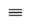
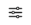
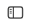
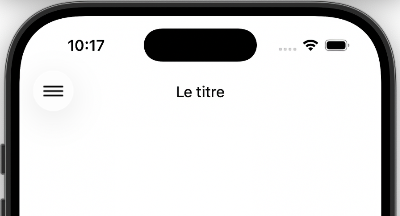
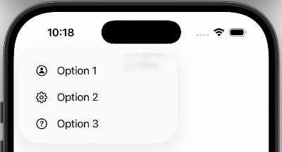
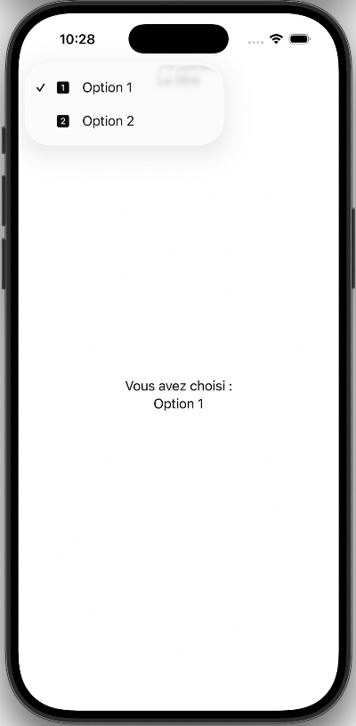

# Menu

Un menu peut être facilement créé à l'aide de la vue [Menu](https://developer.apple.com/documentation/swiftui/menu).

Typiquement, le menu affichera une icône qui mène vers les options disponibles.

Différentes icônes peuvent être utilisées selon le contexte et vos préférences, par exemple :

-  text.justify (menu principal)
-  line.3.horizontal (menu principal)
-  ellipsis.circle (menu d'action)
-  gearshape (menu de paramètres ou d'options)
-  slider.horizontal.3 (menu de paramètres ou d'options)
-  sidebar.left (pour ouvrir un panneau latéral)

```swift title="SwiftUI"
Menu {
    Button(action: {}) {
        Label("Option 1", systemImage: "nom.icone1")
    }
    Button(action: {}) {
        Label("Option 2", systemImage: "nom.icone2")
    }
    Button(action: {}) {
        Label("Option 3", systemImage: "nom.icone3")
    }
} label: {
    Image(systemName: "line.3.horizontal")
        .foregroundStyle(.primary)
 }
```

Souvent, le menu sera ajouté dans la [barre de navigation](la-barre-de-navigation.md#configurer-les-barres-doutils).

```swift title="Swift"
struct ContentView: View {
  var body: some View {
    NavigationStack {
      ... // contenu de la vue
      .toolbar(content: {
        ToolbarItem(placement: .principal, content: {
          Text("Le titre")
        })
        ToolbarItem(placement: .topBarLeading, content: {
          Menu...
        })
      })
    }
  }
}
```

 

## Menu avec Picker

Le menu peut également utiliser [un Picker](../complements/les-formulaires-swiftui.md#picker) qui a l'avantage d'identifier l'option sélectionnée à l'aide d'un crochet.

```swift title="SwiftUI"
struct ContentView: View {
  let options: [Option] = [
    Option(id: 1, texte: "Option 1", icone: "1.square.fill"),
    Option(id: 2, texte: "Option 2", icone: "2.square.fill")
  ]

  @State private var optionChoisie: Int = 1

  var body: some View {
    NavigationStack {
      VStack{
        Text("Vous avez choisi :")
        Text(options[optionChoisie-1].texte)
      }
      .navigationBarTitleDisplayMode(.inline)
      .toolbar(content: {
        ToolbarItem(placement: .principal, content: {
          Text("Le titre")
        })
        ToolbarItem(placement: .topBarLeading, content: {
          Menu {
            Picker("Choisissez une option", selection: $optionChoisie) {
              ForEach(options) { option in
                Label(option.texte, systemImage: option.icone)
              }
            }
          } label: {
            Image(systemName: "line.3.horizontal")
              .foregroundStyle(.primary)
          }
        })
      })
    }
  }
}
```


