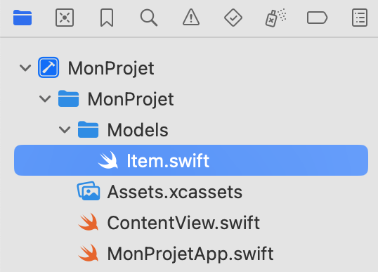

# Le modèle

## Gérer les données de l'application en mémoire (initialiser un tableau d'instances)

Lorsque l'application doit travailler avec des données, par exemple les items d'un catalogue, il est intéressant de créer un modèle pour définir ces données.

Le modèle représente la structure des données, un peu comme une table avec ses champs dans une base de données.

Dans le cas où l'application doit enregistrer les données dans une base de données locale ou distante, le modèle sera central dans le processus.

### Définir un modèle

Le modèle peut être défini à différents endroits et porter n'importe quel nom mais pour mieux nous y retrouver, nous allons standardiser la nomemclature.

Dans un dossier nommé `Models`, chaque modèle sera défini dans un fichier dont le nom est en CassePascal et au singulier (ex : Item).

Pour créer le fichier du modèle, faites un clic droit sur le dossier `Models`, que vous aurez ajouté à la racine du projet, puis choisissez **New Empty File**.

La hiérarchie des fichiers ressemblera à ceci.



Dans le fichier du modèle, les données seront définies [dans une structure ou dans une classe](https://docs.swift.org/swift-book/LanguageGuide/ClassesAndStructures.html). L'utilisation d'une structure est généralement plus simple mais l'utilisation d'une classe est requise si vous désirez enregistrer vos données à l'aide de [SwiftData](swiftdata.md#quest-ce-que-swiftdata).

Le nom de la structure ou de la classe sera identique au nom du fichier.

Ceci n'est pas obligatoire mais si vous croyez que les instances d'un modèle pourraient être utilisées dans des listes ([List](https://developer.apple.com/tutorials/swiftui/building-lists-and-navigation)), la structure ou la classe devra idéalement répondre au protocole [Identifiable](https://developer.apple.com/documentation/swift/identifiable).

Pour répondre à ce protocole, il devra avoir une propriété nommée `id` dont la valeur définit chaque instance de façon unique.

```swift title="Fichier Models/Item.swift (version structure)"
struct Item: Identifiable {
  var id: Int
  var code: String
  var titre: String

  // les structures ont un constructeur par défaut
}
```

```swift title="Fichier Models/Item.swift (version classe)"
class Item: Identifiable {
  var id: Int
  var code: String
  var titre: String

  // le constructeur est requis dans une classe
  init(id: Int = 0, code: String = "", titre: String = "") {
    self.id = id
    self.code = code
    self.titre = titre
  }
}
```

Au besoin, un modèle peut contenir des méthodes et des [propriétés calculées](tableaux-dictionnaires-structures-et-classes.md#les-proprietes-calculees).

Il est possible d'imbriquer des modèles. Par exemple, on pourrait avoir un modèle Panier dont une des propriété est de type Item.

```swift title="Fichier Models/Item.swift"
struct Panier: Identifiable {
  var id: Int
  var item: Item
  ...
}
```

Note : si le modèle utilise autre chose que des types primitifs, vous pourriez avoir un `import` à ajouter.

```swift title="Fichier Models/Item.swift (version classe)"
import SwiftUI

struct Carte: Identifiable {
  var id: Int
  var couleur: Color
  ...
}
```

### Instancier un modèle

Pour créer une instance du modèle, que le modèle soit une structure ou une classe, on appellera son constructeur comme suit :

```swift title="Swift"
let item = Item(id: 1, code: "abc", titre: "Une table")
```

Selon les besoins de l'application, on pourait avoir un tableau de modèles.

```swift title="Swift"
let items: [Item] = [
  Item(id: 1, code: "abc", titre: "Une table"),
  Item(id: 2, code: "def", titre: "Une chaise"),
  Item(id: 3, code: "ghi", titre: "Un lit")
]
```

Le tableau pourrait également être rempli au moment opportun.

```swift title="Swift"
var items: [Item] = []
...
items.append(Item(
  id: 1,
  code: "abc",
  titre: "Une table"
))
```

## Générer un identifiant unique

Dans une base de données, nous avons l'habitude de travailler avec un nombre entier auto-incrémenté qui sert d'identifiant.

Mais hors de la base de données, la notion d'auto-incrément et plus difficile à réaliser.

C'est pourquoi il est plus intéressant de travailler avec un autre type d'indentifiant, par exemple un UUID ou un ULID.

### UUID

Si votre application Swift a besoin d'identifier des instances de façon unique, il est intéressant de travailler avec un [identifiant unique universel](https://fr.wikipedia.org/wiki/Universally_unique_identifier) (**Universally unique identifier**, mieux connu sous son acronyme **UUID**.

Un UUID est facile à générer dans le langage Swift à l'aide de la structure [UUID](https://developer.apple.com/documentation/foundation/uuid).

```swift title="Swift"
import Foundation   // ou import SwiftUI

struct Item: Identifiable {
  var id: UUID = UUID()   // valeur du genre 21DDA6A8-C90A-4F06-8F81-3E31208F74AA
  var code: String
  var titre: String
}
```

### ULID

Un [ULID](https://github.com/ulid/spec/blob/master/README.md) (**Universally Unique Lexicographically sortable IDentifier**) est une autre façon de générer un identifiant unique.

Leur avantage par rapport aux UUID : une partie du ULID est basée sur le temps donc on peut ordonner les ULID.

Par contre, avec Swift, il faudra utiliser une bibliothèque tierce pour pouvoir les utiliser, par exemple <https://github.com/yaslab/ULID.swift/blob/master/Sources/ULID/ULID.swift> (ajouter le paquet au projet ou simplement copier les fichiers `ULID.swift` et `Data+Base32.swift` dans le projet).

Son utilisation est très semblable à celle de UUID.

```swift title="Swift"
ulid = ULID()
```

La valeur générée consiste en 26 caractères alphanumériques. Les 10 premiers représentent le temps et les 16 suivants sont générés au hasard.

Ex : 01JORG0BTY377EV0YM7BGEPKX1

### Pour plus d'information

« UUID vs ULID, How ULID improves write speeds ». Maingi Samuel. <https://medium.com/@sammaingi5/uuid-vs-ulid-how-ulid-improves-write-speeds-d16b23505458>
