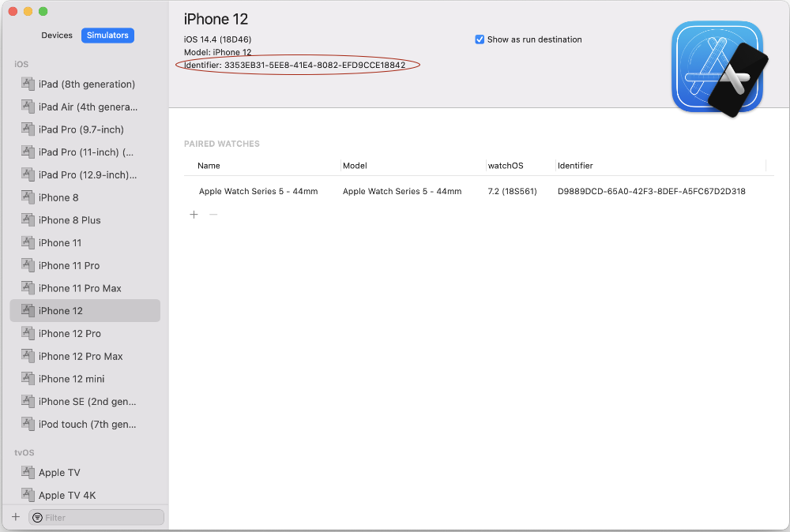

# Le système de fichiers de iOS

## Les dossiers de l'application sous iOS

Les applications iOS sont installées en [bac à sable](https://fr.wikipedia.org/wiki/Sandbox_(s%C3%A9curit%C3%A9_informatique)) (**sandbox**), c'est-à-dire qu'elles fonctionnent isolées du système et des autres applications.

Ceci fait en sorte que les applications n'ont pas accès au système de fichiers complet et ce, pour des raisons de sécurité.

Les fichiers d'une application iOS doivent donc être placés à certains endroits précis dans le système de fichiers de l'appareil mobile.

Notez que contrairement aux applications pour iOS, les applications pour macOS peuvent désactiver le mode bac à sable.

### Dossiers disponibles en lecture et/ou en écriture

Il existe trois principales zones de fichiers auxquelles une application iOS a accès :

- `Bundle Container` : ce dossier est **en lecture seule**. Il contient les fichiers originaux de l'application.
- `Data Container` : ce dossier permet la lecture et l'écriture dans certains sous-dossiers :
  - `Documents` : ce dossier peut être rendu visible à l'utlisateur, notamment via l'application Fichiers.
  - `Library / Application Support` : les fichiers placés ici pourront être utilisés par l'application mais seront invisibles pour l'usager. Il s'agit d'un endroit intéressant pour stocker une base de données, par exemple.
  - `Library / Caches` : pour le contenu qui doit être chargé fréquemment. Le contenu de ce dossier peut être supprimé en tout temps.
  - `tmp` : Fichiers temporaires
- `iCloud Container` : les fichiers placés ici seront synchronisés avec le compte iCloud de l'usager lorsque la capacité iCloud est activée dans le projet.

Notez que [d'autres dossiers peuvent être disponibles, notamment pour les applications macOS](https://developer.apple.com/documentation/foundation/filemanager/searchpathdirectory).

### Accéder à un dossier par programmation

La classe [FileManager](https://developer.apple.com/documentation/foundation/filemanager), avec sa méthode [url()](https://developer.apple.com/documentation/foundation/filemanager/1407693-url), permettra de retrouver les dossiers désirés.

#### Documents

Pour retrouver le chemin de la zone `Data Container / Documents` de l'application :

```swift title="Swift"
let urlDocuments = URL.documentsDirectory
```

ou, pour le code développé avant iOS 16 :

```swift title="Swift"
let urlDocuments = try FileManager.default.url(for: .documentDirectory, in: .userDomainMask, appropriateFor: nil, create: true)
```

Peu importe la technique utilisée, il est possible d'ajouter un fichier à l'URL.

Ceci permettra de retrouver un fichier placé dans la zone `Data Container / Documents` de l'application :

```swift title="Swift"
let urlFichier = urlDocuments.appendingPathComponent("monfichier.txt")
```

Sur le simulateur de Xcode, vous obtiendrez un chemin du genre :

`/Users/monnom/Library/Developer/CoreSimulator/Devices/3353EB31-5EE8-41E4-8082-EFD9CCE18842/data/Containers/**Data/Application**/20AB6A48-62A1-48EF-8F24-B22588598685/**Documents**/monfichier.txt`

Remarquez que dans ce chemin, on retrouve deux séries de caractères, que l'on appelle respectivement [UDID](le-systeme-de-fichiers-de-ios.md#udid-et-app-guid) et [App GUID](le-systeme-de-fichiers-de-ios.md#udid-et-app-guid), qui seront probablement différents pour vous.  
  
Sur un même poste de travail, il y a un UDID propre à chacun des périphériques utilisés dans le simulateur et un Ap GUID propre à chaque installation de l'application.

#### Application Support Directory

Les fichiers qui ne doivent pas être visibles pour l'usager utiliseront plutôt ce code :

```swift title="Swift"
let urlApplicationSupport = URL.applicationSupportDirectory
```

ou, pour le code développé avant iOS 16 :

```swift title="Swift"
let urlApplicationSupport = try FileManager.default.url(for: .applicationSupportDirectory, in: .userDomainMask, appropriateFor: nil, create: true)
```

Cette fois, après avoir fait `.appendingPathComponent("monfichier.txt")`, le chemin sera sous la forme :

`/Users/monnom/Library/Developer/CoreSimulator/Devices/3353EB31-5EE8-41E4-8082-EFD9CCE18842/data/Containers/**Data/Application**/20AB6A48-62A1-48EF-8F24-B22588598685/**Library/Application Support**/monfichier.txt`

#### Bundle

Les fichiers placés dans le paquet de l'application sont en lecture seule.

Cette fois, on devra utiliser la classe [Bundle](https://developer.apple.com/documentation/foundation/bundle) pour y accéder :

```swift title="Swift"
if let urlPaquet = Bundle.main.url(forResource: "monfichier", withExtension: "txt") {
  ...
 }
```

Le chemin sera sous la forme :

`/Users/monnom/Library/Developer/CoreSimulator/Devices/3353EB31-5EE8-41E4-8082-EFD9CCE18842/data/Containers/**Bundle/Application**/BDEC27B7-E77F-46D8-9261-6247C0E5992F/**MonProjet.app**/monfichier.txt`

Si l'application a besoin de modifier un fichier inclus dans le paquet, elle devra d'abord le copier dans un des dossiers dans lesquels elle a le droit d'écrire.

```swift title="Swift"
do {
  ...
  try FileManager.default.copyItem(at: urlPaquet, to: urlApplicationSupport)
} catch {
  print("Erreur : \(error)")
 }
```

??? info "Pour plus d'information"

    « Using the file system effectively ». Apple Developer. <https://developer.apple.com/documentation/foundation/using-the-file-system-effectively>

    « Working with Files on iOS with Swift ». LearnAppMaking.com. <https://learnappmaking.com/filemanager-files-swift-how-to/>

    « iOS storage best practices ». Vikash Anand. <https://medium.com/@anandin02/ios-storage-best-practices-294fca83ad9>

    « Understanding the iOS File System ». Lucideus. <https://medium.com/@lucideus/understanding-the-ios-file-system-eee3dc87e455>

## UDID et app GUID

Le chemin pour accéder à un fichier dans le simulateur est plutôt complexe.

Parmi les nombreux dossiers que vous devez traverser pour l'atteindre, il y a le UDID et le App GUID.

Vous n'avez généralement pas besoin de connaître ces valeurs puisqu'il existe des [techniques pour retrouver un fichier dans le simulateur](les-fichiers-modifies-sur-un-appareil-mobile-ou-sur-le-simulateur.md).

Je vous propose tout de même des techniques pour retrouver ces valeurs afin d'assouvir votre curiosité!

### UDID

Le UDID (**Unique Device ID**) est une série de caractères hexadécimaux que Apple utilise pour identifier le périphérique dans le simulateur.

Il s'agit d'une série de caractères au format UUID (**Universally Unique IDentifier**), soit 32 caractères hexadécimaux séparés par des tirets (8‑4‑4‑4‑12).

Si vous désirez connaître le UDID :

- Dans Xcode, rendez-vous dans le menu **Window** / **Devices & Simulators**.
- Dans la zone de gauche, choisissez le simulateur que vous avez utilisé pour tester votre application.
- Le UDID pour ce simulateur est affiché vis-à-vis le mot **Identifier** dans la zone du haut.  

  

### App GUID

Une autre séries de caractères au format UUID fait partie du chemin du fichier : l'identifiant unique de l'application (app GUID).

Il faut savoir que le app GUID change à chaque installation de l'application. Pas de chance!

Si vous désirez tout de même le connaître, il est possible de faire afficher le chemin complet par programmation dans la sortie standard de Xcode.

Le App GUID apparaîtra à la fin des informations affichées.

```swift title="Fenêtre lldb"
po NSHomeDirectory()
```

```text title="Résultat dans la fenêtre lldb"
(lldb) po NSHomeDirectory()
"/Users/monnom/Library/Developer/CoreSimulator/Devices/28799245-2240-4465-8EB6-8D0C65CA4784/data
/Containers/Data/Application/702898FC-6416-43B8-BB99-79365042F3CE"
```
