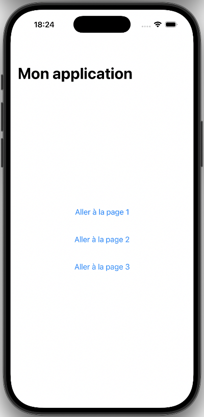
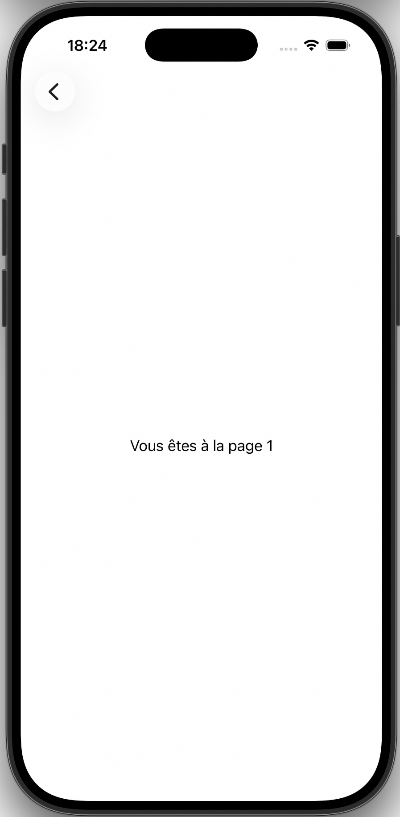
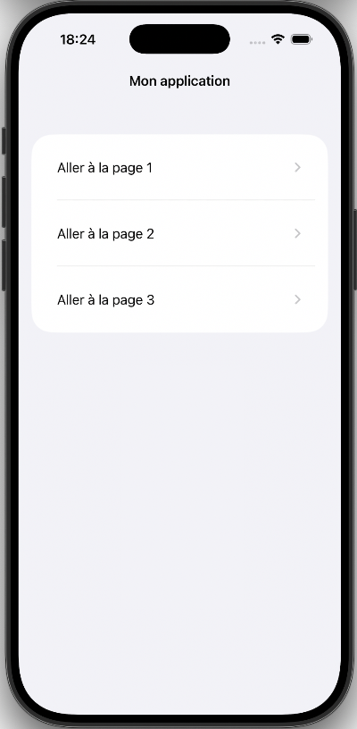
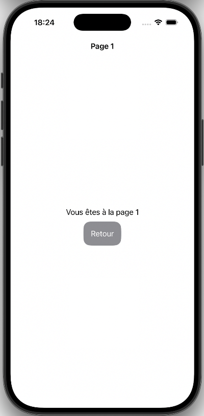
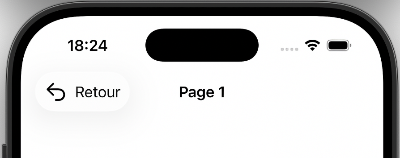

# Les applications multivues

## Naviguer vers une autre fiche

Il existe différentes techniques pour changer de page – ou plus précisément de vue – en SwiftUI.

Dans cette fiche :

- [Lien vers une autre vue avec NavigationLink(destination:...)](les-applications-multivues.md)
- [Lien vers une vue enfant avec NavigationLink(value:...) et .navigationDestination(for:)](les-applications-multivues.md)
- [Lien vers une autre vue avec Button et .navigationDestination(isPresented:)](les-applications-multivues.md)
- [Lien vers une autre vue avec Button et .navigationDestination(item:)](les-applications-multivues.md)

### Lien vers une autre vue avec NavigationLink(destination:...)

À l'intérieur d'un NavigationStack, il est possible d'ajouter des vues de type [NavigationLink](https://developer.apple.com/documentation/swiftui/navigationlink).

Un `NavigationLink` est un lien qui mène à une autre vue.

Dans sa forme la plus simple, le lien de navigation affiche une vue qui affiche le texte spécifié.

Dans la vue affichée par le lien, SwiftUI ajoute automatiquement un bouton de retour dans la barre de navigation pour revenir à la vue précédente.

```swift title="SwiftUI"
var body: some View {
  NavigationStack {
    VStack {
      NavigationLink(destination: Text("Vous êtes à la page 1")) {
        Text("Aller à la page 1")
      }
      .padding()
      NavigationLink(destination: Text("Vous êtes à la page 2")) {
        Text("Aller à la page 2")
      }
      .padding()
      NavigationLink(destination: Text("Vous êtes à la page 3")) {
        Text("Aller à la page 3")
      }
      .padding()
    }
    .navigationTitle("Mon application")
  }
 }
```

Remarquez le bouton de retour dans la vue enfant. Il présente un simple chevron (<). Avant iOS 26, sorti en 2025, il affichait un chevron suivi du titre de la page d'avant.

    

Notez bien que si vous ajoutez un NavigationLink en dehors d'un NavigationStack, il ne sera pas cliquable donc il sera inutile.

#### List

Lorsque le NavigationLink est utilisé à l'intérieur d'un [List](https://developer.apple.com/documentation/swiftui/list), son apparence est automatiquement adaptée au style standard d'iOS.

```swift title="SwiftUI"
var body: some View {
  NavigationStack {
    List {
      NavigationLink(destination: Text("Vous êtes à la page 1")) {
        Text("Aller à la page 1")
      }
      .padding()
      NavigationLink(destination: Text("Vous êtes à la page 2")) {
        Text("Aller à la page 2")
      }
      .padding()
      NavigationLink(destination: Text("Vous êtes à la page 3")) {
        Text("Aller à la page 3")
      }
      .padding()
    }
    .navigationTitle("Mon application")
    .navigationBarTitleDisplayMode(.inline)
  }
 }
```



#### Vue personnalisée

Toute la puissance de `NavigationLink` apparaît lorsqu'il mène vers une vue plus complexe plutôt qu'un simple texte.

Il suffit de créer une vue SwiftUI dans un nouveau fichier, d'y définir son contenu, puis d'y faire référence dans le `NavigationLink`.

Notez que par convention, on placera toutes les vues dans un dossier nommé `Views`. Ce dossier sera placé à la racine de l'application, au même niveau que `Assets.xcassets`.

Cet extrait de code permet d'afficher une page d'ajout en cliquant sur une icône dans la barre de navigation.

```swift title="SwiftUI"
NavigationStack {
  VStack() {
    ...
  }
  .toolbar(content: {
    ToolbarItem(placement: .navigationBarTrailing, content: {
      NavigationLink(destination: AjouterItem()) {
        Image(systemName: "plus.circle")
      }
    })
  })
}
```

```swift title="Fichier Views/VueAjouterItem.swift"
import SwiftUI

struct AjouterItem: View {
  var body: some View {
    // Remarquez qu'il ne faut pas ajouter un nouveau NavigationStack dans la vue
    VStack {
      ...
    }
    .navigationTitle("Ajouter un item")
  }
}
```

### Lien vers une vue enfant avec NavigationLink(value:...) et .navigationDestination(for:)

`NavigationLink` peut aussi utiliser une syntaxe différente qui permet de centraliser la navigation.

On lui passera en paramètre un `value` et c'est le [.navigationDestination(for:)](https://developer.apple.com/documentation/swiftui/view/navigationdestination(for:destination:)) qui se chargera de passer cette valeur à la vue enfant.

Ceci est souvent utilisé dans une liste d'instances quand on doit passer l'instance courante en paramètre à la vue enfant.

```swift title="Fichier Views/ContentView.swift"
struct ContentView: View {
  @Query(sort: \Categorie.titre) var categories: [Categorie]

  var body: some View {
    NavigationStack {
      List (categories) { categorie in
        NavigationLink(value: categorie) {
          Text(categorie.titre)
        }
      }
      .navigationDestination(for: Categorie.self) { categorie in
        ListeItems(categorie: categorie)
      }
      .navigationTitle("Mon application")
    }
  }
}
```

Et dans la vue enfant, la catégorie sera reçue en paramètre.

```swift title="Fichier Views/ListeItems.swift"
struct ListeItems: View {
  var categorie: Categorie

  var body: some View {
    if let items = categorie.items, !items.isEmpty {
      ForEach(items.sorted(by: {$0.code < $1.code})) { item in
        Text("\(item.code) - \(item.titre)")
      }
    }
    else {
      Text("Il n'y a aucun item dans la catégorie \(categorie.titre).")
    }
  }
}
```

### Lien vers une autre vue avec Button et .navigationDestination(isPresented:)

Un bouton est lui aussi capable d'afficher une autre vue. L'astuce consiste à lui faire modifier la valeur d'une variable d'état et à naviguer vers la destination seulement si la variable d'état est à true.

Ceci est possible grâce à [.navigationDestination(isPresented:)](https://developer.apple.com/documentation/swiftui/view/navigationdestination(ispresented:destination:)), qui attend une valeur booléenne pour savoir si la vue doit être affichée ou non.

```swift title="SwiftUI"
@State private var afficherAutrePage = false
...
VStack {
  Button(action: {
    afficherAutrePage = true
  }) {
    Text("Autre page")
  }
}
.navigationDestination(isPresented: $afficherAutreVue) {
    AutreVue()
 }
```

### Lien vers une autre vue avec Button et .navigationDestination(item:)

Si le bouton doit mener vers une vue de destination qui attend des données en paramètre, il faut se tourner vers .[navigationDestination(item:)](https://developer.apple.com/documentation/swiftui/view/navigationdestination(item:destination:)).

La vue enfant sera affichée dès que le paramètre passé à `.navigationDestination(item:)` n'a plus la valeur nil.

Contrairement à `.navigationDestination(for:)`, cette approche est particulièrement utile lorsque la navigation dépend d’un résultat calculé ou généré dynamiquement, plutôt que d’un élément affiché dans une liste.

Dans l’exemple suivant, l’utilisateur clique sur un bouton pour générer un item aléatoire, puis navigue automatiquement vers la fiche de l'item généré.

```swift title="SwiftUI"
struct ContentView: View {
  @State private var itemGenere: Item? = nil
  let titres = ["Clavier", "Souris", "Écran", "Imprimante"]

  var body: some View {
    NavigationStack {
      VStack(spacing: 20) {

        Button("Générer un item au hasard") {
          let titreAleatoire = titres.randomElement()!
          itemGenere = Item(titre: titreAleatoire)
        }
      }
      .navigationTitle("Générateur")
      .navigationDestination(item: $itemGenere) { item in   // $ pour que la valeur soit remise à nil quand on referme la vue enfant
        DetailItem(item: item)
      }
    }
  }
}
```

La vue affichée recevra l'item en paramètre.

```swift title="SwiftUI"
struct DetailItem: View {
  var item: Item

  var body: some View {
    Text("Item généré : \(item.titre)")
      .navigationTitle("Détail")
  }
}
```

### Pour plus d'information

« Better Navigation in SwiftUI with NavigationStack ». Swifty Place. <https://www.swiftyplace.com/blog/better-navigation-in-swiftui-with-navigation-stack>

## Transférer des informations de la vue parent vers une vue enfant (initialisation de propriétés)

Une vue parent peut transmettre de l'information à la vue enfant vers laquelle elle navigue.

Ceci est particulièrement intéressant dans une liste d'items qui permet d'afficher la page de détail de chaque item à partir d'une même vue enfant.

D'abord, la vue enfant définiera les propriétés dont elle a besoin.

```swift title="Fichier Views/VueDetail.swift"
struct VueDetail: View {
  var description: String
  var inventaire: Int

  var body: some View {
    ...
  }
}
```

Ensuite, la vue parent initialisera ces variables lors de l'appel de la vue enfant.

```swift title="SwiftUI"
NavigationLink(destination: VueDetail(description: "Item XYZ", inventaire: 36)) {
  Text("Item XYZ")
}
```

### Pour plus d'information

« View Communication Patterns in SwiftUI ». Vadim Bulavin. <https://www.vadimbulavin.com/passing-data-between-swiftui-views/>

## Cacher le lien de retour automatique

Lorsqu'une vue est affichée via un `NavigationLink`, SwiftUI ajoute automatiquement un bouton de retour dans la barre de navigation pour revenir à la vue précédente.

Il est possible de cacher ce lien. Ce sera utile, par exemple, si vous utilisez [une autre technique pour refermer la vue enfant](les-applications-multivues.md).

```swift title="Vue enfant (SwiftUI)"
struct VueEnfant: View {
  ...

  var body: some View {
    VStack {
      ...
    }
    .navigationBarBackButtonHidden(true)
  }
}
```

##

## Refermer une vue avec dismiss

Dans une vue enfant affichée à l'aide d'un `NavigationLink`, SwiftUI ajoute automatiquement un bouton de retour dans la barre de navigation. Ce bouton permet de revenir à la vue précédente.

Dans certains contextes, il peut toutefois être utile de refermer une vue manuellement. Par exemple, dans un formulaire, un bouton d'enregistrement pourra refermer le formulaire une fois l'enregistrement complété.

Pour ce faire, SwiftUI offre la variable d'environnement [`dismiss`](https://developer.apple.com/documentation/swiftui/environmentvalues/dismiss), qui permet de refermer la vue courante à l'aide de sa méthode `dismiss()`.

Lorsque cette méthode est appelée, la vue est retirée de la pile de navigation gérée par `NavigationStack` et la vue précédente est automatiquement affichée.

L'exemple suivant montre une vue enfant qui peut être refermée à l'aide d'un bouton personnalisé.

```swift title="Vue enfant (SwiftUI)"
struct VueEnfant: View {
  @Environment(\.dismiss) private var dismiss

  var body: some View {
    VStack {
      Text("Vous êtes à la page 1")

      Button(action: {
        dismiss()
      }) {
        Text("Retour")
          .padding()
          .foregroundColor(Color.white)
          .background(Color.gray)
          .cornerRadius(15.0)
      }
    }
    .navigationTitle("Page 1")
    .navigationBarTitleDisplayMode(.inline)
    .navigationBarBackButtonHidden(true)   // on cache le bouton de retour automatique car on désire utiliser un bouton personnalisé
  }
}
```



## Personnaliser le lien de retour

Si, dans la vue enfant, vous n'aimez pas utiliser le lien de retour par défaut (<) dans la barre de navigation pour revenir à la vue parent, il est possible de cacher le lien et d'utiliser autre chose à la place, par exemple un bouton avec l'apparence de votre choix.

Le code qui suit permet d'ajouter un bouton de retour dans le coin supérieur gauche de la barre de navigation. C'est un peu comme si on avait utilisé le lien original mais cette fois, on a pu choisir l'icône et le texte à afficher.

```swift title="Vue enfant (SwiftUI)"
struct VueEnfant: View {
  @Environment(\.dismiss) private var dismiss

  var body: some View {
    VStack {
      ...
    }
    ...
    .navigationBarBackButtonHidden(true)
    .toolbar(content: {
      ToolbarItem(placement: .topBarLeading, content: {
        Button(action: {
          dismiss()
        }) {
          HStack {
            Image(systemName: "arrow.uturn.backward")
            Text("Retour")
          }
        }
      })
    })
  }
}
```



## Déplacer le fichier ContentView.swift

Par défaut, le fichier `ContentView.swift` est placé à la racine du projet, directement sous le dossier qui porte le même nom que le projet.

Dans les faits, il peut être placé n'importe où dans le projet, par exemple dans un dossier nommé `Views`.

Pour déplacer le fichier, il suffit d'ajouter le dossier désiré au projet puis de faire glisser `ContentView.swift` vers ce dossier.

### En cas de problème

Parfois, cette opération crée un conflit dans Xcode.

Pour que tout fonctionne à nouveau, rendez-vous dans le menu **Product** / **Clean Build Folder**.

Si vous avez encore des problèmes, fermez complètement Xcode (clic droit sur son icône dans le Dock / **Quitter**) puis lancez-le de nouveau.

## Boutons dans une liste de NavigationLink

De nombreuses applications ont besoin d'afficher une liste d'items avec, pour chacun, des boutons pour effectuer certaines opérations sur l'item courant.

Souvent, cette liste utilise un NavigationLink pour accéder par exemple à une vue détaillée, et affichent d'autres boutons pour chaque élément de la liste.

Avec une telle liste, si on ne prend pas de précautions, un clic sur un bouton exécutera seulement le code du NavigationLink :-(

Je vous propose deux techniques pour régler ce problème.

### .buttonStyle()

Une technique pour régler ce problème consiste à ajouter un style pour chacun à l'aide du modifieur [.buttonStyle()](https://developer.apple.com/documentation/swiftui/view/buttonstyle(_:)-66fbx).

Il est possible d'utiliser un style prédéfini, par exemple `.bordered`. Si vous ne désirez pas modifier l'apparence des boutons, le style prédéfini `.borderless` fera l'affaire.

Il est également possible d'utiliser un [style personnalisé que vous aurez défini](creer-nos-propres-styles.md#styles-personnalises), à condition que le style réponde au protocole `ButtonStyle`.

Voici un exemple avec le style prédifini `.borderless`.

```swift title="SwiftUI"
List(items) { item in
  NavigationLink(value: item)
    HStack {
      Text("\(item.code) - \(item.titre)")

      Spacer()

      Button(
        action: {
          print("Clic sur Éditer")
      }) {
        Image(systemName: "pencil.line")
      }
      .buttonStyle(.borderless)

      Button(
        role: .destructive,
        action: {
          print("Clic sur Supprimer")
      }) {
        Image(systemName: "trash")
      }
      .buttonStyle(.borderless)
    }
    .navigationDestination(for: Objet.self) { objet in
      VueDetails(objet: objet)
    }
  }
 }
```

### ForEach

Une autre technique pour permettre de cliquer sur des boutons dans un NavigationLink consiste à troquer le List pour un ForEach.

Attention : ceci modifiera également l'apparence de la liste. Il faudra ajuster la vue pour obtenir l'effet désiré (je ne l'ai pas fait ici).

```swift title="SwiftUI"
ForEach(items) { item in
  NavigationLink(value: item)
    HStack {
      Text("\(item.code) - \(item.titre)")

      Spacer()

      Button(
        action: {
          print("Clic sur Éditer")
      }) {
        Image(systemName: "pencil.line")

      Button(
        role: .destructive,
        action: {
          print("Clic sur Supprimer")
      }) {
        Image(systemName: "trash")
      }
    }
  }
 }
```
