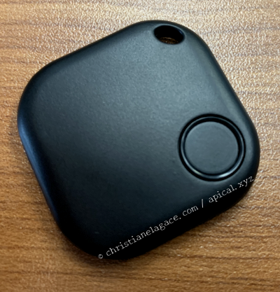
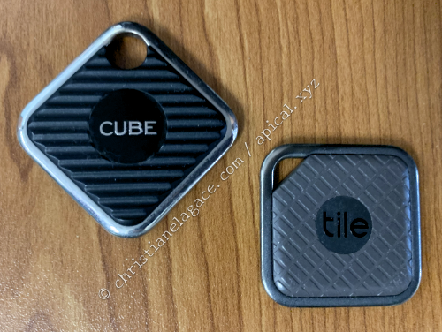
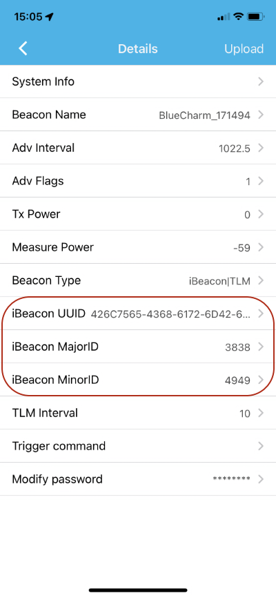
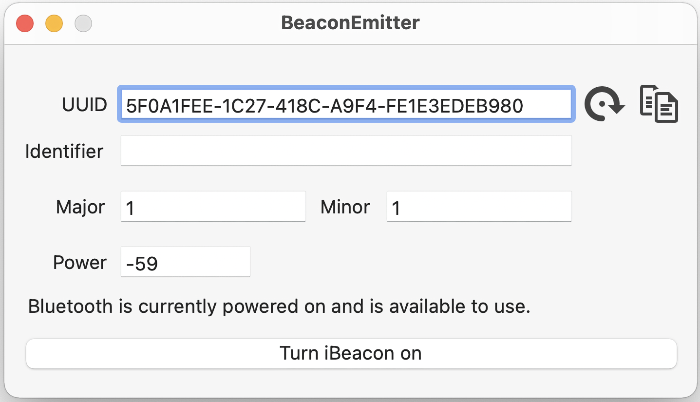
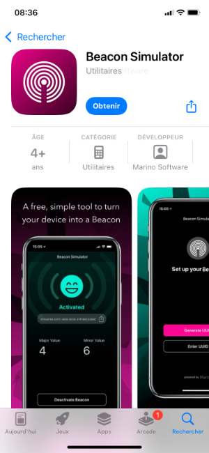
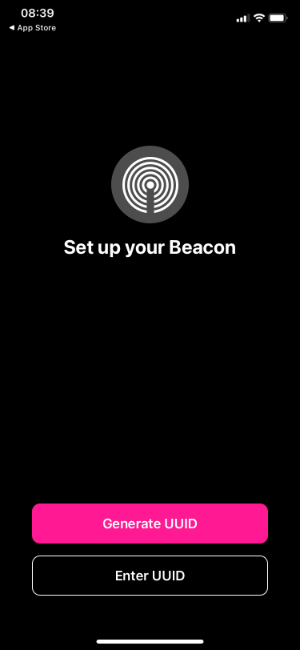
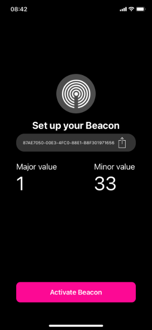
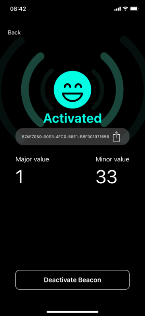

# Les balises de proximité (beacons)

## Qu'est-ce qu'une balise de proximité (beacon)?

Dans cette fiche :

- [Balise de proximité](les-balises-de-proximite-beacons.md#quest-ce-quune-balise-de-proximite-beacon)
  - [Quelques applications possibles](les-balises-de-proximite-beacons.md#quest-ce-quune-balise-de-proximite-beacon)
  - [Capteur utilisé](les-balises-de-proximite-beacons.md#quest-ce-quune-balise-de-proximite-beacon)
- [Localisateurs d'articles](les-balises-de-proximite-beacons.md#quest-ce-quune-balise-de-proximite-beacon)
- [Étiquettes NFC et RFID](les-balises-de-proximite-beacons.md#quest-ce-quune-balise-de-proximite-beacon)
- [Beacon ou iBeacon?](les-balises-de-proximite-beacons.md#quest-ce-quune-balise-de-proximite-beacon)

### Balise de proximité

Une balise de proximité, ou en anglais **beacon**, est un appareil électronique qui envoie un signal plusieurs fois par seconde afin de pouvoir être repéré par d'autres appareils.

Parmi les fabricants de balises de proximité, notons [Estimote](https://estimote.com/), [Aruba](https://www.arubanetworks.com/products/location-services/beacons-tags) et [BlueCharm Beacons](https://bluecharmbeacons.com/).



Balise de proximité BlueCharm Beacon

Généralement, les balises de proximité communiquent à l'aide du protocole BLE (Bluetooth Low Energy).

Ces balises sont passives. Elles envoient un signal mais n'en reçoivent pas.

La plupart fonctionnent avec une pile. Heureusement, le protocole BLE est très peu gourmand à ce niveau.

#### Quelques applications possibles

Un magasin peut placer des balises de proximité vis-à-vis certains étalages. Quand un appareil mobile sur lequel l'application du magasin est installée s'approche de la balise, il capte le signal de la balise et fait apparaître à l'écran des informations au sujet de cet étalage.

Plusieurs musées utilisent des balises de proximité pour offrir aux visiteurs des informations détaillées sur les objets qu'ils exposent.

#### Détection des balises par l'application

Les applications SwiftUI utilisent la classe [CLLocationManager](https://developer.apple.com/documentation/corelocation/cllocationmanager) et de sa méthode `startRangingBeacons` pour détecter les balises de proximité.

Notez que le [capteur de proximité](https://itnext.io/ios-proximity-sensor-as-simple-as-possible-a473df883dc9) intégré au téléphone n'est pas utilisé à cette fin, contrairement à ce que son nom semble indiquer. Son rôle est plutôt de vérifier si une surface quelconque est très près du téléphone, par exemple votre oreille quand vous répondez à un appel.

### Localisateurs d'articles

Il existe sur le marché d'autres petits composants qui sont parfois confondus avec les balises de proximité : les localisateurs d'articles (**trackers ou tags**), que l'on attache par exemple à un trousseau de clés pour le retrouver facilement.

Parmi les fabricants de localisateurs d'articles, notons [Tile](https://www.thetileapp.com/), [Cube](https://cubetracker.com/) et évidemment [Apple AirTag](https://www.apple.com/ca/fr/airtag/).



Localisateurs d'articles Cube et Tile

La ressemblance entre les balises de proximité et les localisateurs d'articles n'est que physique. Leur mode de fonctionnement est même plutôt opposé.

| Balises de proximité | Localisateurs d'articles |
| --- | --- |
| Conçues pour être placées à un endroit précis. Les appareils mobiles se déplaceront pour les détecter. | Conçus pour être attachés à un article qui peut être déplacé. |
| Ne peuvent pas recevoir un signal. Elles ne font qu'émettre. | Peuvent recevoir un ordre, par exemple « joue de la musique » lorsque l'usager appuie sur un bouton sur son téléphone. |
| Peuvent être configurées pour que n'importe quelle application mobile interagisse avec elles. | Généralement, ne peuvent être détectés que par l'application mobile du fabricant. |
| Possibilité de modifier leur UUID. | Impossible de modifier leur UUID. |

Les localisateurs que j'ai testés ne m'ont pas permis d'interagir avec une application que j'ai codée. 

### Étiquettes NFC et RFID

Les étiquettes NFC peuvent elles aussi être confondues avec les balises de proximité.

En anglais, les étiquettes NFC s'appellent **NFC tags** ou **NFC beacon**, où NFC tient pour **Near-field communication**.

Il s'agit de petites étiquettes, ou autocollants, capables de communiquer avec un périphérique tel un téléphone lorsqu'il est à quelques centimètres de l'étiquette.

Les étiquettes NFC sont un sous-ensemble des étiquette RFID (**Radio Frequency Identification**).

Alors que les étiquettes RFID sont souvent utilisées pour l'inventaire ou la gestion antivol en bibliothèque et nécessitent un appareil spécialisé, les NFC sont conçues pour des interactions à très courte portée, par exemple des applications de paiement ou de billetterie, et sont généralement compatibles avec les téléphones cellulaires.

Le plus gros avantage des étiquettes NFC (et de certaines étiquettes RFID) est qu'elles n'ont pas besoin de pile pour fonctionner. C'est le champ électromagnétique de l'appareil qui s'en approche qui leur fournit leur source de tension.

|  |  |
| --- | --- |
| Étiquettes NFC | Étiquettes RFID |
| Étiquettes NFC Source de l'image : [https://www.moniees.ca](https://www.moniees.ca/p/YCVVW-MDBMW/nfc-phone-stickers) | Étiquettes RFID |

### Beacon ou iBeacon?

Si vous recherchez sur le Web des informations sur les balises de proximité, vous rencontrerez tôt ou tard le terme **iBeacon**.

Alors que le terme **beacon** représente les balises de proximité en tant que telles, **iBeacon** est une marque de commerce déposée par Apple pour regrouper toute la technologie alentour des balises de proximité.

### Pour plus d'information

« Bluetooth beacons: Everything you need to know. ». Pointr. <https://www.pointr.tech/blog/beacons-everything-you-need-to-know>

« NFC ». Apple. <https://developer.apple.com/design/human-interface-guidelines/nfc>

## Les paramètres UUID, Major et Minor

Les balises de proximité peuvent être configurées à l'aide d'une application mobile fournie par le fabricant.

Par exemple, pour ma balise [Blue Charm BC011](https://bluecharmbeacons.com/product/bluetooth-ble-multi-beacon-bc011/), j'utilise l'application [KBeacon](https://apps.apple.com/us/app/kbeacon/id1483313365).

Dès que la balise de proximité est activée, elle pourra être détectée par l'application. Il sera alors possible de la configurer.

Parmi les configurations disponibles, nous nous intéressons principalement à trois paramètres : UUID, Major et Minor.



### UUID

Les balises de proximité sont configurées avec un identifiant unique universel (UUID). Il s'agit d'une chaîne hexadécimale au format aaaaaaaa-bbbb-cccc-dddd-eeeeeeeeeeee.

En fait, un groupe de balises peut se partager le même UUID. Il y aura typiquement un seul UUID pour une entreprise.

Les applications sont programmées pour réagir à la présence d'un UUID particulier.

Il est possible de générer un UUID à partir du Terminal à l'aide de cette commande :

```text title="Terminal"
uuidgen
```

La valeur ainsi obtenue pourra être utilisée pour configurer le UUID d'une balise de proximité.

### Major

Ce paramètre permet d'identifier les balises d'un sous-groupe, par exemple toutes les balises du premier étage.

Il s'agit d'un nombre situé entre 0 et 65535.

### Minor

Ce paramètre permet d'identifier une balise en particulier parmi un sous-groupe, par exemple la balise de l'étalage des mitaines parmi le sous-groupe du premier étage.

Il s'agit d'un nombre situé entre 0 et 65535.

## Simuler une balise de proximité

Les balises de proximité ne sont pas dispendieuses. On en retrouve plusieurs modèles entre 25$ et 50$.

Si n'en possédez pas, vous pouvez tout de même utiliser votre MacBook ou encore un iPhone comme balise de proximité. Il faudra y installer une application à cet effet.

### Un MacBook comme balise de proximité

Vous pouvez télécharger le projet Xcode lgaches/BeaconEmitter sur GitHub : <https://github.com/lgaches/BeaconEmitter>.

Ouvrez le projet dans Xcode et configurez l'équipe de développement :

- Dans le navigateur de projet, cliquez sur le nom du projet.
- Rendez-vous dans l'onglet **Signing & Capabilities**.
- Vis-à-vis de **Team** , choisissez votre compte. Si vous n'en avez pas encore, cliquez sur **Add Account** puis fournissez votre code d'usager iCloud de même que votre mot de passe.
- Lancez le projet dans Xcode.
- Lorsque l'application vous le demandera, entrez le UUID ainsi que les valeurs Major et Minor que vous désirez utiliser. Le UUID peut avoir été généré par l'instruction `uuidgen` dans le Terminal ou encore être une valeur que vous inventez de toutes pièces. Attention cependant : si plusieurs personnes travaillent avec des beacons simulés ou réels alentour de vous, chaque UUID doit être unique.
- **Cliquez sur Turn iBeacon on** pour démarrer l'émission du signal.



### Un appareil mobile comme balise de proximité

Un iPhone ou un iPad peut également émettre un signal BLE comme s'il s'agissait d'une balise de proximité.

L'application `Beacon Simulator` par Marino Software, disponible gratuitement sur App Store, permet d'émettre un signal BLE.



Pour configurer l'application, vous pouvez laisser l'application générer un UUID en cliquant sur **Generate UUID** ou encore entrer le UUID de votre choix en cliquant sur **Enter UUID**. Rappel : si plusieurs personnes travaillent avec des beacons simulés ou réels alentour de vous, chaque UUID doit être unique.

Vous devez ensuite entrer une valeur pour les paramètres `Major` et `Minor`.

Une fois le simulateur de beacon configuré, vous pouvez l'activer ou le désactiver en cliquant sur le bouton correspondant.

  

## Limites du simulateur de Xcode

Le simulateur de Xcode est très utile pour tester une application mobile pendant la phase de développement. Cependant, ses fonctionnalités sont limitées comparé à celles d'un téléphone mobile.

Parmi les opérations qui ne peuvent pas être testées sur un simulateur, il y a tout ce qui concerne les capteurs : GPS, gyroscope, magnétomètre, etc.

Il y a également l'utilisation de certains actuateurs, par exemple la vibration.

Les applications qui demandent l'utilisation d'une connexion BLE ou Bluetooth, notamment celles qui visent à détecter les balises de proximité, ne réussiront à rien capter lorsqu'elles roulent dans le simulateur.

Dans tous ces cas, il faut [installer l'application sur un vrai appareil iOS](installer-une-application-swiftui-sur-iphone.md#installation-sans-passer-par-lappstore) pour tester la fonctionnalité en cause.
