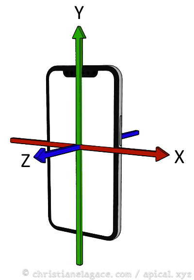
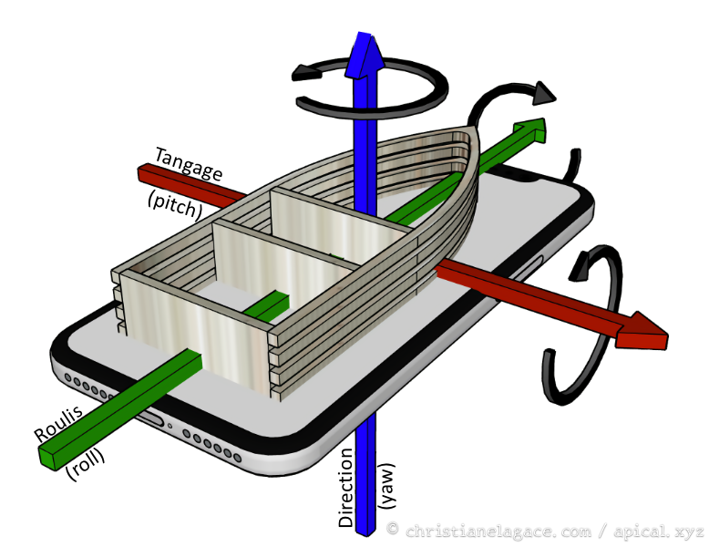
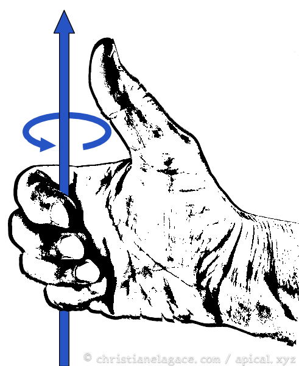

# Les capteurs

## Capteurs d'un appareil mobile

Les appareils mobiles offrent toute une panoplie de capteurs (en anglais : **sensors**) qui peuvent être utilisés dans une application SwiftUI.

[Core Motion](https://developer.apple.com/documentation/coremotion), [Core Location](https://developer.apple.com/documentation/corelocation) et [AVFoundation](https://developer.apple.com/av-foundation/) font partie des bibliothèques qui permettent à une application SwiftUI d'interagir avec différents capteurs.

Voici une liste non exhaustive des informations disponibles grâce aux capteurs d'un iPhone.

- Magnétomètre : orientation par rapport au nord magnétique
- Accéléromètre : accélération en X, Y et Z
- Gyroscope : vitesse de rotation
- Fusion des données entre l'accéléromètre et le gyroscope : orientation du téléphone dans l'espace (attitude)
  - tangage (**pitch**) : angle de rotation alentour de l'axe gauche-droite
  - inclinaison ou roulis (**roll**) : angle de rotation alentour de l'axe longitudinal
  - direction ou lacet (**yaw**) : angle de rotation alentour de l'axe qui transperce l'écran
- GPS : position, c'est-à-dire latitude et longitude ainsi que géolocalisation
- Podomètre : nombre de pas
- Baromètre : pression
- Détecteur de proximité pour détecter si une surface quelconque est très près du téléphone, par exemple votre oreille quand vous répondez à un appel
- Capteur d'éclairage ambiant

Notez que le iPhone a un capteur de température mais il ne permet pas de mesurer la température ambiante. Il sert à réagir si le téléphone devient trop chaud ou trop froid.

??? info "Pour plus d'information"

    « Core Motion ». Apple. <https://developer.apple.com/documentation/coremotion>

    « Learn How to Create iOS Apps - Core Motion ». DevFright. <https://www.devfright.com/category/core-motion/>

    « Getting Processed Device-Motion Data ». Apple. <https://developer.apple.com/documentation/coremotion/getting_processed_device-motion_data>

## L'orientation du téléphone (attitude)

Avant de se lancer dans le développement d'une application mobile qui réagit aux capteurs, prenons le temps de comprendre comment déterminer l'orientation du téléphone.

### Axes par rapport au téléphone

Normalement, on illustre les axes X, Y et Z avec un téléphone debout.

- L'axe des X (rouge) traverse le téléphone de gauche à droite.
- L'axe des Y (vert) traverse le téléphone de bas en haut.
- L'axe des Z (bleu) traverse l'écran de l'arrière vers l'avant.

Pour facilement retenir la couleur de chaque axe, rappelez-vous qu'on a l'habitude de dire dans l'ordre XYZ et RVB donc X est rouge, Y est vert et Z est bleu.



### Orientation

L'orientation (en anglais : **attitude**) permet de déterminer comment le téléphone est positionné.

Elle est définie à l'aide de trois valeurs qui empruntent des termes au monde nautique : le tangage, le roulis et la direction (anglais **pitch**, **roll**, **yaw**).

Les angles d'orientation sont plus faciles à comprendre avec le téléphone couché afin de visualiser les mêmes angles sur un bateau.

- Le tangage (**pitch**) est l'angle par rapport à l'axe qui traverse le téléphone de gauche à droite.
- Le roulis ou l'inclinaison (**roll**) est l'angle par rapport à l'axe longitudinal.
- La direction ou lacet (**yaw**) est l'angle par rapport à l'axe qui transperce l'écran.



### Sens de la rotation positive

Pour savoir si l'angle est positif ou négatif, on peut s'aider du truc de la main droite.

On place le pouce de la main droite dans le sens positif de l'axe et les doigts indiquent le sens positif de la rotation.



### Animation pour illustrer ces valeurs

Sur le site, de React Native Animated (je sais, on n'utilise pas ici cette bibliothèque mais c'est tout de même utile ;-)), une petite animation vous permet de bien visualiser les valeurs retournées par les différents capteurs lorsque le téléphone est manipulé : <https://docs.swmansion.com/react-native-reanimated/docs/device/useAnimatedSensor/>

Attention cependant : le sens du lacet (**yaw**) pourrait être différent de celui utilisé par iOS.

??? info "Pour plus d'information"

    « Axes de rotation d'un aéronef ». Wikipédia. <https://fr.wikipedia.org/wiki/Axes_de_rotation_d%27un_a%C3%A9ronef>

## Travailler avec l'attitude (tangage, roulis, lacet))

Pour obtenir [l'orientation du téléphone dans l'espace](les-capteurs.md#lorientation-du-telephone-attitude) (attitude), la bibliothèque Core Motion combine les données du gyroscope et de l'accéléromètre.

Les données sur l'attitude sont disponibles à partir de la classe [CMMotionManager](https://developer.apple.com/documentation/coremotion/cmmotionmanager). Cette classe peut également fournir d'autres données, par exemple l'accélération, la rotation et la position par rapport au nord magnétique.

Voici les étapes à réaliser pour accéder aux données sur l'attitude.

1. Importez la bibliothèque `CoreMotion`.

   ```swift title="SwiftUI"
   import CoreMotion
   ```
2. Instanciez un objet de type `CMMotionManager`. Selon la structure de votre code, l'appel au constructeur peut être réalisé :
   - lors de la déclaration d'une propriété dans le `ContentView`
   - ou mieux : lors de la déclaration d'une propriété dans une classe observable qui gère les données captées (dans ce cas, la variable sera privée et ne sera pas observable)

   Gardez en tête qu'une application mobile ne doit avoir qu'une instance de `CMMotionManager` sans quoi, il pourrait y avoir de la latence dans la réception des informations.

   ```swift title="SwiftUI"
   var cmMotionManager = CMMotionManager()
   ```
3. Dans le `.onAppear()` à l'intérieur du `ContentView` OU dans le constructeur de la classe qui gère les données captées, vérifiez si les capteurs requis sont disponibles sur l'appareil mobile.

   ```swift title="SwiftUI"
   if cmMotionManager.isDeviceMotionAvailable {
     ...
   }
   ```
4. Si les capteurs sont disponibles, initialisez la fréquence à laquelle vous désirez obtenir des informations. Cette fréquence est donnée en secondes.

   ```swift title="SwiftUI"
   cmMotionManager.deviceMotionUpdateInterval = 0.03
   ```

   Note : l'intervalle doit être compris entre les valeurs maximale et minimale acceptées pour l'appareil mobile. Si vous fournissez une valeur en dehors de la plage valide, SwiftUI utilisera la valeur valide la plus proche.
5. Vous pouvez maintenant lancer la lecture et réagir en cas d'erreur. Les valeurs retournées par le capteur seront stockées dans des variables d'état OU dans des propriétés observables de la classe qui gère les données captées (il faudra à ce moment faire précéder leur nom par `self.`).

   ```swift title="SwiftUI"
   cmMotionManager.startDeviceMotionUpdates(to: .main) { (data, error) in
     if let error {
       print("Erreur de capture : \(error.localizedDescription)")
       return
     }

     // s'il y a des données à traiter
     if let attitude = data?.attitude {
       pitch = attitude.pitch
       roll = attitude.roll
       yaw = attitude.yaw
     }
   }
   ```
6. Au besoin, arrêtez la lecture des valeurs du capteur.

   ```swift title="SwiftUI"
   cmMotionManager.stopDeviceMotionUpdates()
   ```
