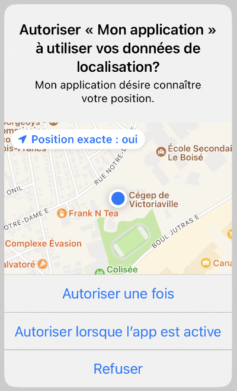
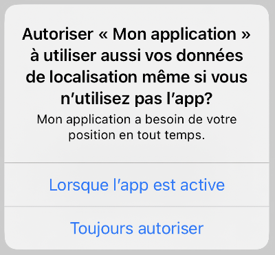
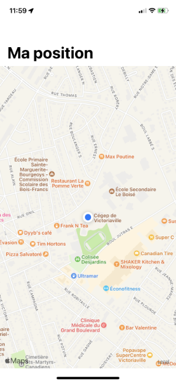
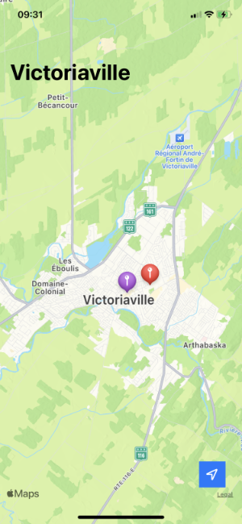
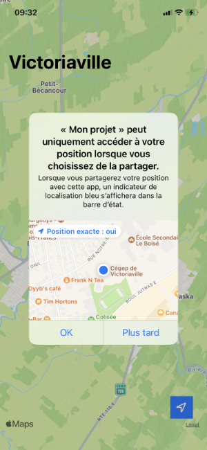
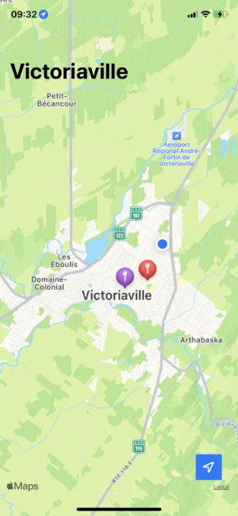

# Les coordonnées géographiques de l'appareil mobile

## CoreLocation : où se situe l'appareil mobile?

La classe [CLLocationManager](https://developer.apple.com/documentation/corelocation/cllocationmanager) permet de connaître l'endroit où se situe l'appareil mobile sur lequel l'application est exécutée.

La position peut être très précise ou encore plutôt approximative selon le besoin de l'application. Plus elle est précise, plus elle demande de ressources.

Elle utilise les ondes Wi-Fi, les ondes cellulaires ou les ondes GPS afin de déterminer la position. Elle utilise l'une ou l'autre de ces techniques ou encore une combinaison de ces techniques afin d'utiliser le moins de ressources possible tout en donnant le degré de précision requis.

Il est à noter que l'usager peut en tout temps désactiver la précision de la géolocalisation sur son iPhone : **Réglages** / **Confidentialité et sécurité** / **Service de localisation** / Clic sur l'application souhaitée / Décocher **Positon exacte**.

Attention : le code présenté ici utilise [ObservableObject](fonctions-obsoletes-ou-anciennes-syntaxes.md#observableobject-published-et-stateobject) plutôt que la technique moderne [@Observable](observer-les-changements-a-un-objet.md). À vous de l'adapter pour cibler iOS 17 ou plus.

### Permission requise

Avant de débuter le codage, il faut [ajouter une clé dans Info.plist](info-plist.md#ajouter-une-paire-cle-valeur-dans-infoplist) afin de [demander la permission pour utiliser la position de l'appareil](demander-une-permission.md).

Il s'agit de la clé [NSLocationWhenInUseUsageDescription](https://developer.apple.com/documentation/bundleresources/information_property_list/nslocationwheninuseusagedescription) (Privacy - Location When In Use Usage Description) pour laquelle vous devez préciser un message du genre « $(PRODUCT_NAME) désire connaître votre position. ». L'application demandera la permission à l'aide de `locationManager.[requestWhenInUseAuthorization](https://developer.apple.com/documentation/corelocation/cllocationmanager/1620562-requestwheninuseauthorization)()`.

#### Si la clé n'est pas ajoutée

Si vous n'ajoutez pas la ou les clés requises dans Info.plist, vous n'obtiendrez jamais la position et vous verrez ce message dans la sortie standard de Xcode lorsque le téléphone est branché à l'ordinateur : « This app has attempted to access privacy-sensitive data without a usage description. The app's Info.plist must contain an “NSLocationWhenInUseUsageDescription” key with a string value explaining to the user how the app uses this data ».

#### Permission donnée par l'usager

Lors du chargement de l'application, l'usager devra donner sa permission avant de poursuivre.

S'il ne le fait pas, les coordonnées demeureront à leur valeur par défaut. Dans les extraits de code plus bas, elles sont simplement initialisées à 0.

Notez qu'une fois la permission obtenue, il y a un certain délai avant que la position soit affichée à l'écran ou avant qu'elle commence à être mise à jour. Dans mes tests, le délai était d'une dizaines de secondes.

Notez également qu'il est possible que la position ne soit pas correctement mise à jour quand les tests sont effectués à l'intérieur d'une bâtisse.



### Lire la position une seule fois

Dans l'extrait de code qui suit, une fois les coordonnées trouvées, elles ne sont plus mises à jour. Le code n'a donc pas besoin de demeurer à l'écoute du service de localisation.

Il s'agit d'un code simplifié pour afficher la latitude et la longitude du téléphone.

Note importante : Il y a un problème avec ce code.   
  
La première fois que l'application est lancée et que la permission est demandée à l'usager, la latitude et la longitude seront toujours à 0. Les vraies valeurs ne seront affichées que la prochaine fois que l'application sera lancée.   
  
Pour régler ce problème, il n'y a pas d'autre choix que de [passer par un délégué](les-coordonnees-geographiques-de-l-appareil-mobile.md#corelocation-ou-se-situe-lappareil-mobile) puisque c'est la seule façon de pouvoir lancer la lecture seulement lorsque la permission est obtenue.

Je vous présente tout de même ce code ici puisqu'il est plutôt simple à comprendre.

```swift title="SwiftUI"
import SwiftUI
import CoreLocation

struct ContentView: View {
  @State private var latitude: Double = 0.0   // La valeur par défaut sera affichée si l'application n'obtient pas la permission requise.
  @State private var longitude: Double = 0.0
  var locationManager = CLLocationManager()

  var body: some View {
    NavigationStack {
      VStack {
        Text("Latitude : \(latitude)")
        Text("Longitude : \(longitude)")
      }
      .navigationTitle("Ma position")
      .onAppear(perform: initialiserPosition)
    }
  }

  /// Initialise la latitude et la longitude
  /// Inspiré de https://www.tutorialspoint.com/how-to-get-the-current-location-latitude-and-longitude-in-ios
  func initialiserPosition() {
    locationManager.requestWhenInUseAuthorization()   // Demande la permission.

    // Problème : au moment où ce code est exécuté, la demande de permission n'est pas terminée.
    if locationManager.authorizationStatus == .authorizedWhenInUse {
        latitude = locationManager.location?.coordinate.latitude ?? -1.0   // La valeur -1 sera affichée s'il y a un problème pendant la recherche de la position.
        longitude = locationManager.location?.coordinate.longitude ?? -1.0
    }
  }
}
```

### Être informé des changements de position (délégué)

Si votre application a besoin de connaître la position de l'appareil mobile à tout moment, il faudra travailler autremement.

Vous aurez besoin d'un délégué (en anglais : [**delegate**](https://developer.apple.com/documentation/corelocation/cllocationmanager/1423792-delegate)), c'est-à-dire un objet spécialisé qui peut recevoir et envoyer des messages à une autre instance d'une classe ou d'une structure.

De plus, ce délégué pourra également assurer que la position soit trouvée dès que la permission est accordée, ce qui règle le problème présenté plus haut.

Afin de bien découper le code, la classe du délégué sera placée dans son propre fichier.

```swift title="Fichier LocationManager.swift"
import Foundation
import CoreLocation

class LocationManager: NSObject, ObservableObject, CLLocationManagerDelegate {
  let locationManager = CLLocationManager()

  @Published var latitude: Double? = 0.0   // La valeur par défaut sera affichée si l'application n'obtient pas la permission requise.
  @Published var longitude: Double? = 0.0

  override init() {
    super.init()
    locationManager.delegate = self   // informe locationManager qu'il doit envoyer ses informations ici lorsqu'elles sont disponibles
    locationManager.requestWhenInUseAuthorization()   // Demande la permission.
  }

  // Initialise les variables une fois les informations de localisation reçues.
  func locationManager(_ locationManager: CLLocationManager, didUpdateLocations locations: [CLLocation]) {
    latitude = locations.first?.coordinate.latitude
    longitude = locations.first?.coordinate.longitude
  }

  // Lance la lecture quand la permission est obtenue.
  func locationManager(_ locationManager: CLLocationManager, didChangeAuthorization status: CLAuthorizationStatus) {
    if status == .authorizedWhenInUse {
      locationManager.startUpdatingLocation()   // si on avait utilisé locationManager.requestLocation(), la localisation aurait été donnée une seule fois
    }
  }

  // Réagit à une erreur.
  func locationManager(_ locationManager: CLLocationManager, didFailWithError error: Error) {
    print("error: \(error.localizedDescription)")
  }
}
```

Dans cet exemple, on obtient une localisation assez présice grâce à l'utilisation du service de localisation par défaut : [locationManager.requestLocation()](https://developer.apple.com/documentation/corelocation/cllocationmanager/1620548-requestlocation).

Si vous désirez plutôt obtenir une liste des endroits visités et du temps qui y est passé, vous pouvez utiliser un service moins gourmand en ressources : [locationManager.startMonitoringVisits()](https://developer.apple.com/documentation/corelocation/cllocationmanager/1618692-startmonitoringvisits).

Un troisième service permet d'être avisé lorsque l'appareil mobile est déplacé d'une distance donnée. Ce service n'utilise pas les ondes GPS et est peu gourmand en ressources. Pour l'appeler : [startMonitoringSignificantLocationChanges()](https://developer.apple.com/documentation/corelocation/cllocationmanager/1423531-startmonitoringsignificantlocati).

Voici finalement la vue qui utilise la classe du délégué présenté plus haut :

```swift title="Fichier ContentView.swift"
struct ContentView: View {

  @StateObject var locationManager = LocationManager()   // C'est ici qu'entre autres, la permission est demandée puis que les données de localisation sont lues.

  var body: some View {
    NavigationStack {
      VStack {
        Text("Latitude : \(locationManager.latitude ?? -1.0)")   // La valeur -1 sera affichée s'il y a un problème pendant la recherche de la position.
        Text("Longitude : \(locationManager.longitude ?? -1.0)")
      }
      .navigationTitle("Ma position")
    }
  }
}
```

### Pour plus d'information

« Configuring your app to use location services ». Apple. <https://developer.apple.com/documentation/corelocation/configuring_your_app_to_use_location_services>

« Getting the current location of a device ». Apple. <https://developer.apple.com/documentation/corelocation/getting_the_current_location_of_a_device>

« Using CoreLocation With SwiftUI ». Andy Ibanez. <https://www.andyibanez.com/posts/using-corelocation-with-swiftui/>

« Core Location Tutorial for iOS: Tracking Visited Locations ». Kodeco. <https://www.kodeco.com/5247-core-location-tutorial-for-ios-tracking-visited-locations>

« Get current location using Core Location (Tutorial) ». fluffy.es. <https://fluffy.es/current-location/>

## Avoir accès aux coordonnées de localisation en tout temps

Dans la fiche « [CoreLocation : où se situe l'appareil mobile?](les-coordonnees-geographiques-de-l-appareil-mobile.md#corelocation-ou-se-situe-lappareil-mobile) », je vous ai expliqué comment coder une application SwiftUI qui affiche la latitude et la longitude de l'appareil mobile. Cette technique permet de connaître la position seulement lorsque l'application est active.

Dans certains cas, une application a besoin de connaître la position de l'appareil mobile en tout temps, même lorsque l'application n'est pas active.

Pensez à Google Maps qui vous guide même lorsque l'écran est fermé.

Pour avoir accès aux coordonnées de géolocalisation en tout temps, vous devez utiliser la clé [NSLocationAlwaysAndWhenInUseUsageDescription](https://developer.apple.com/documentation/bundleresources/information_property_list/nslocationalwaysandwheninuseusagedescription) **en plus de** la clé [NSLocationWhenInUseUsageDescription](https://developer.apple.com/documentation/bundleresources/information_property_list/nslocationwheninuseusagedescription).

Depuis iOS 13.4, il faut d'abord demander la permission avec `locationManager.requestWhenInUseAuthorization()` avant de pouvoir avoir l'option **Toujours autoriser** quand on demande la permission avec `locationManager.requestAlwaysAuthorization()`.

Notez que votre application devra [actualiser les données en arrière-plan](https://developer.apple.com/documentation/corelocation/handling_location_updates_in_the_background). Ceci est très demandant au niveau de la batterie. N'utilisez cette fonctionnalité que si vous en avez vraiment besoin.

Attention : le code présenté ici utilise [ObservableObject](fonctions-obsoletes-ou-anciennes-syntaxes.md#observableobject-published-et-stateobject) plutôt que la technique moderne [@Observable](observer-les-changements-a-un-objet.md). À vous de l'adapter pour cibler iOS 17 ou plus.

```swift title="Fichier LocationManager.swift"
import Foundation
import CoreLocation

class LocationManager: NSObject, ObservableObject, CLLocationManagerDelegate {
  let locationManager = CLLocationManager()

  @Published var latitude: Double? = 0.0   // La valeur par défaut sera affichée si l'application n'obtient pas la permission requise.
  @Published var longitude: Double? = 0.0

  override init() {
    super.init()
    locationManager.delegate = self   // informe locationManager qu'il doit envoyer ses informations ici lorsqu'elles sont disponibles
    locationManager.requestWhenInUseAuthorization()   // demande la permission
  }

  // Effectue son travail une fois les informations de localisation reçues.
  func locationManager(_ locationManager: CLLocationManager, didUpdateLocations locations: [CLLocation]) {
    ...
  }

  // Lance la lecture quand la permission est obtenue.
  func locationManager(_ locationManager: CLLocationManager, didChangeAuthorization status: CLAuthorizationStatus) {
    // Code emprunté inspiré de : https://medium.com/swlh/location-permission-in-ios-13-f9e10917c05e
    // Starting on iOS 13.4.0, to get .authorizedAlways permission, you need to
    // first ask for WhenInUse permission, then ask for Always permission to
    // get to a second system alert
    if status == .authorizedWhenInUse {
      self.locationManager.requestAlwaysAuthorization()
    }
    // fin du code emprunté

    if status == .authorizedWhenInUse || status == .authorizedAlways {
      locationManager.requestLocation()
    }
   }

  // Lit les informations de localisation.
  func requestLocation() {
    locationManager.requestLocation()
  }

  // Réagit à une erreur.
  func locationManager(_ locationManager: CLLocationManager, didFailWithError error: Error) {
    print("Erreur dans LocationManager: \(error.localizedDescription)")
  }
}
```

Quand l'application sera lancée, l'usager verra dans un premier temps la boîte qui demande la permission lorsque l'application est active.

S'il accorde cette permission, il verra ensuite la boîte de dialogue qui demande la permission en tout temps.

 

### Pour plus d'information

« Handling location updates in the background ». Apple. <https://developer.apple.com/documentation/corelocation/handling_location_updates_in_the_background>

« Location Permission in iOS 13 - How to request properly “Always Allow” permission ». Medium. <https://medium.com/swlh/location-permission-in-ios-13-f9e10917c05e>

## Utiliser MapKit pour afficher une carte avec la position actuelle

Je vous présente une petite application qui affiche une [carte géographique](https://developer.apple.com/documentation/mapkit/map) avec un point bleu qui indique la position de l'appareil mobile.

Ceci est réalisé à l'aide d'une vue [Map](https://developer.apple.com/documentation/mapkit/map) et de ses propriétés :

- [userTrackingMode](https://developer.apple.com/documentation/mapkit/mkmapview/1616208-usertrackingmode) qui se charge de centrer la carte sur la position actuelle de l'appareil mobile
- [showsUserLocation](https://developer.apple.com/documentation/mapkit/mkmapview/1452682-showsuserlocation) qui se charge d'afficher un point bleu à cet endroit.

Remarquez que vous n'avez pas besoin de définir une région précise pour y arriver. Le constructeur par défaut de [MKCoordinateRegion](https://developer.apple.com/documentation/mapkit/mkcoordinateregion) est suffisant puisque la position de la carte sera initialisée automatiquement.

Remarquez également que l'usager pourra modifier le zoom de la carte en « pinçant » l'écran et déplacer la carte en effectuant un balayage dans la direction désirée.

Par contre, il ne sera pas possible de modifier le zoom par programmation en changeant les paramètres de la région puisque le zoom original est calculé automatiquement quand on utilise les propriétés `showsUserLocation: true` et `userTrackingMode: .constant(.follow)`.

### Permission requise

Avant de débuter le codage, il faut [ajouter une clé dans Info.plist](info-plist.md#ajouter-une-paire-cle-valeur-dans-infoplist) afin de [demander la permission pour utiliser la position de l'appareil](demander-une-permission.md).

Il s'agit de la clé [NSLocationWhenInUseUsageDescription](https://developer.apple.com/documentation/bundleresources/information_property_list/nslocationwheninuseusagedescription) (Privacy - Location When In Use Usage Description) pour laquelle vous devez préciser un message du genre « $(PRODUCT_NAME) désire connaître votre position. ».

Afin que la permission soit demandée à l'usager, vous devrez instancier un objet de type [CLLocationManager](https://developer.apple.com/documentation/corelocation/cllocationmanager). Inutile de coder une [classe qui répond au protocole CLLocationManagerDelegate](les-coordonnees-geographiques-de-l-appareil-mobile.md#corelocation-ou-se-situe-lappareil-mobile) comme on le fait quand on désire que CLLocationManager nous retourne des informations sur la position actuelle. Une simple instanciation d'objet suffit.

### Code de l'application

Le code de cette application est vraiment très simple quand on sait comment s'y prendre!

```swift title="SwiftUI"
import SwiftUI
import MapKit

struct ContentView: View {
  @State private var region = MKCoordinateRegion()
  let locationManager = CLLocationManager()   // Requis seulement pour demander la permission.

  var body: some View {
    NavigationStack {
      Map(coordinateRegion: $region, showsUserLocation: true, userTrackingMode: .constant(.follow))
        .navigationTitle("Ma position")
        .onAppear(perform: {
          locationManager.requestWhenInUseAuthorization() // Demande la permission.
        })
    }
  }
}
```



### Pour plus d'information

« Using MapKit with SwiftUI ». Swift with Majid. <https://swiftwithmajid.com/2020/07/29/using-mapkit-with-swiftui/>

« SwiftUI MapKit: How to display a map and show a location ». Code with Chris. <https://codewithchris.com/swiftui-mapkit/>

## Utiliser MapKit pour afficher une carte avec des marqueurs

Il est possible d'ajouter des marqueurs sur une carte dans une application SwiftUI.

Dans l'exemple que je vous propose ici, un bouton permet également d'ajouter au besoin un point bleu vis-à-vis la position actuelle de l'appareil mobile.

Remarquez que puisque la position de l'appareil est retrouvée avec [LocationButton](https://developer.apple.com/documentation/corelocationui/locationbutton), il n'est pas requis d'ajouter une clé dans Info.plist.

Pour définir les marqueurs à afficher, il faut travailler avec une structure qui répond au protocole Identifiable.

```swift title="SwiftUI"
import Foundation
import CoreLocation // pour CLLocationCoordinate2D
import SwiftUI // pour Color

struct Endroit: Identifiable {
  let id: UUID
  let coordonnees: CLLocationCoordinate2D
  let couleur: Color

  init(id: UUID = UUID(), latitude: Double, longitude: Double, couleur: Color) {
    self.id = id
    self.coordonnees = CLLocationCoordinate2D(latitude: latitude, longitude: longitude)
    self.couleur = couleur
  }
}
```

Nous voilà prêts pour afficher la carte avec ses marqueurs.

```swift title="SwiftUI"
import SwiftUI
import MapKit
import CoreLocationUI // requis pour LocationButton

struct ContentView: View {
  let locationManager = CLLocationManager()
  @State private var afficherPosition = false
  @State private var regionVictoriaville = MKCoordinateRegion(
    center: CLLocationCoordinate2D(latitude: 46.055765545622585, longitude: -71.95894831209093),
    span: MKCoordinateSpan(latitudeDelta: 0.1, longitudeDelta: 0.1))

  let cegep = Endroit(latitude: 46.05999413735425, longitude: -71.94373881947922, couleur: .red)
  let salleSpectacles = Endroit(latitude: 46.05725513595502, longitude: -71.95564563230727, couleur: .purple)

  var body: some View {
    NavigationStack {
      ZStack {
        Map(coordinateRegion: $regionVictoriaville, showsUserLocation: afficherPosition, annotationItems: [cegep, salleSpectacles]) { endroit in
          // c'est ici qu'on détermine comment on veut que chaque endroit soit affiché
          MapMarker(coordinate: endroit.coordonnees, tint: endroit.couleur)
        }
        .edgesIgnoringSafeArea(.all)
        HStack {
          Spacer()
          VStack {
            Spacer()
            LocationButton {
              afficherPosition = true
            }
            .frame(width: 60, height: 60)
            .labelStyle(.iconOnly)
            .foregroundColor(.white)
          }
        }
        .padding()
      } // fin VStack
      .navigationTitle("Victoriaville")
    } // fin NavigationStack
  }
}
```



Et quand on clique sur le LocationButton représenté par l'icône bleu dans le coin inférieur droit, l'application demande la permission pour accéder à la position.

N'oubliez pas d'ajuster le nom de l'application (**Display Name**) puisque c'est lui qui est affiché dans le message.



Notre position est indiquée par un point bleu après qu'on ait donné notre accord.

Remarquez le petit icône bleu qui apparaît à côté de l'heure pour indiquer que cette application peut suivre notre position.



### Pour plus d'information

« Exploring SwiftUI map custom annotations ». Kristaps Grinbergs. <https://kristaps.me/blog/swiftui-map-annotations/>

« SwiftUI: Add MapMarkers With LongPressGesture — Part 1 ». Medium. <https://medium.com/@alessandromanilii/swiftui-add-mapmarkers-with-longpressgesture-part-1-31f55a87bef8>
