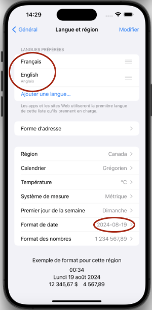
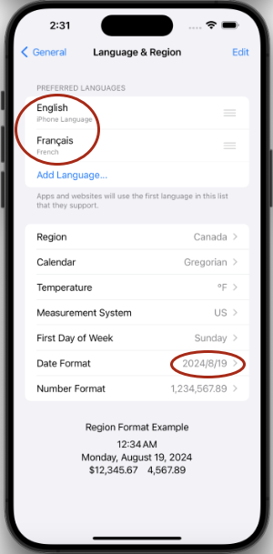

# Les dates

## Comment Swift représente les dates

À l'interne, Swift utilise un nombre de type Double pour représenter une date. Ce nombre correspond aux secondes écoulées [entre la date représentée et le 1er janvier 2001](https://developer.apple.com/documentation/foundation/nsdate/1409769-init) (début du troisième millénaire) dans le fuseau horaire GMT (Greenwich Mean Time).

Par exemple, si une date représente le `8 mai 2024 à 13:52:35` dans le fuseau horaire de Montréal, Swift représentera cette date à l'interne par le nombre `736883555.662463`.

Il est à noter que ceci diffère de plusieurs langages, tels que PHP, pour qui la date de référence est le 1er janvier 1970 ([époque Unix](https://fr.wikipedia.org/wiki/Heure_Unix#:~:text=%C2%AB%20%C3%A9poque%20Unix%20%C2%BB.)).

Prenons l'exemple de dates créées ainsi :

```swift title="Swift"
let dateFormatter = DateFormatter()
 dateFormatter.dateFormat = "yyyy-MM-dd HH:mm:ss"
 let date1String = "2001-01-01 00:00:00"
 let date2String = "1970-01-01 00:00:00"
 let date1 = dateFormatter.date(from: date1String)!   // on sait que la chaîne représente une date au bon format donc ok de mettre le !
 let date2 = dateFormatter.date(from: date2String)!
```

Si on place un point d'arrêt dans le code juste après ces initialisations et qu'on vérifie le contenu des variables date1 et date2, voici ce qu'on obtient.

```text title="Résultat à l'écran"
(lldb) po date1
▿ 2001-01-01 05:00:00 +0000
  - timeIntervalSinceReferenceDate : 18000.0

(lldb) po date2
▿ 1970-01-01 05:00:00 +0000
  - timeIntervalSinceReferenceDate : -978289200.0
```

On voit que date1 corresopnd au `1er janvier 2001 à 5h`, représenté par le nombre `18000.0`. Pourtant, on se serait attendus à avoir la valeur 0.

La différence est due au fuseau horaire. Par défaut, la date créée utilise le fuseau horaire de l'appareil alors que la représentation interne utilise le fuseau horaire GMT. Dans le cas présent, la date a été créée avec le fuseau horaire de Montréal, soit 5 heures (18000 secondes) de différence avec le fuseau GMT.

Ce qu'il faut comprendre, c'est que la représentation interne est toujours à l'heure neutre. C'est le format lisible de la date qui s'ajuste selon le fuseau horaire et ce, autant lors de l'initialisation avec un DateFormatter que lors de l'affichage.

Cette démonstration illustre clairement le fait que la date de référence n'est pas le 1er janvier 1970 puisque la seconde date est représentée par un gros nombre négatif. Une valeur négative représente une date avant la date de référence.

Refaisons l'exercice mais cette fois, en créant la date au fuseau horaire GMT.

```swift title="Swift"
let dateFormatter = DateFormatter()
dateFormatter.dateFormat = "yyyy-MM-dd HH:mm:ss"
dateFormatter.timeZone = TimeZone(abbreviation: "GMT")
let date3String = "2001-01-01 00:00:00"
let date3 = dateFormatter.date(from: date1String)!
```

Cette fois, on obtient bel et bien le nombre 0.

```text title="Résultat à l'écran"
(lldb) po date3
▿ 2001-01-01 00:00:00 +0000
  - timeIntervalSinceReferenceDate : 0.0
```

### Afficher une date à partir de sa représentation interne

Si vous avez en main la représentation interne d'une date, sans avoir recours à la programmation, il est difficile de décoder quelle date ce nombre représente.

Par exemple, lorsqu'une date est enregistrée dans une base de données à l'aide de SwiftData, c'est sa représentation interne qui est enregistrée.

Pour retrouver une date à partir de sa représentation interne :

```swift title="Swift"
let date4 = Date(timeIntervalSinceReferenceDate: 0)
print(date4)   // affiche 2001-01-01 00:00:00 +0000, soit la date au fuseau horaire GMT (indiqué par le +0000)
print(dateFormatter.string(from: date4))   // affiche 2000-12-31 19:00:00, soit 5h avant l'heure GMT pour être au fuseau horaire de Montréal
```

Autre exemple :

```swift title="Swift"
let date5 = Date(timeIntervalSinceReferenceDate: 737038273.680801)
print(date5)   // affiche 2024-05-10 12:51:13 +0000
print(dateFormatter.string(from: date5))   // affiche 2024-05-10 08:51:13
```

### Retrouver la représentation interne d'une date

Inversement, si on a en main une date et qu'on désire voir sa représentation interne, on peut procéder comme suit :

```swift title="Swift"
let representationInterne = date3.timeIntervalSinceReferenceDate
print(representationInterne)   // affiche 0.0
```

### Convertir pour avoir la date butoir du 1er janvier 1970

Swift a prévu un mécanisme pour convertir une date afin qu'elle représente le nombre de secondes entre la date et le 1er janvier 1970.

```swift title="Swift"
let conversionDateInterne3 = date3.timeIntervalSince1970
print(conversionDateInterne3)   // affiche 978307200.0
```

## Initialiser une date avec Swift

Le langage Swift propose la structure [Date](https://developer.apple.com/documentation/foundation/date) pour représenter des dates et heures.

### Date et heure actuelles

Pour initialiser une variable qui représente le moment présent :

```swift title="Swift"
let maintenant = Date()
```

ou

```swift title="Swift"
let maintenant = Date.now
```

La date ainsi créée tiendra compte du fuseau horaire de l'appareil et du fait qu'on est en heure normale ou avancée.

### Représenter une date et une heure données

Dans le cas où il faut représenter un moment donné, il faut travailler avec un [DateFormatter()](https://developer.apple.com/documentation/foundation/dateformatter).

Cet extrait de code permet de créer une instance de [Date](https://developer.apple.com/documentation/foundation/date) à partir d'une chaîne de caractères.

```swift title="Swift"
let dateFormatter = DateFormatter()
dateFormatter.dateFormat = "yyyy-MM-dd HH:mm:ss"
let dateTransactionString = "2024-02-26 08:39:00"

if let dateTransaction = dateFormatter.date(from: dateTransactionString) {
  // ici, l'instance de Date est correctement initialisée
}
```

La date ainsi créée sera de type Date?. Le type est un optionnel puisque si on fournit une chaîne qui ne correspond pas à une date valide, la variable prendra la valeur nil.

### Ajouter des minutes à l'heure actuelle

La méthode [.addingTimeInterval()](https://developer.apple.com/documentation/foundation/date/addingtimeinterval(_:)) permet d'ajouter des secondes à un objet de type Date.

```swift title="Swift"
let dansDixMinutes = Date().addingTimeInterval(10 * 60)
```

### Fuseau horaire

Par défaut, la date créée avec un DateFormatter est basée sur le fuseau horaire de l'appareil. Cependant, [sa représentation interne](les-dates.md#comment-swift-represente-les-dates) est toujours basée sur fuseau horaire GMT (Greenwich Mean Time).

Donc, si la date créée est au fuseau horaire de Montréal, sa représentation interne sera ajustée pour représenter l'heure GMT. Par exemple, s'il est 7h43 à Montréal, la représentation interne aura 5 heures de moins, soit 2h43.

Si la date doit être affichée pour un autre fuseau horaire, il est possible de forcer un fuseau horaire comme suit :

```swift title="Swift"
let dateFormatter = DateFormatter()
dateFormatter.dateFormat = "yyyy-MM-dd HH:mm:ss"
let dateTransactionString = "2024-02-26 08:39:00"
dateFormatter.timeZone = TimeZone(abbreviation: "GMT")

if let dateTransaction = dateFormatter.date(from: dateTransactionString) {
  // ici, l'instance de Date est correctement initialisée
}
```

### Créer une chaîne à partir d'une date

Si vous avez besoin d'effectuer l'opération inverse, c'est-à-dire créer une chaîne à partir d'une instance de Date, consultez la fiche « [Convertir une date en chaîne](les-dates.md#convertir-une-date-en-chaine) ».

### Pour plus d'information

« Introduction to Date and Time Programming in Swift, Part 1 ». Auth0 by Otka. <https://auth0.com/blog/introduction-date-time-programming-swift-1/>

## Convertir une date en chaîne

Il existe de nombreuses techniques pour convertir une date en chaîne.

Peu importe la technique utilisée, il faut se rappeler qu'une date est sujette aux configurations régionales ainsi qu'à la langue. L'apparence de la date dépendra donc des configurations de l'appareil ou du simulateur (**Réglages** / **Général** / **Langue et région**).

Voici deux exemples de configurations que l'on pourrait retrouver sur un téléphone.

 

### Interpolation de chaîne

L'interpolation de chaîne permet de convertir à peu près n'importe quel type de donnée en chaîne de caractère.

Par contre, nous n'avons aucun contrôle sur la façon dont les informations seront converties.

```swift title="SwiftUI"
Text("\(Date.now)")
```

En français, la date sera au format : jeudi 11 avril 2024 à 15:28:10 heure avancée de l'Est

En anglais, on verra plutôt : Thursday, April 11, 2024 at 3:28:10 PM Eastern Daylight Saving Time

### Text avec style

La vue [Text](https://developer.apple.com/documentation/swiftui/text) attend normalement un paramètre de type chaîne.

Il est également possible de lui passer un premier paramètre de type [Date](https://developer.apple.com/documentation/foundation/date) suivi du paramètre [style](https://developer.apple.com/documentation/swiftui/text/init(_:style:)) pour préciser comment afficher cette date.

```swift title="SwiftUI"
Text(Date.now, style: .date)
```

En français : 11 avril 2024

En anglais : April 11, 2024

### .formatted()

La méthode [.formatted()](https://developer.apple.com/documentation/foundation/date/3766588-formatted) permet de préciser le format d'affichage d'une date.

Il existe un format par défaut. Il est également possible de lui passer des paramètres afin de préciser le format.

```swift title="SwiftUI"
struct ContentView: View {
  var dateTransaction = Date.now.formatted()

  var body: some View {
    Text(dateTransaction)
  }
}
```

En français : 2024-04-11 15:28

En anglais : 2024/4/11, 3:28 PM

Voici un autre exemple. Cette fois, des paramètres ont été ajoutés pour préciser le format.

```swift title="SwiftUI"
struct ContentView: View {
  var dateTransaction = Date.now.formatted(date: .abbreviated, time: .shortened)

  var body: some View {
    Text(dateTransaction)
  }
}
```

En français : 11 avr. 2024 à 15:28

En anglais : Apr 11, 2024 at 3:28 PM

Voici quelques exemples des formats possibles.

|  |  |  |  |
| --- | --- | --- | --- |
| date | time | français | anglais |
| .abbreviated | .shortened | 11 avr. 2024 à 15:28 | Apr 11, 2024 at 3:28 PM |
| .long | .standard | 11 avril 2024 à 15:28:10 | April 11, 2024 at 3:28:10 PM |
| .complete | .complete | jeudi 11 avril 2024 à 15:28:10 HAE | Thursday, April 11, 2024 at 3:28:10 PM EDT |
| .numeric | .omitted | 2024-04-11 | 2024/4/11 |
| .omitted | .standard | 15:28:10 | 3:28:10 PM |

### DateFormatter()

Pour avoir un maximum de contrôle sur le format de la date, il est possible de travailler avec un DateFormatter().

La syntaxe est très semblable à celle utilisée [pour instancier une date](les-dates.md#initialiser-une-date-avec-swift). La seule différence est l'utilisation de la méthode `string()`.

```swift title="Swift"
struct ContentView: View {
  var dateTransaction: String

  init() {
    let dateFormatter = DateFormatter()
    dateFormatter.dateFormat = "yyyy-MM-dd HH:mm:ss"

    dateTransaction = dateFormatter.string(from: Date.now)
  }

  var body: some View {
    Text(dateTransaction)
  }
}
```

Dans cet exemple, le résultat sera toujours au même format puisqu'aucun mot n'est présent.

La date apparaîtra au format : 2024-04-11 15:28:10

Attention : il aurait été possible de demander le mois en toutes lettres en changeant le format comme ceci :

```swift title="SwiftUI"
dateFormatter.dateFormat = "dd MMMM yyyy"
```

Sans précautions supplémentaires, on obtiendrait :

En français : 11 avril 2024

En anglais : 11 April 2024   Ouch!

Bien qu'il soit [possible de remédier à ce problème](https://developer.apple.com/documentation/foundation/dateformatter), il est préférable d'utiliser une des techniques présentées plus haut pour que la date respecte le format de localisation.

### Pour plus d'information

« Preparing dates, currencies, and numbers for translation ». Apple. <https://developer.apple.com/documentation/xcode/preparing-dates-numbers-with-formatters>
