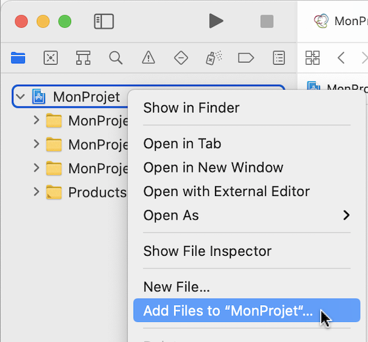
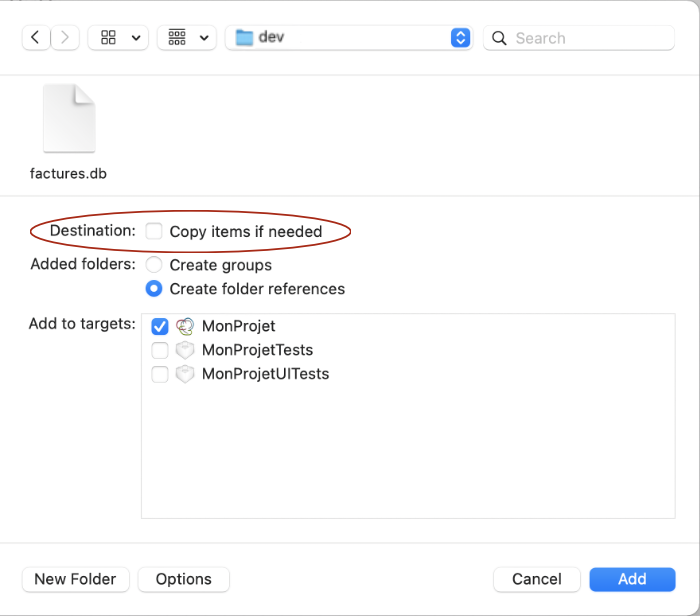
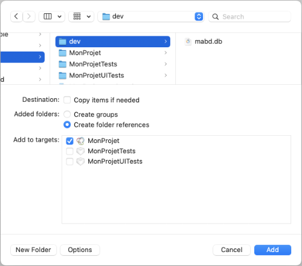
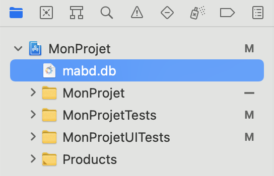
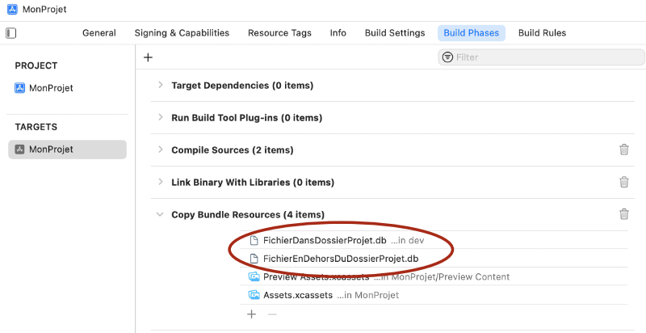
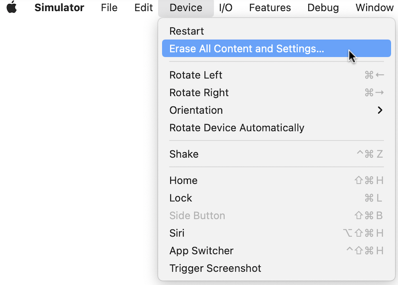

# Les fichiers du paquet de l'application

## Ajouter un fichier dans le paquet de l'application

Pour que l'application iOS puisse travailler avec un fichier, par exemple une base de données SQLite, il faut ajouter le fichier de la BD dans le projet.

Les fichiers ainsi ajoutés feront partie du paquet (**bundle**) qui sera installé sur l'appareil mobile.

- Dans le navigateur de projet de Xcode (s'il n'est pas visible, cliquez sur l'icône de chemise  dans la zone de gauche), faites un clic droit sur le nom du projet.
- Sélectionnez **Add Files To "..."**.

  
- Retrouvez le fichier à ajouter.
- La case **Copy items if needed** n'a d'effet que si le fichier n'est pas dans le dossier du projet.

  

  - Si le fichier est dans le dossier du projet, l'ajout sera toujours un lien vers le fichier original, que la case ait été cochée ou non.
  - Si le fichier n'est pas dans le dossier du projet, il sera copié dans le dossier du projet si vous cochez cette case. Sinon, l'ajout sera un lien vers le fichier original et il deviendra inutilisable si le projet est copié sans faire suivre ce fichier.
- Cliquez sur **Add**.
- Remarquez que sur certains ordinateurs, la zone des options prend toute la place et cache les noms de fichiers. Si vous ne parvenez pas à voir correctement la liste des fichiers, vous pouvez cliquer sur le bouton **Options** au bas de l'écran afin de refermer la section des options (la zone **Destination** et les suivantes dans l'impression d'écran).

  
- Une fois ajouté, le fichier sera visible directement sous le nom du projet. Il ne sera pas dans un sous-dossier.

  

### Valider l'ajout dans le paquet

Pour vous assurer que vous avez bien ajouté le fichier au paquet, suivez ces instructions : « [Quels fichiers sont inclus dans le paquet?](les-fichiers-du-paquet-de-l-application.md#quels-fichiers-sont-inclus-dans-le-paquet) ».

### Pour éviter de dupliquer la base de données

C'est connu, si un fichier est présent en deux exemplaires, il est facile de se tromper et de travailler dans la mauvaise version ou pire, de travailler tantôt dans une version, tantôt dans l'autre et ainsi obtenir deux versions à moitié bonnes.

Pour éviter un telle situation, je vous partage ici une technique qui ne créera pas de copie de la base de données.

- Ajoutez un dossier `dev` dans le dossier du projet. **Attention : je parle d'un dossier créé à l'aide du Finder et non d'un groupe créé dans Xcode.**

  Le dossier `dev` ne fera pas partie du projet alors il ne sera jamais copié sur un iPhone. Il sera possible d'y copier tous les fichiers utiles pendant le développement, notamment les fichiers à ajouter au paquet.
- Placez votre base de données dans le dossier `dev`.
- Lors de l'ajout du fichier dans le projet, la case **Copy items if needed** ne changera rien, qu'elle soit cochée ou non, puisque le fichier fait partie du dossier du projet. Xcode effectuera une copie du fichier seulement lors de la création du paquet.

??? info "Pour plus d'information"

    « How To Add Resource Files Into Xcode Project And iOS App ». https://www.dev2qa.com/. <https://www.dev2qa.com/how-to-add-resource-files-into-xcode-project-and-ios-app/>

## Quels fichiers sont inclus dans le paquet?

Pour consulter la liste des fichiers qui font partie du paquet de votre application :

- Dans le navigateur de projet, cliquez sur le nom du projet.
- Dans la zone qui apparaît à droite, cliquez sur le nom du projet dans la zone **TARGETS**.
- Rendez-vous dans l'onglet **Build Phases**.
- Les fichiers sont listés dans la zone **Copy Bundle Resources**.  

  

  Dans cet exemple, `FichierDansDossierProjet.db` est un lien vers le fichier original qui est dans le dossier `dev`.

  Le fichier `FichierEnDehorsDuDossierProjet.db` n'est pas un lien. Il s'agit d'un fichier qui n'était pas placé dans le dossier du projet et la case **Copy items if needed** a été cochée lors de son ajout.

## Supprimer un fichier du Application Support Directory du simulateur

Plusieurs applications se chargent de copier un fichier à partir de leur paquet (**bundle**) vers le dossier `Documents` du Data Container ou encore vers le dossier `Library / Application Support` du Data Container.

Cette copie est nécessaire si l'application désire modifier le fichier puisque les fichiers du paquet sont en lecture seule.

Parfois, pendant le développement de l'application, il faut apporter manuellement des modifications à un fichier. Ces modifications sont généralement faites directement dans le fichier du paquet.

Ces modifications ne seront pas prises en compte si l'application a déjà effectué la copie du fichier.

À ce moment, il faut supprimer le fichier qui a été copié afin que l'application recommence à partir du fichier du paquet.

### Sur un appareil mobile

Si l'application tourne sur un appareil mobile, il ne faut pas supprimer les données qui ont été ajoutées par l'utilisateur. La solution consiste généralement à détecter la version du fichier puis à effecteur les modifications par programmation.

### Sur le simulateur

Lorsque l'application tourne sur le simulateur de Xcode, il est possible de [retrouver le fichier du simulateur](les-fichiers-modifies-sur-un-appareil-mobile-ou-sur-le-simulateur.md) afin de le supprimer.

Si l'application est bien conçue, elle créera une nouvelle copie à partir du paquet lors de son prochain lancement.

### Nettoyer le simulateur

Le menu du simulateur offre une solution plus simple mais également plus drastique :

- Rendez-vous dans le menu **Device**.
- Sélectionnez **Erase All Content and Settings**.
- Le simulateur vous demandera une confirmation puis supprimera toutes les données que les applications ont installées lors des simulations avec ce périphérique.

