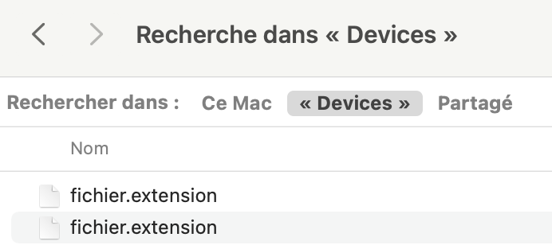
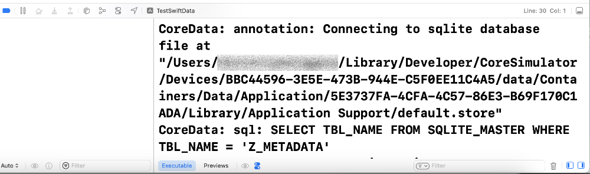
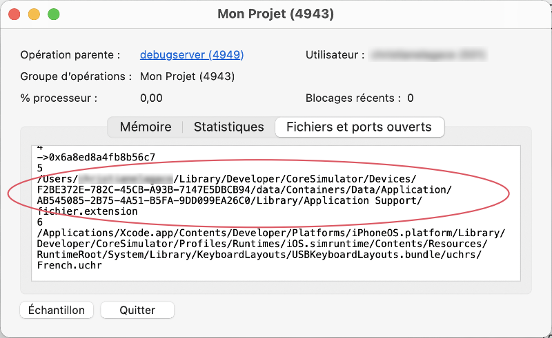
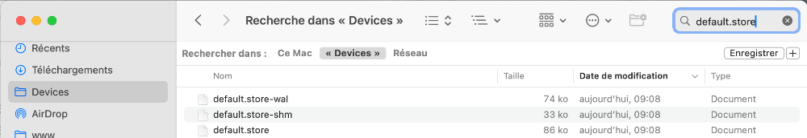
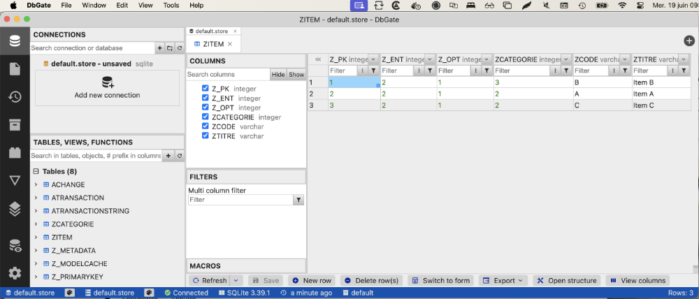
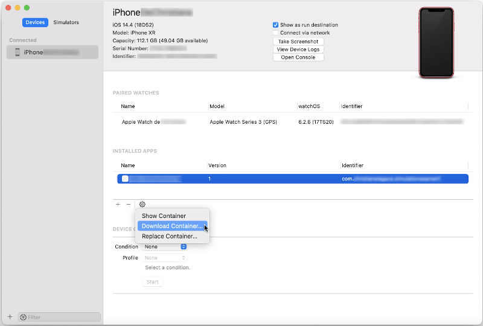
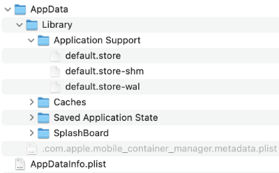

# Les fichiers modifiés sur un appareil mobile ou sur le simulateur

## Retrouver un fichier dans le simulateur

Une application qui roule sur le simulateur de Xcode peut modifier des fichiers gérés par l'application, par exemple une base de données SQLite.

Si le fichier est dans le dossier `Data Container/Documents`, le chemin complet sera sous la forme :

`/Users/monnom/Library/Developer/CoreSimulator/Devices/[UDID]/data/Containers/Data/Application/[app GUID]/Documents`

Si le fichier est dans le dossier `Data Container/Application Support`, le chemin complet sera sous la forme :

`/Users/monnom/Library/Developer/CoreSimulator/Devices/[UDID]/data/Containers/Data/Application/[app GUID]/Library/Application Support`

Dans ces chemins, [UDID] représente le [UDID](le-systeme-de-fichiers-de-ios.md#udid-et-app-guid) (**Unique Device ID**) du périphérique utilisé dans le simulateur. Il s'agit d'une série de caractères hexadécimaux que Apple utilise pour identifier le périphérique.

[app GUID] représente [l'identifiant unique de l'application](le-systeme-de-fichiers-de-ios.md#udid-et-app-guid) (**app GUID**).

Étant donné la complexité du chemin, je vous propose quelques techniques pour retrouver ces fichiers sur le disque de votre Mac .

### Outil de recherche dans le Finder

Pour retrouver le fichier à l'aide du Finder, suivez ces étapes :

- D'abord, [assurez-vous que le Finder soit configuré pour limiter la recherche au dossier courant et à ses sous-dossiers](travailler-avec-un-mac.md).
- Dans le Finder, appuyez sur les touches <kbd>⇧ Maj</kbd>+<kbd>⌘ Cmd</kbd>+<kbd>G</kbd> ou rendez-vous dans le menu **Aller** / **Aller au dossier**.
- Entrez le chemin `~/Library/Developer/CoreSimulator/Devices` (se transformera automatiquement en `~/Bibliothèque/Developer/CoreSimulator/Devices`).

  
- **Si vous avez à travailler régulièrement avec ce dossier, je vous conseille de le faire glisser à partir de [la barre de chemin du Finder](travailler-avec-un-mac.md) vers la zone des favoris à gauche de la fenêtre du Finder.**
- Dans la zone de recherche dans le coin supérieur droit de l'écran, entrez le nom du fichier à rechercher.

  
- Vous verrez tous les fichiers de ce nom qui sont dans la zone de documents de l'application ou dans le ApplicationSupportDirectory. Ceux du Bundle n'apparaissent pas.

  
- Pour connaître le chemin exact du fichier, cliquez sur son nom. Si vous avez [configuré le Finder en conséquence](travailler-avec-un-mac.md), le chemin apparaîtra dans la barre de chemin au bas de l'écran.

  

### Retrouver le chemin exact du fichier par programmation

Voici quelques techniques pour obtenir le chemin exact du fichier par programmation.

Les techniques sont différentes selon la prorammation utilisée pour accéder à la base de données dans l'application.

#### SwiftData

##### NSHomeDirectory()

Vous pouvez ajouter un point d'arrêt à un endroit quelconque de l'application puis, lorsque le point d'arrêt sera atteint, faire afficher la fonction [NSHomeDirectory()](https://developer.apple.com/documentation/foundation/1413045-nshomedirectory) dans la [fenêtre lldb](deboguer-une-application-swiftui.md#fenetre-de-debogage-de-bas-niveau-lldb-low-level-debugger) :

```text title="Fenêtre lldb"
po NSHomeDirectory()
```

```text title="Résultat dans la fenêtre lldb"
(lldb) po NSHomeDirectory()
"/Users/monnom/Library/Developer/CoreSimulator/Devices/28799245-2240-4465-8EB6-8D0C65CA4784/data
/Containers/Data/Application/702898FC-6416-43B8-BB99-79365042F3CE"
```

À ce chemin, il faudra ajouter les sous-dossiers `Library/Application%20Support`.

##### Activer le débogage

Avec SwiftData, si vous [activez le débogage](debogage-avec-swiftdata.md), le chemin et le nom du fichier de la base de données apparaîtront directement dans la sortie standard de Xcode.



#### Base de données SQLite sans bibliothèque ni ORM supplémentaire

Si vous travaillez avec une base de données que votre application [se charge de copier dans le dossier Application Support](../complements/interagir-avec-sqlite-sans-orm.md#ouverture-de-la-base-de-donnees-sqlite), cette technique est pour vous.

La technique demande une petite instruction supplémentaire dans le code pour faire afficher le chemin complet par programmation dans la sortie standard de Xcode.

Ajoutez une instruction `print()` pour faire afficher le chemin où le fichier est ouvert.

```swift title="Fichier GestionBD.swift"
do {
  let urlApplicationSupport = try FileManager.default.url(for: .applicationSupportDirectory, in: .userDomainMask, appropriateFor: nil, create: true)
  .appendingPathComponent("mabd.db")
  print(urlApplicationSupport)
} catch {
  print("Erreur inattendue : \(error)")
 }
```

```text title="Résultat dans la sortie standard de Xcode"
file:///Users/monnom/Library/Developer/CoreSimulator/Devices/28799245-2240-4465-8EB6-8D0C65CA4784/data
/Containers/Data/Application/702898FC-6416-43B8-BB99-79365042F3CE/Library/Application%20Support/mabd.db
```

Vous pouvez maintenant ouvrir le fichier dans l'application de votre choix.

### Commande dans le Terminal

La commande `find` dans le Terminal permet elle aussi de retrouver rapidement un fichier.

```text title="Terminal"
find ~/Library/Developer/CoreSimulator/Devices -name "fichier.extension" 2>/dev/null
```

Attention : les fichiers dont le chemin contient le mot Bundle sont les fichiers originaux de l'application. Il n'ont pas pu être modifiés par l'application puisqu'ils sont en lecture seule.

```text title="Résultat à l'écran"
/Users/monnom/Library/Developer/CoreSimulator/Devices/7A17BF42-9EB2-4EA7-BDAA-7620AAB825A3/data/Containers/Bundle/Application/E0067276-3A4D-41B1-82CA-D9AF2D3588F1/fichier.extension/factures.db
/Users/monnom/Library/Developer/CoreSimulator/Devices/7A17BF42-9EB2-4EA7-BDAA-7620AAB825A3/data/Containers/Data/Application/0E0A32CE-0579-4468-B58D-2962659D6074/Library/Application Support/fichier.extension
/Users/monnom/Library/Developer/CoreSimulator/Devices/3353EB31-5EE8-41E4-8082-EFD9CCE18842/data/Containers/Bundle/Application/DCC9B980-5AA2-411B-938A-2F7DE0ABA408/Factures.app/fichier.extension
/Users/monnom/Library/Developer/CoreSimulator/Devices/3353EB31-5EE8-41E4-8082-EFD9CCE18842/data/Containers/Data/Application/426763E8-E271-40DC-862A-E37F31501BD6/Library/Application Support/fichier.extension
```

### Moniteur d'activité

Le moniteur d'activité est un autre outil intéressant pour retrouver le chemin exact d'un fichier de l'application qui tourne dans le simulateur.

- Lancez votre application dans le simulateur.
- Ouvrez le moniteur d'activié (appuyez sur <kbd>⌘ Cmd</kbd>+<kbd>Espace</kbd> puis entrez Moniteur).
- Retrouvez votre projet parmi les processus.

  
- Cliquez sur le bouton **Inspecter l'opération sélectionnée** dans le haut de l'écran.
- Dans la fenêtre qui s'ouvre, cliquez sur l'onglet **Fichiers et ports ouverts**.
- Faites défiler l'écran jusqu'à ce que vous trouviez le fichier que vous recherchez. Vous verrez alors son chemin exact.

  

##

## Démonstration pour afficher la base de données SQLite de SwiftData

Quand on développe une application qui interagit avec une base de données, il est essentiel de consulter la base de données régulièrement afin de constater que les opérations y sont bien réalisées.

Dans le cas d'une application iOS avec SwiftData, il y a ceci de particulier : l'emplacement de la base de données peut changer à chaque fois que l'application est installée.

Puisque le chemin pour retrouver la base de données est complexe et changeant, je vous propose une technique pour explorer facilement la base de données :

- D'abord, installez l'éditeur SQLite de votre choix, par exemple [DbGate](editeur-visuel-sqlite-dbgate.md#installation-de-dbgate) ou [Valentina Studio](editeur-visuel-sqlite-valentina-studio.md#installer-valentina-studio).
- Vous devez rechercher la base de données dans le simulateur. Pour simplifier le travail, elle sera copiée à un endroit plus approprié, par exemple sur le bureau.

  Je vous propose deux approches :

  - [Utilisez le script Pyton fourni](utilitaires-pour-faciliter-votre-travail-avec-la-bd-sqlite-de-swiftdat.md#copier-les-bd-swiftdata-a-laide-de-copier_default_storepy) afin de copier toutes les bases de données SwiftData du simulateur.

    ou
  - [Rechercher le fichier dans le Finder](les-fichiers-modifies-sur-un-appareil-mobile-ou-sur-le-simulateur.md) : à partir du dossier `~/Library/Developer/CoreSimulator/Devices` que vous aurez placé dans les favoris à gauche de la fenêtre du Finder, recherchez le fichier `default.store`.

    
  - Copiez à l'endroit désiré **les trois fichiers** trouvés.
- Les données sont désormais visibles dans votre éditeur SQLite.

  Sous DbGate :

  

  Attention : si vous ne voyez pas les tables qui correspondent à vos modèles, c'est probablement parce que vous avez ouvert le mauvais fichier `default.store`.

  Le fichier ouvert pourrait être celui généré par une autre application ou encore celui qui fait partie de l'[implémentation interne de SwiftData](swiftdata.md#emplacement-de-la-base-de-donnees-swiftdata).

## Récupérer les données d'une application à partir du iPhone

Lorsqu'une application installée sur un iPhone ou sur autre appareil mobile est en cours d'utilisation, il y a de fortes chances qu'elle enregistre des informations dans un ou plusieurs fichiers.

Il est possible de récupérer ces informations sur votre Mac.

- Branchez l'appareil mobile sur votre Mac à l'aide d'un câble.
- Ouvrez Xcode.
- Rendez-vous dans le menu **Window** / **Devices and Simulators**.
- Dans la zone de gauche, choisissez l'onglet **Devices** puis cliquez sur votre appareil mobile.
- Dans la zone du centre, cliquez sur le nom de l'application.
- Sous l'application, cliquez sur l'icône d'engrenage ou de points de suspension selon votre version de Xcode puis choississez **Download Container**.

  
- Notez que parfois, Xcode affiche le message `The specified file could not be transferred`. Ceci n'empêche pas le téléchargement du fichier.
- Dans le Finder, retrouvez le fichier téléchargé. Il portera l'extension .xcappdata.
- Faites un clic droit sur ce fichier puis choisissez **Afficher le contenu du paquet**.

  
- Vous avez désormais une copie locale des données de l'application. Vous reconnaîtrez ici certains [dossiers de l'application](le-systeme-de-fichiers-de-ios.md#les-dossiers-de-lapplication-sous-ios). Entre autres, on y retrouve la base de données SQLite créée par SwiftData.   

  
- Dans le cas où le dosseir `AppData/Library/Application Support` n'est pas présent, essayez de refaire la procédure.

## Libérer l'espace disque utilisé par les simulateurs de Xcode

Après un certain temps à programmer dans Xcode, il se peut que l'espace disque utilisé par les simulateurs devienne important.

Voici quelques techniques pour récupérer l'espace utilisé par les simulateurs devenus inutiles.

Évidemment, si vous supprimez des simulateurs, les configurations que vous avez réalisées dans différents périphériques virtuels seront perdues **de même que les bases de données utilisées par vos applications**.

Heureusement, si vos applications sont bien conçues, elles pourront recréer leurs bases de données lors de leur prochaine exécution. Par exemple, avec une base de données SwiftData, la base de données sera recréée à partir des modèles marqués par la macro @Model.

### Commande xcrun simctl

Il existe une série de commandes qui débutent par `xcrun simctl` qui permettent de gérer les simulateurs de Xcode.

Pour réinitialiser les simulateurs et ainsi récupérer l'espace disque utilisé :

```text title="Terminal"
xcrun simctl erase all
```

Remarquez que les sous-dossiers de `/Users/monnom/Library/Developer/CoreSimulator/Devices` seront recréés au prochain lancement d'un simulateur mais ils ne prendront plus autant de place.

### Suppression des dossiers

Il est possible de libérer l'espace disque sans impact négatif sur Xcode en supprimant tout le contenu du dossier `/Users/monnom/Library/Developer/CoreSimulator/Devices`.

Ici encore, les dossiers seront recréés au prochain lancement d'un simulateur mais ils ne prendront plus autant de place.

Une fois les dossiers du simulateur supprimés, il faut tout de même lancer cette commande afin de réinitialiser les simulateurs.

```text title="Terminal"
xcrun simctl erase all
```

Sans cette commande, le prochain lancement de votre application dans un simulateur vous donnerait l'erreur `Unable to boot device because it cannot be located on disk.`{ .erreur }.

### Suppression définitive d'un simulateur

Dans Xcode, rendez-vous dans le menu **Window** / **Devices and simulators** puis cliquez sur l'onglet **Simulators**.

Faites un clic droit sur le simulateur à supprimer puis choisissez **Delete**.

#### Réinstaller un simulateur

Une fois un simulateur supprimé, il n'est plus possible de l'utiliser pour tester une application.

Il est possible de remettre en place toute une série de simulateurs :

- Dans Xcode, rendez-vous dans le menu **Xcode** / **Settings** puis cliquez sur l'onglet **Components**.
- Vis-à-vis la version de iOS pour laquelle vous désirez développer, cliquez sur **Update**. Tous les simulateurs normalement installés pour cette version seront réinstallés.

Pour réinistaller un simulateur précis :

- Dans Xcode, rendez-vous dans le menu **Window** / **Devices and simulators** puis cliquez sur l'onglet **Simulators**.
- Cliquez sur le + au bas de l'écran.
- Sélectionnez le simulateur désiré puis cliquez sur **Create**.
