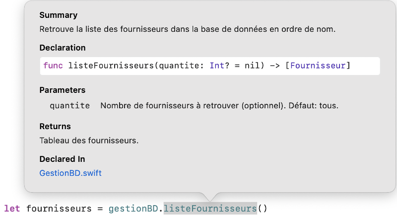
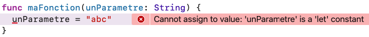

# Les fonctions

## Déclarer une fonction Swift

Dans le langage Swift, les fonctions sont déclarées avec le mot-clé `func`.

Le nom d'une fonction utilisera laCasseChameau.

```swift title="Swift"
func maFonction() {
    ...
}
```

S'il y a une valeur de retour, on précisera son type avec une flèche.

```swift title="Swift"
func maFonction() -> Bool {
    ...
    return valeur
}
```

Pour déclarer les paramètres, on indique leur nom et leur type.

```swift title="Swift"
func maFonction(unParametre: String) -> Bool {
    ...
    return valeur
}
```

Pour utiliser une telle fonction, on précisera le nom de chaque paramètre devant sa valeur.

```swift title="Swift"
quelqueChose = maFonction(unParametre: "Hello World!")
```

Il est possible d'omettre le nom du premier paramètre si la déclaration de la fonction le permet.

```swift title="Swift"
func autreFonction(_ parametreNonNomme: String, parametreNomme: String) {
  ...
}
```

```swift title="Swift"
autreFonction("blabla", parametreNomme: "Hello World!")
```

??? info "Pour plus d'information"

    « Functions ». Swift. <https://docs.swift.org/swift-book/LanguageGuide/Functions.html>

## Où déclarer les fonctions?

Sans un projet SwiftUI, une fonction qui est utilisée seulement dans une vue sera déclarée directement dans la structure de cette vue, généralement après le body.

Cesi assurera que la fonction aura accès aux variables déclarées dans le ContentView, notammnent les [variables d'état](l-etat-dans-swiftui.md).

```swift title="SwiftUI"
struct ContentView: View {
  @State private var uneVariable: String = ""
  ...

  var body: some View {
    ...
  }

  func maFonction() {
    ...
    if uneVariable == "" {
      ...
    }
  }
}   // fin ContentView
```

## Documenter les fonctions avec Markdown

La syntaxe [Markdown](https://github.com/apple/swift/blob/main/docs/DocumentationComments.md) est utilisée pour documenter les fonctions Swift. Il s'agit en fait d'une saveur de Markdown spécialement conçue pour la documentation Swift.

### Documentation sur une ligne

Si la documentation entre sur une seule ligne, on peut utiliser les triples barres obliques.

```swift title="Swift"
/// Gestion d'une base de données SQLite.
class GestionBD {
  ...
}
```

Il est également possible de procéder comme suit :

```swift title="Swift"
/**
  Ouvre la base de données et initialise la propriété pointeurBD.
 */
func ouvrirBD() {
  ...
}
```

### Documentation multilignes

Avec un ou plusieurs paramètres et une valeur de retour, on aura ceci :

```swift title="Swift"
/**
 Retrouve la liste des fournisseurs dans la base de données en ordre de nom.

 - parameters:
   - quantite: Nombre de fournisseurs à retrouver (optionnel). Défaut: tous.

 - Returns: Tableau des fournisseurs.
 */
```

Quand une fonction est ainsi documentée, il est possible de voir cette documentation lorsque la fonction est appelée. Il suffit de faire un clic droit sur son nom puis de choisir **Show Quick Help**.



??? info "Pour plus d'information"

    « Swift Documentation ». NSHipster. <https://nshipster.com/swift-documentation/>

    « Documenting Your Swift Code in Xcode Using Markdown ». AppCoda. <https://www.appcoda.com/swift-markdown/>

    « Swift Documentation ». Sarunw. <https://sarunw.com/posts/swift-documentation/>

    « Formatting Your Documentation Content ». Swift.org. <https://www.swift.org/documentation/docc/formatting-your-documentation-content>

## Passer un paramètre par référence

On dira qu'un paramètre est passé par valeur lorsque la fonction qui le reçoit travaille avec une copie de cette variable. Avec Swift, le paramètre est considéré comme une constante et donc il ne peut pas être modifié.

Le paramètre sera passé par référence si la fonction qui le reçoit travaille directement avec la variable et donc qu'elle peut la modifier.

Voyons dans quels cas un paramètre est passé par valeur ou par référence.

### Classes

Lorsqu'un objet, c'est-à-dire une instance d'une **classe**, est passé en paramètre à une fonction, il est toujours passé par référence.

### Structures et types primitifs

C'est différent pour les instances d'une **structure** ou pour les variables de type primitif : par défaut, ils sont passés par valeur.

Ces paramètres sont donc immuables.

À preuve, si vous tentez de modifier la valeur d'un tel paramètre, vous obtiendrez l'erreur `Cannot assign to value: 'unParametre' is a 'let' constant`{ .erreur }.



### Forcer un paramètre par référence

Si vous avez besoin de passer par référence une instance d'une structure ou une variable de type primitif, vous devez ajouter le mot-clé `inout` devant le type du paramètre lors de la déclaration de la fonction.

De plus, vous devrez précéder la variable par une esperluette (`&`) lors de l'appel de la fonction.

```swift title="SwiftUI"
var body: some View {
  ...
  Button("Cliquez ici", action: {
    maFonction(unParametre: &uneVariable)
  })
  ...
}

 func maFonction( unParametre: inout String) {
  unParametre = "abc"
 }
```

??? info "Pour plus d'information"

    « Functions - In-Out Parameters ». Swift. <https://docs.swift.org/swift-book/LanguageGuide/Functions.html#ID173>

## Ignorer la valeur de retour d'une fonction

Si vous appelez une fonction sans utiliser sa valeur de retour, vous obtiendrez le message d'avertissement « Result of call to '...' is unused ».

Pour indiquer à Swift que vous désirez délibérément ignorer la valeur de retour :

```swift title="Swift"
_ = maFonction()
```

??? info "Pour plus d'information"

    « Useful Details About Underscore Keyword in Swift - Skip function invocation result ». Dmitri Pavlutin. <https://dmitripavlutin.com/useful-details-about-underscore-keyword-in-swift/#4-skip-function-invocation-result>

## C'est quoi ces doublons?

Quand on déclare une fonction, il faut préciser le nom et le type de chaque paramètre.

```swift title="Swift"
func maFonction(unParametre: String) -> String {
  ...
  return ...
}
```

Quand le paramètre est un type objet, on a parfois l'impression qu'on bégaie.

```swift title="Swift"
func maFonction(item: Item) -> String {
  ...
  return ...
}
```

Ce qu'il faut savoir :

- le premier mot entre parenthèses, qui débute par une minuscule, est le nom du paramètre. On l'utilisera également lors de l'appel de la fonction.
- le second mot, qui débute par une majuscule, est son type.

Lors de l'appel de la fonction, on a également l'impression de bégayer.

```swift title="Swift"
ForEach(items) { item in
  Text(maFonction(item: item))
}
```

Dans ce cas, les deux mots entre parenthèses débutent par une minuscule.

- Le premier correspond au nom du paramètre, tel que défini dans la fonction.
- Le second est le nom de la variable dont la valeur est passée en paramètre.
